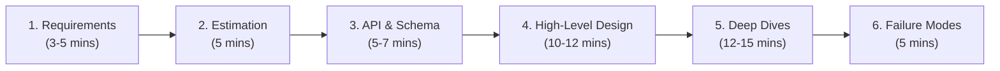
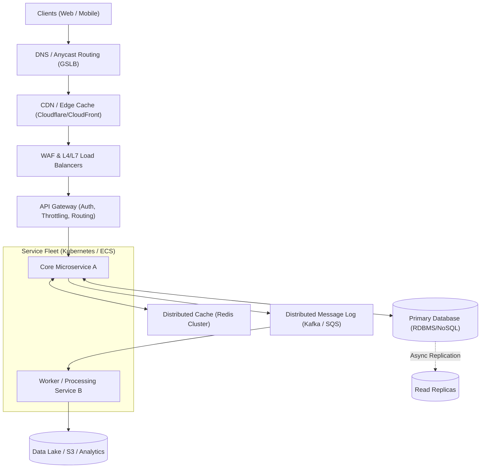

# The System Design Interview Playbook: Staff & Principal Guide

System design interviews at the Staff, Principal, and Senior Engineering Manager level are fundamentally different from mid-level interviews. Interviewers are not evaluating whether you can draw boxes for a load balancer and a cache. They are evaluating:
1. **Leadership & Ownership**: Can you drive ambiguity into crisp technical requirements without being prompted?
2. **First-Principles Trade-offs**: Can you justify *why* Pattern A was chosen over Pattern B, defending latency, cost, consistency, and operational complexity?
3. **Operational Maturity**: Do you design for failure from second one (partial failures, partition tolerance, cascading crash loops, backpressure)?

---

## 1. The 45-Minute Whiteboard Cadence

A typical 45–60 minute interview should follow a strict, disciplined time allocation:

| Step | Time | Goal | Staff/Principal Focus |
| :--- | :--- | :--- | :--- |
| **1. Requirements** | 3–5 min | Eliminate ambiguity; define functional vs. non-functional boundaries. | Push back on unnecessary constraints; define exact SLOs (e.g., p99 latency < 50ms, 99.99% availability). |
| **2. Estimations** | 5 min | Sizing scale to decide architectural tier (single node vs. sharded vs. distributed log). | Focus on order-of-magnitude QPS, IOPS, bandwidth, and cache sizing (80/20 rule). |
| **3. API & Schema** | 5–7 min | Define the contract and primary data access patterns. | Enforce idempotency keys, pagination tokens, and schema evolution compatibility. |
| **4. High-Level Design** | 10–12 min | End-to-end data flow (Happy Path). | Draw clean boundaries: ingress $\rightarrow$ routing $\rightarrow$ computation $\rightarrow$ caching $\rightarrow$ persistent storage $\rightarrow$ asynchronous pub/sub. |
| **5. Deep Dives** | 12–15 min | Dive into 1–2 high-complexity bottlenecks. | Handle race conditions, distributed transactions (Sagas/Outbox), hot partition mitigations, and read/write amplification. |
| **6. Resilience & Ops** | 5 min | Wrap up with operational reality. | Multi-AZ/Multi-Region failovers, circuit breakers, load shedding, and Golden Signals. |

---

## 2. Step 1: Requirements Clarification

Never jump straight to the architecture. Spend the first 3 to 5 minutes scoping down the problem.

### Functional Requirements (Scope the Core)
* Identify the **top 2 or 3 critical user interactions**. (e.g., For Twitter/X: *1. Post a tweet, 2. View user timeline, 3. View home feed*).
* Explicitly state what is **out of scope** (e.g., *"We will defer user direct messaging, media transcoding, and ad-tech recommendation algorithms to keep focus on the core feed"*).

### Non-Functional Requirements (The Architectural Drivers)
* **Availability vs. Consistency**: Is this an AP or CP system under the CAP theorem?
  * *Payments / Financial ledger*: Strict consistency, ACID, zero lost writes (CP).
  * *Social feed / Chat*: High availability, eventual consistency acceptable, read-heavy (AP).
* **Latency Budgets**: Explicitly state target percentiles:
  * Read p99: `< 100ms`
  * Write p99: `< 200ms`
* **Scale & Growth**: Current scale vs. 3-year projected scale.
* **Durability & Disaster Recovery**: RPO (Recovery Point Objective = 0) and RTO (Recovery Time Objective < 1 min).

---

## 3. Step 2: Back-of-the-Envelope Estimation

Estimations dictate the architecture. You don't need exact math; you need fast, confident **power-of-ten** approximations.

### Baseline Rules of Thumb
* $1 \text{ day} \approx 86,400 \text{ seconds} \approx 10^5 \text{ seconds}$.
* $1 \text{ million requests / day} \approx \frac{1,000,000}{100,000} \approx 10 \text{ QPS}$.
* $100 \text{ million requests / day} \approx 1,000 \text{ QPS}$.
* **Peak Multiplier**: Always assume peak traffic is $2\times$ to $5\times$ average QPS.

### The Standard Calculation Formula
Suppose an application has **300 Million Daily Active Users (DAU)**:

1. **Traffic (QPS)**:
   * Assume an average user makes 10 read requests and 1 write request per day.
   * Total Daily Reads = $300\text{M} \times 10 = 3\text{ Billion requests/day}$.
   * Read Average QPS = $\frac{3 \times 10^9}{10^5} = 30,000 \text{ QPS}$.
   * Read Peak QPS ($2\times$) = **$60,000 \text{ QPS}$**. *(Signals: Requires multiple L7 load balancers, extensive caching, and read replicas)*.
   * Write Average QPS = $\frac{300 \times 10^6 \times 1}{10^5} = 3,000 \text{ QPS}$.
   * Write Peak QPS = **$6,000 \text{ QPS}$**. *(Signals: Single relational DB cannot sustain 6,000 random disk IOPS writes; requires sharding, write-behind caching, or append-only logs)*.

2. **Storage Sizing (5-Year Horizon)**:
   * Average write payload size = $2 \text{ KB}$.
   * Daily Storage = $300\text{M writes} \times 2 \text{ KB} = 600 \text{ GB/day}$.
   * Annual Storage = $600 \text{ GB} \times 365 \approx 220 \text{ TB/year}$.
   * 5-Year Storage = $\approx 1.1 \text{ Petabytes}$. *(Signals: Object storage for payloads, sharded NoSQL or partitioned RDBMS for metadata)*.

3. **Memory / Cache Sizing (80/20 Pareto Rule)**:
   * Assume 20% of the daily read traffic generates 80% of total read requests.
   * Daily unique read data volume = $30\text{M unique reads} \times 2 \text{ KB} \approx 60 \text{ GB}$.
   * Working memory required in Redis/Memcached cluster = **$\approx 60 \text{ GB}$ to $100 \text{ GB}$** (including Redis memory overhead). Easily handled by a small Redis cluster.

---

## 4. Latency Numbers Every Staff Engineer Must Know

Keep these ballpark numbers in mind when discussing performance and hardware limits:

| Operation | Latency | Staff Insight |
| :--- | :--- | :--- |
| **L1 cache reference** | $0.5 \text{ ns}$ | CPU-bound computation is virtually free compared to I/O. |
| **L2 cache reference** | $7 \text{ ns}$ | ~14x slower than L1. |
| **Main Memory (RAM) reference** | $100 \text{ ns}$ | In-memory caches (Redis) avoid disk and bus stalls. |
| **Read 1 MB sequentially from RAM** | $3 \text{ }\mu\text{s}$ | Fast vectorized scans. |
| **Read 1 MB sequentially from NVMe SSD** | $50 \text{ }\mu\text{s}$ | SSDs make sequential disk access very competitive. |
| **Read 1 MB randomly from SSD** | $1,000 \text{ }\mu\text{s}$ ($1 \text{ ms}$) | Random I/O is the primary bottleneck for un-indexed DB queries. |
| **Datacenter Round-Trip (Same DC)** | $0.5 \text{ ms}$ | East-West microservice latency budget floor. |
| **Cross-Region Round-Trip (US-East to US-West)**| $60 \text{ ms}$ | Limits synchronous cross-region replication (2PC is lethal here). |
| **Transatlantic Round-Trip (US to Europe)** | $150 \text{ ms}$ | Physical speed of light limit in optical fiber. |

---

## 5. Step 3: API Contracts & Data Modeling

### 1. API Design
* Use standard RESTful conventions or gRPC Protobuf definitions.
* **Mandatory Staff-level headers**:
  * `X-Request-Id` / `traceparent`: For distributed tracing across microservices.
  * `Idempotency-Key`: Guarantees safe client retries without double-charging or duplicate entries.
* **Pagination**: Always advocate for **Cursor-based / Keyset pagination** over `OFFSET / LIMIT` for large datasets (avoids $O(N)$ database scan penalty).

### 2. Data Modeling Strategy
* **Relational (RDBMS)**: ACID transactions, complex relational joins, structured schema with low evolution rate.
* **Document (MongoDB)**: Hierarchical data, localized queries (fetching entire order + items together), schema agility.
* **Key-Value (Redis/DynamoDB)**: Ultra-low latency lookups by primary key, session state, leaderboard counters.
* **Wide-Column / Time-Series (Cassandra, ClickHouse)**: Write-heavy append logs, high-throughput time-series metrics.

---

## 6. Step 4: High-Level Architecture (The Standard Archetype)

When designing a distributed service, anchor your whiteboard to this battle-tested macro pattern:

---

## 7. Step 5: The Principal Deep Dive (Handling Hard Edge Cases)

This is where the interview is won or lost. Pick the most complex component and address these edge cases proactively:

### 1. Concurrency & Race Conditions
* **Pessimistic Locking (`SELECT FOR UPDATE`)**: Safe, but destroys throughput and risks deadlocks.
* **Optimistic Locking (`version` column)**: High read throughput; best when write collisions are rare.
* **Distributed Locks (Redlock / ZooKeeper)**: Necessary when coordinating across multiple services, but beware of clock drift and long GC pauses causing lock expiration before work finishes.

### 2. The Dual-Write Problem
When writing to both a database and publishing an event to Kafka, network blips cause partial failures.
* **The Solution**: **Transactional Outbox Pattern**. Write the domain entity and an `outbox` event record in the *same local database transaction*. A CDC process (Debezium/Kafka Connect) or Polling Publisher reads the outbox table and streams events to Kafka with at-least-once delivery.

### 3. Hotspotting / The Celebrity Problem
If one user has 100M followers (e.g., Elon Musk), fan-out-on-write will destroy the system.
* **The Solution: Hybrid Fan-out**:
  * For standard users: Fan-out on write (push model) into followers' timeline caches.
  * For celebrities: Fan-out on read (pull model). Merge the celebrity's recent posts dynamically when a follower opens their feed.

---

## 8. Step 6: Operational Resilience & Failure Defense

Conclude by demonstrating that you build systems ready for real-world production chaos:

1. **Graceful Degradation**: If the ML recommendation service crashes, fallback immediately to a static, cached "Top 10" list instead of returning an HTTP 500.
2. **Circuit Breaking & Bounded Retries**: Always use exponential backoff with **Full Jitter**. Bound retry limits to 3 attempts. Trip circuit breakers (Resilience4j) when error rates cross 50%.
3. **Multi-AZ Active-Active**: Ensure stateless services run across at least 3 Availability Zones with independent failure domains.

---

## 💡 Principal Engineer Interview Quick Checklist

* [ ] Did I clarify scope and state what is out-of-scope?
* [ ] Did I explicitly define whether the system prioritizes Consistency or Availability?
* [ ] Did I justify my storage and QPS numbers with simple power-of-10 math?
* [ ] Did I address the dual-write problem and race conditions?
* [ ] Did I design for partial failures, backpressure, and load shedding?
* [ ] Did I explain how to monitor and observe the system using the 4 Golden Signals?
