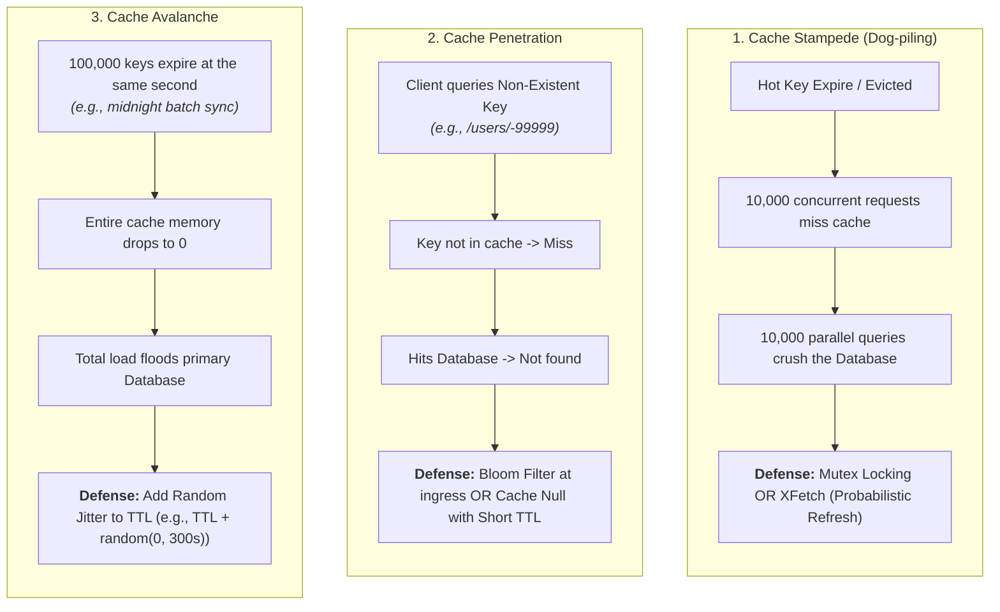

# 02 - Caching

Caching is a common technique in modern computing to enhance system performance and reduce response time. From the front end to the back end, caching plays a crucial role in improving the efficiency of various applications and systems.

A typical system architecture involves several layers of caching. At each layer, there are multiple strategies and mechanisms for caching data, depending on the requirements and constraints of the specific application.

---

## 1. Hardware Caches

Before diving into a typical system architecture, let’s zoom in and look at how prevalent caching is within each computer itself.

Let’s first look at computer hardware. The most common hardware caches are L1, L2, and L3 caches.

* **L1 Cache:** The smallest and fastest cache, typically integrated into the CPU itself. It stores frequently accessed data and instructions, allowing the CPU to quickly access them without having to fetch them from slower memory.
* **L2 Cache:** Larger but slower than L1 cache, and is typically located on the CPU die or on a separate chip.
* **L3 Cache:** Even larger and slower than L2 cache, and is often shared between multiple CPU cores.

Another common hardware cache is the **Translation Lookaside Buffer (TLB)**. It stores recently used virtual-to-physical address translations. It is used by the CPU to quickly translate virtual memory addresses to physical memory addresses, reducing the time needed to access data from memory.

---

## 2. Operating System Caches

At the operating system level, there are page caches and other file system caches.

### Page Cache
The Page cache is managed by the operating system and resides in main memory. It is used to store recently used disk blocks in memory. When a program requests data from the disk, the operating system can quickly retrieve the data from memory instead of reading it from disk.

### Inode Cache
There are other caches managed by the operating system, such as the inode cache. These caches are used to speed up file system operations by reducing the number of disk accesses required to access files and directories.

---

## 3. Application System Architecture Caching

Now let’s zoom out and look at how caching is used in a typical application system architecture.

### Client-Side / Browser Caching
On the application front end, web browsers can cache HTTP responses to enable faster retrieval of data. 

When we request data over HTTP for the first time, and it is returned with an expiration policy in the HTTP header; if we request the same data again, the browser returns the data from its cache if available.

### Content Delivery Networks (CDNs)
Content Delivery Networks (CDNs) are widely used to improve the delivery of static content, such as images, videos, and other web assets. One of the ways that CDNs speeds up content delivery is through caching.

When a user requests content from a CDN, the CDN network looks for the requested content in its cache.

If the content is not already in the cache, the CDN fetches it from the origin server and caches it on its edge servers. When another user requests the same content, the CDN can deliver the content directly from its cache, eliminating the need to fetch it from the origin server again.

### Load Balancer Caching
Some load balancers can cache resources to reduce the load on back-end servers. When a user requests content from a server behind a load balancer, the load balancer can cache the response and serve it directly to future users who request the same content. This can improve response times and reduce the load on back-end servers.

### Messaging Infrastructure
Caching does not always have to be in memory. In the messaging infrastructure, message brokers such as Kafka can cache a massive amount of messages on disk. This allows consumers to retrieve the messages at their own pace. The messages can be cached for a long period of time based on the retention policy.

### Distributed Caches
Distributed caches such as Redis can store key-value pairs in memory, providing high read/write performance compared to traditional databases.

### Search Engines
Full-text search engines like Elastic Search can index data for document search and log search, providing quick and efficient access to specific data.

### Database Caching
Even within the database, there are multiple levels of caching available. 
* Data is typically written to a write-ahead log (WAL) before being indexed in a B-tree.
* The **buffer pool** is a memory area used to cache query results.
* **Materialized views** can precompute query results for faster performance.
* The **transaction log** records all transactions and updates to the database, while the **replication log** tracks the replication state in a database cluster.

---

## Staff / Principal Interview Strategy: Caching at Scale

Phil Karlton famously quipped: *"There are only two hard things in Computer Science: cache invalidation and naming things."* In Staff and Principal interviews, interviewers expect you to master failure modes, concurrency race conditions, and invalidation strategies.

### 1. The Three Classic Caching Disasters & Mitigations

#### Detailed Defenses:
1. **Cache Stampede Defense**:
   * **Mutex / Distributed Lock**: When a cache miss occurs, the first thread acquires a short-lived lock (e.g., Redis `SET key value NX PX 5000`) to query the database and populate the cache. Other threads wait, poll, or receive a slightly stale cached value.
   * **Probabilistic Early Expiration (XFetch Algorithm)**:
     $$-\beta \times \delta \times \ln(\text{random}()) > \text{remaining\_ttl}$$
     As the remaining TTL approaches zero, background worker threads have an increasing mathematical probability of refreshing the key asynchronously *before* it actually expires for clients.
2. **Cache Penetration Defense**:
   * **Bloom Filters**: Place an in-memory Bloom filter in front of the cache. If the filter returns false (item definitely does not exist), immediately return `404 Not Found` without touching Redis or the database.
   * **Cache Nulls**: Cache the empty response with a short TTL (e.g., 30–60 seconds) so repeated queries hit the cache.
3. **Cache Avalanche Defense**:
   * **TTL Jitter**: Never use hardcoded TTLs across bulk datasets. Always add uniform random jitter:
     $$\text{Actual TTL} = \text{Base TTL} + \text{random}(0, \text{Jitter Window})$$

---

### 2. Cache Invalidation & The Dual-Write Race Condition
When mutating data in the database, should you **update the cache** or **evict (delete) the cache**?

> [!CAUTION]
> **Always Evict the Cache Key. Never Update It In-Place.**

* **Why Updating Fails**: If two concurrent writes occur ($W_1$ and $W_2$):
  1. $W_1$ writes to DB (value = A).
  2. $W_2$ writes to DB (value = B).
  3. Due to network latency, $W_2$ updates cache first (cache = B).
  4. $W_1$ updates cache second (cache = A).
  * *Result*: Database has `B`, but cache permanently has stale `A`!
* **The SRE Standard: Delete Cache on Write**:
  1. Write transaction commits to DB.
  2. Evict the key from Redis (`DEL key`).
  3. The next read encounters a miss and lazily populates the fresh value from DB.
* **Asynchronous CDC Invalidation (The Zero-Race Standard)**:
  Instead of having the application delete the cache, use **Change Data Capture (Debezium + Kafka)** streaming from the DB transaction log (WAL). A consumer service reads the CDC stream and evicts Redis keys asynchronously. This decouples application code and guarantees cache eviction even if an app instance crashes mid-write.

---
*(Source: [ByteByteGo Caching Video](https://youtu.be/dGAgxozNWFE?si=sH9B-VvsPdHxxkB_))*
