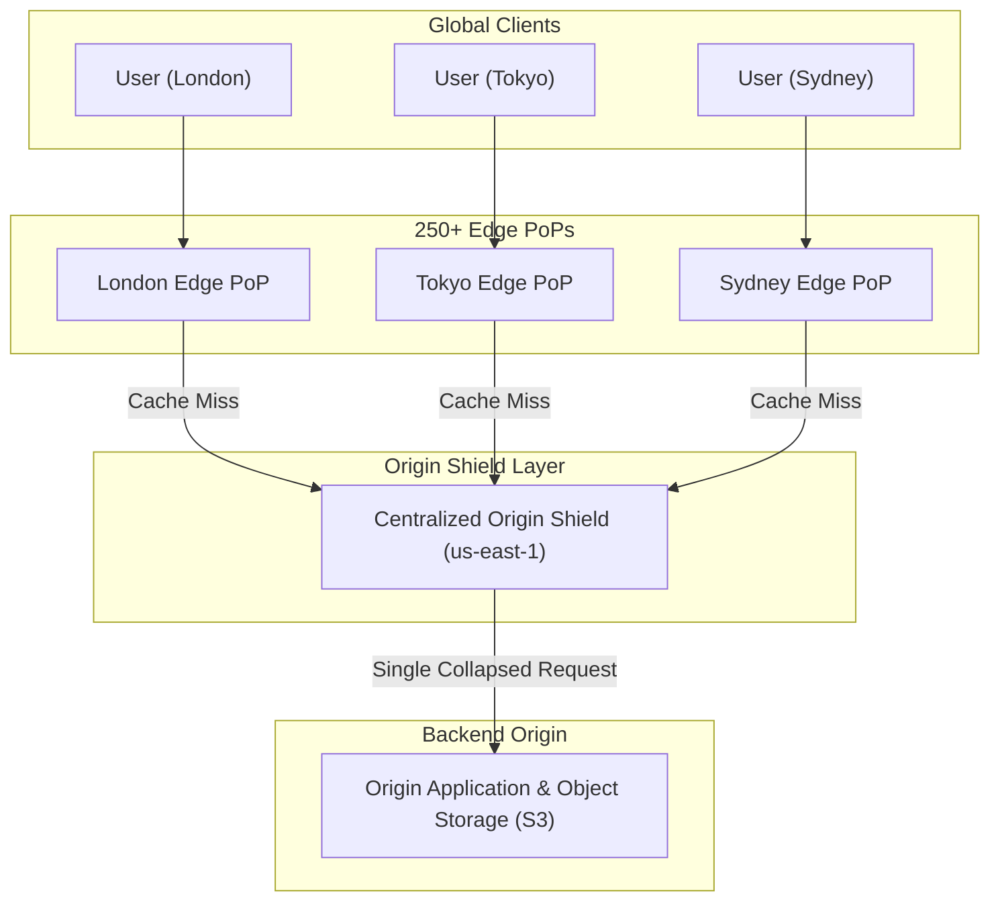

# 03 - Content Delivery Networks (CDNs)

A **Content Delivery Network (CDN)** is a system of distributed servers designed to deliver web content to users based on their geographic location.

Originally developed in the late 90s to speed up the delivery of static HTML content, CDNs have evolved significantly. Today, a modern CDN should be used for virtually all HTTP traffic.

<p align="center"></p>
<p align="center"></p>

---

## 1. Bringing Content Closer to the User (PoPs)

At a fundamental level, a CDN brings content closer to the user. This vastly improves the performance and perceived latency of a web service—which is critical to user engagement and retention.

To achieve this, CDNs deploy servers at hundreds of locations all over the world. These physical server locations are called **Points of Presence (PoPs)**. 

A server inside the PoP is commonly referred to as an **edge server**. Having many PoPs ensures that every user can reach a fast edge server close to their physical location.

<p align="center"></p>

---

## 2. Routing Traffic to the Closest PoP

Different CDNs use different network technologies to direct a user’s request to the closest PoP. The two most common methods are **DNS-based routing** and **Anycast**.

### DNS-Based Routing
With DNS-based routing, each PoP has its own unique IP address. When the user looks up the IP address for the CDN, the DNS server determines the user's location and returns the IP address of the specific PoP closest to them.

<p align="center"></p>

### Anycast Routing
With Anycast, all PoPs globally share the *exact same* IP address. When a request comes into the network for that IP address, the underlying network infrastructure automatically routes the request to the PoP that is physically closest to the requester.

<p align="center"></p>

---

## 3. The Edge Server as a Reverse Proxy

Each edge server acts as a **reverse proxy** equipped with a massive content cache. 

* **Static Caching:** Static contents are cached on the edge server. If a requested piece of content is in the cache, it is immediately returned to the user. 
* **Reducing Origin Load:** The edge server only asks the main origin server for a copy of the content if it is *not* in its cache. This drastically reduces the load and bandwidth requirements on your primary origin servers.

<p align="center"></p>

### On-The-Fly Transformations
A modern CDN doesn't just store static files; it can also transform content into more optimized formats in real-time. For example, it could minify JavaScript bundles on the fly, or convert an old image format into a modern, compressed format like WebP or AVIF before sending it to the user.

<p align="center"></p>
<p align="center"></p>

---

## 4. TLS Termination

The edge server serves a very important role in the modern HTTP stack: **All TLS (SSL) connections terminate at the edge server.**

TLS handshakes are computationally expensive. Older, commonly used versions like TLS 1.2 take several network round trips to establish. By terminating the TLS connection at the edge server (which is geographically very close to the user), it significantly reduces the latency required to establish an encrypted TCP connection.

This massive speedup is one of the main reasons why modern applications send even *dynamic, uncacheable* HTTP content through the CDN.

<p align="center"></p>

---

## 5. Security & DDoS Protection

Besides pure performance, modern CDNs provide massive security benefits.

All modern CDNs have enormous network bandwidth capacity at the edge. This is the key to providing effective **DDoS (Distributed Denial of Service) protection** against large-scale attacks—having a network with a capacity much larger than the attackers can generate.

This is especially effective with a CDN built on an **Anycast network**, as it allows the CDN to diffuse and absorb the attack traffic over a huge number of servers globally.

<p align="center"></p>
<p align="center"></p>

---

## 6. High Availability

Finally, a modern CDN drastically improves system availability. 

By its very nature, a CDN is highly distributed. By maintaining copies of your content across hundreds of PoPs, the CDN can withstand many more hardware failures or regional outages than your centralized origin servers ever could. If one PoP goes down, traffic is simply routed to the next closest PoP.

<p align="center"></p>

---

## Staff / Principal Interview Strategy: CDNs & Edge Architecture

In Staff and Principal system design rounds, an interviewer doesn't just want to hear *"we will put a CDN in front."* They expect you to articulate cache headers, origin shielding, cache invalidation strategies, and edge compute.

### 1. Origin Shielding & Tiered Caching
When operating a global CDN with 250+ Points of Presence (PoPs), an unshielded pull CDN creates a hidden bottleneck:
* **The Origin Stampede Problem**: If a new image or breaking news article is published, a simultaneous cache miss across 250 PoPs results in **250 parallel requests hitting your origin database/storage cluster**.
* **The Architecture Fix (Origin Shield)**: Introduce a centralized caching layer (Origin Shield) strategically co-located near your primary cloud region. Edge PoPs fetch from the Origin Shield rather than the origin directly, collapsing thousands of global misses into a single origin read.



---

### 2. Cache Invalidation: Content Addressing vs. Global Purge
* **The Anti-Pattern (Manual URL Purging)**: Calling the CDN API to purge `/images/logo.png`. Global propagation across hundreds of PoPs takes seconds to minutes and can leave inconsistent edge states during network partitions.
* **The Principal Pattern (Content-Addressed Hashing)**: Never mutate an asset in-place. Build systems with immutable asset hashing:
  `/static/app.a8f9c2d.js`
  * When code changes, deploy a new file with a new content hash. The HTML simply points to the new URL.
  * **Benefit**: Invalidation is instant ($O(1)$) and cache hit rates approach $100\%$ with `Cache-Control: public, max-age=31536000, immutable`.

---

### 3. HTTP Header Mastery: `stale-while-revalidate`
To achieve single-digit millisecond latency for semi-dynamic data (e.g., product pricing or catalog feeds), use the `stale-while-revalidate` directive:

```http
Cache-Control: public, max-age=60, stale-while-revalidate=300
```

* **How It Operates**:
  * For the first 60 seconds: Served fresh from CDN cache.
  * Between 60 and 360 seconds: CDN **immediately returns the cached stale data** to the client (sub-10ms response!), while *asynchronously* triggering a background fetch to the origin to update the cache for future requests.
  * Clients **never** suffer origin latency on cache misses!

---

### 4. Edge Computing (Cloudflare Workers / Lambda@Edge)
Modern CDNs are distributed application runtimes running lightweight V8 isolates:
* **Edge Authentication**: Validating JWT signatures and verifying authorization claims at the edge before requests reach the origin VPC.
* **A/B Testing & Geo-Routing**: Splitting traffic and injecting feature flags based on client IP geolocation without adding backend latency.
* **Edge Bot Mitigation**: Running cryptographic challenges (Cloudflare Turnstile) to drop DDoS attacks at the perimeter.

---
*(Source: [ByteByteGo CDN Video](https://youtu.be/RI9np1LWzqw?si=U1dVTFLktMGkJfG2))*
