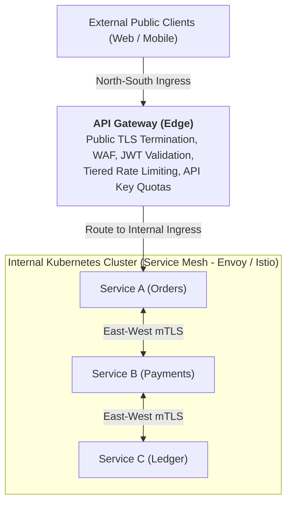

# 04 - API Gateways

An **API Gateway** is a single point of entry for all clients of an application. It sits between the clients and a collection of backend microservices, acting as a reverse proxy to manage and route all incoming traffic.

An API gateway typically provides several highly critical functions, including:
* Authentication and security policy enforcement
* Load balancing and circuit breaking
* Protocol translation and service discovery
* Monitoring, logging, analytics, and billing
* Caching

---

## 1. The Typical Client Request Flow

Let’s examine a typical flow of a client request traveling through the API gateway and onto the backend service.

### Step 1: The Client Request
The client sends a request to the API gateway. This request is typically HTTP-based (such as REST, GraphQL, or other higher-level abstractions).

### Steps 2 & 3: Validation and Basic Security
The API gateway first validates the HTTP request. It checks the caller’s IP address and HTTP headers against its predefined **allow-lists** and **deny-lists**. 

It can also perform **basic rate limit checks** based on attributes like the IP address. For example, it could instantly reject requests from a single IP address that is flooding the system and exceeding a certain rate limit.

### Step 4: Authentication & Authorization
The API gateway passes the request to an Identity Provider (IdP) for authentication and authorization. Once validated, the API gateway receives an authenticated session back from the provider, which dictates the "scope" or permissions of what that specific request is allowed to do.

### Step 5: Advanced Rate Limiting
Once the user's identity is known, a **higher-level rate-limit check** is applied against their authenticated session. (For example, a free-tier user might be allowed 100 requests per minute, while a premium user gets 1000). If the session is over its tier limit, the request is rejected.

### Steps 6 & 7: Service Discovery
With the help of a Service Discovery component, the API gateway locates the appropriate backend microservice to handle the request based on path matching (e.g., routing `/users` to the User Service and `/orders` to the Order Service).

### Step 8: Protocol Translation
The API gateway can transform the incoming HTTP request into a different protocol required by the backend service. For example, it might translate an incoming REST request into a **gRPC** call for internal backend communication. 

When the response comes back from the backend service, the API gateway translates it back to the public-facing HTTP protocol and returns it to the client.

---

## 2. Other Critical Services

A proper API gateway provides several other critical services to ensure the health of the entire system:
* **Circuit Breaking:** It protects backend services from being overloaded by "breaking the circuit" and returning errors early if a backend service is struggling.
* **Observability:** It provides centralized logging, monitoring, and analytics to give operators a clear view of system health and traffic patterns.

---

## Conclusion

An API gateway is a critical piece of modern distributed infrastructure. To improve availability and reduce latency, it is typically deployed across multiple geographic regions, positioning it as close to the global client base as possible.

---

## Staff / Principal Interview Strategy: API Gateways vs. Service Mesh

In Staff and Principal architecture rounds, interviewers will test your ability to separate perimeter ingress concerns from internal microservice mesh communication.

### 1. North-South vs. East-West Traffic Separation

* **North-South (API Gateway)**:
  * Manages untrusted public internet traffic entering the trusted internal network.
  * Solves perimeter security: coarse-grained rate limiting (Token Bucket), DDoS scrubbing, client API keys, OAuth2/OIDC token exchange, and public API monetization.
* **East-West (Service Mesh — Envoy / Istio)**:
  * Manages trusted service-to-service communication inside the VPC or Kubernetes cluster.
  * Solves zero-trust networking: automated **mutual TLS (mTLS)** rotation, distributed tracing context injection (`traceparent`), local circuit breaking, and canary traffic weight shifting (e.g., 95% v1, 5% v2).

---

### 2. The Backend-for-Frontend (BFF) Pattern
* **The Monolithic Gateway Problem**: When a single API gateway tries to serve Mobile, Web, IoT, and Third-Party Partner APIs, it becomes a release bottleneck and returns bloated payloads that waste mobile cellular data.
* **The BFF Solution**: Deploy lightweight, client-specific gateways:
  * **Mobile BFF**: Aggregates 5 backend service calls into 1 compact JSON payload, strips unused fields to preserve battery and bandwidth.
  * **Web BFF**: Delivers rich, fully hydrated payloads for large desktop screens.
  * **Partner Public BFF**: Implements strict API quota throttling, billing webhooks, and public OpenAPI documentation.

---

### 3. The "Smart Endpoints, Dumb Pipes" Principle
> [!CAUTION]
> **Never Put Business Logic or Database Access in the API Gateway.**

A classic anti-pattern is writing orchestration scripts or database lookups directly inside Kong, Apigee, or Spring Cloud Gateway filters.
* **Why It Fails**: The gateway becomes a distributed monolith. Any bug in business logic can bring down the entire ingress infrastructure for all microservices, and deployments require cross-team coordination.
* **The Principal Rule**: Keep the gateway **purely operational** (authentication, rate limiting, routing, telemetry). Business workflows belong inside domain orchestrators or dedicated application microservices.

---

### 4. High-Performance Token Validation (JWKS vs. Introspection)
* **The Slow Way (Opaque Token Introspection)**: Calling the Identity Provider (IdP) over the network on every single request. Adds $20-50\text{ ms}$ of latency floor to every API call.
* **The Staff Engineer Standard (Asymmetric Cryptographic Verification)**:
  * The API Gateway periodically fetches and caches the IdP’s public **JSON Web Key Set (JWKS)** endpoint.
  * When a request arrives with an `Authorization: Bearer <JWT>`, the gateway verifies the cryptographic signature locally using the cached public key.
  * Signature verification completes in **$< 0.1\text{ ms}$** in memory with zero network round trips.

---
*(Source: [ByteByteGo API Gateway Video](https://youtu.be/6ULyxuHKxg8?si=mMWzwr0U0yae6YTR))*
