# 05 - Network Protocols

Every day, over 5 billion people use the internet, generating exabytes of data. This massive data exchange is made possible by network protocols acting as the hidden engines powering our digital universe.

<p align="center"></p>

<p align="center"></p>

---

## 1. The Transport Layer
TCP and UDP provide the essential transport layer foundation for the application protocols built on top of them.

### Transmission Control Protocol (TCP)
TCP prioritizes **reliability over raw speed**. Features like error checking, transmission controls, and ordered data delivery ensure robust performance. TCP continuously adapts to network conditions with flow control and retransmissions.
<p align="center"></p>
<p align="center">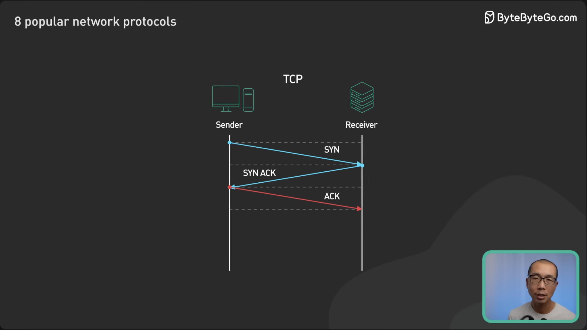</p>

### User Datagram Protocol (UDP)
UDP focuses on **speed over reliability**. With extremely lightweight error checking and no handshakes, UDP minimizes overhead for use cases like gaming, voice (VoIP), Internet of Things, and live streaming. However, UDP data can be corrupted by dropped packets, so it is often combined with application-layer integrity checks to balance speed and reliability.
<p align="center">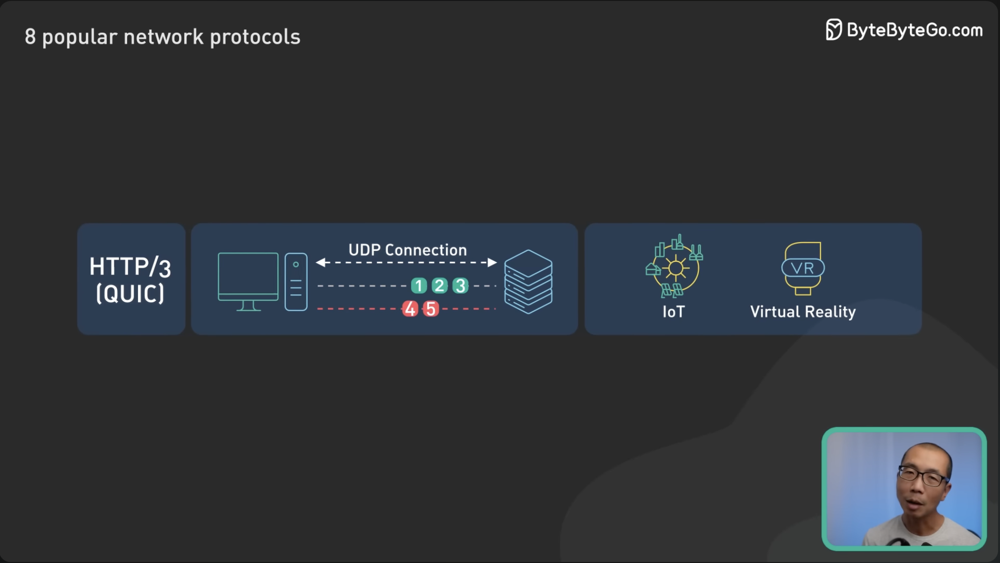</p>
<p align="center"></p>

---

## 2. The Web Backbone (HTTP Family)

### HTTP (Hypertext Transfer Protocol)
The backbone of web development. HTTP uses a strict request-response model where clients request resources and servers send back responses with status codes (e.g., `200 OK`, `404 Not Found`, `500 Internal Server Error`). It defines methods like `GET`, `POST`, `PUT`, and `DELETE` that trigger different operations on the server.
<p align="center">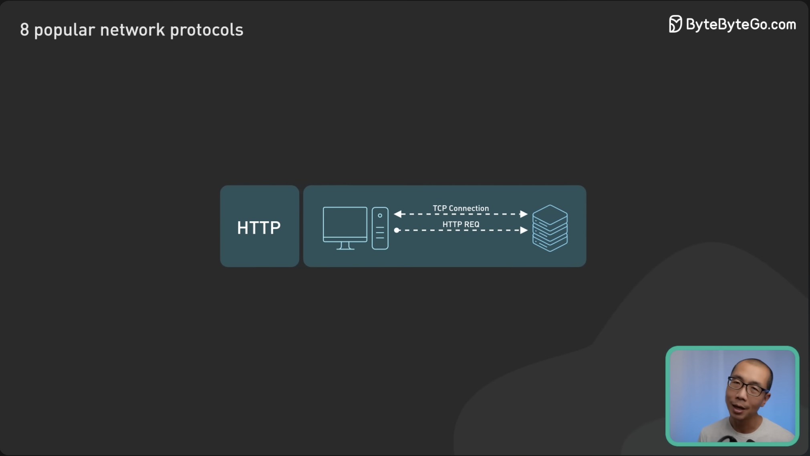</p>

### HTTPS & TLS
HTTPS builds on HTTP by adding encryption through **Transport Layer Security (TLS)**. TLS allows the browser and server to establish an encrypted connection—scrambling traffic so it is meaningless to anyone intercepting it over the public internet. It also verifies the server's identity, preventing man-in-the-middle attacks. This is essential for secure banking and shopping.
<p align="center">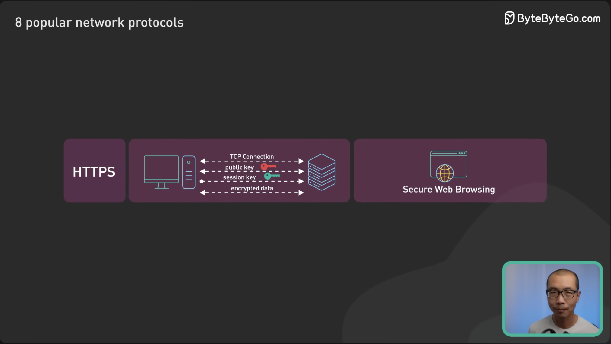</p>
<p align="center">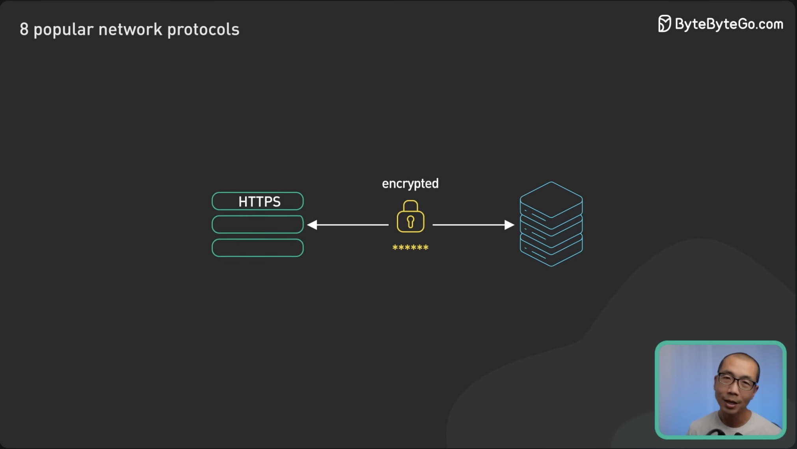</p>
<p align="center"></p>

### HTTP/3 & QUIC
HTTP/3 aims to improve speed and security by fixing nagging performance issues with previous versions. It uses **QUIC**, which is built on UDP rather than TCP.
* **No Head-of-Line Blocking:** One lost packet will no longer stall streams behind it.
* **0-RTT Resume:** Speeds up initial connection setup by combining cryptographic and transport handshakes. Clients skip round trips for servers they’ve connected to before.
* **Encryption by Default:** All connection data and metadata (like packet numbers) are scrambled by default at the transport layer.
<p align="center">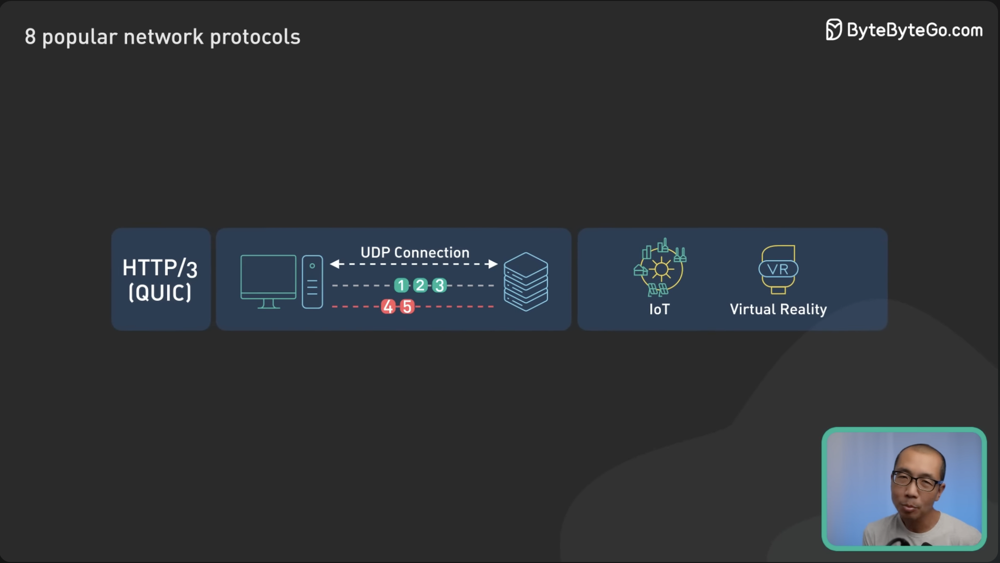</p>
<p align="center">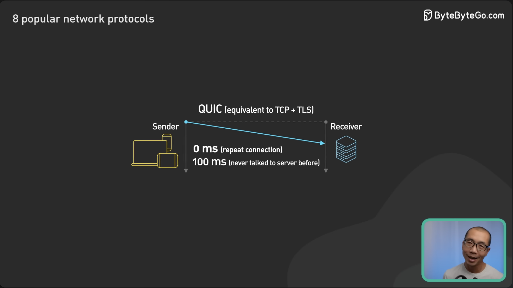</p>
<p align="center"></p>
<p align="center"></p>

---

## 3. API Paradigms

### REST API
REST (Representational State Transfer) is the most common way for web apps to talk to servers. It organizes resources into unique URIs and interacts with them using standard HTTP methods. REST APIs should be stateless for easy scaling and use versioning for backward compatibility.
<p align="center"></p>

### GraphQL
GraphQL is not just an architectural style, but a query language developed by Facebook. It allows clients to ask for specific data as they need it, eliminating **over-fetching** and **under-fetching**. This leads to more efficient network communication, though it comes with a steeper learning curve and requires more processing on the server side due to its flexible querying capabilities.
<p align="center">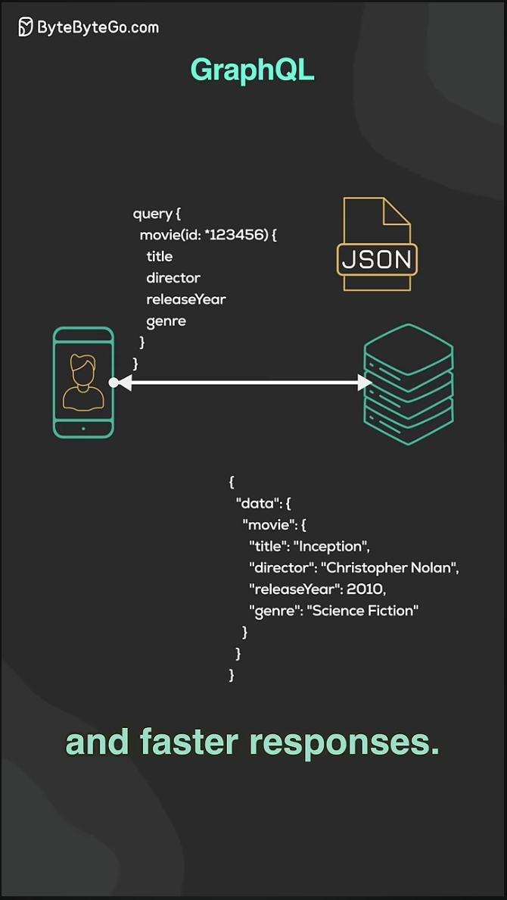</p>

### gRPC
gRPC is a modern, high-performance Remote Procedure Call framework. By default, it uses **Protocol Buffers (Protobufs)** for data serialization instead of JSON. It is a massive favorite for internal microservices architectures (used by companies like Netflix for inter-service communication). However, it can pose challenges for browser clients due to limited native browser support.
<p align="center">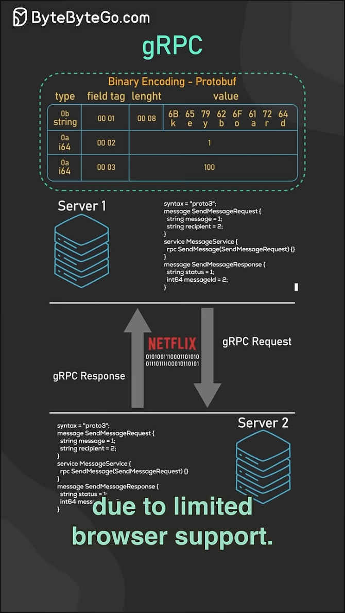</p>

---

## 4. Real-Time & Asynchronous Communication

### WebSockets
Unlike HTTP, WebSocket provides **full-duplex, bi-directional communication** on a single persistent TCP connection. The initial handshake reuses the existing TCP connection, allowing messages to flow freely in both directions with minimal framing. It is ideal for chat, gaming, or real-time updates where sending small messages instantly with low overhead is required.
<p align="center">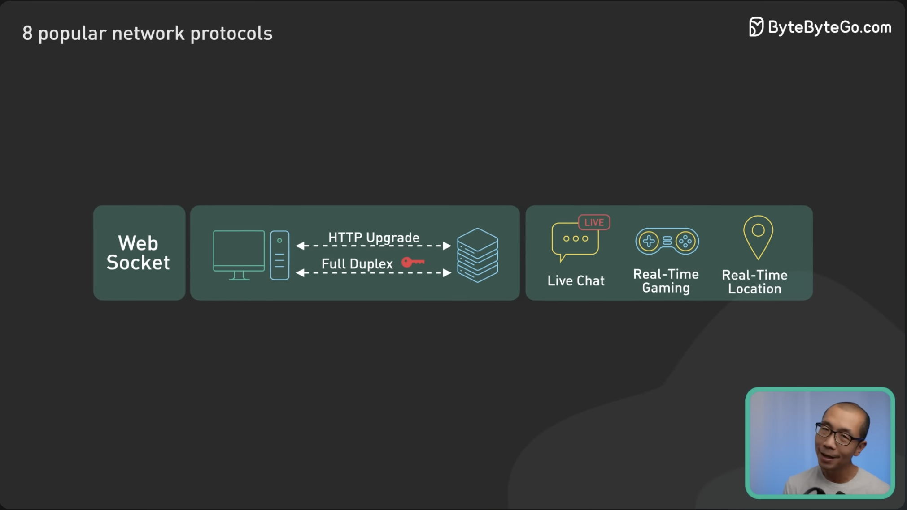</p>
<p align="center">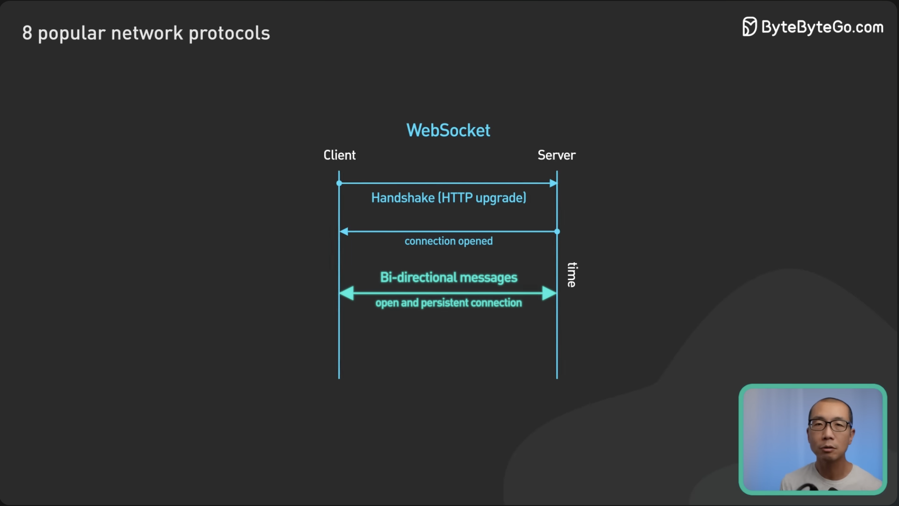</p>

### Server-Sent Events (SSE)
While WebSockets are bi-directional, Server-Sent Events (SSE) provide a strict **one-way (Server-to-Client)** persistent connection over standard HTTP. If you are building a stock ticker, a live sports score app, or a notification feed where the client just listens for updates and never sends data back over the same channel, SSE is much cheaper and easier to scale than a full WebSocket.

```text
       Client                                Server
         |                                     |
         | --- HTTP GET /events -------------> |
         |     (Accept: text/event-stream)     |
         |                                     |
         | <--- HTTP 200 OK ------------------ |
         |      (Content-Type: event-stream)   |
         |                                     |
         |      [ Connection Stays Open ]      |
         |                                     |
         | <--- event: message --------------- |
         |      data: {"price": 100}           |
         |                                     |
         | <--- event: message --------------- |
         |      data: {"price": 105}           |
         |                                     |
         | <--- event: message --------------- |
         |      data: {"price": 102}           |
         |                                     |
```

### Webhooks
Webhooks are all about being **event-driven**. They use simple HTTP callbacks to provide asynchronous operations. Instead of polling, a server sends an HTTP request to the client when an event occurs (e.g., GitHub notifying CI systems whenever a new commit is pushed). They are not suitable if synchronous communication or an immediate response is required.
<p align="center">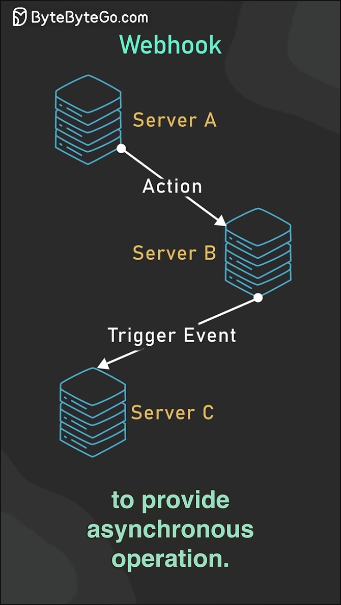</p>

---

## 5. Legacy Application Protocols

### SMTP
Simple Mail Transfer Protocol (SMTP) is the standard for transferring email messages between mail servers. Understanding SMTP is critical for properly configuring mail services and avoiding denied listing.
<p align="center">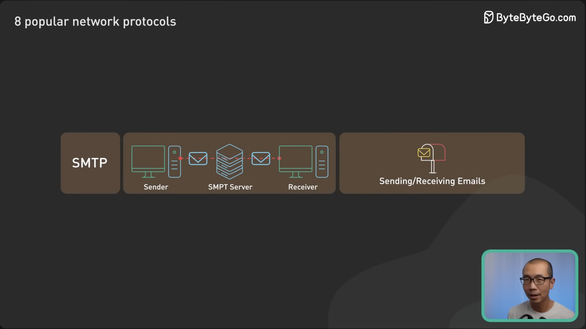</p>

### FTP
File Transfer Protocol (FTP) allows efficient uploading and downloading of files between hosts. It remains ubiquitous for file-based workflows, especially in financial institutions.
<p align="center">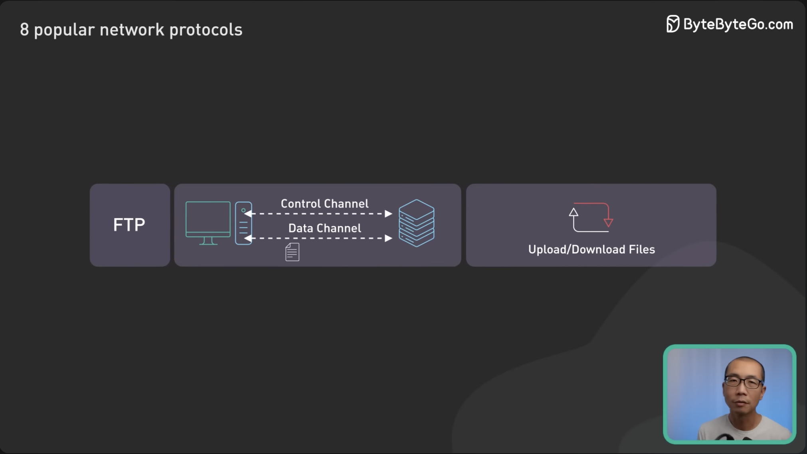</p>

---

## Staff / Principal Interview Strategy: Protocol Selection Matrix

In distributed systems design, choosing the wrong communication protocol introduces severe latency floors and network head-of-line blocking. Here is the decision framework expected at the Staff and Principal level:

### 1. Protocol Comparison Matrix

| Protocol | Transport | Serialization | Bi-Directional? | Browser Native? | Best Use Case |
| :--- | :--- | :--- | :---: | :---: | :--- |
| **REST** | HTTP/1.1 or H2 | JSON / Text | No (Req/Res) | Yes | Public developer APIs, CRUD services, web applications. |
| **gRPC** | HTTP/2 | Binary (Protobuf) | Yes (Streaming) | No (needs grpc-web) | East-West internal microservices, high-throughput RPCs. |
| **GraphQL** | HTTP/1.1 or H2 | JSON | No (Subscriptions via WS) | Yes | Aggregation gateways (BFF), mobile apps needing sparse fields. |
| **WebSocket**| TCP (Upgraded) | Binary / Text | Yes (Full Duplex) | Yes | Multiplayer games, collaborative editing (Figma), low-latency chat. |
| **SSE (Server-Sent Events)** | HTTP/1.1 or H2 | Text (`text/event-stream`) | No (Server $\to$ Client) | Yes | Stock tickers, real-time dashboards, LLM token streaming (ChatGPT). |

---

### 2. HTTP/2 Multiplexing vs. HTTP/3 (QUIC) Connection Migration
* **The HTTP/2 Head-of-Line Blocking Trap**:
  * HTTP/2 multiplexes hundreds of logical streams over a single TCP connection.
  * *The Flaw*: TCP guarantees in-order delivery. If a single TCP packet is dropped due to cellular packet loss, **the entire TCP connection stalls** until that lost packet is retransmitted—blocking all 100 multiplexed HTTP/2 streams!
* **The HTTP/3 (QUIC over UDP) Revolution**:
  * QUIC implements stream multiplexing at the **transport layer over UDP**.
  * A lost packet on Stream A only pauses Stream A; Streams B through Z continue processing with zero latency impact.
  * **Connection Migration**: Identified by a 64-bit Connection ID rather than the classic 4-tuple `(SrcIP, SrcPort, DstIP, DstPort)`. When a user walks out of their house and their phone switches from WiFi to 5G cellular, **the connection does not drop or re-handshake**—streaming video or active calls continue uninterrupted!

---

### 3. Enterprise Webhook Delivery Standard
When designing asynchronous push notifications to external partners (e.g., Stripe, Shopify, PayPal):
1. **Cryptographic Signatures**: Always hash the payload using HMAC-SHA256 with a shared secret:
   `X-Signature-SHA256: t=1614552000,v1=5257a863e5b...`
   Recipients verify the signature to prevent tampering and replay attacks.
2. **Idempotency Guarantees**: Send an immutable `X-Event-Id: evt_98234` so the recipient can de-duplicate retries.
3. **Decoupled Delivery**: Never make webhook HTTP calls synchronously in the transaction thread. Push webhook delivery tasks into an asynchronous queue (SQS / Kafka) backed by a retry worker with exponential backoff (1m, 5m, 1h, 6h, 24h) and a Dead-Letter Queue (DLQ).

---
## References
* [8 Popular Network Protocols in 1 Video](https://youtu.be/P6SZLcGE4us?si=HRh6VQTZuAKgmwF1)
* [REST API in 30 Seconds](https://youtu.be/hQUjpbb75eY?si=K5gXZNPWPgkk5oHX)
* [GraphQL Explained](https://youtu.be/rQhost93z40?si=nYG3KtHxHbFy2mmx)
* [Webhooks Explained](https://youtu.be/f7KgDNZU3-Y?si=kUARXtejmBTV-4s_)
