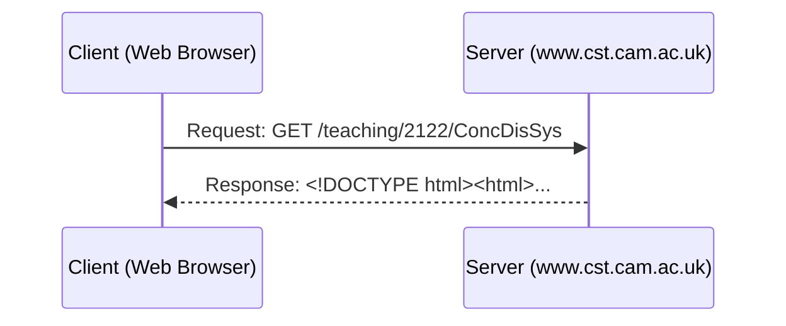
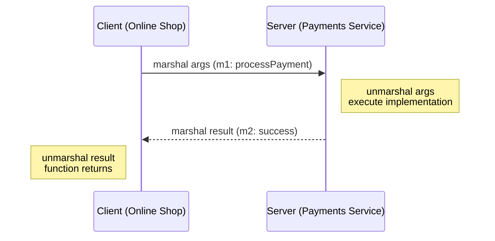

# Lecture 1: Foundations & RPC

## 1.1 About Distributed Systems

A distributed system is one where multiple computers (nodes) communicate via a network to achieve a shared task. 

> *"A distributed system is one in which the failure of a computer you didn't even know existed can render your own computer unusable."* — Leslie Lamport

**Shared Memory vs. Message Passing**
Concurrency on a single computer is known as *shared-memory concurrency*, where multiple threads in the same process access the same address space. In distributed systems, we typically don't have shared memory. Each node runs its own OS and address space. Different computers can only communicate by sending each other messages over a network (*message passing*).

**Why build distributed systems?**
1. **Inherently distributed:** Some applications naturally require distribution (e.g., sending a message from your phone to a friend's phone).
2. **Reliability (Fault Tolerance):** If one node fails, the system as a whole can continue functioning by routing traffic to other nodes.
3. **Performance:** Serving data from a node geographically closer to the user reduces latency (getting around the speed of light limit).
4. **Scale:** Solving problems that are simply too large for a single machine (e.g., CERN data analysis).

**The Challenge:**
In a single computer, a hardware failure usually just causes the machine to crash cleanly. In a distributed system, a node or network link can fail at any time, leading to *partial failures*. Writing software that continues to function despite these non-deterministic partial failures is the core challenge of distributed systems.

---

## 1.2 Distributed Systems and Computer Networking

When building distributed algorithms, we don't care about the underlying physical layer (e.g., fiber optic cables, radio waves, or even hard drives in a van). We abstract the network into a simple model: **nodes passing messages**.

> [!NOTE] 
> **Bandwidth vs Latency**
> * **Latency:** The time it takes for a message to arrive (e.g., 1ms within a datacenter, 100ms across continents).
> * **Bandwidth:** The volume of data that can be transferred per unit of time (e.g., 10 Mbit/s).
> 
> *Fun Fact:* Sending a truck full of hard drives across the country has extremely high latency (1 day) but astronomical bandwidth (Petabytes/day).

### Network Faults
Networks are fundamentally unreliable. Cables get cut (sometimes by sharks or cows), routers get overloaded, or denial-of-service attacks occur. In our system models, we usually assume **point-to-point (unicast)** communication.

### Client-Server Example: The Web
The web is an everyday example of a distributed system. Clients (web browsers) send HTTP request messages to servers, which respond with HTTP response messages containing page contents.



In a URL, the part between `//` and the following `/` is the hostname. The rest is the path. The request includes the HTTP method (e.g., GET), user-agent, and accept header. The response contains the file requested and a content-type. Because these messages can be large, HTTP runs on top of TCP, which breaks the data into small network packets.

> [!TIP]
> **Staff Insight: Request-Response Framing over TCP**
> Because TCP is an unformatted continuous byte stream without built-in message boundaries, multiplexing requests and responses requires two mechanisms:
> 1. **Message Framing**: Either *Length-prefixed framing* (a 4-byte integer header indicating message payload size, used by gRPC and Kafka) or *Delimiter-based framing* (e.g., `\r\n\r\n` in HTTP/1.1).
> 2. **Correlation IDs**: A unique `Request-ID` in the frame header so that responses arriving asynchronously or out of order can be mapped back to the originating caller thread.

---

## 1.3 Example: Remote Procedure Calls (RPC)

RPC is a framework designed to make executing a function on a remote node look as much as possible like calling a local function. This is known as **Location Transparency**.

### Java RPC Call Example
Here is how RPC might look in a Java online shop application calling a separate payments service:
```java
// Online shop handling customer's card details
Card card = new Card();
card.setCardNumber("1234 5678 8765 4321");
card.setExpiryDate("10/2024");
card.setCVC("123");

// Implementation of this function is on another node!
Result result = paymentsService.processPayment(card, 3.99, Currency.GBP);
if (result.isSuccess()) {
    fulfilOrder();
}
```

### The Flow of RPC
1. **Client calls a Stub:** The client application calls a local stub function provided by the RPC middleware.
2. **Marshalling:** The stub encodes the function arguments into a network message format (e.g., JSON).
3. **Network Transmission:** The message is sent over the network to the server.
4. **Unmarshalling:** The server decodes the message, executes the actual function, and marshals the result to send back.



### The Problem with RPC
Unlike local function calls, remote calls can fail in ambiguous ways. If the client receives no response, it is impossible to know what happened:
1. Did the request message get lost in the network?
2. Did the server crash during the function call?
3. Did the server process it, but the response message got delayed or lost?

Because waiting forever is not a good approach, the client will have to give up after some **timeout**.

> [!WARNING]
> **Is Location Transparency achievable?**
> Ideally, RPC hides where a resource is located, making it seem local. However, location transparency is practically a myth because developers must explicitly handle partial failures. If a client doesn't hear back, it might retry the request. If the request was actually processed, retrying could execute the action twice (e.g., charging a credit card twice). Thus, the application code must always be aware it is dealing with an unreliable network.

> [!IMPORTANT]
> **Staff Insight: Why Location Transparency is an Architectural Myth**
> Local function calls are predictable: they either complete in nanoseconds, return an error, or crash the process cleanly. They pass memory references directly.
> Remote Procedure Calls (RPC), by contrast, cross an unreliable network:
> 1. **Non-deterministic latency**: A call can take 2ms or 20,000ms.
> 2. **Partial Failures**: The client cannot distinguish whether the request was lost, the server crashed during processing, or the response packet was dropped.
> 3. **Pass-by-value only**: Cannot pass pointers or shared memory objects; everything must be serialized.
> Treating network calls as if they were local function calls leads developers to omit timeouts, circuit breakers, and idempotency keys. Modern architectures explicitly embrace **location awareness** instead of transparency.

### History of RPC
* **1980s:** SunRPC / ONC RPC
* **1990s:** CORBA, Java RMI, Microsoft DCOM
* **1998:** SOAP / XML-RPC
* **Modern:** gRPC, Thrift, REST, GraphQL

### RESTful APIs
REST (Representational State Transfer) is the most common modern HTTP-based RPC. 
* Communication is **stateless**.
* Resources are represented by URLs.
* State is updated using standard HTTP methods (`GET`, `POST`, `PUT`, `DELETE`).

**JavaScript fetch() REST example:**
```javascript
let args = {amount: 3.99, currency: 'GBP'};
let request = {
    method: 'POST',
    body: JSON.stringify(args),
    headers: {'Content-Type': 'application/json'}
};

fetch('https://example.com/payments', request)
    .then((response) => {
        if (response.ok) success(response.json());
        else failure(response.status); // server error
    })
    .catch((error) => {
        failure(error); // network error
    });
```

### Enterprise Systems and SOA
In large enterprises, applications are split into multiple services (Service-Oriented Architecture or Microservices). These services may be written in different languages. To ensure they can communicate, RPC frameworks use an **Interface Definition Language (IDL)** to specify language-independent API schemas, automatically generating marshalling/unmarshalling stubs.

**gRPC Protocol Buffers IDL example:**
```protobuf
message PaymentRequest {
    message Card {
        required string cardNumber = 1;
        optional int32 expiryMonth = 2;
        optional int32 expiryYear = 3;
        optional int32 CVC = 4;
    }
    enum Currency { GBP = 1; USD = 2; }
    required Card card = 1;
    required int64 amount = 2;
    required Currency currency = 3;
}

message PaymentStatus {
    required bool success = 1;
    optional string errorMessage = 2;
}

service PaymentService {
    rpc ProcessPayment(PaymentRequest) returns (PaymentStatus) {}
}
```

---

## Staff / Principal Interview Strategy: RPC & Network Foundations

When designing service-to-service communication in a Staff or Principal architecture round:

### 1. The Idempotency Key Architecture
Because RPC timeouts leave execution status ambiguous (did the payment go through before the response packet was dropped?), **every mutating RPC must be idempotent**:
* Client generates a unique UUID `Idempotency-Key` and transmits it in the RPC header.
* The receiving service records the `Idempotency-Key` in a database with a unique constraint within the same transaction.
* If a network timeout occurs and the client retries, the server detects the duplicate key, **skips re-execution**, and immediately returns the previously computed result.

### 2. Fail-Open vs. Fail-Closed Decision Framework
When an RPC dependency times out or trips a circuit breaker:
* **Fail-Closed (Pessimistic)**: Abort and reject the user request. Mandatory for ledger transfers, debiting accounts, and authentication gates.
* **Fail-Open (Optimistic)**: Return a fallback default or degraded payload. Mandatory for recommendation feeds, ad banners, and non-blocking risk scores (e.g., approve payments under $50 if fraud ML times out).

### 3. REST vs. gRPC for Enterprise Microservices
* **Public Perimeter (North-South)**: REST + JSON (widest client compatibility, browser native, HTTP caching).
* **Internal Mesh (East-West)**: gRPC + Protocol Buffers (strictly-typed interface contracts, $5\times$ to $10\times$ faster binary serialization, HTTP/2 multiplexing over a single TCP connection, generated client SDKs across multiple languages).
