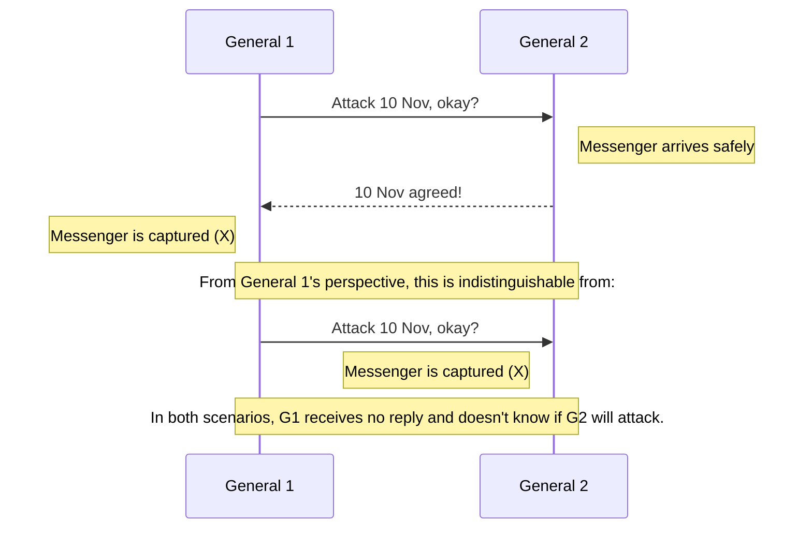
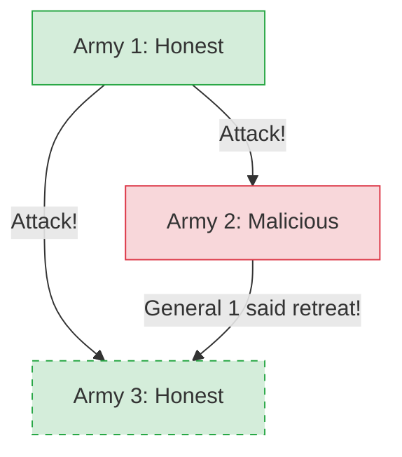

# Lecture 2: Models of Distributed Systems

A system model captures our assumptions about how nodes and networks behave. We begin with two classic thought experiments that illustrate the challenges of reaching agreement over unreliable communication channels.

## 2.1 The Two Generals Problem

**Scenario:** Two generals, each leading an army, want to attack a city. If only one attacks, they lose. If both attack at the same time, they win. They can only communicate via messengers who must run through enemy territory (meaning messages can be dropped/captured).

**The Problem:**
No matter how many acknowledgement messages they send back and forth, they can *never* reach absolute certainty that the other army will attack.
* General 1 sends: "Attack at dawn."
* General 2 receives it, and replies: "Confirmed. Attack at dawn."
* General 2 now worries: "Did my confirmation arrive? If it didn't, General 1 won't attack, and I'll die alone."
* General 1 replies: "Received your confirmation."
* General 1 now worries: "Did my acknowledgment of the confirmation arrive? If it didn't, General 2 might not attack."

> [!IMPORTANT]
> **Key Takeaway:** In a distributed system with unreliable networks, there is no way for one node to have absolute certainty about the state of another node. **Common knowledge cannot be achieved over an unreliable link.**

**Real-world application:** An online shop sending a charge request to a payment service. The shop only wants to ship goods if the payment succeeds, and the payment service only wants to charge if the goods ship.
In practice, this is solvable because payments have **reversibility**. If the shop cannot dispatch the goods after payment, it can simply issue a refund. The fact that actions can be undone makes the real-world equivalent solvable, unlike an army being defeated.

---

## 2.2 The Byzantine Generals Problem

**Scenario:** Similar to the Two Generals, but now there are three or more generals. The network is completely reliable (messengers are never captured), but some of the generals might be **traitors (malicious)**. 

**The Problem:**
A malicious general can lie, sending contradictory messages to different honest generals to cause confusion. The goal is for the *honest* generals to agree on a single plan, despite the lies.

> [!NOTE]
> **The Byzantine Fault Limit**
> It has been proven that this problem can only be solved if *strictly fewer than one-third* of the generals are malicious. 
> Formula: You need `3f + 1` nodes in total to tolerate `f` malicious nodes. 
> Example: A system of 4 nodes can tolerate 1 malicious node.

Cryptography (**digital signatures**) helps significantly by allowing generals to prove who said what, but the core problem remains hard.

**Real-world application:** In most datacenter software, nodes crash but they don't actively lie or act maliciously. However, in open networks like Blockchains or Cryptocurrencies, participants might actively try to cheat the system. Systems that survive this are called **Byzantine Fault Tolerant (BFT)**.

---

## 2.3 Describing Nodes and Network Behaviour

To design a distributed algorithm, we must clearly define our "System Model"—the assumptions we make about the network, the nodes, and time.

### 1. Network Behaviour
* **Reliable links:** Messages are received if and only if they are sent. (Unrealistic in raw form).
* **Fair-loss links:** Messages may be dropped, duplicated, or reordered, but if you keep retrying, they eventually get through. (Standard Internet model).
* **Arbitrary links:** An active adversary can eavesdrop, modify, spoof, or replay traffic.

> [!TIP]
> **Converting Network Link Models**
> * A fair-loss link can be turned into a reliable link by continually **retrying** lost messages and using **deduplication** on the recipient side.
> * An arbitrary link can be converted into a fair-loss link using cryptographic protocols like **TLS**, which prevents eavesdropping and tampering.

> **Exercise 3.** Say you have a client-server RPC system in which a client repeats an RPC request until it receives a response. How could the server deduplicate the requests?

### 2. Node Behaviour
* **Crash-stop:** If a node crashes, it stops executing forever (never comes back online).
* **Crash-recovery:** A node may crash and lose in-memory state, but its persistent disk storage survives, and it resumes executing later.
* **Byzantine (fail-arbitrary):** A node deviates from the algorithm, including malicious behavior or software bugs.

### 3. Synchrony (Timing) Assumptions
* **Synchronous:** Network latency has a strict upper bound. Nodes execute code at a known, constant speed. While **Real-Time Operating Systems (RTOS)** provide scheduling guarantees, most distributed systems do not use them, meaning execution speeds can vary unpredictably due to OS scheduling, garbage collection pauses, or page faults.
* **Asynchronous:** No timing guarantees at all. Messages can be delayed infinitely.
* **Partially Synchronous:** The system is usually synchronous, but occasionally experiences unpredictable, unbounded delays (network partitions, CPU spikes). **This is the most accurate model for real-world systems.**

> **Exercise 4.** Reliable network links allow messages to be reordered. Give pseudocode for an algorithm that strengthens the properties of a reliable point-to-point link such that messages are received in the order they were sent (this is called a FIFO link), assuming an asynchronous crash-stop system model.
>
> **Exercise 5.** How do we need to change the algorithm from Exercise 4 if we assume a crash-recovery model instead of a crash-stop model?

---

## 2.4 Fault Tolerance and High Availability

We build distributed systems to achieve higher availability than a single machine can offer.

**Availability:** The fraction of time a service is functioning correctly (uptime).
* **Two nines (99%):** ~3.7 days of downtime per year.
* **Three nines (99.9%):** ~8.8 hours of downtime per year.
* **Four nines (99.99%):** ~53 minutes of downtime per year.
* **Five nines (99.999%):** ~5.3 minutes of downtime per year.

> [!TIP]
> **SLO vs SLA**
> * **Service-Level Objective (SLO):** The target availability (e.g., "99.9% of requests succeed in <200ms").
> * **Service-Level Agreement (SLA):** The legal contract that dictates the financial penalties if the SLO is violated.

**Single Point of Failure (SPOF)**
A system component is a Single Point of Failure (SPOF) if its failure causes the entire system to fail. Fault-tolerant systems are explicitly designed to avoid having any SPOF.

**Failure Detectors:**
To tolerate faults, we must first detect them. A timeout-based failure detector sends a heartbeat message and assumes the node is dead if it doesn't reply in time.
* In a purely asynchronous system, perfect failure detectors do not exist because you cannot distinguish a crashed node from a slow network.
* In partially synchronous systems, we use **Eventually Perfect Failure Detectors**, which might mistakenly flag a slow node as dead, but eventually get it right.
