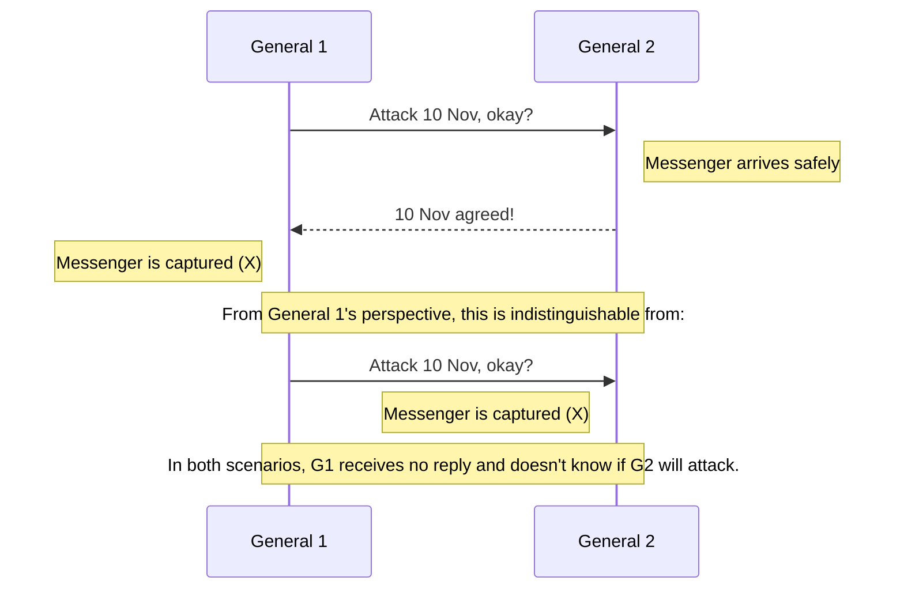
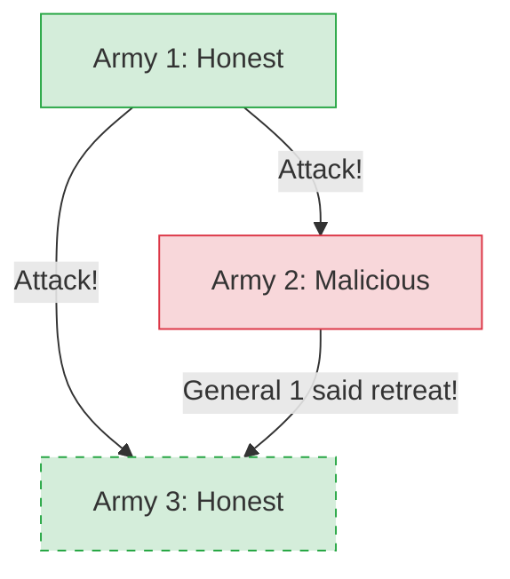
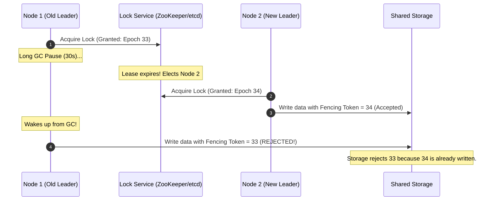

# Lecture 2: Models of Distributed Systems

A system model captures our assumptions about how nodes and networks behave. We begin with two classic thought experiments that illustrate the challenges of reaching agreement over unreliable communication channels.

## 2.1 The Two Generals Problem

**Scenario:** Two generals, each leading an army, want to attack a city. If only one attacks, they lose. If both attack at the same time, they win. They can only communicate via messengers who must run through enemy territory (meaning messages can be dropped/captured).

**The Problem:**
No matter how many acknowledgement messages they send back and forth, they can *never* reach absolute certainty that the other army will attack.
* General 1 sends: "Attack at dawn."
* General 2 receives it, and replies: "Confirmed. Attack at dawn."
* General 2 now worries: "Did my confirmation arrive? If it didn't, General 1 won't attack, and I'll die alone."
* General 1 replies: "Received your confirmation."
* General 1 now worries: "Did my acknowledgment of the confirmation arrive? If it didn't, General 2 might not attack."

> [!IMPORTANT]
> **Key Takeaway:** In a distributed system with unreliable networks, there is no way for one node to have absolute certainty about the state of another node. **Common knowledge cannot be achieved over an unreliable link.**

**Real-world application:** An online shop sending a charge request to a payment service. The shop only wants to ship goods if the payment succeeds, and the payment service only wants to charge if the goods ship.
In practice, this is solvable because payments have **reversibility**. If the shop cannot dispatch the goods after payment, it can simply issue a refund. The fact that actions can be undone makes the real-world equivalent solvable, unlike an army being defeated.

---

## 2.2 The Byzantine Generals Problem

**Scenario:** Similar to the Two Generals, but now there are three or more generals. The network is completely reliable (messengers are never captured), but some of the generals might be **traitors (malicious)**. 

**The Problem:**
A malicious general can lie, sending contradictory messages to different honest generals to cause confusion. The goal is for the *honest* generals to agree on a single plan, despite the lies.

> [!NOTE]
> **The Byzantine Fault Limit**
> It has been proven that this problem can only be solved if *strictly fewer than one-third* of the generals are malicious. 
> Formula: You need `3f + 1` nodes in total to tolerate `f` malicious nodes. 
> Example: A system of 4 nodes can tolerate 1 malicious node.

Cryptography (**digital signatures**) helps significantly by allowing generals to prove who said what, but the core problem remains hard.

**Real-world application:** In most datacenter software, nodes crash but they don't actively lie or act maliciously. However, in open networks like Blockchains or Cryptocurrencies, participants might actively try to cheat the system. Systems that survive this are called **Byzantine Fault Tolerant (BFT)**.

---

## 2.3 Describing Nodes and Network Behaviour

To design a distributed algorithm, we must clearly define our "System Model"—the assumptions we make about the network, the nodes, and time.

### 1. Network Behaviour
* **Reliable links:** Messages are received if and only if they are sent. (Unrealistic in raw form).
* **Fair-loss links:** Messages may be dropped, duplicated, or reordered, but if you keep retrying, they eventually get through. (Standard Internet model).
* **Arbitrary links:** An active adversary can eavesdrop, modify, spoof, or replay traffic.

> [!TIP]
> **Converting Network Link Models**
> * A fair-loss link can be turned into a reliable link by continually **retrying** lost messages and using **deduplication** on the recipient side.
> * An arbitrary link can be converted into a fair-loss link using cryptographic protocols like **TLS**, which prevents eavesdropping and tampering.

> [!TIP]
> **Staff Insight: Deduplication & FIFO Ordering Over Unreliable Networks**
> 1. **Deduplication**: Sender embeds a monotonically increasing `(client_id, sequence_no)`. The server stores the highest processed `sequence_no` per `client_id` in transactional storage; duplicates are dropped.
> 2. **FIFO Delivery over Crash-Stop**: Sender sequences messages. Receiver buffers out-of-order arrivals in a priority queue and only delivers message $k$ when message $k-1$ has been acknowledged and delivered.
> 3. **FIFO Delivery over Crash-Recovery**: The receiver must persist its `last_delivered_seq` to durable storage (Write-Ahead Log / disk) before passing the message to the application so that upon crash reboot, it does not re-deliver duplicate state or skip sequences.

### 2. Node Behaviour
* **Crash-stop:** If a node crashes, it stops executing forever (never comes back online).
* **Crash-recovery:** A node may crash and lose in-memory state, but its persistent disk storage survives, and it resumes executing later.
* **Byzantine (fail-arbitrary):** A node deviates from the algorithm, including malicious behavior or software bugs.

### 3. Synchrony (Timing) Assumptions
* **Synchronous:** Network latency has a strict upper bound. Nodes execute code at a known, constant speed. While **Real-Time Operating Systems (RTOS)** provide scheduling guarantees, most distributed systems do not use them, meaning execution speeds can vary unpredictably due to OS scheduling, garbage collection pauses, or page faults.
* **Asynchronous:** No timing guarantees at all. Messages can be delayed infinitely.
* **Partially Synchronous:** The system is usually synchronous, but occasionally experiences unpredictable, unbounded delays (network partitions, CPU spikes). **This is the most accurate model for real-world systems.**

* In a purely asynchronous system, perfect failure detectors do not exist because you cannot distinguish a crashed node from a slow network.
* In partially synchronous systems, we use **Eventually Perfect Failure Detectors**, which might mistakenly flag a slow node as dead, but eventually get it right.

---

## Staff / Principal Interview Strategy: System Models & Fault Tolerance

In Staff and Principal architecture reviews, interviewers test your understanding of real-world distributed failure boundaries:

### 1. The Industry Standard Model: Partially Synchronous + Crash-Recovery
Never assume a synchronous network in a cloud environment (AWS, GCP, Azure). 
* **The Reality**: Modern cloud infrastructure is **Partially Synchronous**: the network is normally fast, but unpredictable GC pauses, noisy neighbors, and cross-AZ network partitions cause arbitrary delays.
* **The Implication**: Algorithms that depend on strict time bounds (like distributed locks without leases) will fail. Systems must be designed assuming that *any* node can freeze for 30 seconds and wake up thinking it is still the leader.

### 2. The Zombie Leader Problem & Fencing Tokens
Consider a classic distributed lock or leader: Node 1 acquires a lock, but hits a 45-second Stop-the-World JVM GC pause. The lock service times out and assigns the lock to Node 2. Node 1 wakes up from GC, unaware that time passed, and writes to storage.

* **The Defense: Fencing Tokens**: Every time the lock service grants a lock or elects a leader, it issues a monotonically increasing **Fencing Token (Epoch number)**. The storage layer checks the token on every write: if a write arrives with a token lower than the highest token observed, it is **instantly rejected**.

### 3. Quorum Math: Preventing Split-Brain
When network partitions slice a cluster of $N$ nodes into two isolated halves, both halves might attempt to elect a leader, leading to **Split-Brain** (data corruption via dual writes).
* **The Invariant**: A leader must receive votes from a **Strict Majority Quorum**:
  $$Q \ge \left\lfloor \frac{N}{2} \right\rfloor + 1$$
* **Why an Odd Number of Nodes?**:
  * 3 nodes tolerate 1 failure ($\lfloor 3/2 \rfloor + 1 = 2$).
  * 4 nodes still only tolerate 1 failure ($\lfloor 4/2 \rfloor + 1 = 3$), while adding network complexity.
  * Always deploy 3, 5, or 7 nodes for consensus clusters (ZooKeeper, etcd, Raft).
