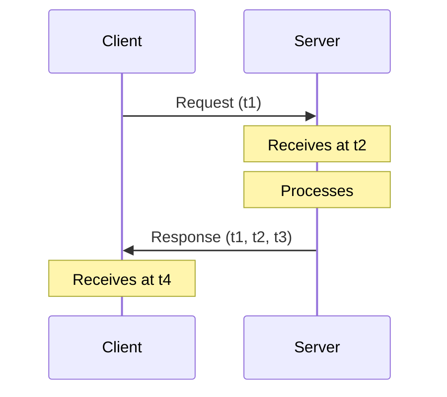
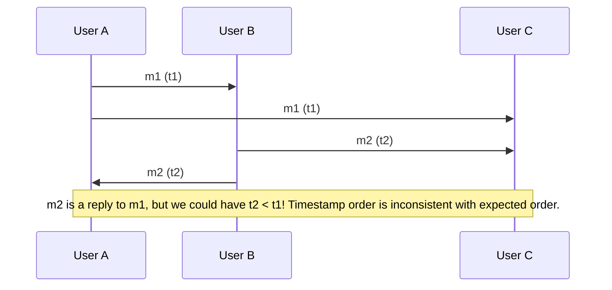
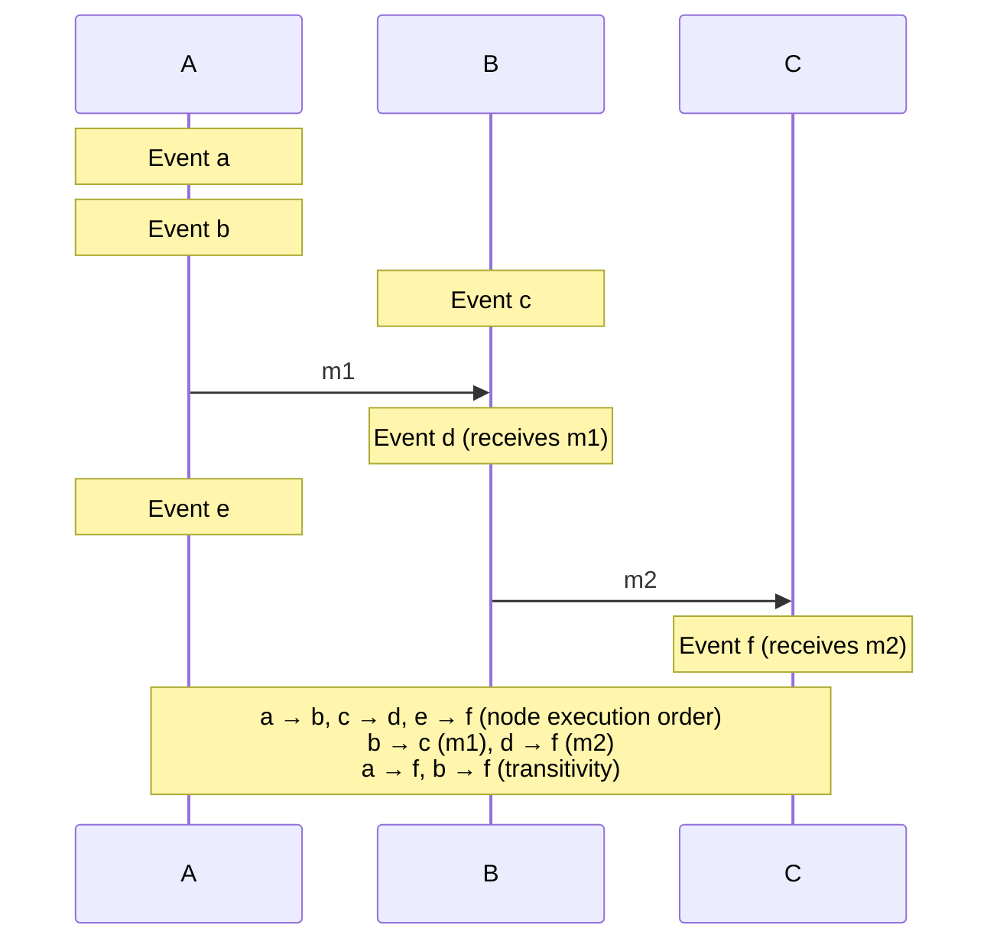

# Lecture 3: Time, Clocks, and Ordering of Events

Time is critical in distributed systems for timeouts, scheduling, and determining the order of events across multiple nodes. However, measuring time consistently across a network is incredibly difficult.

## 3.1 Physical Clocks

Physical clocks measure elapsed seconds. 
* **Quartz Clocks:** Cheap and ubiquitous, but they suffer from **clock drift** (running slightly fast or slow due to temperature or manufacturing imperfections). A typical quartz clock drifts by about 1 second every 12 days (~1 ppm).
* **Atomic Clocks:** Extremely accurate, measuring the resonant frequency of atoms (like Caesium-133). Very expensive and bulky.
* **GPS Clocks:** Satellites broadcast highly accurate atomic time, but require a clear line of sight to the sky (meaning data centers need roof antennas).

### Coordinated Universal Time (UTC) and Leap Seconds
Because the Earth's rotation is not perfectly constant, astronomical time drifts away from atomic time. To keep them aligned, **leap seconds** are occasionally inserted into UTC. 
* A minute might occasionally have 61 seconds (e.g., `23:59:60`).
* Software that relies on sub-second precision often crashes or enters livelocks during leap seconds (e.g., the 2012 Reddit/Linux crash).
* **Smearing:** To avoid crashes, companies like Google "smear" the leap second by running their clocks slightly slower over a 24-hour period, hiding the leap second from applications.

### Timestamp Representations
> [!NOTE]
> Two common representations of timestamps are used in computing:
> * **Unix time:** The number of seconds since 1 January 1970 00:00:00 UTC (the "epoch"), excluding leap seconds.
> * **ISO 8601:** Year, month, day, hour, minute, second, and timezone offset relative to UTC (e.g., `2021-11-09T09:50:17+00:00`).

> [!TIP]
> **Staff Insight: Leap Second Smearing Pitfall**
> While leap second smearing (stretching 1 second across 24 hours) prevents crashes in standard application software, it causes clocks to run ~11.6 ppm slower than true international atomic time (TAI). For high-frequency trading (HFT) or precision telecommunications, this frequency offset creates measurable clock divergence against external unsmeared feeds.

---

## 3.2 Clock Synchronization and Monotonic Clocks

Because quartz clocks drift, computers must periodically sync their clocks with highly accurate servers over the network using the **Network Time Protocol (NTP)**.

### NTP Strata Hierarchy and Statistical Filtering
NTP servers are arranged into a hierarchy of **strata**:
* **Stratum 0:** Atomic clock or GPS receiver.
* **Stratum 1:** Servers synced directly with a stratum 0 device.
* **Stratum 2:** Servers that sync with stratum 1, etc.

NTP clients contact multiple servers, discard outliers, and average the rest. They make multiple requests to the same server and use statistics to reduce random error due to variations in network latency.

### How NTP Estimates Clock Skew
NTP attempts to calculate the difference (skew) between the client's clock and the server's clock by measuring the round-trip network time. 



The round-trip network delay $\delta$ and estimated clock skew $\theta$ are calculated as:
* **Round-trip delay:** $\delta = (t_4 - t_1) - (t_3 - t_2)$
* **Estimated clock skew:** $\theta = \frac{t_3 + \delta/2 - t_4}{1} = \frac{t_2 - t_1 + t_3 - t_4}{2}$

*Assumption:* It assumes network latency is perfectly symmetric (takes the same amount of time to travel there as it does to come back).
*Problem:* If network congestion causes asymmetric latency, the NTP time estimation will be inherently inaccurate.

> [!NOTE]
> **Staff Insight: Theoretical Error Bound of NTP**
> For a round-trip network delay $\delta$, the maximum possible error in NTP’s estimated clock skew is bounded by $\pm \frac{\delta}{2}$ (the worst-case scenario where one leg of the network journey took virtually zero time and the return leg consumed the entire delay $\delta$). On public internet links with asymmetric routing, NTP cannot guarantee millisecond-level precision.

### Slewing vs Stepping
If a computer's clock is out of sync, how does NTP fix it?
* **Slewing:** If the error is small (< 125ms), NTP slightly speeds up or slows down the local clock until it catches up.
* **Stepping:** If the error is large, NTP violently overwrites the local clock with the server's time. *The clock will visibly jump forwards or backwards.*

If the skew is very large ($\ge$ 1,000 s), NTP may panic and do nothing, requiring operator intervention.

### Two Types of Clocks in Programming
Because of NTP stepping, developers must be extremely careful which clock they use:

1. **Time-of-Day Clocks (Real-time):**
   * Returns the time since an epoch (e.g., `System.currentTimeMillis()` in Java).
   * Can be stepped backwards by NTP.
   * **DANGER:** Never use this to measure elapsed duration, as you might get a negative time difference!

2. **Monotonic Clocks:**
   * Returns time since an arbitrary point (e.g., when the machine booted).
   * Guaranteed to always move forward. Cannot jump backwards.
   * Only useful for measuring elapsed duration on a *single node*. Meaningless when compared across different nodes. (e.g., `System.nanoTime()` in Java).

```java
// BAD: Time-of-day clock (may jump backwards)
long startTime = System.currentTimeMillis();
doSomething();
long endTime = System.currentTimeMillis();
long elapsedMillis = endTime - startTime; // Could be negative!

// GOOD: Monotonic clock (always moves forward)
long startTime = System.nanoTime();
doSomething();
long endTime = System.nanoTime();
long elapsedNanos = endTime - startTime; // Guaranteed >= 0
```

---

## 3.3 Causality and Happens-Before

Since physical clocks are unreliable across a network, physical timestamps can be inconsistent with expected causality. For example, even with synced clocks, if A sends $m_1$ at $t_1$ and B replies with $m_2$ at $t_2$, it's possible that $t_2 < t_1$ if A's clock is slightly ahead of B's.



We need a mathematical way to reason about the order of events without relying on physical time. We borrow the concept of **causality** from physics.

> [!NOTE]
> If Event A sends a message that causes Event B to happen, then A must have occurred before B. It is impossible for an effect to precede its cause.

### The Happens-Before Relation ($\to$)

We define the "happens-before" relation mathematically. Event `a` happens-before event `b` (written `a → b`) if:
1. `a` and `b` occurred on the same node, and `a` executed first.
2. `a` is the sending of a message, and `b` is the receipt of that *same* message.
3. Transitivity: If `a → c` and `c → b`, then `a → b`.



### Concurrent Events ($\parallel$)
The happens-before relation is a **partial order**. It does not order *everything*.
If two events happen on different nodes, and no messages are exchanged between them, we say they are **concurrent** (written `a || b`). 

* Note: "Concurrent" in distributed systems does *not* mean they happened at the exact same physical time. It simply means they are completely independent and neither one influenced the other.

> [!IMPORTANT]
> **Trichotomy of Distributed Events**
> For any two events $a$ and $b$ in a distributed system, exactly one of three mutually exclusive statements is true:
> 1. $a \to b$ ($a$ causally preceded $b$)
> 2. $b \to a$ ($b$ causally preceded $a$)
> 3. $a \parallel b$ ($a$ and $b$ are concurrent / mutually independent)

---

## Staff / Principal Interview Strategy: Time & Clocks in Production

In Staff and Principal interviews, demonstrating awareness of physical clock drift and how real databases handle ordering is a major differentiator:

### 1. The Cassandra / Dynamo LWW (Last-Write-Wins) Data Loss Trap
Apache Cassandra uses physical wall-clock timestamps to resolve conflicting writes on the same key:
* **The Disaster**: If Node A’s NTP clock drifts **$150\text{ ms}$ ahead** of Node B’s clock:
  1. At 12:00:00.000, Client 1 writes `balance = $100` on Node A (timestamped `12:00:00.150` due to forward drift).
  2. At 12:00:00.050, Client 2 updates `balance = $200` on Node B (timestamped `12:00:00.050` based on its accurate clock).
  3. Cassandra resolves the conflict using Last-Write-Wins: it **silently discards Client 2’s update** because Node A’s drifted timestamp was higher!
* **Staff Rule**: Never rely on physical NTP timestamps for strict write ordering or financial ledgers without logical clocks or consensus.

### 2. Google Spanner's TrueTime API
How did Google achieve external consistency across global datacenters without logical clocks?
* Google installed atomic clocks and GPS receivers directly in every datacenter rack.
* Because physical clocks still drift, Google’s `TrueTime.now()` returns a time **interval** rather than a single number:
  $$\text{TrueTime} = [t_{\text{earliest}}, t_{\text{latest}}] \quad \text{where } \epsilon \le 7\text{ ms}$$
* **Commit Wait**: When Spanner writes a transaction at timestamp $t$, it deliberately delays returning to the client until it is mathematically certain that $t_{\text{earliest}} > t$ (waiting $2\epsilon \approx 14\text{ ms}$). This guarantees that any subsequent transaction anywhere in the world will receive a strictly higher timestamp!

### 3. Monotonic vs. Wall-Clock Clocks in Application Code
When writing production Java / Go code:
* **Latency & Timeouts**: Always use `System.nanoTime()` (Java) or `time.Since()` (Go), which read the CPU’s monotonic clock counter. Monotonic clocks can never step backwards.
* **Timestamps & Wall Clock**: Use `System.currentTimeMillis()` or `Instant.now()` *only* for user-facing calendar timestamps or database created_at fields—never for measuring code elapsed time or timeout calculations.
