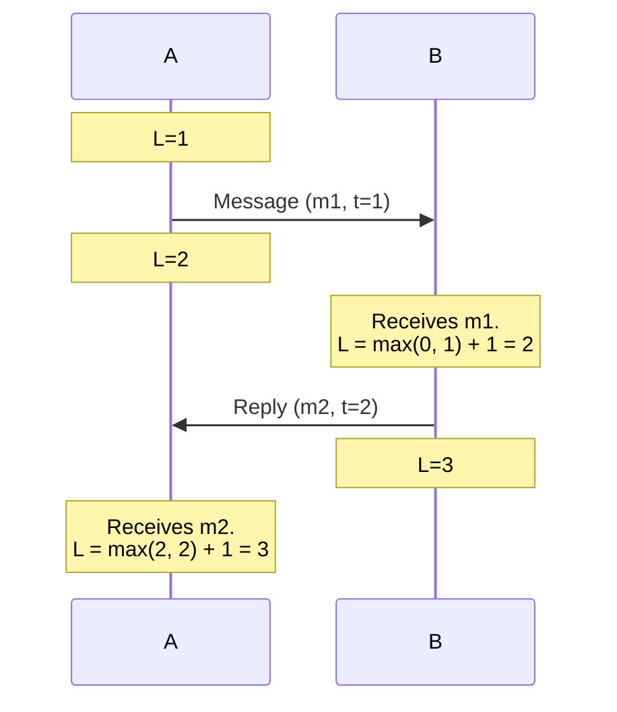
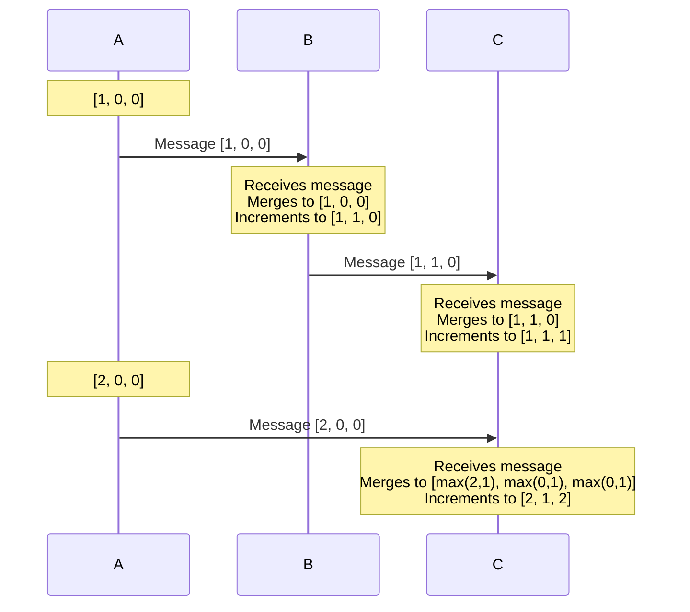
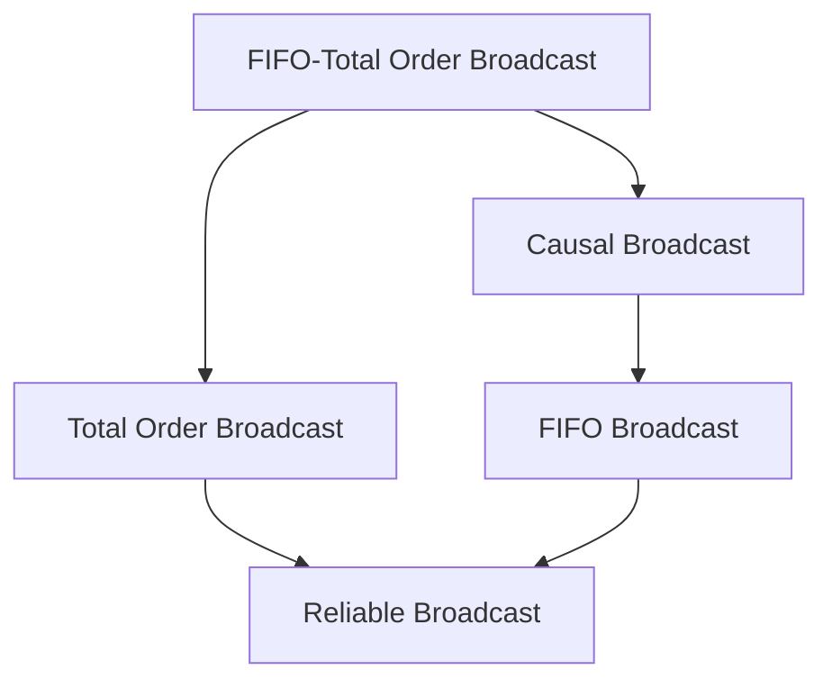
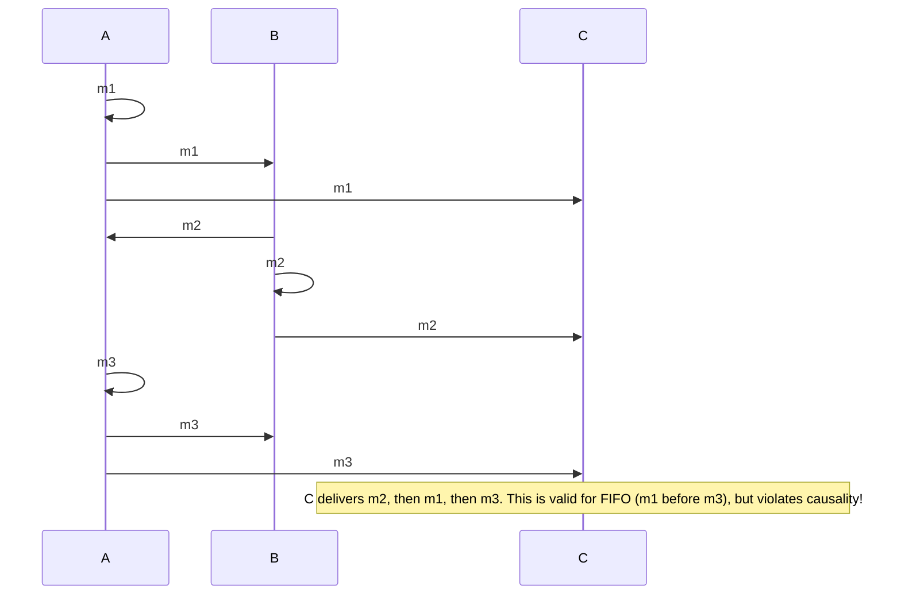
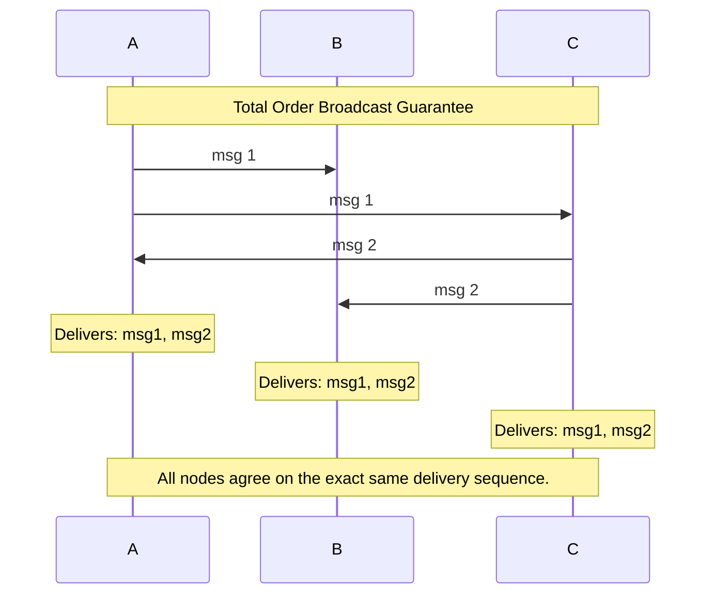

# Lecture 4: Broadcast Protocols and Logical Time

Because physical clocks are fundamentally unreliable for capturing causality (as shown in Lecture 3), distributed systems rely on **Logical Clocks**. Logical clocks don't measure seconds; they measure the number of *events* that have occurred.

## 4.1 Logical Time

There are two primary types of logical clocks used to enforce the happens-before relationship.

### 1. Lamport Clocks
Each node maintains a simple integer counter.

```python
# Lamport Clocks Pseudocode
on_initialisation():
    t = 0 # each node has its own local variable t

on_any_local_event():
    t = t + 1

on_request_to_send_message(m):
    t = t + 1
    send(t, m) via underlying network link

on_receiving_message(t_prime, m):
    t = max(t, t_prime) + 1
    deliver m to the application
```



**Properties of Lamport Clocks:**
* If event A happens before event B (`A → B`), then the timestamp of A will be strictly less than B (`L(A) < L(B)`).
* **The Limitation:** The reverse is *not* true! Just because `L(A) < L(B)`, you cannot prove that A caused B. They might have been completely concurrent.

To break ties and create a total order $\prec$, we include the node ID:
> [!IMPORTANT]
> **Formal Lamport Clock tie-breaking rule:**
> $(a \prec b) \iff (L(a) < L(b)) \lor (L(a) == L(b) \land N(a) < N(b))$

### 2. Vector Clocks
To truly detect concurrent events, we need Vector Clocks. Instead of a single integer, a Vector Clock is an array of integers, one for every node in the system (e.g., `[t_A, t_B, t_C]`).

```python
# Vector Clocks Pseudocode (for node Ni)
on_initialisation():
    T = [0, 0, ..., 0] # vector of size n

on_any_local_event():
    T[i] = T[i] + 1

on_request_to_send_message(m):
    T[i] = T[i] + 1
    send(T, m) via network

on_receiving_message(T_prime, m):
    for j in range(n):
        T[j] = max(T[j], T_prime[j])
    T[i] = T[i] + 1
    deliver m to the application
```



**Properties of Vector Clocks:**
Formal Vector Clock ordering operators:
* $T = T' \iff T[i] = T'[i]$ for all $i$
* $T \le T' \iff T[i] \le T'[i]$ for all $i$
* $T < T' \iff T \le T'$ and $T \neq T'$
* $T \parallel T'$ (concurrent) $\iff T \not\le T'$ and $T' \not\le T$

* You can mathematically compare two vectors. If every number in Vector A is less than or equal to Vector B, then A happened before B. 
* If Vector A is greater in one index, but Vector B is greater in a different index, the events are **concurrent**. Vector clocks *can* detect causality perfectly.
* **The Limitation:** They take up a lot of memory. If you have 10,000 clients, every message must carry an array of 10,000 integers.

**Exercise 10-14:** (Omitted for brevity - covers Lamport/Vector timestamps calculation, proving relations, and determining appropriate clock types).

---

## 4.2 Delivery Order in Broadcast Protocols

A Broadcast protocol delivers a message from one node to all nodes in a group. In a reliable broadcast, we guarantee that all non-faulty nodes will eventually deliver every message, but we must choose *what order* they deliver them in.

> [!NOTE]
> **Receiving vs. Delivering**
> ```mermaid
> graph LR
>     N[Network] -->|Receive| B[Broadcast Algorithm / Buffer]
>     B -->|Deliver| A[Application]
> ```
> The broadcast middleware may buffer or queue messages received from the network to ensure they are delivered to the application in the correct order.

There is a hierarchy of strictness:



1. **FIFO Broadcast (Weakest):**
   * Messages sent by the *same* node must be delivered in the order they were sent.
   * Messages sent by *different* nodes can arrive in any order.



2. **Causal Broadcast:**
   * Messages that are causally related (one is a reply to another) must be delivered in causal order.
   * Concurrent messages can arrive in any order.

3. **Total Order Broadcast (Atomic Broadcast):**
   * ALL nodes must deliver all messages in the **exact same order**. 
   * It doesn't matter what that order is, as long as every node agrees on the sequence.
   


4. **FIFO-Total Order Broadcast (Strongest):**
   * A combination: All nodes deliver everything in the exact same order, AND that order strictly respects the FIFO sending order of individual nodes.

**Exercise 15.** Prove relationships between causal, FIFO, and FIFO-total order broadcast.

---

## 4.3 Broadcast Algorithms

How do we actually implement these broadcasts over a network?

### Reliable Broadcast: Eager vs Gossip
* **Eager Reliable Broadcast:** The first time a node receives a message, it blasts it out to every other node in the network via reliable point-to-point links. Sends `O(n^2)` redundant messages.
* **Gossip Protocols:** A node randomly selects a few other nodes and sends the message to them. Extremely efficient and resilient, though lacking absolute guarantees.

### FIFO Broadcast Algorithm

```python
on_initialisation():
    sendSeq = 0
    delivered = [0, 0, ..., 0]
    buffer = {}

on_request_to_broadcast_m_at_node_Ni():
    send(i, sendSeq, m) via reliable broadcast
    sendSeq = sendSeq + 1

on_receiving_msg_via_reliable_broadcast():
    buffer.add(msg)
    while exists (sender, expectedSeq, m) in buffer where expectedSeq == delivered[sender]:
        deliver m to the application
        delivered[sender] = delivered[sender] + 1
```

### Causal Broadcast Algorithm

```python
on_initialisation():
    sendSeq = 0
    delivered = [0, 0, ..., 0]
    buffer = {}

on_request_to_broadcast_m_at_node_Ni():
    deps = copy(delivered)
    deps[i] = sendSeq
    send(i, deps, m) via reliable broadcast
    sendSeq = sendSeq + 1

on_receiving_msg_via_reliable_broadcast():
    buffer.add(msg)
    while exists (sender, deps, m) in buffer where deps <= delivered:
        deliver m to the application
        remove message from buffer
        delivered[sender] = delivered[sender] + 1
```

### Implementing Total Order Broadcast
Implementing Total Order is notoriously difficult. 
* **The Single Leader approach:** Funnel all messages to a single "Leader" node. The leader orders them and broadcasts them via FIFO. If the leader crashes, the system halts.
* **Total Order via Lamport Clocks:** 
  ```python
  # Attach Lamport timestamp to every message
  # Deliver messages in total order of timestamps
  # Problem: How to know if you've seen all messages with timestamp < T?
  # Solution: Use FIFO links and wait for a message with timestamp >= T from EVERY node.
  ```

**Exercise 16.** Give pseudocode for an algorithm that implements FIFO-total order broadcast using Lamport clocks.
