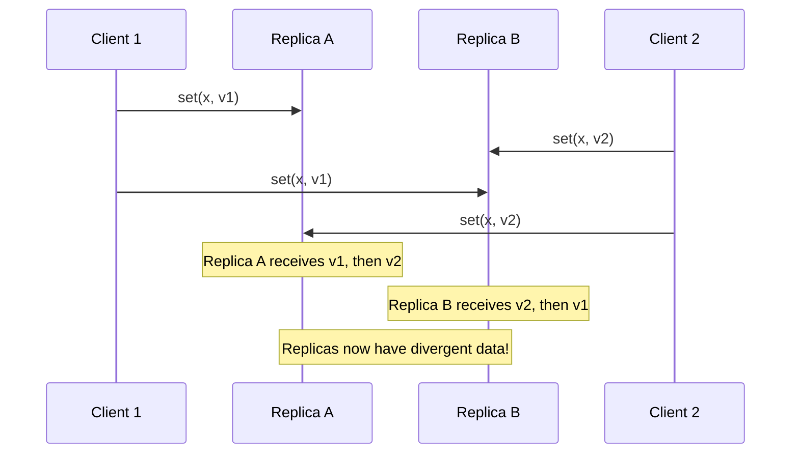
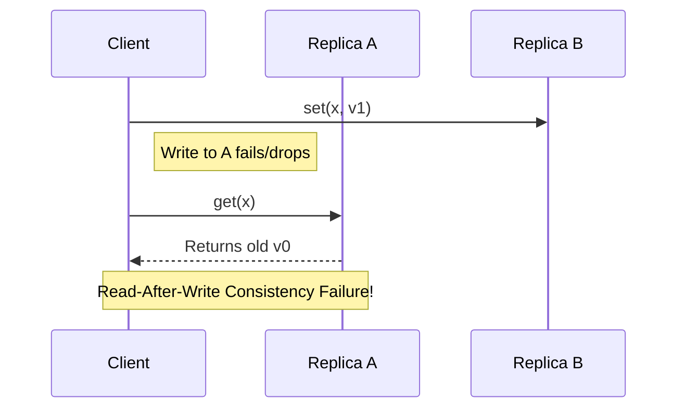
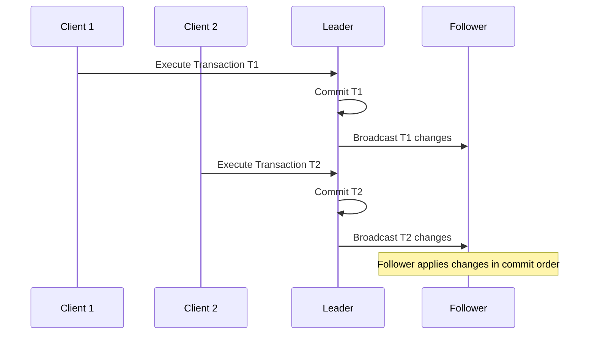

# Lecture 5: Replication

Replication means keeping a copy of the same data on multiple nodes, each of which is called a replica. It is the primary mechanism for achieving fault tolerance—if one node crashes, the data is still accessible on other nodes.

## 5.1 Manipulating Remote State

Replicating data that never changes is easy (just copy it once). The challenge is managing *changes* to state across multiple nodes.

### Retrying and Idempotence
When a client sends a write request to a database, the network might drop the acknowledgement. The client doesn't know if the write succeeded, so it retries.
* **The Danger:** Retrying a request like "Add $10 to my account" can result in being credited $20. 
* **The Solution (Idempotence):** We must design update operations to be *idempotent*. An idempotent function `f(x) = f(f(x))` means performing it multiple times has the exact same effect as performing it once. (e.g., "Set my balance to $100" is idempotent).

### Deletions and Tombstones
If you want to delete a record in a distributed database, you cannot simply erase it. If Node A deletes it, but Node B was offline during the deletion, Node B will eventually sync back up, see that Node A is "missing" the record, and unhelpfully restore it for you!
* **The Solution (Tombstones):** Instead of erasing the data, you overwrite it with a special flag `deleted = true`. This is called a tombstone. It tells the other nodes that the data was intentionally destroyed, not just missing. When nodes reconcile (anti-entropy), they use logical timestamps to keep the newer tombstone record and discard the older actual record.

### Handling Concurrent Writes
If two clients write to the same key at the exact same time, we have a conflict. 



There are two common approaches to resolving this:
1. **Last Writer Wins (LWW):** We attach a Lamport timestamp to both writes. The database simply accepts the write with the highest timestamp and silently discards the other. (Warning: This causes data loss).
2. **Multi-value Registers:** We use Vector Clocks. The database detects that the writes are concurrent, keeps *both* values (called siblings), and forces the application to merge them later.

**Exercise 17**
Apache Cassandra uses a replication approach similar to the one described here, but it uses physical timestamps instead of logical timestamps. Write a critique of this approach based on the blog post: https://www.datastax.com/blog/2013/09/why-cassandra-doesnt-need-vector-clocks. What do you think of its arguments and why? What facts are missing from it? What recommendation would you make to someone considering using Cassandra?

---

## 5.2 Quorums

Replication improves reliability because the probability of *all* replicas failing is much lower than one failing. If each replica has probability $p$ of being faulty, the probability of all $n$ replicas failing is $p^n$. For example, with $p = 0.01$ and $n = 3$, the probability of all failing is $10^{-6}$.

If we replicate data across nodes, how do we guarantee we read the freshest data?

Imagine we have two replicas, A and B. A client writes a new value to both, but the write to A fails. The client then tries to read the value. If it reads from A, it will get the old, stale data. This violates **Read-After-Write Consistency**.



### Read and Write Quorums
To fix this, we don't just write to one node or read from one node. We write to a *quorum* (a subset) of nodes, and read from a quorum of nodes. 

If we have $n$ replicas, we configure a write quorum $w$ and a read quorum $r$.
As long as **$w + r > n$**, it is mathematically guaranteed that the read quorum will intersect with the write quorum by at least one node. The reader simply looks at the timestamps returned by the nodes and picks the highest one.

```mermaid
graph TD
    subgraph Read Quorum (r=3)
    A((Node A))
    B((Node B))
    C((Node C))
    end
    
    subgraph Write Quorum (w=3)
    C
    D((Node D))
    E((Node E))
    end
    
    style C fill:#fff3cd,stroke:#28a745,stroke-width:4px
    Note[Intersection Node (C) guarantees<br/>read will see the latest write]
```

> [!TIP]
> **Majority Quorums**
> The most common configuration is a strict majority. For a 5-node cluster ($n=5$), you require 3 nodes to acknowledge a write ($w=3$), and you read from 3 nodes ($r=3$). 
> Since $3 + 3 > 5$, you have strict consistency, and the system can survive 2 nodes crashing without going offline.

### Read Repair (Dynamo-Style)
When a client reads from a quorum and notices that one of the replicas returned stale data, the client can actively help fix the database by sending the fresh data back to the lagging replica. This is called **Read Repair**, heavily popularized by Amazon's Dynamo database (and Apache Cassandra).

---

## 5.3 Replication using Broadcast

The Quorum approach essentially uses "best-effort broadcast." An alternative approach is to use the strict broadcast protocols we learned in Lecture 4.

### State Machine Replication (SMR)
If we use a **FIFO-Total Order Broadcast** to send every single database update to all replicas, we achieve State Machine Replication.
* Every replica receives the exact same sequence of updates in the exact same order.
* As long as the database logic is *deterministic*, every replica will end up in the exact same state.
* **Blockchains** and smart contracts are essentially just State Machine Replication running over a Total Order Broadcast!

```python
# State Machine Replication (SMR) Pseudocode
on request to perform update u do:
    send u via FIFO-total order broadcast

on delivering u through FIFO-total order broadcast do:
    update state using arbitrary deterministic logic!
```

### Active vs. Passive Replication
SMR is also known as **Active Replication**, since every node independently executes the deterministic update logic.

An alternative is **Passive Replication** (or **Primary-Backup Replication**). Here, one node is designated as the **Leader**. The leader executes the transaction logic and simply uses total order broadcast to send the resulting *state changes* (data updates) to the followers.



### Commutativity and Weaker Broadcasts
Do we *always* need total order broadcast? Not if the updates are commutative!
If update functions $f$ and $g$ commute (i.e., $f(g(x)) = g(f(x))$), replicas can process updates in different orders and still end up in the exact same state. 
* Total order broadcast: required for arbitrary deterministic logic.
* Causal broadcast: required if concurrent updates commute.
* Reliable broadcast: required if *all* updates commute.
