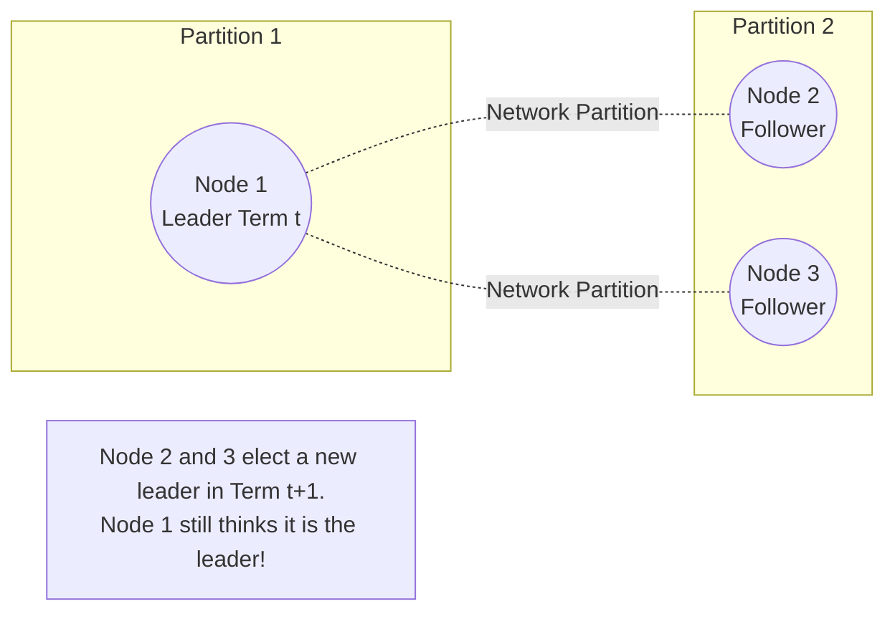
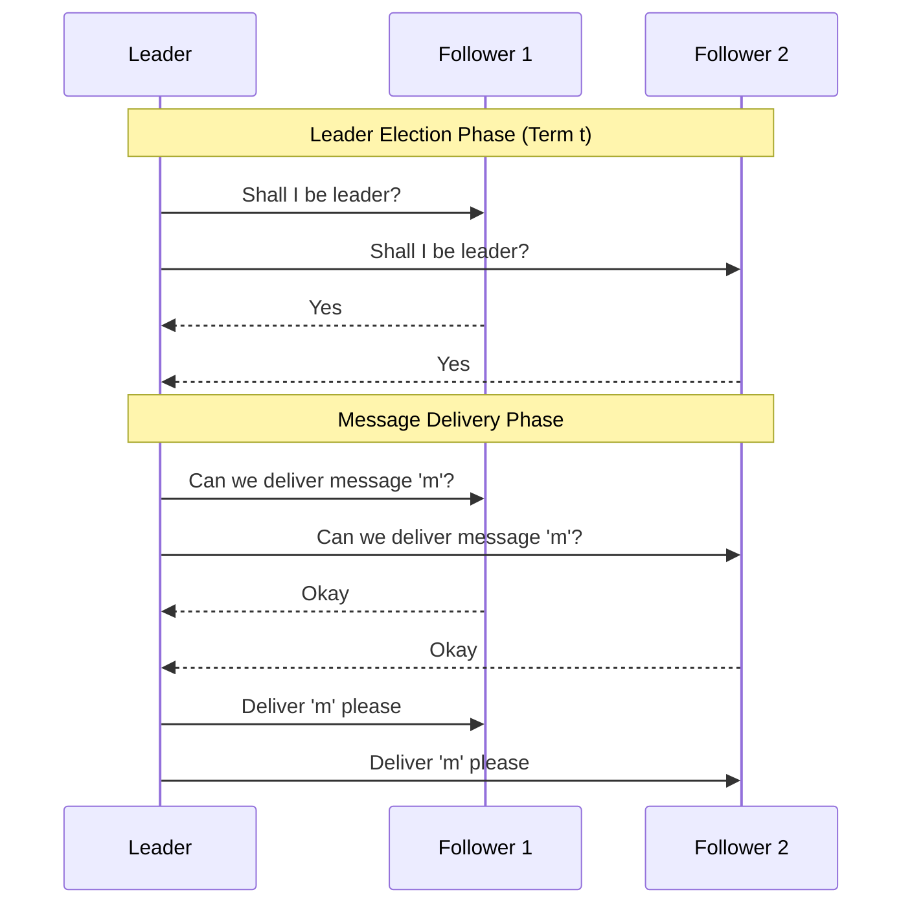
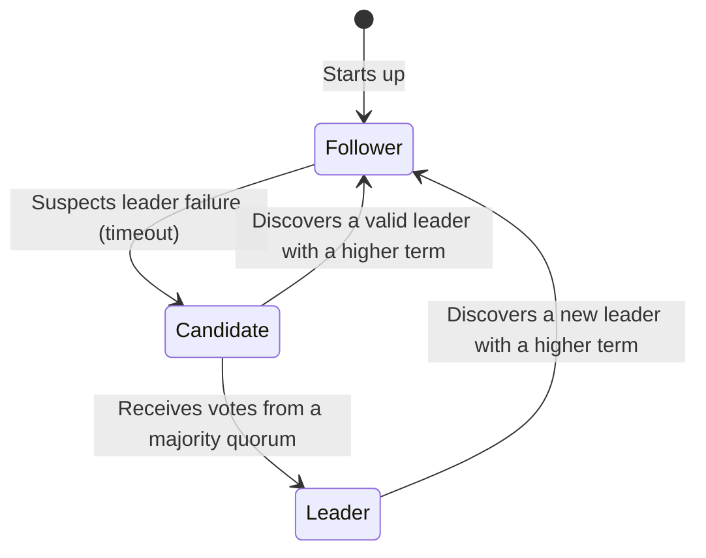

# Lecture 6: Consensus

As we saw in Lecture 5, **Total Order Broadcast** is incredibly powerful for database replication, but it usually relies on a single Leader node to sequence the messages. If that leader crashes, the system stops. 

To overcome this, systems historically relied on **Manual Failover**: a human operator gets notified of the crash and manually reconfigures the nodes to point to a new leader. While fine for planned maintenance, it is far too slow for unplanned outages. To make the system truly fault-tolerant, we need the nodes to automatically agree on who the *new* leader should be.

This requires **Consensus**—an automatic leader election.

## 6.1 Introduction to Consensus

The Consensus problem is defined as: *Several nodes want to come to an agreement about a single value. Once a decision is made, it is final.*

It has been mathematically proven that **Consensus and Total Order Broadcast are exactly equivalent**. If you can solve one, you can solve the other.
* **Famous Algorithms:** Paxos, Multi-Paxos, Raft, Zab (ZooKeeper).

### System Models and The FLP Impossibility Result
A famous theorem by Fischer, Lynch, and Paterson (FLP) proved that in a purely *asynchronous* system (where messages can be delayed infinitely), **no deterministic consensus algorithm is guaranteed to ever terminate**. 
* Because of this, practical consensus algorithms like Raft must assume a **Partially Synchronous** system. They rely on local clocks and timeouts to detect leader crashes and ensure the algorithm eventually makes progress.

Algorithms like Raft and Paxos assume a **Crash-Recovery** system model with fair-loss links. There are also consensus algorithms designed for a **Byzantine** system model (used in blockchains), but they are significantly more complex and less efficient than crash-recovery consensus.

### Leader Election and Split Brain
When a leader crashes, the remaining nodes must elect a new one. The biggest danger during an election is **Split Brain**—a scenario where two different nodes both believe they are the leader at the same time. If this happens, they will sequence updates differently, destroying the database's consistency.

```mermaid
graph TD
    subgraph Election Quorum for Node A (Majority)
    A((Node A))
    B((Node B))
    C((Node C))
    end
    
    subgraph Election Quorum for Node E (Majority)
    C
    D((Node D))
    E((Node E))
    end
    
    style C fill:#f8d7da,stroke:#dc3545,stroke-width:4px
    
    Note[Because Node C can only vote ONCE per term,<br/>it is mathematically impossible for both<br/>Node A and Node E to win the election.]
```

To prevent Split Brain, consensus algorithms use **Quorums**. A node can only become the leader if it receives votes from a *majority quorum* of the nodes in the cluster. Because any two majority quorums must overlap by at least one node, it is mathematically impossible for two nodes to win an election at the same time *in the same term*.

### Multiple Leaders Across Terms and Quorum Verification
While we can guarantee only one leader per term, we cannot prevent multiple leaders from existing across *different* terms due to network partitions. 



Because of this, an old leader might still be blindly accepting requests, completely unaware that it has been usurped! To guarantee safety, **a leader must verify its quorum before delivering any message**. 


If a new leader had been elected, the old leader would find out during this second round-trip because at least one follower in the quorum would have already voted for the new term and would reject the old leader's request.

---

## 6.2 The Raft Consensus Algorithm

Raft is a consensus algorithm explicitly designed to provide a fault-tolerant **FIFO-Total Order Broadcast** out of the box.

### Node States
In Raft, a node is always in one of three states:
1. **Follower:** Passively receives log entries from the Leader.
2. **Candidate:** If a Follower stops hearing from the Leader (its randomized election timeout fires), it becomes a Candidate and requests votes from the cluster.
3. **Leader:** The node that won the election. It accepts writes from clients and replicates them to the Followers.



### Log Consistency Checks
Raft divides time into **Terms** (an incrementing integer). Every leader election increments the Term.
To ensure no committed data is ever lost, a follower performs a strict **Log Consistency Check** before accepting a candidate's vote request or a leader's append request. The follower checks that its local log matches the sender's log. Specifically, they check that the *term* of the last log entry matches, and if so, that the lengths are consistent. If a follower's log is found to be inconsistent with a new leader, the follower truncates its local log to match the leader's exact history.

### The Full Raft Algorithm Pseudocode

Below is the complete pseudocode for the Raft algorithm, spanning node initialization, leader election, and log replication.

```python
# 1. Initialisation
on initialisation do:
    currentTerm := 0; votedFor := null
    log := []; commitLength := 0
    currentRole := follower; currentLeader := null
    votesReceived := {}; sentLength := []; ackedLength := []

on recovery from crash do:
    currentRole := follower; currentLeader := null
    votesReceived := {}; sentLength := []; ackedLength := []

on node nodeId suspects leader has failed, or on election timeout do:
    currentTerm := currentTerm + 1; currentRole := candidate
    votedFor := nodeId; votesReceived := {nodeId}; lastTerm := 0
    if log.length > 0 then lastTerm := log[log.length - 1].term
    msg := (VoteRequest, nodeId, currentTerm, log.length, lastTerm)
    for each node in nodes: send msg to node
    start election timer

# 2. Voting on a new leader
on receiving (VoteRequest, cId, cTerm, cLogLength, cLogTerm) at node nodeId do:
    if cTerm > currentTerm then:
        currentTerm := cTerm; currentRole := follower
        votedFor := null
    lastTerm := 0
    if log.length > 0 then lastTerm := log[log.length - 1].term
    logOk := (cLogTerm > lastTerm) or (cLogTerm == lastTerm and cLogLength >= log.length)
    if cTerm == currentTerm and logOk and votedFor in {cId, null} then:
        votedFor := cId
        send (VoteResponse, nodeId, currentTerm, true) to node cId
    else:
        send (VoteResponse, nodeId, currentTerm, false) to node cId

# 3. Collecting votes
on receiving (VoteResponse, voterId, term, granted) at nodeId do:
    if currentRole == candidate and term == currentTerm and granted then:
        votesReceived := votesReceived U {voterId}
        if len(votesReceived) >= (len(nodes) + 1) // 2:
            currentRole := leader; currentLeader := nodeId
            cancel election timer
            for each follower in nodes \ {nodeId} do:
                sentLength[follower] := log.length
                ackedLength[follower] := 0
                ReplicateLog(nodeId, follower)
    else if term > currentTerm then:
        currentTerm := term
        currentRole := follower
        votedFor := null
        cancel election timer

# 4. Broadcasting messages
on request to broadcast msg at node nodeId do:
    if currentRole == leader then:
        append the record (msg: msg, term: currentTerm) to log
        ackedLength[nodeId] := log.length
        for each follower in nodes \ {nodeId} do:
            ReplicateLog(nodeId, follower)
    else:
        forward the request to currentLeader via a FIFO link

periodically at node nodeId do:
    if currentRole == leader then:
        for each follower in nodes \ {nodeId} do:
            ReplicateLog(nodeId, follower)

# 5. Replicating from leader to followers
function ReplicateLog(leaderId, followerId):
    prefixLen := sentLength[followerId]
    suffix := [log[prefixLen], ..., log[log.length - 1]]
    prefixTerm := 0
    if prefixLen > 0 then prefixTerm := log[prefixLen - 1].term
    send (LogRequest, leaderId, currentTerm, prefixLen, prefixTerm, commitLength, suffix) to followerId

# 6. Followers receiving messages
on receiving (LogRequest, leaderId, term, prefixLen, prefixTerm, leaderCommit, suffix) at node nodeId do:
    if term > currentTerm then:
        currentTerm := term; votedFor := null
        cancel election timer
    if term == currentTerm then:
        currentRole := follower; currentLeader := leaderId
    
    logOk := (log.length >= prefixLen) and (prefixLen == 0 or log[prefixLen - 1].term == prefixTerm)
    if term == currentTerm and logOk then:
        AppendEntries(prefixLen, leaderCommit, suffix)
        ack := prefixLen + suffix.length
        send (LogResponse, nodeId, currentTerm, ack, true) to leaderId
    else:
        send (LogResponse, nodeId, currentTerm, 0, false) to leaderId

# 7. Updating followers' logs
function AppendEntries(prefixLen, leaderCommit, suffix):
    if suffix.length > 0 and log.length > prefixLen then:
        index := min(log.length, prefixLen + suffix.length) - 1
        if log[index].term != suffix[index - prefixLen].term then:
            log := [log[0], ..., log[prefixLen - 1]]
    if prefixLen + suffix.length > log.length then:
        for i := log.length - prefixLen to suffix.length - 1 do:
            append suffix[i] to log
    if leaderCommit > commitLength then:
        for i := commitLength to leaderCommit - 1 do:
            deliver log[i].msg to the application
        commitLength := leaderCommit

# 8. Leader receiving log acknowledgements
on receiving (LogResponse, follower, term, ack, success) at nodeId do:
    if term == currentTerm and currentRole == leader then:
        if success == true and ack >= ackedLength[follower] then:
            sentLength[follower] := ack
            ackedLength[follower] := ack
            CommitLogEntries()
        else if sentLength[follower] > 0 then:
            sentLength[follower] := sentLength[follower] - 1
            ReplicateLog(nodeId, follower)
    else if term > currentTerm then:
        currentTerm := term
        currentRole := follower
        votedFor := null
        cancel election timer

# 9. Leader committing log entries
function CommitLogEntries():
    minAcks := (len(nodes) + 1) // 2
    ready := {len in {1, ..., log.length} | acks(len) >= minAcks}
    if ready != {} and max(ready) > commitLength and log[max(ready) - 1].term == currentTerm then:
        for i := commitLength to max(ready) - 1 do:
            deliver log[i].msg to the application
        commitLength := max(ready)
```

**Exercise 18**
Three nodes are executing the Raft algorithm. At one point in time, each node has the following log:
- Node A: `(msg: m1, term: 1)`, `(msg: m2, term: 1)`
- Node B: `(msg: m1, term: 1)`, `(msg: m4, term: 2)`, `(msg: m5, term: 2)`, `(msg: m6, term: 2)`
- Node C: `(msg: m1, term: 1)`, `(msg: m4, term: 2)`, `(msg: m7, term: 3)`

(a) Explain what events may have occurred that caused the nodes to be in this state.
(b) What are the possible values of the commitLength variable at each node?
(c) Node A starts a leader election in term 4, while the nodes are in the state above. Is it possible for it to obtain a quorum of votes? What if the election was instead started by one of the other nodes?
(d) Assume that node B is elected leader in term 4, while the nodes are in the state above. Give the sequence of messages exchanged between B and C following this election.
