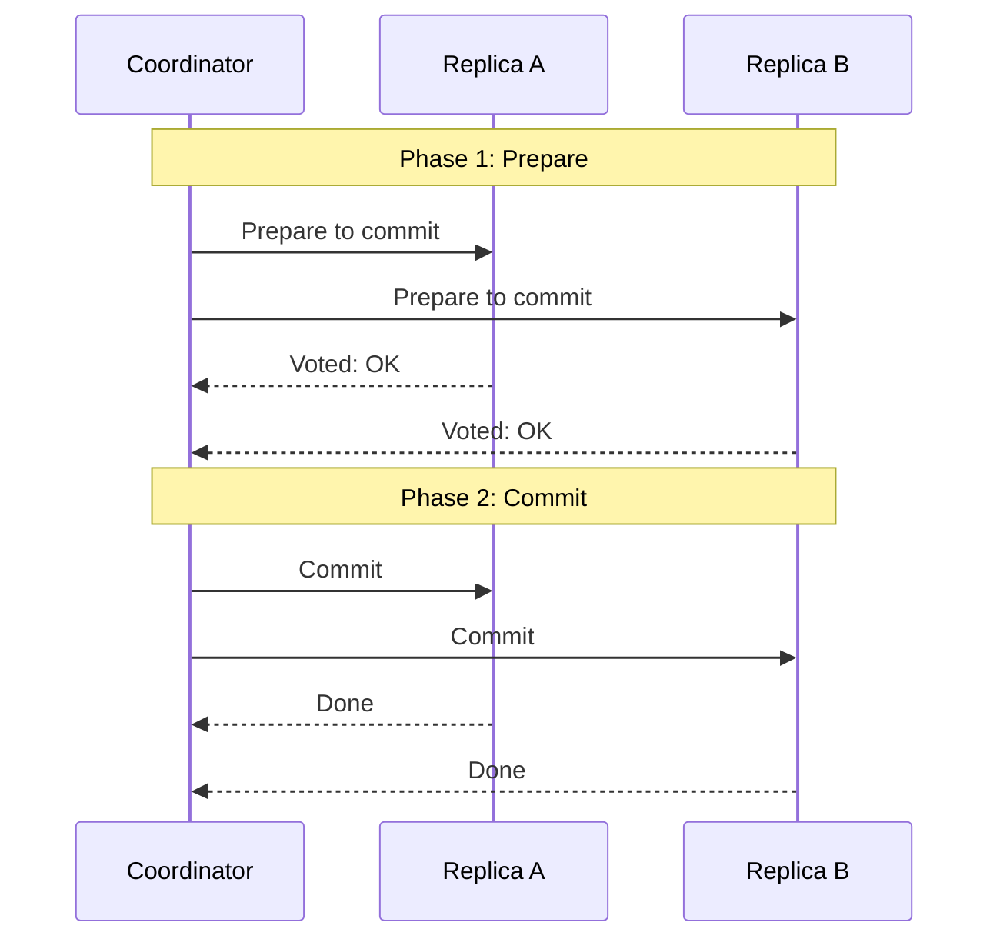
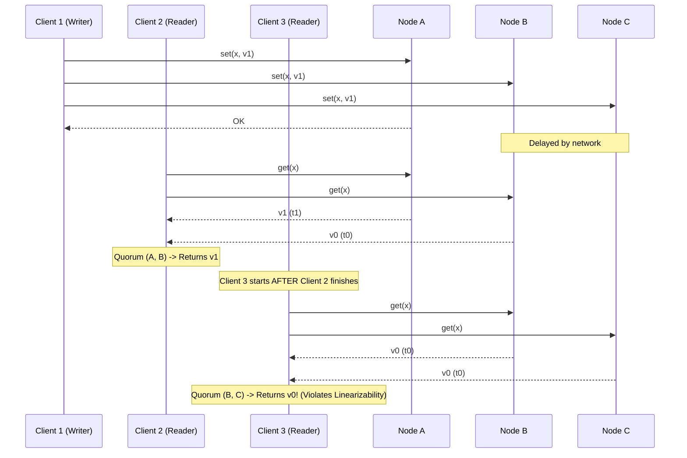
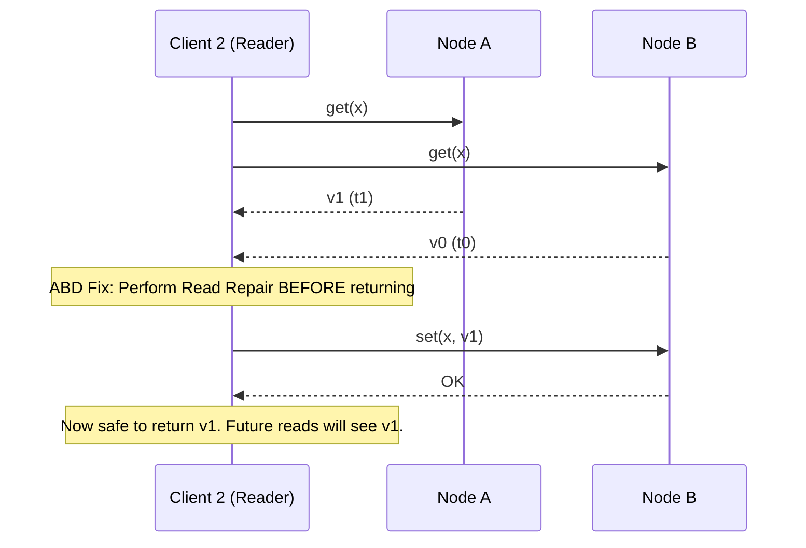
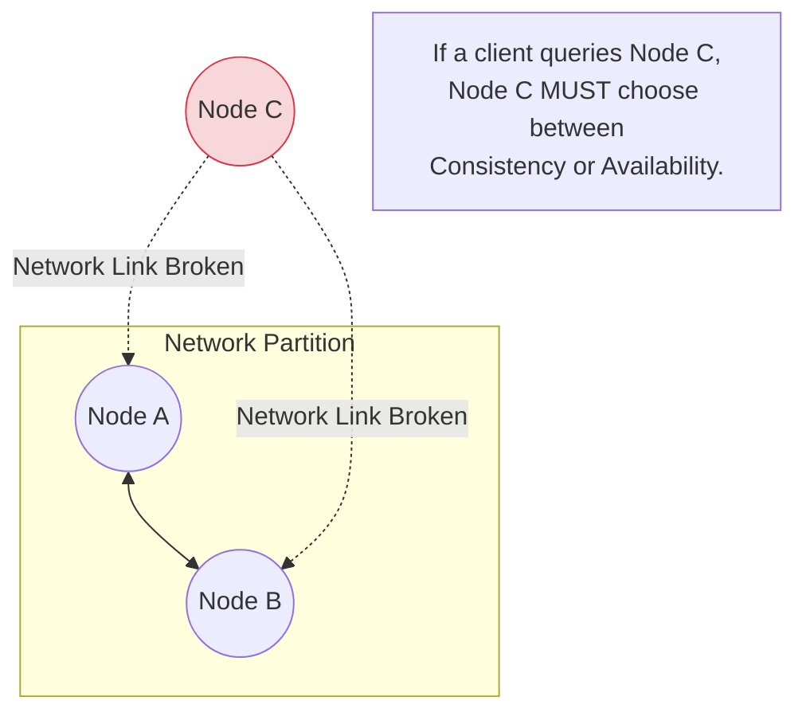
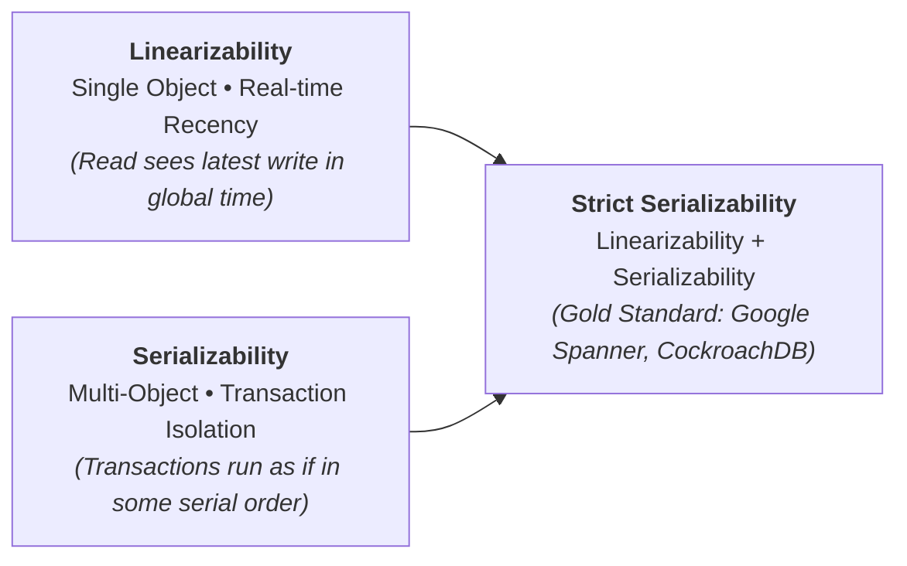

# Lecture 7: Replica Consistency

In distributed systems, the word "Consistency" is heavily overloaded. 
* In ACID transactions, the 'C' means the database transitions from one valid state to another (satisfying application invariants, like "balance >= 0").
* In Distributed Systems, Consistency refers to the guarantees provided when reading from and writing to multiple replicas.

## 7.1 Two-Phase Commit (2PC)

When a transaction spans multiple nodes (e.g., deducting money from Bank A and adding it to Bank B), we must ensure **Atomicity**: either *all* nodes commit the transaction, or *all* nodes abort it. This is the **Atomic Commitment** problem.

The most common solution is the **Two-Phase Commit (2PC)** protocol, managed by a Coordinator node:



1. **Phase 1 (Prepare):** The Coordinator asks all participating nodes, "Are you ready to commit?" The nodes write the transaction data to disk, lock the rows, and reply "OK."
2. **Phase 2 (Commit/Abort):** If *all* nodes reply "OK", the Coordinator logs a "Commit" decision and tells all nodes to execute the commit. If *any* node replies "No" or times out, the Coordinator tells all nodes to abort and rollback.

**The Problem with 2PC:**
The Coordinator is a single point of failure. If the Coordinator crashes *after* the nodes have voted "OK" but *before* it broadcasts the final decision, the nodes are stuck. They cannot unilaterally abort (another node might have received the commit message), so they must hold their database locks indefinitely until the Coordinator reboots. This can halt the entire database.

### Fault-Tolerant Two-Phase Commit

To avoid the single point of failure of the coordinator, modern systems can use **Total Order Broadcast** (like Paxos) to replicate the coordinator's state and decisions. In Paxos Commit, every node participating in the transaction uses Total Order Broadcast to disseminate its vote on whether to commit or abort.

```python
# Fault-Tolerant 2PC using Total Order Broadcast

on initialisation for transaction T do
    commitVotes[T] := {}
    replicas[T] := {}
    decided[T] := False
    
on request to commit transaction T with participating nodes R do
    for each r in R do
        send (Prepare, T, R) to r

on receiving (Prepare, T, R) at node replicaId do
    replicas[T] := R
    ok = "is transaction T able to commit on this replica?"
    total_order_broadcast(Vote, T, replicaId, ok) to replicas[T]

on a node suspects node replicaId to have crashed do
    for each transaction T in which replicaId participated do
        total_order_broadcast(Vote, T, replicaId, False) to replicas[T]

on delivering (Vote, T, replicaId, ok) by total order broadcast do
    if replicaId not in commitVotes[T] and replicaId in replicas[T] and not decided[T]:
        if ok == True:
            commitVotes[T].add(replicaId)
            if commitVotes[T] == replicas[T]:
                decided[T] := True
                commit transaction T at this node
        else:
            decided[T] := True
            abort transaction T at this node
```

By counting only the *first* vote delivered from each replica via the totally ordered sequence, all nodes independently arrive at the exact same commit/abort decision, even if some nodes suspected failures and broadcasted aborts on behalf of others.

---

## 7.2 Linearizability

Linearizability (often called "Strong Consistency") is the gold standard for distributed data. 
**Definition:** A system is linearizable if every operation appears to take effect atomically at exactly one moment in time, and all subsequent operations observe that updated state. It makes a replicated database look and behave exactly like a single, non-replicated machine.

> [!NOTE] 
> Linearizability is defined in terms of **real time**, as if observed by a hypothetical global observer who can instantaneously see the state of all nodes. It requires that if operation A finishes before operation B starts, B must observe A's effect—even if the nodes haven't communicated (unlike the happens-before relationship).

> [!WARNING]
> Do not confuse linearizability with serializability! Serializability means transactions behave as if executed sequentially (preventing write-write anomalies), while linearizability guarantees real-time, up-to-date reads. A system providing *both* is said to have **Strict Serializability** (or One-Copy Serializability).

### The Problem: Non-Linearizable Quorum Reads

Even with quorum reads and writes, a system can violate linearizability if it allows a client to read an old value after another client has already read the new value.



### Implementing Linearizability (ABD Algorithm)

To make quorum reads linearizable, the client must perform a **Read Repair** during the read. If the client queries a quorum and sees mismatched timestamps, it must write the freshest value back to the lagging replicas *before* returning the value to the application.



**Multi-writer ABD Extension:**
If multiple clients can write, we must ensure their timestamps reflect real-time ordering. A writer must first request the latest timestamp from a quorum, then use `logical timestamp = 1 + max_timestamp`. To prevent two clients from generating the same timestamp, ties are broken using the client ID.

### Linearizable Compare-and-Swap (CAS)
While the ABD algorithm works for blind writes and reads, it cannot handle atomic Compare-and-Swap operations safely. To achieve a perfectly linearizable CAS operation across replicas, you must use **Total Order Broadcast** (Consensus).

```python
# Linearizable CAS using Total Order Broadcast

on request to perform get(x) do
    total_order_broadcast(get, x) and wait for delivery

on request to perform CAS(x, old, new) do
    total_order_broadcast(CAS, x, old, new) and wait for delivery

on delivering (get, x) by total order broadcast do
    return localState[x] as result of operation get(x)

on delivering (CAS, x, old, new) by total order broadcast do
    success := False
    if localState[x] == old:
        localState[x] := new
        success := True
    return success as result of operation CAS(x, old, new)
```

---

## 7.3 Eventual Consistency and the CAP Theorem

Linearizability provides great guarantees, but it is slow (requires waiting on quorums) and brittle (if a network partition separates a node from the quorum, it cannot answer queries).

### The CAP Theorem



The CAP Theorem states that in the presence of a **Network Partition (P)**, you must choose between:
* **Consistency (C):** Guaranteeing Linearizability, meaning minority nodes (like Node C) must refuse to answer queries because they cannot contact the quorum (sacrificing Availability).
* **Availability (A):** Allowing minority nodes to answer queries using their local, potentially stale data (sacrificing Consistency).

> [!IMPORTANT]
> The phrase "Pick 2 out of 3" is misleading. You don't pick between C, A, and P. Network partitions are a fact of physical networks; they happen. Therefore, the choice is *only forced during a partition*: you must then choose between Consistency and Availability.

### System Model Requirements

Different consistency models require different levels of synchrony and waiting:

| Problem | Must wait for communication | Requires Synchrony |
| :--- | :--- | :--- |
| Atomic Commit | All participating nodes | Partially Synchronous |
| Consensus / TOB / Linearizable CAS | Quorum | Partially Synchronous |
| Linearizable get/set (ABD) | Quorum | Asynchronous |
| Eventual Consistency / Causal Broadcast | Local replica only | Asynchronous |

### Eventual Consistency
Systems that prioritize Availability use **Optimistic Replication**. Nodes accept writes locally while offline and sync with the cluster later. 
* **Guarantee:** If no new updates are made, *eventually* all replicas will converge to the same state.
* **The Trade-off:** Because nodes accept writes without coordinating, you will inevitably get **Conflicts**. The system must have a strategy for resolving these conflicts.

---

## Staff / Principal Interview Strategy: Consistency Models & PACELC

In Staff and Principal design interviews, you are expected to articulate consistency guarantees far beyond the introductory CAP theorem:

### 1. Linearizability vs. Serializability (The Ultimate Comparison)



| Dimension | **Linearizability** | **Serializability** | **Strict Serializability** |
| :--- | :--- | :--- | :--- |
| **Scope** | Single object / register | Multiple objects / transactions | Multiple objects + real-time ordering |
| **Core Guarantee** | Real-time recency: once a write returns, all subsequent reads globally must see it. | Multi-statement transactions execute as if they ran sequentially one-by-one. | Transactions are serializable AND respect global wall-clock time order. |
| **Enforced By** | Consensus (Raft/Paxos), ABD algorithm | Two-Phase Locking (2PL), Serializable Snapshot Isolation (SSI) | Spanner TrueTime + Paxos + 2PC |

### 2. The PACELC Theorem (Why CAP is Incomplete)
CAP only describes system behavior during a rare **Network Partition ($P$)**. The **PACELC Theorem** (Daniel Abadi) explains how systems behave during normal operations:

$$\text{If } \mathbf{P} \text{ (Partition)} \implies \text{Trade off } \mathbf{A} \text{ (Availability) vs. } \mathbf{C} \text{ (Consistency)}$$
$$\text{Else } \mathbf{E} \implies \text{Trade off } \mathbf{L} \text{ (Latency) vs. } \mathbf{C} \text{ (Consistency)}$$

* **$PA / EL$ Systems (DynamoDB, Cassandra)**:
  * Under partition: Prioritize Availability ($PA$).
  * Under normal operation: Prioritize low Latency over strict consistency ($EL$) by reading/writing to local nodes without waiting for global quorum sync.
* **$PC / EC$ Systems (Spanner, CockroachDB, ZooKeeper, MongoDB default)**:
  * Under partition: Prioritize Consistency ($PC$) by rejecting writes if a quorum cannot be reached.
  * Under normal operation: Prioritize Consistency ($EC$) by paying the round-trip latency to replicate writes across quorums before acknowledging clients.

### 3. The ABD Algorithm & Synchronous Read-Repair
How do you achieve linearizable reads from a leaderless cluster without a leader?
* **The Attiya-Bar-Noy-Dolev (ABD) Protocol**:
  1. **Phase 1 (Read Quorum)**: Query a quorum of nodes, retrieve the value with the highest version/timestamp.
  2. **Phase 2 (Write-Back Quorum)**: Before returning the value to the client, the reader **must write that highest value back to a quorum of nodes**.
* **Why Phase 2 is Mandatory**: If a previous write died halfway through, the write-back ensures that any subsequent reader is guaranteed to observe the same or newer value, preventing time from moving backwards.
