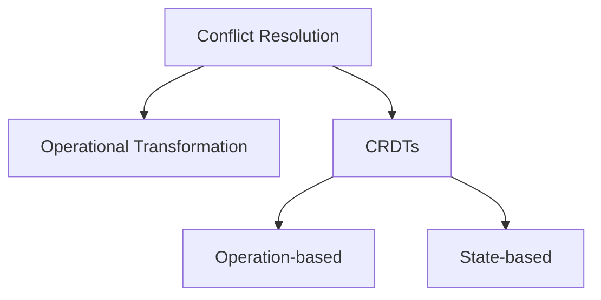
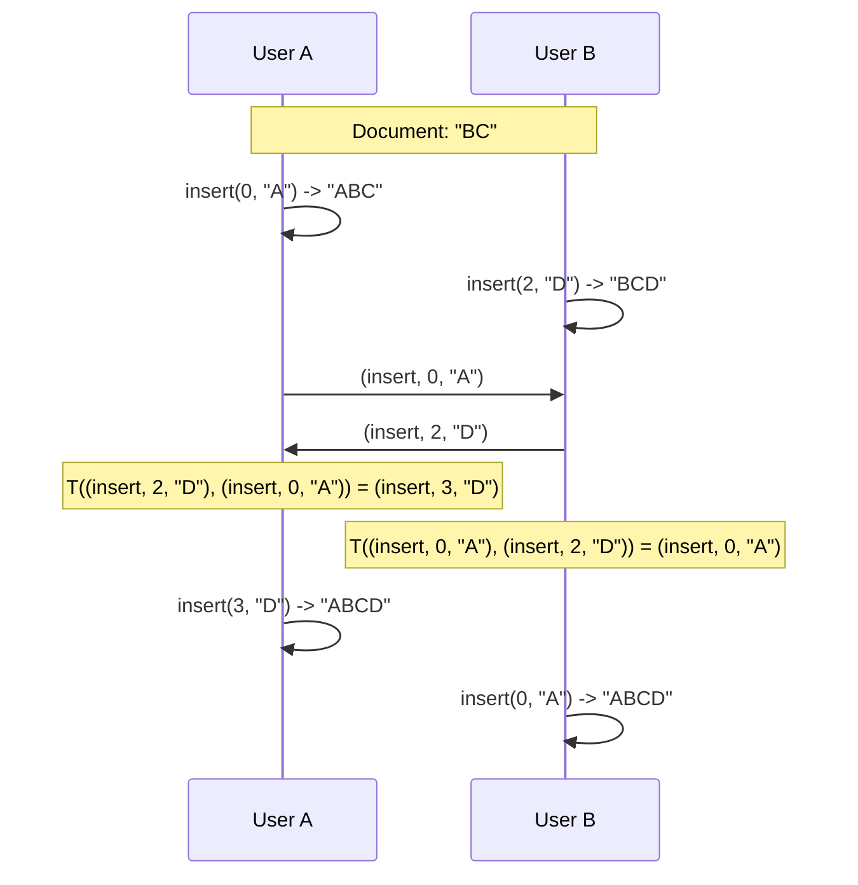
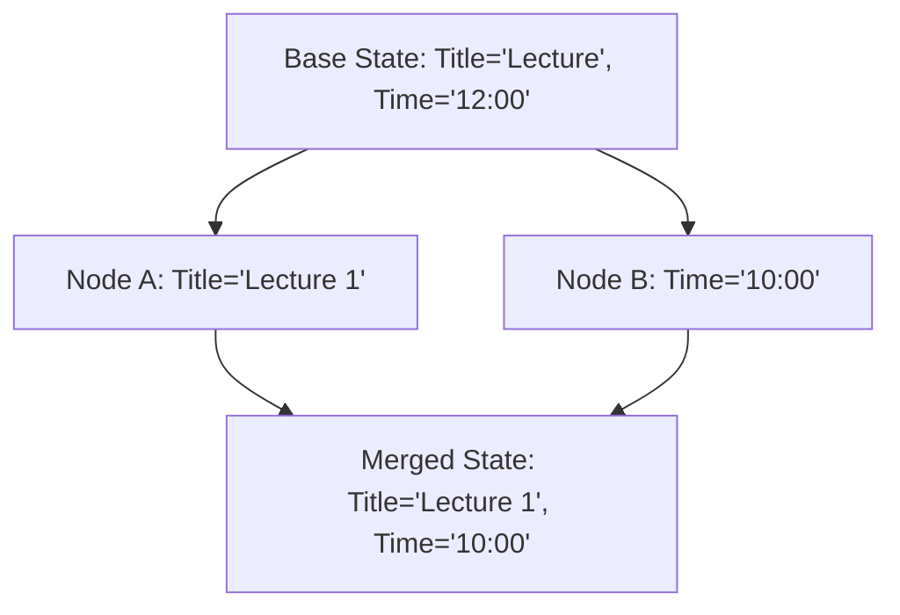
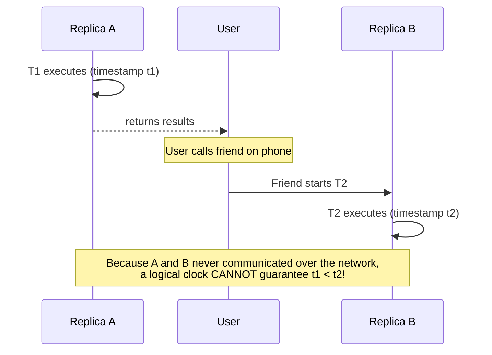
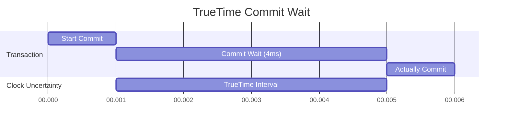

# Lecture 8: Case Studies

In this final lecture, we look at how the theoretical concepts of logical time, broadcasting, and consistency models are applied in two massive, real-world systems: Collaborative text editing (like Google Docs) and Google's Spanner database.

## 8.1 Collaboration and Conflict Resolution

Collaboration software (Google Docs, Figma, Trello) allows multiple users to edit the same data concurrently. From a distributed systems perspective, every user's device is a replica, and the system uses **Optimistic Replication** to provide strong eventual consistency. 

Because users can edit offline or simultaneously, **Conflicts** are guaranteed to happen. There are three main algorithms to resolve these conflicts automatically:



### Strong Eventual Consistency
While basic eventual consistency just guarantees that state will match if updates stop, **Strong Eventual Consistency (SEC)** provides formal guarantees:
1. **Eventual delivery**: Every update made to one non-faulty replica is eventually processed by every non-faulty replica.
2. **Convergence**: Any two replicas that have processed the same set of updates are in the same state (even if they were processed in a different order).

### 1. Operational Transformation (OT)
Used by Google Docs (via the Jupiter system). 
* When two users type at the same time, the server looks at their operations and mathematically transforms the indexes so they don't overwrite each other.
* **The Transformation Function:** `T(op1, op2)` takes an incoming operation `op1` and a concurrent local operation `op2`, returning a transformed operation `op1'` such that applying `op1'` to the local state has the effect originally intended by `op1`.



* **The Catch:** OT requires a central server (a Leader) to sequence the operations via Total Order Broadcast. It does not work well in decentralized, peer-to-peer networks.

### 2. Conflict-Free Replicated Data Types (CRDTs)
CRDTs are data structures explicitly designed so that concurrent updates can be merged mathematically without conflicts, *without* needing a central server. 

#### Operation-based CRDTs
The system broadcasts the *operation* itself (e.g., "Set X to 5"). Requires **Reliable Broadcast** so no operations are lost.

**Operation-based Map CRDT Pseudocode (Last-Writer-Wins):**
```python
on initialisation do
    values := {}

on request to read value for key k do
    if exists (t, k, v) in values: return v else: return null

on request to set key k to value v do
    t := newTimestamp() # globally unique, e.g. Lamport
    broadcast (set, t, k, v) by reliable broadcast

on delivering (set, t, k, v) by reliable broadcast do
    previous := {(t', k', v') in values | k' == k}
    if previous == {} or for all (t', k', v') in previous: t' < t:
        values := (values \ previous) U {(t, k, v)}
```

#### State-based CRDTs
The system broadcasts the *entire state* of the replica, and the recipient runs a merge function (operator $\sqcup$) to combine it with its own state. The merge function mathematically guarantees convergence by satisfying three properties:
* **Commutative:** $s_1 \sqcup s_2 = s_2 \sqcup s_1$
* **Associative:** $(s_1 \sqcup s_2) \sqcup s_3 = s_1 \sqcup (s_2 \sqcup s_3)$
* **Idempotent:** $s_1 \sqcup s_1 = s_1$

This allows the use of sloppy **Best-Effort Broadcast** (like Gossip protocols) because lost or duplicated messages don't matter as long as the states eventually sync.

**State-based Map CRDT Pseudocode (Last-Writer-Wins):**
```python
# Merge operator: takes highest timestamp for each key
s1 U s2 = {(t, k, v) in (s1 U s2) | no element exists with same key and higher timestamp}

on initialisation do
    values := {}

on request to set key k to value v do
    t := newTimestamp()
    values := {(t', k', v') in values | k' != k} U {(t, k, v)}
    broadcast values by best-effort broadcast

on delivering V by best-effort broadcast do
    values := values U V
```

#### Calendar Conflict Resolution Example


#### Text Editing with CRDTs
Instead of using array indexes (which shift when someone types), text CRDTs assign a mathematically infinite fractional identifier between 0 and 1 to every character. 
* If 'A' is at `0.2` and 'C' is at `0.3`, a user can insert 'B' concurrently at `0.25`. 
* To break ties when two users concurrently insert at the exact same position, the CRDT incorporates the unique `nodeId` of the client.
* Since the IDs never shift, operations are commutative.
* **Requirement:** Text CRDTs use **Causal Broadcast**. Why? Because the deletion of a character and the insertion of that same character do not commute. Causal broadcast guarantees that a character's insertion is delivered before its deletion.

**Operation-based Text CRDT Pseudocode:**
```python
on request to insert character v at index idx at node nodeId do
    (p1, n1, v1) := ElementAt(chars, idx)
    (p2, n2, v2) := ElementAt(chars, idx + 1)
    new_p := (p1 + p2) / 2
    broadcast (insert, new_p, nodeId, v) by causal broadcast

on delivering (insert, p, n, v) by causal broadcast do
    chars := chars U {(p, n, v)}

on request to delete character at index idx do
    (p, n, v) := ElementAt(chars, idx + 1)
    broadcast (delete, p, n) by causal broadcast

on delivering (delete, p, n) by causal broadcast do
    chars := {(p', n', v') in chars | not (p' == p and n' == n)}
```

---

## 8.2 Google's Spanner and TrueTime

Google Spanner is a globally distributed database that provides **Strict Serializability** (transactions) and **Linearizability** (reads/writes) across datacenters worldwide, all while scaling to petabytes of data.

Spanner uses standard techniques under the hood:
* **State Machine Replication (Paxos)** within a shard
* **Two-Phase Locking (2PL)** for serializability
* **Two-Phase Commit (2PC)** for cross-shard atomicity

Normally, achieving global serializability requires aggressively locking the database, which kills performance. Spanner's magic trick is its ability to perform **lock-free read-only transactions** using Multi-Version Concurrency Control (MVCC) powered by atomic clocks.

### MVCC Snapshot Reads
In MVCC, every write transaction $T_w$ has a commit timestamp $t_w$. Every value is tagged with this timestamp (old values are kept, not overwritten). A read-only transaction $T_r$ gets a snapshot timestamp $t_r$. It ignores values with $t_w > t_r$ and reads the most recent value with $t_w \le t_r$.

### The Problem with Logical Clocks
If Spanner used Lamport Clocks, real-time causality could be violated by out-of-band communication. 



### TrueTime
To fix this, Google installed GPS receivers and Atomic Clocks in every single datacenter to create an API called **TrueTime**. Nodes sync with the time server every 30 seconds. Between syncs, TrueTime assumes a worst-case drift of 200 ppm.

Because no clock is perfect, TrueTime does not return a single timestamp. It returns an **Uncertainty Interval**: `[earliest_possible_time, latest_possible_time]`. Usually, this interval is about `4ms` wide.



### The Spanner Commit Wait
When a transaction wants to commit in Spanner:
1. It gets the TrueTime interval (e.g., "The time is between `10:00:00.000` and `10:00:00.004`").
2. The database assigns the transaction a timestamp of `10:00:00.004` ($t_{latest}$).
3. **The Magic:** Spanner purposely *halts and waits* for the uncertainty duration (e.g. 4 milliseconds). It absolutely refuses to release the database locks until the physical atomic clocks pass `10:00:00.004`.
4. Once the wait is over, the transaction commits.

**Why wait?** 
By waiting out the uncertainty interval, Spanner mathematically guarantees that no other server in the world can possibly generate a timestamp that overlaps with this transaction. Spanner essentially bends physical time to force absolute Linearizability across the globe, at the tiny cost of a 4ms delay per write.

---

## Exercises

**Exercise 21:** Prove that the operation-based map CRDT algorithm provides strong eventual consistency.

**Exercise 22:** Give pseudocode for a variant of the operation-based map CRDT algorithm that has multi-value register semantics instead of last-writer-wins semantics; that is, when there are several concurrent updates for the same key, the algorithm should preserve all of those updates rather than preserving only the one with the greatest timestamp.
