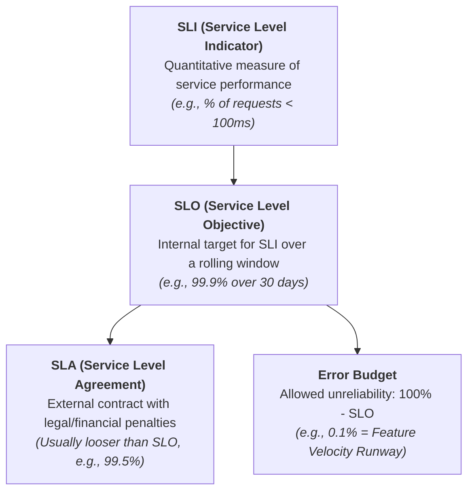
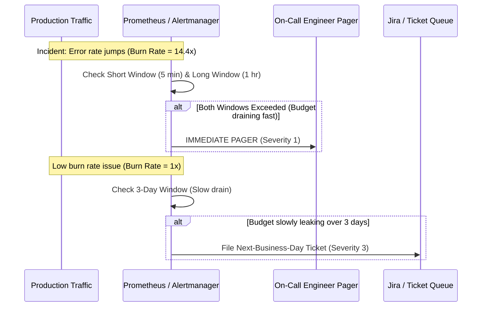

# Service Level Objectives (SLOs) & Error Budgets: SRE Engineering Playbook

In high-scale distributed systems, achieving 100% availability is not only impossible, it is an anti-pattern. Extreme availability comes with exponential engineering cost, slows feature delivery to a crawl, and provides zero incremental benefit to end-users whose local ISPs or mobile networks have an availability of only 99% to 99.9%.

This playbook establishes the mathematical framework, alerting strategies, and governance policies behind **SLIs, SLOs, and Error Budgets** derived from the Google Site Reliability Engineering (SRE) standard.

---

## 1. Academic Definitions & Core Taxonomy

* **SLI (Service Level Indicator)**: A carefully defined quantitative measure of some aspect of the service level provided. 
  $$\text{SLI} = \frac{\text{Good Events}}{\text{Total Valid Events}} \times 100\%$$
* **SLO (Service Level Objective)**: A target percentage value or range for an SLI over a defined compliance period (typically a rolling 28-day or 30-day window).
* **SLA (Service Level Agreement)**: An explicit contract between service provider and customers that includes financial or contractual penalties for missing targets. **Rule of thumb**: SLA must always be looser than the internal SLO to allow the team to remediate issues before facing financial liabilities.
* **Error Budget**: The mathematical inverse of the SLO:
  $$\text{Error Budget} = 100\% - \text{SLO}$$

---

## 2. Defining SLIs by Service Archetype

Never define a generic "uptime" metric. Instead, measure performance strictly from the user's perspective.

### Archetype 1: Request-Driven Services (APIs, Web Services)
* **Availability SLI**: The ratio of successful requests to total valid incoming requests.
  $$\text{Availability} = \frac{\text{Count of HTTP Status } < 500}{\text{Total Valid HTTP Requests (excluding 4xx client errors)}} \times 100\%$$
* **Latency SLI**: The proportion of valid requests that complete faster than a defined threshold.
  $$\text{Latency SLI} = \frac{\text{Count of requests with latency } \le 150\text{ ms}}{\text{Total valid requests}} \times 100\%$$
  > [!IMPORTANT]
  > Always track latency for **successful requests separately from failed requests**. A failed request often fails instantly (e.g., fast HTTP 503 or connection drop), which artificially lowers your average latency metric if lumped together.

### Archetype 2: Data Pipeline & Streaming Systems (Kafka, Batch)
* **Freshness SLI**: The age of the newest record processed relative to when it occurred.
  $$\text{Freshness} = \text{Current Wall Clock Time} - \text{Record Event Timestamp}$$
* **Completeness SLI**: The percentage of source records successfully transformed and committed to downstream storage without silent drops.
* **Throughput SLI**: Sustained processing volume per minute/second compared against input lag.

---

## 3. The Mathematics of "Nines" & Downtime

Every added "9" multiplies infrastructure, operational, and redundancy costs by approximately $5\times$ to $10\times$.

| Availability % | Downtime per Year | Downtime per Month (30d) | Downtime per Week | Staff Engineering Insight |
| :--- | :--- | :--- | :--- | :--- |
| **99% (Two 9s)** | 3.65 days | 7.20 hours | 1.68 hours | Standard batch systems; internal non-critical tooling. |
| **99.9% (Three 9s)** | 8.76 hours | 43.8 minutes | 10.1 minutes | High-standard web services; single-region multi-AZ deployment. |
| **99.99% (Four 9s)** | 52.6 minutes | 4.38 minutes | 1.01 minutes | Core payment gateways, authentication providers; requires active-active multi-region failover. |
| **99.999% (Five 9s)**| 5.26 minutes | 25.9 seconds | 6.05 seconds | Telco infrastructure, core switch networks; fully autonomous zero-human failover, dual-write ledgers. |

---

## 4. Multi-Window Multi-Burn-Rate Alerting

Legacy alerts (e.g., *"Page if error rate > 1% in the last 5 minutes"*) suffer from two fatal flaws:
1. **Alert Fatigue**: A 5-minute traffic spike triggers a page, but resolves itself before the engineer logs in.
2. **Silent Budget Drainage**: A steady 0.5% error rate drains your entire monthly 99.9% budget without ever crossing a 1% threshold.

### Google SRE Standard: Burn Rate Alerting
**Burn Rate** is the rate at which an incident is consuming the 30-day error budget:
* A **Burn Rate of 1** means your service will exhaust exactly 100% of its monthly error budget in 30 days.
* A **Burn Rate of 14.4** means your service will consume **100% of its budget in 50 hours** (or 2% of the budget in 1 hour).

### The Standard Google Alerting Matrix

To avoid false alarms, Google mandates **Multi-Window Verification**: an alert triggers only if **both** a short window (to detect sudden resolution) and a long window (to detect significant budget impact) exceed the burn rate threshold.

| Severity | Target Action | Burn Rate | Short Window | Long Window | Budget Consumed |
| :--- | :--- | :--- | :--- | :--- | :--- |
| **Sev-1 (Page)** | Immediate phone/pager wake-up | **14.4x** | 5 minutes | 1 hour | 2% consumed in 1 hour |
| **Sev-2 (Page)** | Wake up on-call engineer | **6x** | 30 minutes | 6 hours | 5% consumed in 6 hours |
| **Sev-3 (Ticket)**| Investigate next business day | **1x** | 6 hours | 3 days | 10% consumed in 3 days |

---

## 5. Error Budget Policies & Engineering Governance

An SLO without an enforced Error Budget Policy is just a vanity metric. The Error Budget is the contract that bridges Product Management (desiring new features) and Engineering (desiring stability).

### The Four Operating Rules:
1. **Normal State (Budget > 0)**:
   * Product teams ship features rapidly.
   * Routine canary deployments and non-disruptive experiments are encouraged.
2. **Exhaustion State (Budget Consumed $\ge 100\%$)**:
   * **Feature Freeze**: All non-critical production feature deployments are halted until the rolling window recovers.
   * **Engineering Pivot**: 100% of engineering bandwidth shifts to reliability: technical debt cleanup, performance profiling, improving test suites, or fixing infrastructure bottlenecks.
3. **Emergency Outlier Rule**:
   * Security vulnerabilities and critical data-corruption patches bypass the feature freeze.
4. **Postmortem Requirement**:
   * Any single incident that drains $> 10\%$ of the monthly budget triggers a mandatory, blameless postmortem with action items prioritized ahead of sprint backlog items.

---

## 6. Staff / Principal Interview Strategy

When an interviewer asks you: *"How do you ensure reliability for this distributed banking / transaction system?"*

* **Step 1: Refuse the "100% Availability" Trap**:
  > *"I would align with product on a 99.99% availability SLO for critical transaction auth paths, and 99.9% for reporting/analytics. 100% availability is economically unfeasible and blocks velocity."*
* **Step 2: Propose Multi-Window Multi-Burn Rate Alerts**:
  > *"We avoid point-in-time threshold alerts. Instead, we instrument Prometheus using Google's Multi-Window Multi-Burn-Rate standard, paging on-call only when short and long windows confirm that >2% of our 30-day budget is burning within an hour."*
* **Step 3: Articulate the Error Budget Policy**:
  > *"Reliability is a cultural contract. If an outage drains our budget, deployments freeze and engineering shifts entirely to resilience work until our budget recovers."*
