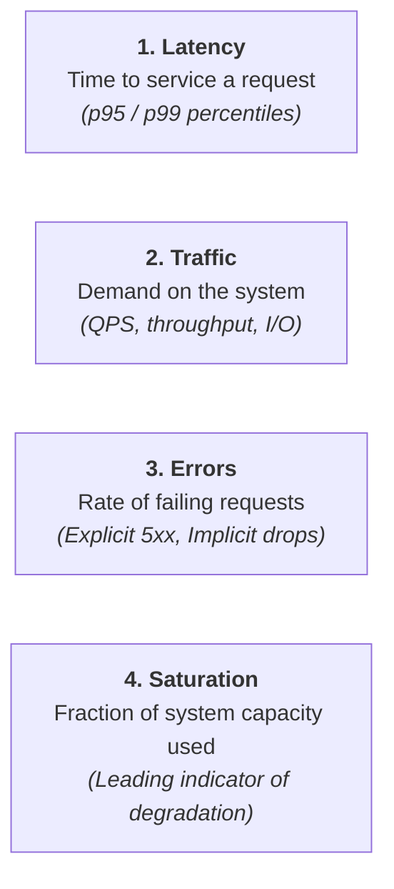
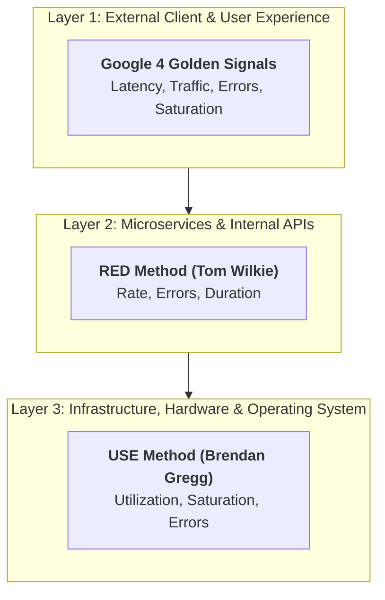

# The 4 Golden Signals & Observability: SRE Engineering Playbook

Monitoring distributed systems requires separating high-signal metrics from noise. According to Google Site Reliability Engineering (SRE) principles, if you can only measure four metrics of your user-facing production system, measure these four: **Latency, Traffic, Errors, and Saturation**.

This playbook details the statistical realities of distributed metrics, the mathematics of tail latency amplification, and a comparative analysis of the industry's leading monitoring methodologies.

---

## 1. The Four Golden Signals Deep Dive



### Signal 1: Latency (The Time to Service Work)
* **Definition**: The time it takes from when a client transmits a request until the complete response is delivered back.
* **The "Success vs. Failure" Trap**: You **must** separate successful request latency from error request latency.
  * *Example*: A database failure returns an instant HTTP `500 Internal Server Error` in $1\text{ ms}$. If you average that with healthy $120\text{ ms}$ queries, your overall latency artificially improves while users are failing!
* **The "Average is a Lie" Rule**: Never monitor average/mean latency. In distributed systems, latency is never a Gaussian (bell-curve) distribution; it is heavily right-skewed and often bimodal (cache hit vs. cache miss). Use **p90, p95, p99, and p99.9** percentiles.

### Signal 2: Traffic (Demand on the Infrastructure)
* **Definition**: A direct measure of incoming demand placed on your service by external clients or upstream dependencies.
* **Measurement Units**:
  * HTTP / gRPC Services: Requests per second (QPS / RPS).
  * Storage Engines: Transactions per second (TPS) or Disk IOPS.
  * Event Brokers (Kafka): Ingested messages per second or Ingress Network Bytes/sec.

### Signal 3: Errors (The Rate of Failures)
* **Definition**: The rate of requests that fail, broken into three classifications:
  1. **Explicit Errors**: Clean HTTP status $5\text{xx}$ or gRPC error codes (`UNAVAILABLE`, `DEADLINE_EXCEEDED`).
  2. **Implicit Errors**: A response returns HTTP $200\text{ OK}$, but the response body contains an empty payload, a partial JSON error block, or corrupted state.
  3. **Policy Errors**: A request succeeds with correct data, but exceeds the strict SLO SLA threshold (e.g., took $1.8\text{ seconds}$ when the commitment was $< 500\text{ ms}$).

### Signal 4: Saturation (The Leading Indicator)
* **Definition**: A measure of system fullness emphasizing the most constrained resource (CPU cores, memory, disk I/O, network sockets, thread pool depth, database connections).
* **Why Saturation Matters Most**: Latency is a **lagging** indicator (by the time latency spikes, users are already impacted). Saturation is a **leading** indicator:
  * When a thread pool hits $85\%$ utilization, latency begins an exponential rise due to queuing theory.
  * In asynchronous architectures, **queue depth** is the truest signal of saturation.

---

## 2. Statistical Foundation: The "Tail at Scale" Amplification

Why does a Staff/Principal Engineer obsess over the **99th (p99)** and **99.9th (p99.9)** percentiles instead of p50 or averages?

### The Mathematics of Distributed Fan-Out
In modern microservice architectures, a single user request rarely hits one server; it fans out to dozens or hundreds of downstream services, microservices, caches, and database partitions.

The overall latency perceived by the client is governed by the **slowest component**:
$$\text{User Latency} = \max(L_1, L_2, \dots, L_N)$$

If an incoming web request depends on calling $N$ downstream leaf nodes in parallel, and each leaf node has a $99\%$ probability of completing quickly ($1\%$ probability of hitting its p99 tail latency):

$$\text{Probability of Fast Response} = (1 - 0.01)^N$$
$$\text{Probability User Experiences Tail Latency} = 1 - (0.99)^N$$

| Fan-Out ($N$ Sub-Requests) | % of End Users Experiencing p99 Latency | Impact Severity |
| :---: | :---: | :--- |
| **1** | **$1\%$** | Barely noticeable. |
| **10** | **$9.6\%$** | ~1 in 10 user requests is slow. |
| **50** | **$39.5\%$** | ~4 in 10 requests hit tail latency. |
| **100** | **$63.4\%$** | **More than 6 out of 10 users suffer degraded performance!** |

> [!CAUTION]
> If a home page requires 100 backend microservice queries, **$63.4\%$ of all user requests will suffer from the worst-case 99th-percentile latency**, even though every individual microservice is "healthy" and passing its 99% SLA! This is known as **Tail Latency Amplification** (Jeff Dean & Luiz André Barroso, Google).

---

## 3. Comparison: Google 4 Signals vs. RED vs. USE

Different layers of your architecture require different observability lenses:



| Dimension | **Google 4 Golden Signals** | **RED Method** | **USE Method** |
| :--- | :--- | :--- | :--- |
| **Author / Origin** | Google SRE Team | Tom Wilkie (Grafana / Kiali) | Brendan Gregg (Netflix / Joyent) |
| **Core Metrics** | Latency, Traffic, Errors, Saturation | Rate, Errors, Duration | Utilization, Saturation, Errors |
| **Primary Scope** | User-facing distributed applications | Request-driven microservices & RPC | Low-level OS, hardware, and physical resources |
| **Target Audience** | Service Owners, SREs, Directors | Application Developers & Backend Teams | Systems Engineers, DBAs, Kernel Specialists |
| **Key Question** | *"Are our users happy and is the service about to fall over?"* | *"How is my microservice performing right now?"* | *"Which hardware resource is bottlenecked or dying?"* |

---

## 4. Production PromQL Cheat Sheet

Production-ready Prometheus PromQL queries for the 4 Golden Signals:

### 1. Latency (p99 Duration in seconds)
Calculates the 99th percentile latency over a 5-minute sliding window from a Prometheus histogram:
```promql
histogram_quantile(0.99, sum(rate(http_request_duration_seconds_bucket{status!~"5.."}[5m])) by (le, service))
```

### 2. Traffic (Incoming Requests Per Second)
Calculates the real-time QPS across all instances:
```promql
sum(rate(http_requests_total[1m])) by (service)
```

### 3. Error Rate (5xx Ratio Percentage)
Calculates the fraction of total requests resulting in server errors:
```promql
(sum(rate(http_requests_total{status=~"5.."}[5m])) 
 / 
 sum(rate(http_requests_total[5m]))) * 100
```

### 4. Saturation (JVM Thread Pool / CPU Saturation)
Measures active worker threads against maximum allowable pool limits:
```promql
(sum(jvm_threads_current) by (instance) 
 / 
 sum(jvm_threads_peak) by (instance)) * 100
```

---

## 5. Staff / Principal Interview Strategy

When asked: *"How would you design the observability and telemetry for an ultra-high-throughput payment switch or distributed system?"*

* **Anchor to Golden Signals vs. USE**:
  > *"At the application level, I instrument the **RED / Golden Signals** on every inbound and outbound interface (measuring p95 and p99 latency separated by status code, request rate, error percentages, and thread pool queue saturation). At the underlying infrastructure level (EC2, EKS nodes, and Oracle/Mongo clusters), I use the **USE method** to monitor CPU core saturation, disk I/O wait queues, and socket exhaustion."*
* **Demonstrate Tail-at-Scale Awareness**:
  > *"Because our orchestration layer fans out to multiple backend dependencies, I prioritize tail latency over medians. A single 1% degradation on a leaf service cascades to 63% of user requests under 100-way fan-out. We mitigate this using aggressive client timeouts, hedged requests, and distributed tracing via OpenTelemetry."*
