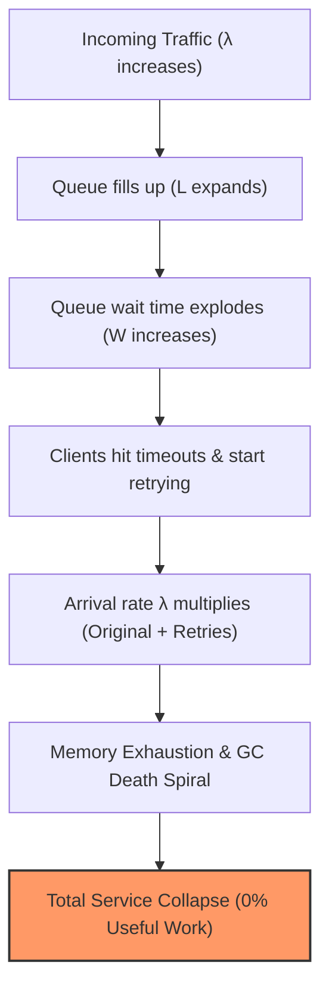
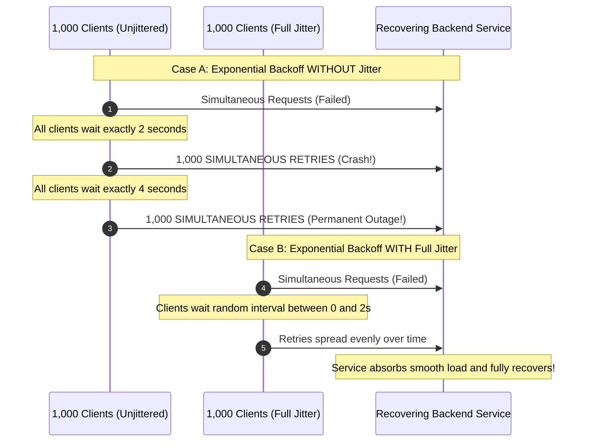
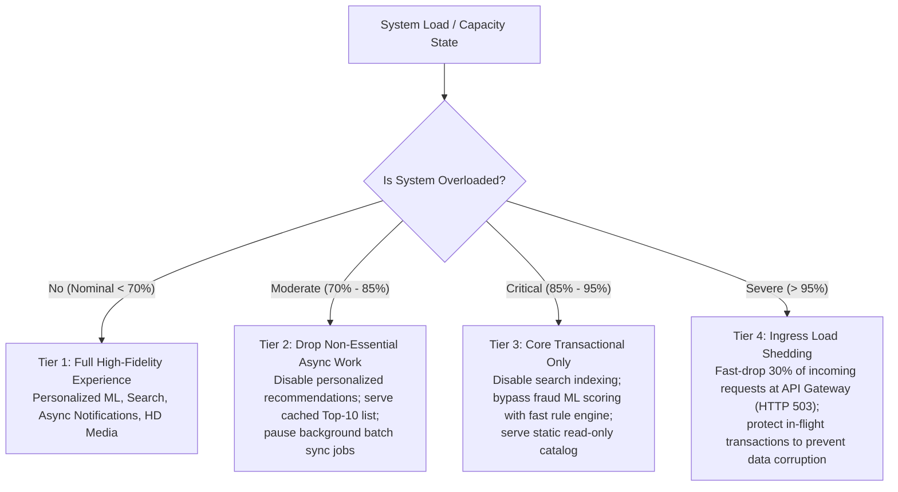

# Handling Overload: SRE Engineering Playbook

In distributed systems, **Overload** occurs when the rate of incoming work exceeds the system's processing capacity. Because hardware and network capacity are fundamentally finite, every distributed service will eventually hit saturation.

When a service becomes saturated, the worst possible behavior is trying to process every request until memory is exhausted, threads lock up, and the service crashes completely—serving **0% useful traffic**.

The core Staff/Principal engineering principle is **Graceful Degradation via Load Shedding**: deliberately rejecting a fraction of traffic to protect the server so that the remaining capacity continues to process work at full speed.

---

## 1. Queuing Theory & The Saturation Death Spiral

The dynamics of system overload are governed by **Little's Law** from operations research:

$$L = \lambda \times W$$

* $L$ = Average number of requests inside the system (concurrency / in-flight requests).
* $\lambda$ = Average arrival rate of incoming requests (QPS).
* $W$ = Average time a request spends in the system (Latency = Queue Wait Time + Execution Time).



### The Mechanism of the Death Spiral
1. As arrival rate $\lambda$ approaches capacity $\mu$, queue waiting time increases exponentially.
2. The client times out after $2\text{ seconds}$ and aborts the connection.
3. **The Disaster**: The server does *not* know the client gave up. The server eventually pulls the abandoned request from its queue and spends $500\text{ ms}$ of expensive CPU/Database resources processing a response that will simply be thrown into a closed TCP socket!
4. The server wastes $100\%$ of its CPU on dead requests while fresh, living requests sit starved in the queue.

---

## 2. Load Shedding vs. Rate Limiting

Engineers frequently confuse these two defenses:

| Dimension | **Rate Limiting (Throttling)** | **Load Shedding** |
| :--- | :--- | :--- |
| **Protected Entity** | Protects the system from a **specific client or tenant**. | Protects the **server itself** from aggregate resource exhaustion. |
| **Decision Location**| API Gateway, Edge Proxy, WAF. | Directly inside the application process / thread pool. |
| **Decision Criteria**| Client ID, IP Address, API Key, Token Bucket. | CPU utilization, memory pressure, internal queue depth, GC pause times. |
| **Response Code** | `HTTP 429 Too Many Requests` | `HTTP 503 Service Unavailable` with `Retry-After` header. |
| **Goal** | Enforce multi-tenant fairness and prevent noisy neighbors. | Keep the server alive under macro surges regardless of who is calling. |

---

## 3. High-Leverage Load Shedding Algorithms

### A. LIFO (Last-In-First-Out) over FIFO
Under normal conditions, queues should be First-In-First-Out (FIFO) for fairness. **Under overload, FIFO is catastrophic.**
* In a FIFO queue under heavy load, the request at the head of the queue is the *oldest*—meaning it is the most likely to have already timed out on the client side.
* **The SRE Fix: LIFO Queueing**: Under severe load, flip the queue to LIFO. The newest request is processed immediately because the client is still waiting on the other end of the socket! Abandoned requests at the bottom of the queue are dropped immediately.

### B. CoDel (Controlled Delay) Load Shedding
Instead of measuring queue length, measure **Queue Sojourn Time** (how long a request waits in the queue before being dequeued for execution).
* If minimum wait time in the queue exceeds a threshold (e.g., $> 20\text{ ms}$) over a rolling window, the server immediately drops incoming requests at ingress without queuing them.

---

## 4. Retries & The Thundering Herd Problem

When a service blips, thousands of clients fail simultaneously. If they all retry, they generate a **Retry Storm** that keeps the recovering service pinned down.



### The Mathematical Formula: AWS Full Jitter
Standard exponential backoff without jitter causes synchronized spikes:
$$\text{Backoff} = \min(M, B \times 2^{\text{attempt}})$$

To break the synchronization, apply **Full Jitter** (Amazon Architecture Standard):
$$\text{Sleep} = \text{random}(0, \min(M, B \times 2^{\text{attempt}}))$$

Where $M$ is the maximum cap ceiling (e.g., $30\text{s}$) and $B$ is the base retry duration (e.g., $100\text{ms}$). Full jitter yields the lowest client completion time and completely eliminates resonance waves.

---

## 5. Tiered Graceful Degradation in Practice

When capacity drops, shed non-essential features dynamically:



---

## 6. Implementation: Resilience4j Circuit Breaker & Rate Limiter

In modern Java / Spring microservices, use **Resilience4j** to handle overload programmatically:

```java
// Spring Boot configuration for Resilience4j RateLimiter & Bulkhead
@Configuration
public class ResilienceConfig {

    @Bean
    public BulkheadRegistry bulkheadRegistry() {
        BulkheadConfig config = BulkheadConfig.custom()
            .maxConcurrentCalls(50)             // Max parallel executions allowed
            .maxWaitDuration(Duration.ofMillis(20)) // Fail-fast: don't wait in queue > 20ms
            .build();
        return BulkheadRegistry.of(config);
    }

    @Bean
    public RateLimiterRegistry rateLimiterRegistry() {
        RateLimiterConfig config = RateLimiterConfig.custom()
            .limitForPeriod(1000)                // 1000 requests
            .limitRefreshPeriod(Duration.ofSeconds(1)) // per second
            .timeoutDuration(Duration.ofMillis(0)) // Drop immediately if quota full (HTTP 429)
            .build();
        return RateLimiterRegistry.of(config);
    }
}
```

---

## 7. Staff / Principal Interview Strategy

When asked: *"What happens if your payment gateway or e-commerce service experiences a 10x traffic surge during Black Friday?"*

* **Lead with Load Shedding vs. Rate Limiting**:
  > *"First, our API Gateway enforces rate limiting per tenant. But if aggregate traffic threatens our downstream databases, our microservices enforce **internal load shedding**. Rather than letting requests queue indefinitely and crash into JVM GC death spirals, we monitor thread pool queue wait times via CoDel and drop excess traffic at ingress with HTTP 503."*
* **Highlight Retry Discipline**:
  > *"Every client calling our services is strictly mandated to use exponential backoff with **Full Jitter** and bounded retries ($\le 3$). This prevents retry storms and ensures that recovering nodes don't get crushed by thundering herds."*
* **Explain Degradation Tiers**:
  > *"We architect four degradation tiers: under high load, we dynamically shed heavy personalization algorithms and fall back to static cached datasets, ensuring the core payment processing pathway remains 100% operational."*
