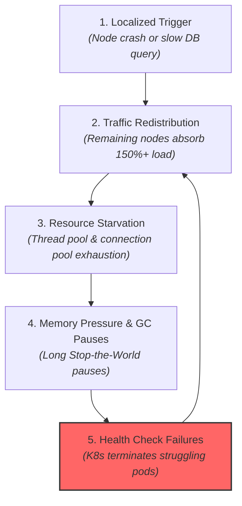
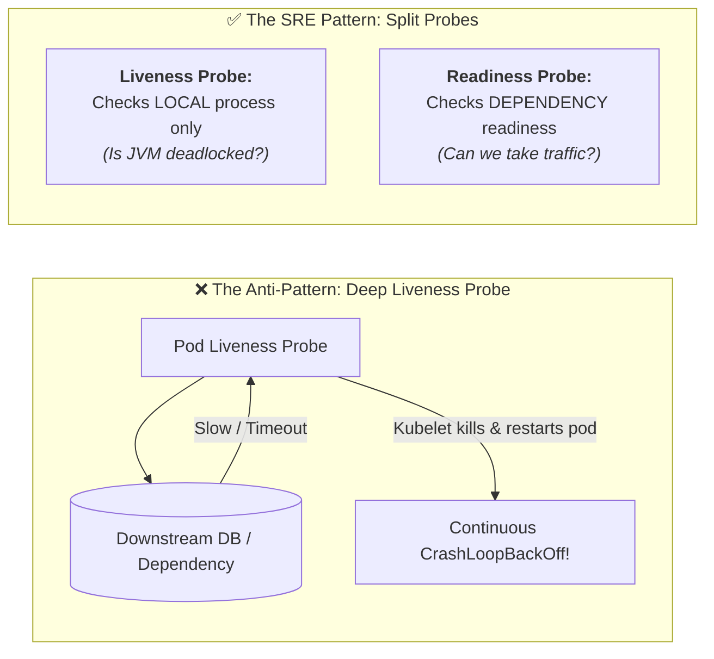
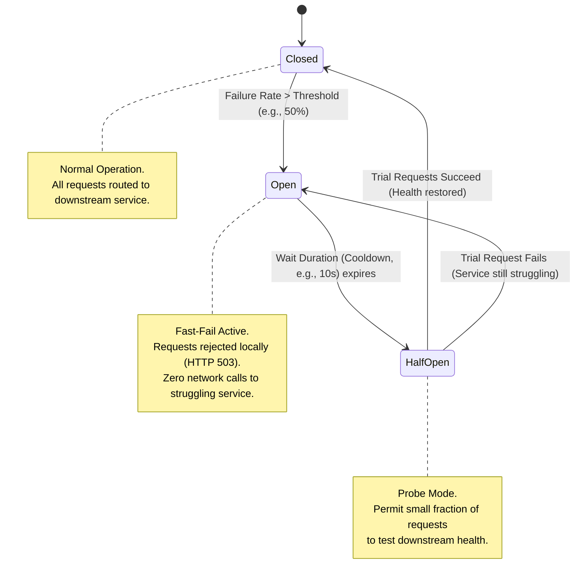
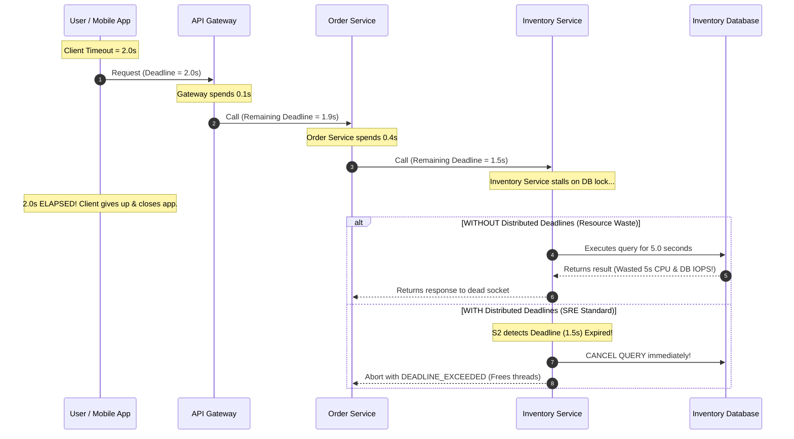

# Cascading Failures & Resiliency: SRE Engineering Playbook

A **Cascading Failure** is a failure that amplifies over time as a result of positive feedback loops. It occurs when an initial localized failure (a node crash, network blip, or slow database query) shifts load or exhausts shared resources across other parts of the system, triggering a domino effect that collapses the entire distributed architecture.

Cascading failures are the single most dangerous failure mode in cloud computing because they **cannot be resolved by simply restarting nodes**; restarting servers into an ongoing overload storm only accelerates the collapse.

---

## 1. Anatomy & Root Causes of Cascading Failures



### The Four Primary Drivers:
1. **Thread & Connection Pool Starvation**: Service A calls Service B synchronously. If Service B slows down by $10\times$, Service A's worker threads wait $10\times$ longer. Within seconds, Service A’s thread pool is completely saturated holding open sockets. Service A can no longer process unrelated requests and crashes.
2. **Load Redistribution (The Domino Crash)**: A cluster of 4 nodes runs at $80\%$ capacity. Node 1 crashes due to a bad memory stick. Its $25\%$ traffic shifts to the remaining 3 nodes, pushing them to $107\%$ capacity. Node 2 crashes under the strain. The remaining 2 nodes now face $160\%$ load and crash instantly.
3. **The Cold Cache Stampede**: When a failed service is brought back online, its internal caches (Redis / local memory) are completely empty. Every single request bypasses the cache and strikes the primary database directly, instantly bringing down the database.
4. **The Kubernetes Liveness Probe Death Spiral**: Misconfigured health check probes actively destroy struggling systems.

---

## 2. The Kubernetes Health Check Trap: Liveness vs. Readiness

A classic cause of multi-million-dollar outages is confusing Kubernetes **Liveness** and **Readiness** probes.



### The Golden Rule of Container Health:
* **Liveness Probe**: Asks: *"Is the process completely deadlocked, corrupt, or broken beyond recovery?"*
  * **Action on Failure**: Kubelet **kills and restarts** the container.
  * **Rule**: **NEVER check external databases or downstream dependencies in a liveness probe.** If the database is slow, restarting the application pod will not fix the database—it just destroys in-flight transactions and floods the database with new connection handshakes!
* **Readiness Probe**: Asks: *"Can this pod receive incoming traffic right now?"*
  * **Action on Failure**: Kubelet **stops routing traffic** from the Service load balancer to this pod. The container is left alive to finish background work or wait for the database to recover.

---

## 3. Defense Mechanism 1: Circuit Breaker Pattern

A **Circuit Breaker** wraps remote RPC/HTTP calls and monitors failure rates. When failures cross a safe threshold, the circuit trips to **Open**, immediately failing subsequent calls locally without waiting for network timeouts.



### Resilience4j Sliding Window Mechanics
Modern circuit breakers use a **sliding window** (count-based or time-based) to track outcomes:
* **Failure Rate Threshold (e.g., 50%)**: If $> 50\%$ of calls in the last 100 requests return errors or timeouts, trip the breaker.
* **Slow Call Threshold (e.g., 70% > 2s)**: If calls aren't throwing exceptions but are abnormally slow, trip the breaker to prevent upstream thread exhaustion.

---

## 4. Defense Mechanism 2: Distributed Deadlines & Context Propagation

Setting client timeouts is insufficient if the timeout isn't communicated to downstream dependencies.



### Implementation:
* In **gRPC**: Native `Context.withDeadlineAfter(...)` automatically propagates across RPC boundaries and cancels child tasks.
* In **HTTP REST**: Propagate the standard HTTP header: `Request-Timeout: 1500` or W3C Baggage headers, coupled with OpenTelemetry tracing contexts.

---

## 5. Defense Mechanism 3: Bulkheading (Fault Isolation)

The term **Bulkhead** is borrowed from nautical ship design: partitioning a ship's hull into watertight compartments so that a single leak does not sink the entire vessel.

In software architecture, bulkheading isolates resources so that a failure in one feature cannot consume resources needed by other features:

1. **Thread Pool Isolation**: Maintain separate thread pools for different downstream integrations.
   * *Example*: If the Payment Service thread pool is exhausted, the Product Catalog thread pool continues operating normally.
2. **Database Connection Pool Partitioning**: Split database connections into dedicated pools for high-priority transactional paths vs. low-priority analytics/reporting.
3. **Multi-Tenant Sharding**: Ensure noisy enterprise tenants run on dedicated shards so their surges cannot impact other customers.

---

## 6. Resilience4j Production Configuration (Spring Boot)

```yaml
# application.yml: Resilience4j CircuitBreaker & TimeLimiter
resilience4j.circuitbreaker:
  instances:
    inventoryService:
      slidingWindowType: COUNT_BASED
      slidingWindowSize: 100
      minimumNumberOfCalls: 20
      failureRateThreshold: 50.0          # Trip if 50% of last 100 calls fail
      slowCallRateThreshold: 70.0         # Trip if 70% of calls exceed slowCallDuration
      slowCallDurationThreshold: 1500ms
      waitDurationInOpenState: 10000ms    # Cool off for 10s before testing with Half-Open
      permittedNumberOfCallsInHalfOpenState: 10
      automaticTransitionFromOpenToHalfOpenEnabled: true

resilience4j.timelimiter:
  instances:
    inventoryService:
      timeoutDuration: 2000ms             # Strict deadline per call
      cancelRunningFuture: true           # Abort execution thread if timeout occurs
```

---

## 7. Staff / Principal Interview Strategy

When asked: *"How do you design a distributed microservice architecture that is immune to cascading failures?"*

* **1. Eliminate Unbounded Waiting**:
  > *"Every outbound network call must have a strict, non-negotiable timeout. Furthermore, we propagate **distributed deadlines** across RPC boundaries so downstream workers abort abandoned work rather than wasting CPU on dead sockets."*
* **2. Enforce Circuit Breakers & Bulkheads**:
  > *"We wrap external integrations with Resilience4j circuit breakers with both failure-rate and slow-call thresholds. Internally, we bulkhead our thread pools and connection pools to guarantee that a degraded recommendation engine cannot starve our checkout processing pipeline."*
* **3. Defend Health Checks**:
  > *"I enforce a strict separation between Kubernetes Liveness and Readiness probes. Liveness probes test only internal process health to prevent destructive CrashLoopBackOff cascades when downstream dependencies experience latency."*
