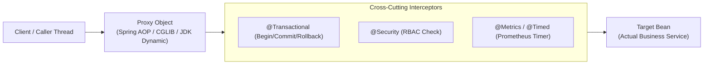
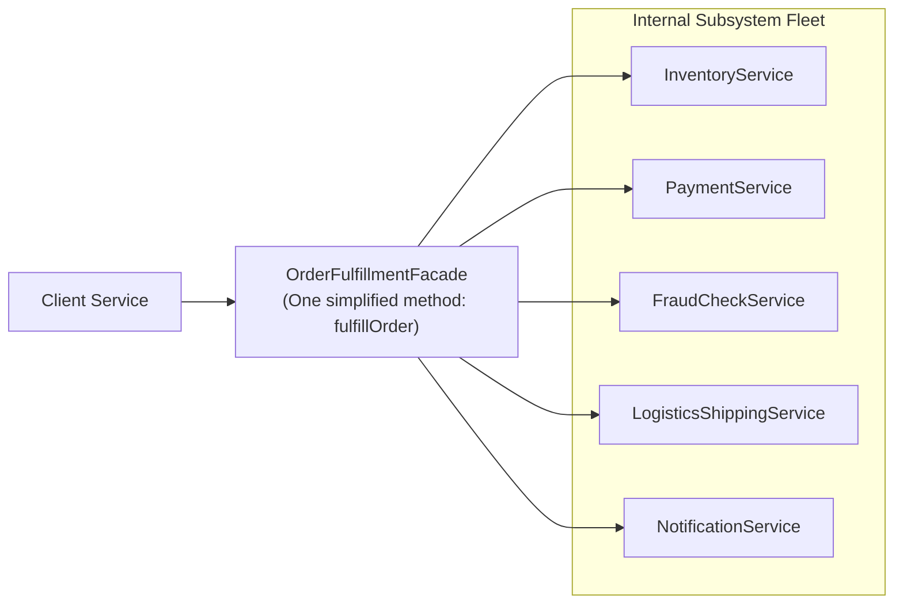

# Structural Design Patterns in Modern Java: Staff & Principal Guide

Structural design patterns are concerned with how classes and objects are composed to form larger, more flexible systems. They use inheritance and composition to create new functionalities while preserving loose coupling.

In Staff and Principal engineering interviews, structural patterns are heavily probed in the context of **framework internals (Spring AOP, bytecode manipulation)**, **legacy subsystem integration**, and **cross-cutting resilience**.

---

## 1. The Proxy Pattern: Spring AOP & Bytecode Mechanics

A **Proxy** provides a surrogate or placeholder for another object to control access to it. It is the architectural engine behind virtually all modern enterprise Java frameworks.



### A. JDK Dynamic Proxies vs. CGLIB Bytecode Enhancement
Spring creates proxies using two distinct mechanisms:

| Dimension | **JDK Dynamic Proxies** | **CGLIB (Code Generation Library)** |
| :--- | :--- | :--- |
| **Mechanism** | Standard Java reflection (`java.lang.reflect.Proxy`). | Bytecode generation via ASM (`Enhancer`). |
| **Requirement** | Target class **must implement an interface**. | Generates a **subclass** of the target class at runtime. |
| **Limitation** | Cannot proxy standalone concrete classes. | Cannot proxy `final` classes or `final` methods! |
| **Spring Default** | Spring Boot 1.x default for interface-backed beans. | **Spring Boot 2.x & 3.x default** (`spring.aop.proxy-target-class=true`). |

---

### B. The Classic Spring Self-Invocation Anti-Pattern
> [!CAUTION]
> **The Most Common Enterprise Bug with Proxies:**
> Calling an `@Transactional` or `@Async` method from another method **within the same class** completely bypasses the proxy!

```java
@Service
public class OrderService {

    public void processOrder(Order order) {
        // ... validating order ...
        
        // ❌ BUG: Calling another method in the SAME class!
        // This is a raw 'this.saveToDatabase()' call, bypassing the Spring Proxy!
        // The @Transactional annotation is completely IGNORED!
        this.saveToDatabase(order);
    }

    @Transactional(propagation = Propagation.REQUIRES_NEW)
    public void saveToDatabase(Order order) {
        orderRepository.save(order);
    }
}
```

#### How to Solve It:
1. **Architectural Fix (Recommended)**: Extract `saveToDatabase` into a dedicated repository/service bean (`OrderPersistenceService`) so the call enters through the Spring-managed proxy.
2. **Self-Injection**: Inject `OrderService` into itself (lazy) to invoke methods via the proxy:
   ```java
   @Autowired @Lazy private OrderService self;
   public void processOrder(Order order) {
       self.saveToDatabase(order); // Enters through proxy!
   }
   ```
3. **`AopContext.currentProxy()`**: (Requires `@EnableAspectJAutoProxy(exposeProxy = true)`).

---

## 2. The Decorator Pattern: Dynamic Behavior Extension

The **Decorator** attaches additional responsibilities to an object dynamically without modifying the underlying class or using deep subclass inheritance hierarchies.

### A. The Classic Java Example: `java.io`
```java
// Layering behaviors via composition:
InputStream in = new BufferedInputStream(
                    new GZIPInputStream(
                        new FileInputStream("data.gz")));
```

### B. Enterprise Decorator: Resilience & Telemetry Layering
In distributed microservices, decorators are used to wrap external HTTP or gRPC clients with cross-cutting concerns:

```java
public interface PaymentClient {
    PaymentResponse charge(BigDecimal amount);
}

// 1. Concrete Component
public class HttpPaymentClient implements PaymentClient {
    public PaymentResponse charge(BigDecimal amount) {
        // Raw HTTP POST over network...
        return new PaymentResponse("OK");
    }
}

// 2. Metrics & Telemetry Decorator
public class MonitoredPaymentClient implements PaymentClient {
    private final PaymentClient delegate;
    private final MeterRegistry registry;

    public MonitoredPaymentClient(PaymentClient delegate, MeterRegistry registry) {
        this.delegate = delegate;
        this.registry = registry;
    }

    @Override
    public PaymentResponse charge(BigDecimal amount) {
        Timer.Sample sample = Timer.start(registry);
        try {
            return delegate.charge(amount);
        } finally {
            sample.stop(registry.timer("payment.charge.duration"));
        }
    }
}
```

### Decorator vs. Proxy: The Crucial Difference
* **Proxy**: Controls access to the target object. The proxy often manages the life cycle of the target or restricts operations (e.g., authentication, lazy loading).
* **Decorator**: Adds new responsibilities and behaviors. Decorators are meant to be **stacked** in an arbitrary sequence (e.g., Logging $\to$ Metrics $\to$ Retry $\to$ Target).

---

## 3. The Adapter Pattern: Subsystem Harmonization

The **Adapter** converts the interface of a class into another interface that clients expect. It allows classes with incompatible interfaces to work together.

### Enterprise Use Case: Modernizing Legacy Banking Protocol
Suppose an existing enterprise payment system communicates via legacy ISO 8583 banking messages, but the new microservice architecture expects a modern JSON `PaymentGateway` interface:

```java
// Target Interface expected by modern microservices
public interface ModernPaymentGateway {
    PaymentResult processTransaction(String accountId, BigDecimal amount);
}

// Adaptee: Legacy banking switch system
public class LegacyIso8583Switch {
    public byte[] transmitBitmapPayload(byte[] isoMessage) {
        // Proprietary binary networking
        return new byte[]{0x00, 0x01};
    }
}

// Object Adapter
public class Iso8583Adapter implements ModernPaymentGateway {
    private final LegacyIso8583Switch legacySwitch;

    public Iso8583Adapter(LegacyIso8583Switch legacySwitch) {
        this.legacySwitch = legacySwitch;
    }

    @Override
    public PaymentResult processTransaction(String accountId, BigDecimal amount) {
        // 1. Translate modern domain model into legacy byte format
        byte[] payload = packIso8583(accountId, amount);
        
        // 2. Delegate to legacy system
        byte[] response = legacySwitch.transmitBitmapPayload(payload);
        
        // 3. Unpack and translate response back to modern domain model
        return unpackIso8583(response);
    }

    private byte[] packIso8583(String accountId, BigDecimal amount) { /* serialization */ return new byte[0]; }
    private PaymentResult unpackIso8583(byte[] raw) { /* parsing */ return new PaymentResult(true); }
}
```

---

## 4. The Facade Pattern: Simplifying Complex Subsystems

A **Facade** provides a unified, higher-level interface to a complex set of interfaces in a subsystem, making the subsystem easier to use.



* **Facade vs. Adapter**:
  * An **Adapter** makes two *incompatible existing interfaces* work together (one-to-one translation).
  * A **Facade** defines a *new, simplified interface* over a complex, sprawling subsystem (one-to-many simplification).

---

## 5. Staff / Principal Interview Strategy: Structural Patterns

### 1. Spring AOP & Proxy Traps
* **Interview Prompt**: *"Explain how Spring implements `@Transactional` and what limitations arise from its proxy-based design."*
* **The Principal Answer**:
  > *"Spring wraps target beans in dynamic proxies (using CGLIB by default in modern Spring Boot). When an external call invokes an `@Transactional` method, the proxy intercepts it, begins a database transaction on the `PlatformTransactionManager`, executes the target method, and commits or rolls back based on exceptions. The primary limitation is self-invocation: internal calls (`this.method()`) execute directly on the target instance without passing through the proxy, rendering transaction, cache, and security annotations completely inert."*

### 2. Adapter as an Anti-Corruption Layer (ACL)
* **Interview Prompt**: *"How do you integrate a new cloud microservice with an on-premise mainframe legacy system without letting legacy concepts pollute your clean domain model?"*
* **The Principal Answer**:
  > *"We implement the **Adapter Pattern as an Anti-Corruption Layer (ACL)**. The clean domain service only interacts with modern domain interfaces. The adapter encapsulates the translation of legacy schemas, error codes, and network protocols. If the mainframe is eventually decommissioned or replaced, only the adapter implementation is rewritten; the core domain business logic remains 100% untouched."*
