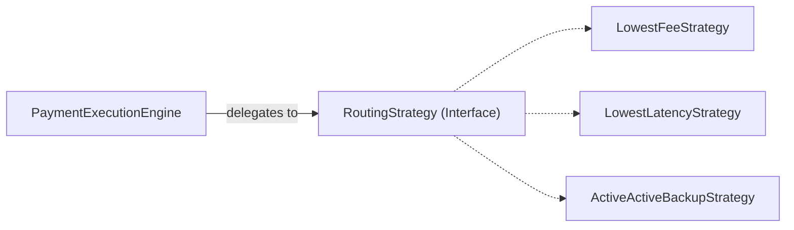
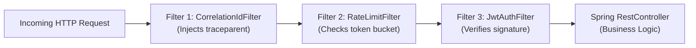

# Behavioral Design Patterns in Modern Java: Staff & Principal Guide

Behavioral design patterns characterize the ways in which classes and objects interact and distribute responsibility. They shift the focus away from object creation and structural wiring toward **control flow, algorithms, and inter-object communication**.

In Staff and Principal engineering interviews, you are expected to understand not just the classic GoF class structures, but **how modern Java (Lambdas, Functional Interfaces, Records) obsoletes verbose patterns**, and how in-memory behavioral patterns scale out into **distributed event-driven systems**.

---

## 1. The Strategy Pattern: From Polymorphism to Functional Lambdas

The **Strategy** pattern defines a family of algorithms, encapsulates each one, and makes them interchangeable. Strategy lets the algorithm vary independently from clients that use it.



### A. The Classic GoF Approach vs. Modern Java 8+ Lambdas
In legacy Java, implementing a strategy required creating 5 separate class files. In modern Java, any Single Abstract Method (SAM) interface is a **Functional Interface** that can be passed directly as a lambda or method reference:

```java
@FunctionalInterface
public interface FeeCalculationStrategy {
    BigDecimal calculateFee(BigDecimal amount);
}

public class PaymentService {
    // Strategy can be injected as a lambda!
    public BigDecimal processPayment(BigDecimal amount, FeeCalculationStrategy strategy) {
        BigDecimal fee = strategy.calculateFee(amount);
        return amount.add(fee);
    }
}

// In-line strategy selection:
paymentService.processPayment(amount, amt -> amt.multiply(new BigDecimal("0.02"))); // 2% fee
paymentService.processPayment(amount, amt -> new BigDecimal("1.50"));               // Flat fee
```

### B. Enterprise Spring Strategy Pattern: The Map-Injection Idiom
In high-scale enterprise architectures, strategies must be dynamically resolved at runtime (e.g., routing transactions based on payment network: `VISA`, `AMEX`, `DISCOVER`):

```java
public interface PaymentNetworkHandler {
    PaymentNetwork getNetwork();
    void process(Transaction tx);
}

@Service
public class PaymentRoutingEngine {
    // Spring automatically populates this map where key is the bean name!
    private final Map<PaymentNetwork, PaymentNetworkHandler> handlers = new EnumMap<>(PaymentNetwork.class);

    @Autowired
    public PaymentRoutingEngine(List<PaymentNetworkHandler> handlerList) {
        for (PaymentNetworkHandler handler : handlerList) {
            handlers.put(handler.getNetwork(), handler);
        }
    }

    public void route(Transaction tx) {
        PaymentNetworkHandler handler = handlers.get(tx.getNetwork());
        if (handler == null) {
            throw new UnsupportedOperationException("No handler for: " + tx.getNetwork());
        }
        handler.process(tx);
    }
}
```

---

## 2. The Observer Pattern: From In-Process to Distributed Logs

The **Observer** pattern defines a one-to-many dependency between objects so that when one object changes state, all its dependents are notified and updated automatically.

### In-Process Spring Observer: `ApplicationEventPublisher`
```java
// 1. Immutable Domain Event
public record OrderPlacedEvent(String orderId, String customerId, BigDecimal amount) {}

// 2. Publisher
@Service
public class OrderService {
    private final ApplicationEventPublisher publisher;

    public OrderService(ApplicationEventPublisher publisher) {
        this.publisher = publisher;
    }

    public void checkout(Order order) {
        // ... save order ...
        publisher.publishEvent(new OrderPlacedEvent(order.id(), order.customerId(), order.amount()));
    }
}

// 3. Decoupled Listeners
@Component
public class InventoryListener {
    @EventListener
    public void onOrderPlaced(OrderPlacedEvent event) {
        // Reserve inventory in memory
    }
}

@Component
public class NotificationListener {
    @Async // Executed asynchronously in a background thread pool!
    @EventListener
    public void sendEmailConfirmation(OrderPlacedEvent event) {
        // Send email without blocking main checkout thread
    }
}
```

> [!IMPORTANT]
> **Staff Insight: The Distributed Observer Transition**
> In-process observers (`@EventListener`) have a single fatal flaw in distributed architectures: **they do not survive JVM crashes**.
> If the process crashes immediately after `checkout()`, the asynchronous notification or inventory listener event is **permanently lost**.
> In distributed architectures, the in-process Observer pattern evolves into **Distributed Publish/Subscribe (Apache Kafka)**, where events are written to an immutable, replicated commit log.

---

## 3. The Chain of Responsibility Pattern: Filter Pipelines

The **Chain of Responsibility** avoids coupling the sender of a request to its receiver by giving more than one object a chance to handle the request. Handlers are chained together, passing the request along the line until one handles it or the pipeline finishes.

### Enterprise Archetypes:
* **Java EE / Jakarta**: `javax.servlet.Filter`
* **Spring Security**: `SecurityFilterChain` (UsernamePasswordAuthenticationFilter $\to$ BearerTokenAuthenticationFilter $\to$ ExceptionTranslationFilter $\to$ FilterSecurityInterceptor)
* **High-Performance Netty**: `ChannelPipeline` (decoding frames $\to$ SSL decryption $\to$ business handlers)



---

## 4. The Template Method vs. Callback Pattern

The **Template Method** defines the skeleton of an algorithm in an operation, deferring some steps to subclasses.

### A. The Classic Inheritance Approach
```java
public abstract class DataProcessor {
    // Template Method (final prevents overriding the algorithm's skeleton)
    public final void process(String filePath) {
        openFile(filePath);
        readData();
        processData(); // Abstract step
        closeFile();
    }

    protected abstract void processData();
    private void openFile(String p) { /* ... */ }
    private void readData() { /* ... */ }
    private void closeFile() { /* ... */ }
}
```

### B. Modern Functional Template Callback (The Spring Idiom)
Inheritance creates tight coupling. Modern frameworks use the **Template Callback Pattern** (e.g., `JdbcTemplate`, `TransactionTemplate`, `KafkaTemplate`):

```java
// Spring manages database connection, transaction begin, commit, and rollback:
transactionTemplate.execute(status -> {
    // Client only provides the variable business logic callback!
    userRepository.debitBalance(accountId, amount);
    ledgerRepository.recordEntry(accountId, amount);
    return true;
});
```

---

## 5. The Command Pattern: Sagas & Asynchronous Execution

The **Command** pattern encapsulates a request as an object, thereby letting you parameterize other objects with different requests, queue or log requests, and support undoable operations.

* In microservices, the Command pattern is the foundation of **Saga Orchestrators**:
  * An orchestrator holds a sequence of `Command` objects: `[ReserveInventoryCommand, DebitPaymentCommand, CreateShipmentCommand]`.
  * Each command exposes an `execute()` method and a matching **`compensate()`** method to execute undo logic if a downstream step fails!

---

## 6. Staff / Principal Interview Strategy: Behavioral Patterns

### 1. Replacing Class Hierarchies with Functional Idioms
* **Interview Prompt**: *"When would you avoid using a classic GoF Strategy or Command pattern class hierarchy?"*
* **The Principal Answer**:
  > *"Classic GoF patterns were conceived in 1994 when C++ and Java lacked first-class functions. In modern Java, creating separate classes for single-method strategies introduces unnecessary file bloat and mental overhead. I use Java Lambdas, `Function<T, R>`, or method references for simple interchangeable algorithms. I only use full GoF class structures when the strategy holds complex state, lifecycle hooks, or requires Spring-managed dependency injection."*

### 2. Event Sourcing vs. Observer
* **Interview Prompt**: *"How does the Observer pattern connect to Event Sourcing and CQRS in distributed systems?"*
* **The Principal Answer**:
  > *"The Observer pattern decouples state mutation from side-effects. In Event Sourcing, this is elevated to the storage model: state changes are modeled as an append-only stream of immutable domain events (the ultimate Observer publisher). Read models (projections) act as observers that subscribe to the event stream to construct materialized views optimized for specific query patterns."*
