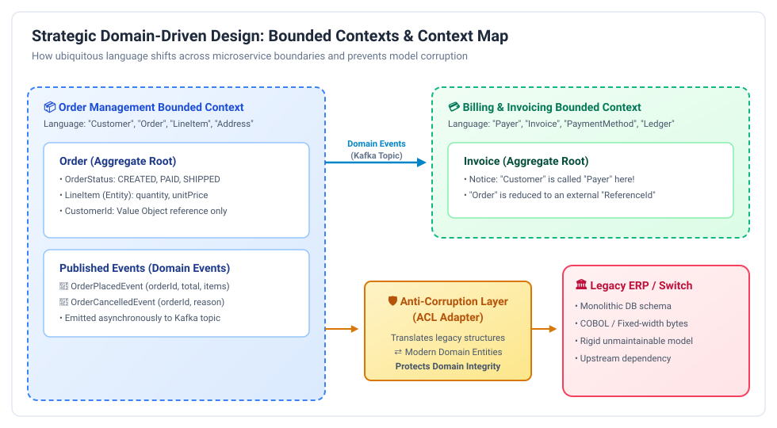
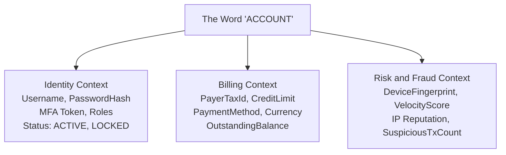

# Strategic Domain-Driven Design (DDD): Staff & Principal Guide

Domain-Driven Design (DDD), originally formulated by Eric Evans, is not about object-oriented design patterns. It is an architectural methodology for **aligning software models with business realities**.

In Staff and Principal engineering interviews, interviewers frequently ask: *"We have a 15-year-old monolithic application. How do you decide where to draw the boundaries to split it into microservices?"*

If you answer: *"I will create a User Service, an Order Service, and a Database Service,"* you have failed the interview. The correct, authoritative answer is **Strategic Domain-Driven Design**.

---

## 1. The Core Pillars of Strategic DDD

  

### A. Ubiquitous Language (Domain Grammar)
A shared, unambiguous language co-created by software engineers and domain experts (business operations, product managers, risk underwriters).
* **The Rule**: The words used in verbal conversations must match the classes in Java code, the tables in the database, and the methods in the API.
* If a domain expert calls it a `PolicyUnderwritingAssessment`, developers must never call it `UserEvaluationDto`.

---

### B. Subdomains: Core vs. Supporting vs. Generic
Not all code in an enterprise is equally valuable. A Principal Engineer must ruthlessly categorize systems to allocate talent and budget:

| Subdomain Type | Business Value | Competitive Advantage? | Build vs. Buy Decision | Example (Fintech / E-Commerce) |
| :--- | :--- | :---: | :--- | :--- |
| **Core Domain** | **Highest** | **YES (Differentiator)** | **Custom Build In-House**. Put your best Staff/Principal engineers here. | Real-time switch transaction routing, fraud ML detection, high-speed matching engine. |
| **Supporting Subdomain** | Moderate | No | **Custom Build or Outsource**. Complements the core domain. | Custom merchant onboarding workflows, regulatory compliance reporting. |
| **Generic Subdomain** | Low | No | **Buy SaaS / Off-the-Shelf**. Never reinvent the wheel. | User Authentication (Auth0/Okta), Invoicing/Tax (Stripe/Avalara), Email delivery (SendGrid). |

---

## 2. Bounded Contexts: The Microservice Boundary

A **Bounded Context** is an explicit conceptual and linguistic boundary within which a specific domain model applies. Inside the boundary, all terms in the Ubiquitous Language have a single, precise meaning.

### The Polysemy Problem (The Word Trap)
In a monolith, developers try to create a single, unified `User` or `Account` class with 80 columns in MySQL. This is catastrophic because the word `Account` means completely different things to different departments:

* In the **Identity Context**, an account is credentials and authentication tokens.
* In the **Billing Context**, an account is a ledger of credits, debits, and tax IDs.
* In the **Fraud Context**, an account is a risk score, graph connections, and velocity limits.

> [!IMPORTANT]
> **The Principal Rule of Microservice Boundaries:**
> **1 Bounded Context $\approx$ 1 Microservice (or a tightly cohesive cluster of services).**
> Never force multiple bounded contexts into a single shared database model. Each bounded context maintains its own independent domain model and database.

---

## 3. Context Mapping: Inter-Context Relationship Patterns

When systems span multiple Bounded Contexts, their models must interact. A **Context Map** defines the organizational and architectural integration between them:

### 1. Anti-Corruption Layer (ACL) — The Enterprise Hero
When a clean, modern microservice must communicate with an ugly, bloated legacy monolith or external partner API:
* The downstream service places an **ACL (Adapter + Translator)** at its perimeter.
* The ACL translates the external messy concepts into pristine internal domain models.
* If the legacy system changes or is replaced, only the ACL is updated—**zero legacy concepts leak into the clean domain**.

### 2. Open Host Service (OHS) & Published Language (PL)
* The upstream service defines a formal, standardized public protocol (e.g., Protobuf/gRPC or OpenAPI REST spec) and makes it available to anyone needing integration.
* Example: AWS S3 REST API or Stripe Payment Intents API.

### 3. Shared Kernel (High Risk)
* Two teams share a common subset of the domain model and database code (e.g., a shared Java library JAR).
* **Warning**: Creates tight coupling and coordination overhead. Changes to the kernel require simultaneous releases by both teams. Use sparingly.

### 4. Customer-Supplier (Upstream / Downstream)
* The upstream (Supplier) must deliver features that the downstream (Customer) depends on. The downstream team's priorities influence the upstream team's sprint planning.

### 5. Conformist
* The downstream team simply adopts the upstream team's model as-is without any translation layer (typically used when integrating with an immovable industry standard, like SWIFT or ISO 8583).

---

## 4. Staff / Principal Interview Strategy: Monolith Decomposition

When an interviewer asks you: *"Walk me through how you would architect the decomposition of our legacy core banking or e-commerce monolith into microservices."*

* **Step 1: Event Storming & Ubiquitous Language**:
  > *"I would start with business stakeholders and domain experts in an **Event Storming** workshop. We map out all business domain events chronologically across the system to identify natural language boundaries."*
* **Step 2: Isolate Core Subdomains**:
  > *"I separate the system into Core, Supporting, and Generic subdomains. We immediately buy or adopt SaaS for generic subdomains (auth, emails) and protect our engineering capacity for the Core Domain that differentiates the business."*
* **Step 3: Define Bounded Contexts & Context Map**:
  > *"We identify Bounded Contexts where terms diverge (e.g., 'Order' in checkout vs. 'Order' in logistics). Each Bounded Context becomes the candidate boundary for a microservice with its own dedicated database."*
* **Step 4: Protect with Anti-Corruption Layers (ACL)**:
  > *"During the multi-year migration, new microservices will never query the legacy database directly. We install an Anti-Corruption Layer that communicates via asynchronous domain events or facade adapters, ensuring the new architecture remains pristine."*
