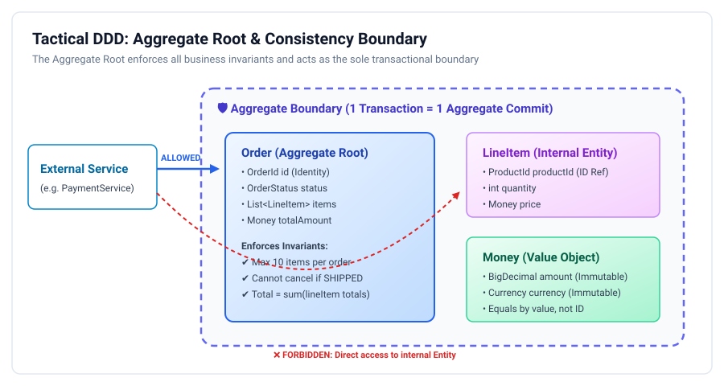
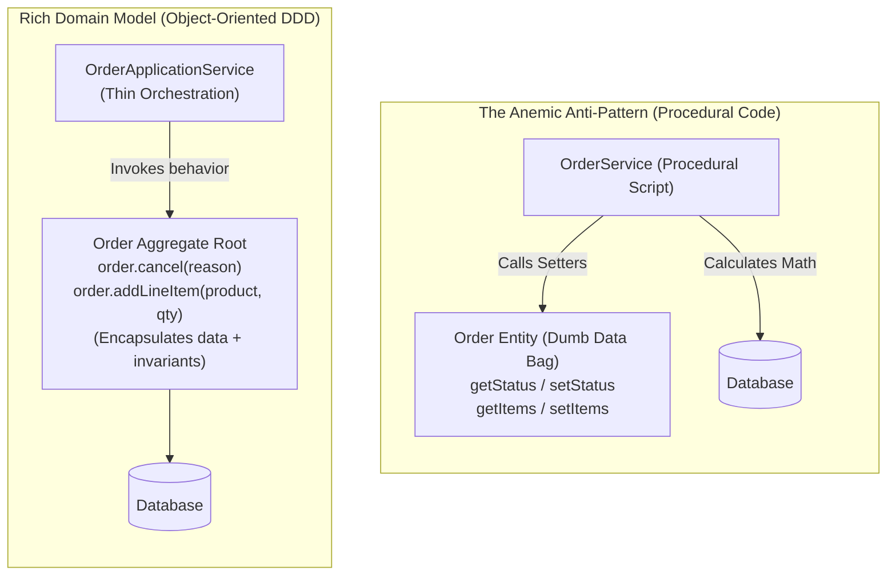

# Tactical Domain-Driven Design (DDD): Staff & Principal Guide

While Strategic DDD draws the macro boundaries of your systems (Bounded Contexts), **Tactical DDD** provides the technical modeling constructs used inside a single service to enforce **business invariants, transactional integrity, and thread safety**.

In Staff and Principal engineering rounds, tactical DDD separates senior software crafters from junior developers who write procedural "anemic" code wrapped in dozens of boilerplate setters.

---

## 1. Tactical DDD Architecture Overview

<p align="center">
  
</p>

---

## 2. Entities vs. Value Objects: The Fundamental Distinction

| Dimension | **Entity** | **Value Object (VO)** |
| :--- | :--- | :--- |
| **Identity** | Defined by a unique **Identity (`ID`)** that remains constant over time. | Defined purely by the **combination of its attributes**. No ID. |
| **Mutability** | State changes over time (lifecycle), but its ID never changes. | **Strictly Immutable**. If an attribute changes, a new VO is created. |
| **Equality** | `e1.getId().equals(e2.getId())`. Two entities with different IDs are distinct even if all other fields match. | `vo1.equals(vo2)` based on all fields. If values match, they are interchangeable. |
| **Validation** | Invariants validated during state transition methods. | **Self-validating on construction**. A Value Object can never exist in an invalid state. |
| **Java 17+ Archetype**| Standard class with private fields and business methods. | **Java `record`** or class with all `final` fields. |

### Practical Code Comparison:
```java
// ✅ VALUE OBJECT: Immutable, self-validating, equals based on values
public record Money(BigDecimal amount, Currency currency) {
    public Money {
        Objects.requireNonNull(amount, "Amount cannot be null");
        Objects.requireNonNull(currency, "Currency cannot be null");
        if (amount.scale() > 2) {
            throw new IllegalArgumentException("Currency precision exceeds 2 decimal places");
        }
    }

    public Money add(Money other) {
        if (!this.currency.equals(other.currency)) {
            throw new CurrencyMismatchException("Cannot add " + other.currency + " to " + this.currency);
        }
        return new Money(this.amount.add(other.amount), this.currency); // Returns a brand new VO!
    }
}

// ✅ ENTITY: Has identity, tracks state transitions
public class User {
    private final UserId id; // Identity
    private EmailAddress email; // Value Object
    private FullName name; // Value Object
    private UserStatus status; // Enum

    public User(UserId id, EmailAddress email, FullName name) {
        this.id = Objects.requireNonNull(id);
        this.email = Objects.requireNonNull(email);
        this.name = Objects.requireNonNull(name);
        this.status = UserStatus.PENDING_VERIFICATION;
    }

    public void verifyEmail(String token) {
        // Business logic & state change
        this.status = UserStatus.ACTIVE;
    }
}
```

---

## 3. Aggregates & The Aggregate Root

An **Aggregate** is a cluster of associated domain objects (Entities and Value Objects) that we treat as a **single unit for data changes**. 

The **Aggregate Root (AR)** is the primary entity that acts as the sole gateway to the aggregate.

### The Four Cardinal Rules of Aggregate Design (Vaughn Vernon):
1. **Model True Invariants Inside Consistency Boundaries**:
   * An invariant is a business rule that must be true *at all times*.
   * *Example*: *"An order's total must equal the sum of its line items"* or *"An order cannot exceed 10 line items"*.
2. **Design Small Aggregates**:
   * Do not create a monolithic `Customer` aggregate containing 10,000 past orders! High concurrency on small aggregates minimizes database lock contention.
3. **Reference Other Aggregates by Identity (`ID`) Only**:
   * ❌ **Anti-Pattern**: `class Order { private Customer customer; }` (Direct object graph reference).
   * ✅ **DDD Pattern**: `class Order { private CustomerId customerId; }` (Reference by ID).
   * *Why this is critical for Staff Engineers*: Referencing by ID decouples aggregate storage, prevents eager-loading massive ORM entity trees, and makes future microservice extraction trivial!
4. **Update Other Aggregates Using Eventual Consistency**:
   * In a single database transaction, **commit changes to only ONE aggregate instance**. If another aggregate must change, publish a **Domain Event** asynchronously.

```java
public class Order { // Aggregate Root
    private final OrderId id;
    private final CustomerId customerId; // Reference by ID only!
    private OrderStatus status;
    private final List<LineItem> lineItems = new ArrayList<>(); // Internal Entity
    private Money totalAmount;

    public void addLineItem(ProductId productId, Money unitPrice, int quantity) {
        // Enforce Invariant 1: Cannot modify completed orders
        if (this.status != OrderStatus.DRAFT) {
            throw new IllegalStateException("Cannot add items to an order that is already " + status);
        }
        // Enforce Invariant 2: Maximum 10 items
        if (lineItems.size() >= 10) {
            throw new DomainRuleException("Order cannot exceed 10 items");
        }

        LineItem item = new LineItem(new LineItemId(UUID.randomUUID()), productId, unitPrice, quantity);
        lineItems.add(item);
        recalculateTotal();
    }

    private void recalculateTotal() {
        this.totalAmount = lineItems.stream()
            .map(LineItem::total)
            .reduce(new Money(BigDecimal.ZERO, Currency.USD), Money::add);
    }
}
```

---

## 4. The Anemic Domain Model Anti-Pattern

Martin Fowler identified the **Anemic Domain Model** as one of the most pervasive anti-patterns in enterprise Java:



### Why Anemic Models Fail at Scale:
1. **Zero Encapsulation**: Any service in the codebase can call `order.setStatus(PAID)` without verifying payment, bypassing fraud checks and business rules.
2. **Logic Duplication**: The same validation rules are duplicated across 5 different Spring `@Service` classes.
3. **Unmaintainable Complexity**: As business rules grow, service classes swell to 3,000 lines of procedural spaghetti code.

---

## 5. Staff / Principal Interview Strategy: Tactical DDD

When an interviewer probes your low-level software architecture and data integrity:

* **1. Defend the Single-Aggregate Transaction Rule**:
  > *"A fundamental tenet of my domain design is that **one database transaction touches exactly one aggregate root**. If an operation requires modifying both an `Order` and an `Inventory` aggregate, I do not wrap them in a multi-table distributed lock. I commit the `Order` aggregate locally and publish an `OrderPlacedEvent` to Kafka. The `Inventory` aggregate updates asynchronously via eventual consistency."*
* **2. Articulate Value Objects for Bug Elimination**:
  > *"I aggressively replace primitive obsession with Value Objects (`Money`, `EmailAddress`, `PostalCode`). Value Objects are immutable, enforce self-validation upon construction, and prevent an entire category of production defects (such as accidentally passing a `CustomerId` into an `OrderId` method parameter)."*
* **3. Reference Other Aggregates by ID**:
  > *"I enforce a strict rule across my engineering teams: aggregates must reference foreign aggregates by ID only, never by direct object references. This eliminates Hibernate N+1 query cascades, prevents deadlocks across transactional boundaries, and ensures services are naturally modular and ready to be extracted into standalone microservices."*
