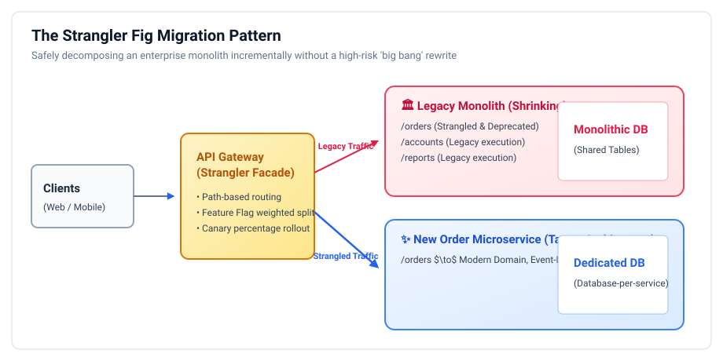
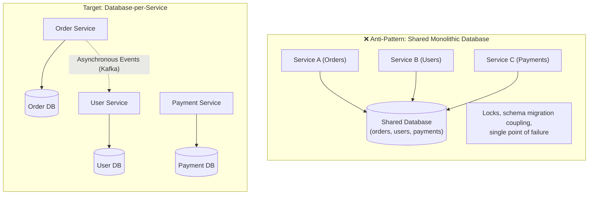
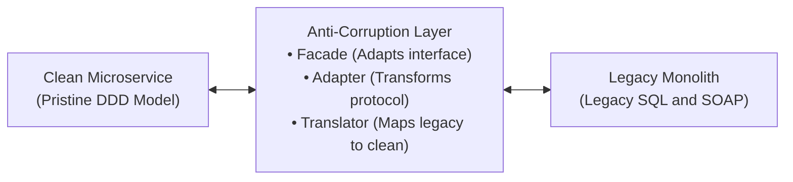

# Monolith Decomposition: Staff & Principal Guide

Decomposing a monolithic system into microservices is one of the highest-stakes responsibilities of a Staff Engineer, Principal Engineer, or Engineering Manager. "Big bang" rewrites (shutting down the old system and launching a brand-new platform on day one) fail more than 80% of the time due to scope creep, undetected edge cases, and catastrophic deployment failures.

The industry-standard, zero-downtime approach to decomposing large systems is the **Strangler Fig Pattern**, coupled with **Anti-Corruption Layers (ACL)** and **Database-per-Service** separation.

---

## 1. The Strangler Fig Pattern

  

Named by Martin Fowler after the Australian strangler fig tree—which seeds in the upper branches of a host tree, slowly grows roots downward until it surrounds the host tree, and eventually leaves a hollow, self-supporting tree when the host dies.

### The Four-Step Migration Cadence:
1. **Intercept (Strangler Facade)**: Place an API Gateway or reverse proxy in front of the existing monolith. All client traffic flows through this facade, which initially forwards 100% of requests to the monolith.
2. **Replicate & Build**: Identify a single Bounded Context (e.g., `/orders`). Build the new Order Microservice independently with its own clean domain model and database.
3. **Strangle (Incremental Traffic Cutover)**:
   * **Shadow Traffic (Dark Launching)**: Mirror production traffic to the new service asynchronously to verify performance and compare results without affecting clients.
   * **Canary Release**: Divert $1\% \to 5\% \to 25\% \to 100\%$ of live `/orders` traffic to the new microservice using path-based routing or feature flags.
4. **Deprecate & Decommission**: Once the new service is handling 100% of the domain with stable SLOs, delete the old `/orders` module and database tables from the monolith. Repeat for the next Bounded Context.

---

## 2. Database Decomposition: The Hardest Problem in Architecture

Separating application code is easy; separating relational database schemas with 15 years of foreign keys and stored procedures is difficult.

### The Three Fallacies of Shared Databases:
1. **Schema Coupling**: Team A alters an `order_status` column, silently breaking a reporting stored procedure written by Team B. Independent deployments become impossible.
2. **Resource Starvation**: A runaway analytical query run by the finance team locks tables and starves the real-time order checkout pipeline.
3. **Technology Lock-In**: You cannot adopt a document database (MongoDB) or time-series store because everything is trapped in the monolithic Oracle/Postgres instance.

### How to Break Shared Database Dependencies:
* **Breaking Foreign Keys**: Replace SQL foreign key constraints with **Logical Identifiers** (e.g., store `customer_id` as a UUID in the order table rather than a foreign key referencing the `users` table).
* **Breaking Cross-Table SQL Joins**:
  1. **Application-Side Join (BFF / GraphQL)**: The API Gateway or GraphQL layer queries the Order Service, retrieves the list of orders, extracts the `customer_id`s, and calls the User Service in parallel.
  2. **CQRS Read Projections**: Stream user updates via Kafka into a read-optimized view inside the Order Service so the data is locally accessible without remote calls.

---

## 3. The Anti-Corruption Layer (ACL) in Practice

When decomposing a monolith, new microservices cannot wait for the entire legacy database to be rewritten. They must communicate with the monolith during the multi-year transition.

> [!CAUTION]
> **The Legacy Contamination Hazard**: If a new microservice accepts legacy database models, legacy status flags, and outdated error codes, the new service becomes just as brittle and corrupt as the monolith it was meant to replace!

### Components of a Production ACL:
1. **Facade**: Exposes a clean, idiomatic interface to the new microservice.
2. **Adapter**: Bridges the transport protocol (e.g., translating an internal gRPC call into an HTTP REST or database query against the monolith).
3. **Translator**: A bidirectional mapper that converts legacy data structures (e.g., status codes `1 = PENDING`, `2 = COMPLETE`, `99 = RETRIED`) into clean Domain Enums (`PaymentStatus.AUTHORIZED`).

---

## 4. Staff / Principal Interview Strategy: Decomposition & Migration

When an interviewer tests your ability to lead a monolithic migration:

* **1. Explicitly Reject the Big-Bang Rewrite**:
  > *"I never advocate for a greenfield 'big-bang' rewrite of an enterprise monolith. It introduces unacceptable business risk, freezes feature velocity for years, and fails to capture 10+ years of subtle edge cases baked into the legacy codebase. Instead, I execute an incremental **Strangler Fig Migration**."*
* **2. Articulate the Data Migration Strategy**:
  > *"Code migration is downstream of data migration. I first introduce **Change Data Capture (Debezium / Kafka Connect)** to replicate writes from the monolithic database to the new microservice database in real-time. We run both in shadow mode (dual-writing / dual-reading) to verify data parity before flipping the strangler facade to make the new service the system of record."*
* **3. Enforce Database-per-Service**:
  > *"Microservices sharing a single database is merely a distributed monolith. I enforce strict database-per-service isolation. Cross-boundary data consistency is resolved via asynchronous domain events and Sagas, never via cross-database SQL joins or distributed locks."*
