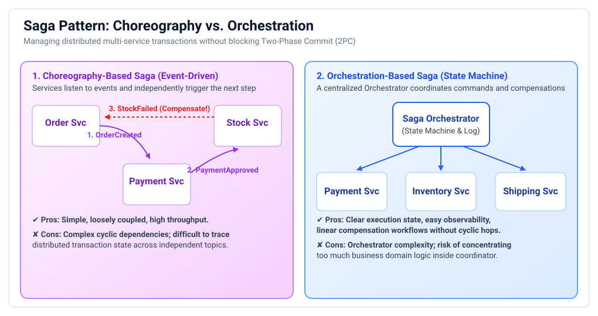
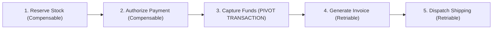
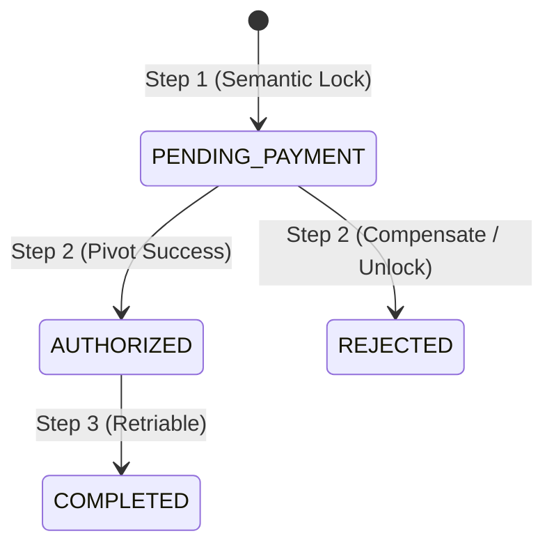

# Distributed Transactions & Sagas: Staff & Principal Guide

In monolithic architectures, maintaining data integrity across tables is trivial: start a local database transaction (`BEGIN`), execute multiple SQL updates, and either `COMMIT` or `ROLLBACK`. The database guarantees ACID (Atomicity, Consistency, Isolation, Durability).

In a microservice architecture with **Database-per-Service**, transactions must cross network boundaries, multiple physical databases, and different storage technologies.

This playbook details why classic **Two-Phase Commit (2PC)** fails at scale, the architecture of the **Saga Pattern**, and how to handle the critical loss of **Isolation** in distributed transactions.

---

## 1. Why Two-Phase Commit (2PC) Fails in Microservices

Many engineers attempt to solve distributed transactions using 2PC (e.g., XA transactions). In a microservice ecosystem, **2PC is an anti-pattern**:

1. **Locks Held Across the Network**: Phase 1 of 2PC acquires row/table locks across all participating services and holds them open while waiting for network acknowledgments. If a network partition occurs, database locks remain held indefinitely, exhausting connection pools.
2. **Availability Degradation ($A = a^n$)**: If a 2PC transaction spans 5 microservices, and each service has $99.9\%$ availability, the availability of the transaction is:
   $$\text{Availability} = 0.999^5 \approx 99.5\%$$
   The entire transaction fails if *any single service* or network link blips.
3. **Coordinator Single Point of Failure**: If the 2PC coordinator crashes after Phase 1, participants are left in doubt, blocking resources until a human intervenes.

---

## 2. The Saga Pattern Overview

  

Originally proposed in 1987 by Hector Garcia-Molina and Kenneth Salem, a **Saga** is a sequence of **local database transactions** ($T_1, T_2, \dots, T_n$). 
* Each transaction updates data within a single service and commits locally using standard ACID.
* If a step fails, the Saga executes **Compensating Transactions** ($C_{k-1}, \dots, C_1$) in reverse order to semantically undo earlier work.

### Compensating Transactions vs. Rollbacks:
* A **Rollback** in a relational database *erases* the write as if it never happened.
* A **Compensating Transaction** is a **forward-moving semantic undo**. 
  * *Example*: You cannot "un-charge" a credit card in a database rollback. You must execute a *Compensating Refund Transaction* that credits the balance back!

---

## 3. Transaction Classifications in a Saga

A robust Saga divides its steps into three distinct categories:

1. **Compensable Transactions**: Steps that can be undone by executing a compensating transaction (e.g., reserving stock can be undone by releasing stock).
2. **Pivot Transaction**: The **point of no return**. If the Pivot Transaction commits, the Saga is guaranteed to run to completion. If the Pivot fails, the Saga aborts and triggers compensations for all preceding steps.
3. **Retriable Transactions**: Steps that occur *after* the Pivot. They are mathematically guaranteed to succeed eventually via idempotent retries and exponential backoff (e.g., sending email confirmations, creating shipping manifests).

---

## 4. Choreography vs. Orchestration: The Trade-Off Matrix

| Dimension | **Choreography-Based Saga** | **Orchestration-Based Saga** |
| :--- | :--- | :--- |
| **Communication** | Event-driven pub/sub (Kafka/RabbitMQ). | Centralized Command/Reply (Temporal, Camunda, AWS Step Functions). |
| **Coupling** | **Loose coupling**. Services only listen to events; no central coordinator. | **Tighter coupling** to the orchestrator state machine. |
| **Cyclic Dependencies** | **High risk**. Services can accidentally trigger circular event ping-pong loops. | **Zero risk**. Orchestrator explicitly directs traffic. |
| **Observability** | **Difficult**. Hard to understand what state a distributed transaction is in without distributed tracing. | **Trivial**. The orchestrator maintains a single, queryable state machine log. |
| **Best For** | Simple workflows with 2–4 services (e.g., Order $\to$ Payment $\to$ Email). | **Complex enterprise workflows** with 5+ steps, branching logic, and human approval gates. |

---

## 5. The "Lack of Isolation" Problem & Semantic Locks

A Saga provides **Atomicity, Consistency, and Durability (ACD)**, but it **lacks Isolation (I)**! 

Because each local transaction commits immediately, intermediate states are visible to other concurrent transactions before the entire Saga finishes.

### The Three Concurrency Anomalies in Sagas:
1. **Lost Updates**: Transaction A reads an account balance; Transaction B updates it; Transaction A overwrites B's change when its Saga step commits.
2. **Dirty Reads**: Service A updates product inventory from 10 to 9. Service B reads the inventory and sells the last item. Service A's Saga fails downstream and rolls back inventory to 10. Service B made a decision based on uncommitted, invalid state!
3. **Non-Repeatable Reads**: A service reads data mid-saga, but a concurrent saga updates that data before the first saga finishes.

### Production Countermeasure: Semantic Locking (The `PENDING` State)
Never let an aggregate mutate directly to its final state. Always introduce an intermediate status flag:

* When an order is placed, set `status = PENDING_PAYMENT`.
* While in `PENDING_PAYMENT`, business invariants **block other operations** on this order (semantic lock).
* If the payment fails, the compensating transaction flips the state to `CANCELLED`.
* If payment succeeds, it flips to `CONFIRMED`.

---

## 6. Staff / Principal Interview Strategy: Distributed Transactions

When an interviewer asks you: *"How do you guarantee atomicity across your payment, inventory, and order services without using distributed locks?"*

* **1. Reject 2PC Immediately with Technical Justification**:
  > *"I avoid Two-Phase Commit (2PC) or XA transactions. 2PC holds database locks across network boundaries, drastically reducing throughput, and causes availability degradation where the system fails if any single participant blips. In microservices, we embrace eventual consistency via the **Saga Pattern**."*
* **2. Choose Between Orchestration and Choreography Based on Scale**:
  > *"For simple 2-step sequences, event choreography is acceptable. But for multi-step enterprise checkouts (Order $\to$ Fraud Check $\to$ Payment $\to$ Inventory $\to$ Notification), I mandate **Saga Orchestration** using an engine like Temporal or AWS Step Functions. Orchestrators provide a single queryable state machine, eliminate circular event dependencies, and simplify compensating logic."*
* **3. Address the Lack of Isolation Proactively**:
  > *"Because Sagas lack transactional isolation, I design domain models with **Semantic Locks**. When a resource is modified in Step 1, its status is flagged as `PENDING`. Concurrent transactions treat pending resources as locked, preventing dirty reads and lost updates until the saga commits its pivot transaction or completes compensation."*
