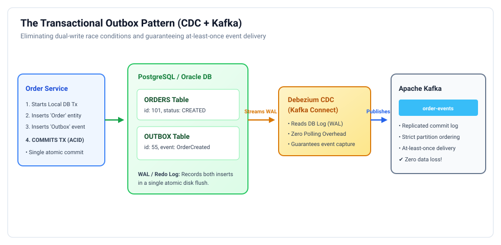
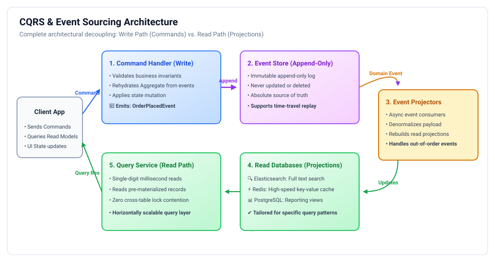
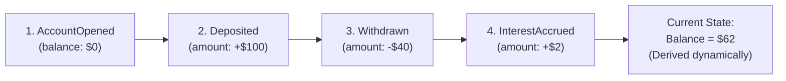

# Event Sourcing, CQRS & The Outbox Pattern: Staff & Principal Guide

In distributed microservices, state mutations and event notifications cannot be coupled using naive REST calls. Traditional architectures suffer from two fundamental bottlenecks:
1. **The Dual-Write Trap**: Trying to write to a relational database and publish an event to a message broker (Kafka) in the same application method.
2. **Read/Write Schema Contention**: Trying to make a single database schema serve both high-concurrency ACID writes and complex, highly denormalized analytical queries.

This playbook establishes the enterprise solutions: the **Transactional Outbox Pattern (CDC)**, **CQRS (Command-Query Responsibility Segregation)**, and **Event Sourcing**.

---

## 1. The Dual-Write Problem & The Transactional Outbox Pattern

<p align="center">
  
</p>

### The Disaster of Naive Dual-Writing:
```java
// ❌ ANTI-PATTERN: The Dual-Write Race Condition
@Transactional
public void createOrder(Order order) {
    orderRepository.save(order);                // Step 1: Database Write
    kafkaTemplate.send("orders", new OrderCreatedEvent(order)); // Step 2: Message Broker Write
}
```

> [!CAUTION]
> **Why Dual-Writing Always Fails in Production:**
> * If the database write succeeds, but the application crashes or Kafka times out on Step 2: **Data is saved, but no event is ever published.** Downstream billing and shipping services are never notified!
> * If you reverse the order (publish to Kafka first, then save to DB): Kafka sends the event, but the database transaction rolls back due to a constraint violation. **Downstream services process a phantom event for an order that does not exist!**
> * Distributed transactions (2PC between Postgres and Kafka) are unsupported and destroy throughput.

---

### The Solution: The Transactional Outbox Pattern
Instead of writing to two separate systems, the application writes to **two tables within the SAME local database**:

```sql
-- 1. Primary Domain Table
CREATE TABLE orders (
    order_id VARCHAR(64) PRIMARY KEY,
    customer_id VARCHAR(64),
    total_amount DECIMAL(12,2),
    status VARCHAR(32)
);

-- 2. Outbox Table
CREATE TABLE outbox_events (
    event_id VARCHAR(64) PRIMARY KEY,
    aggregate_type VARCHAR(64),
    aggregate_id VARCHAR(64),
    event_type VARCHAR(64),
    payload JSONB,
    created_at TIMESTAMP WITH TIME ZONE
);
```

#### Application Logic:
```java
@Transactional
public void placeOrder(Order order) {
    // 1. Insert into orders table
    orderRepository.save(order);

    // 2. Insert into outbox table in the SAME database transaction!
    OutboxEvent event = new OutboxEvent(
        UUID.randomUUID().toString(),
        "Order",
        order.getId(),
        "OrderCreated",
        objectMapper.writeValueAsString(order)
    );
    outboxRepository.save(event);
    
    // 3. Commit Transaction: 100% ACID guaranteed! Both succeed or both roll back.
}
```

---

### Publishing Outbox Events: Polling vs. Transaction Log Tailing (CDC)

How do events travel from the `outbox_events` table to Apache Kafka?

1. **Approach A: Polling Publisher (Acceptable for low scale)**:
   * A background worker thread runs: `SELECT * FROM outbox_events ORDER BY created_at LIMIT 100 FOR UPDATE SKIP LOCKED`.
   * Publishes events to Kafka, then deletes processed rows.
   * *Cons*: Adds polling load on the database; poll interval introduces $100\text{ ms} - 1000\text{ ms}$ latency.
2. **Approach B: Change Data Capture (CDC via Debezium) — The Principal Standard**:
   * **Debezium** connects as a replica to the database's internal transaction log (PostgreSQL **Write-Ahead Log (WAL)**, MySQL **binlog**, or Oracle **Redo Log**).
   * As soon as the transaction commits, Debezium streams the insert directly into Kafka with **sub-millisecond latency**.
   * **Zero polling overhead** on the database; zero impact on application threads.

---

## 2. CQRS (Command-Query Responsibility Segregation)

<p align="center">
  
</p>

Coined by Greg Young (derived from Bertrand Meyer's CQS principle), **CQRS** advocates that the data model used for mutating state (Commands) should be completely separate from the data model used for reading state (Queries).

### The Asymmetry of Modern Workloads:
* In typical web and enterprise systems, **reads outnumber writes by $10:1$ to $100:1$**.
* Write models require strict normalization (3NF) to prevent anomalies and enforce invariants.
* Read models require denormalized, pre-joined data to serve mobile screens in $< 10\text{ ms}$ without complex SQL joins.

### CQRS Architecture in Practice:
* **The Command Side (Write)**:
  * Accepts commands (`CreateOrderCommand`, `CancelOrderCommand`).
  * Validates business invariants against an Aggregate Root.
  * Commits writes to a relational database or Event Store.
* **The Query Side (Read)**:
  * Consumes domain events from Kafka asynchronously.
  * Projects events into specialized, purpose-built read databases:
    * **Elasticsearch**: Full-text search, auto-complete, and fuzzy filtering.
    * **Redis**: Real-time user session feeds and balance lookups.
    * **PostgreSQL (Read Replica)**: Denormalized tables with pre-computed joins for dashboard reporting.

---

## 3. Event Sourcing

Instead of storing the *current state* of an entity in a mutable table, **Event Sourcing** stores the entity as an **immutable, append-only sequence of domain events**.

$$\text{Current State} = \text{Fold}(\text{All Historical Events from } t_0 \text{ to } t_{\text{now}})$$



### The Real-World Analogy:
A bank ledger is an event-sourced system. A bank does not maintain your account balance as a single mutable number in a database column. It stores every single credit and debit event. Your balance is calculated by summing all previous transactions.

### Event Sourcing Advantages:
1. **100% Perfect Audit Trail**: Zero data loss. You know not only *what* the state is, but *how* and *why* it reached that state.
2. **Time Travel & Debugging**: You can reconstruct the exact state of any aggregate at any point in history (e.g., *"What was customer X's order state on October 12th at 14:02 UTC?"*).
3. **Optimistic Concurrency**: Append-only writes eliminate row-level update deadlocks.

### Event Sourcing Challenges & Solutions:
* **Rehydration Latency on Long-Lived Entities**: If an account has 50,000 events, replaying 50,000 events to verify a $5 withdrawal takes seconds!
  * **The Fix: Snapshots**: Every $N$ events (e.g., every 100 events), the system saves a snapshot of the current state. To rehydrate, the system loads the latest snapshot and replays only the events that occurred after the snapshot.
* **Schema Evolution**: As business rules change, event payloads evolve.
  * **The Fix: Upcasters**: Upcaster transformers migrate old event versions (v1) into modern schema versions (v2) in memory during event deserialization.

---

## 4. Staff / Principal Interview Strategy: Outbox & CQRS

When an interviewer tests your distributed data pipeline design:

* **1. Proactively Call Out the Dual-Write Anti-Pattern**:
  > *"Whenever a microservice must update a database and publish an event to Kafka, I strictly forbid naive dual-writing in application code. Network drops or app crashes will inevitably produce phantom events or lost notifications. I mandate the **Transactional Outbox Pattern with Debezium Change Data Capture (CDC)**, guaranteeing 100% ACID atomicity between local state updates and event publishing."*
* **2. Justify CQRS Based on Access Asymmetry**:
  > *"I introduce CQRS when read access patterns fundamentally diverge from write invariant boundaries. The write side optimizes for fast transactional commits and small aggregate boundaries. The read side uses Kafka event projectors to hydrate denormalized Elasticsearch indices or Redis caches, giving users sub-10ms queries without placing lock contention on the primary write database."*
* **3. Address Eventual Consistency Trade-Offs in CQRS**:
  > *"The primary trade-off of CQRS is eventual consistency: a user might execute a write command, immediately refresh the page, and not see the update if the read projector is lagging by 50ms. We solve this by having the UI optimistically render the mutation, or by returning the newly committed version from the Command API directly."*
