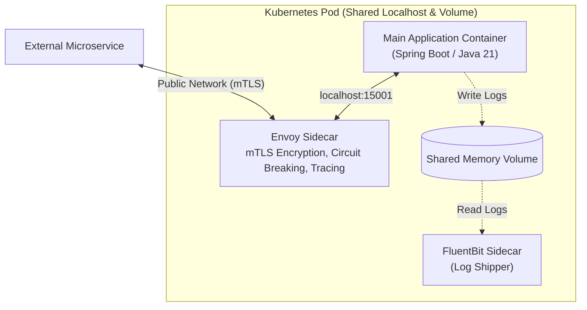
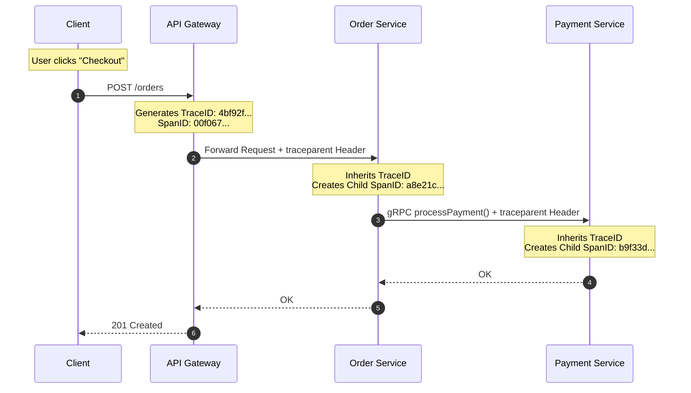

# Cloud-Native Architecture & Microservice Resilience: Staff & Principal Guide

Building microservices that survive in elastic cloud environments (Kubernetes, AWS, GCP) requires adherence to cloud-native operating principles. Microservices are fundamentally **ephemeral**: containers scale up, crash, migrate across nodes, and restart continuously.

This playbook covers the **Modernized 12-Factor App**, distributed deployment patterns (**Sidecar, Ambassador, Init Containers**), and **Distributed Context Propagation (OpenTelemetry & W3C TraceContext)**.

---

## 1. The Modernized 12-Factor App (Cloud-Native Standard)

The original Twelve-Factor App methodology (created by Heroku co-founder Adam Wiggins) remains the definitive baseline for scalable software. In modern Kubernetes and cloud environments, Staff Engineers extend it with modern observability and security principles.

| # | Factor | Core Principle | Staff/Principal Production Implementation |
| :-: | :--- | :--- | :--- |
| **I** | **Codebase** | One codebase tracked in git, many deploys. | Monorepo or Multi-repo with clean semantic versioning; identical artifact deployed to Staging and Prod. |
| **II** | **Dependencies** | Explicitly declare and isolate dependencies. | Multi-stage Docker builds; container images pin exact library versions; no reliance on host packages. |
| **III** | **Config** | Store configuration in the environment. | Strict separation of code and config. Inject secrets via Kubernetes Secrets or HashiCorp Vault; never check `.env` into git. |
| **IV** | **Backing Services**| Treat backing resources as attached resources. | Databases, caches, and Kafka brokers are attached via connection strings. Swapping a local Postgres for AWS Aurora requires **zero code changes**. |
| **V** | **Build, Release, Run**| Strictly separate build and run stages. | CI/CD pipelines build immutable container tags (e.g., `:sha-8f2a1b`). Configuration is merged only during the release phase. |
| **VI** | **Processes** | Execute the app as stateless processes. | Zero local disk persistence. Shared state lives in Redis/Postgres. Any container can be killed instantly without data loss. |
| **VII**| **Port Binding** | Export services via port binding. | Self-contained web runtimes (embedded Netty/Tomcat). Binds directly to `0.0.0.0:8080`, exposed via Kubernetes Services. |
| **VIII**|**Concurrency** | Scale out via the process model. | Horizontal pod autoscaling (HPA) based on CPU/memory or Kafka consumer lag rather than vertical machine resizing. |
| **IX** | **Disposability** | Fast startup and graceful shutdown. | Fast boot time ($< 5\text{s}$ via GraalVM/JVM optimization). Must handle `SIGTERM`: flush in-flight work and gracefully drain connections within 30 seconds. |
| **X** | **Dev/Prod Parity**| Keep dev, staging, and prod as similar as possible. | Use Testcontainers in integration tests to spin up real Dockerized PostgreSQL and Kafka rather than in-memory H2 mocks. |
| **XI** | **Logs** | Treat logs as event streams. | Applications write raw JSON to `stdout`/`stderr`. DaemonSet agents (FluentBit/Vector) stream logs to OpenSearch/Datadog. |
| **XII**| **Admin Processes**| Run management tasks as one-off processes. | Database schema migrations (Liquibase/Flyway) run as Kubernetes `Jobs` during CI/CD, not inside application startup threads. |

---

### The Modern Cloud Extensions (Factors 13–15):
* **XIII. API-First**: Define interfaces using OpenAPI or Protobuf IDLs *before* writing application code. Client and server teams code against mocks in parallel.
* **XIV. Telemetry First**: Instrument OpenTelemetry metrics, traces, and structured logs natively in code from day one.
* **XV. Zero Trust Security**: Never trust the internal network. All east-west traffic between microservices must be authenticated via **mutual TLS (mTLS)** and short-lived tokens.

---

## 2. Distributed Container Deployment Patterns

In Kubernetes, a **Pod** is a cohesive group of one or more containers sharing storage and a network namespace (localhost).



### 1. The Sidecar Pattern
* Deploys a secondary helper container alongside the primary application container.
* **Responsibilities**: Offload operational concerns from application code:
  * **Service Mesh Proxy (Envoy / Istio)**: Intercepts inbound and outbound traffic, handles mTLS rotation, retry policies, and metrics reporting.
  * **Log Shipper (FluentBit)**: Tails log files from a shared ephemeral volume and ships them to a centralized SIEM.
  * **Secrets Refresh (Vault Agent)**: Periodically rotates credentials and injects them into a local ramdisk.

### 2. The Ambassador Pattern
* Acts as an out-of-process proxy representing an external service to the main container.
* *Example*: The main application connects to `localhost:6379`. The Ambassador proxy transparently handles sharded Redis routing, read-replica failovers, and retry backoff.

### 3. The Init Container Pattern
* Specialized containers that run to completion *before* the main application container starts.
* **Use Cases**: Waiting for a database to be healthy, running Liquibase/Flyway database schema migrations, or downloading large ML models from S3 onto a shared volume.

---

## 3. Distributed Tracing & Context Propagation

In an architecture with 50 microservices, an error in Service 48 cannot be diagnosed by searching through 50 disjointed log files. Distributed systems require **Distributed Tracing**.



### The W3C TraceContext Standard:
Distributed context is passed across HTTP headers and Kafka message headers using the **W3C TraceContext** specification:

```http
traceparent: 00-4bf92f3577b34da6a3ce929d0e0e4736-00f067aa0ba902b7-01
```

* **`00`**: Version number.
* **`4bf92f3577b34da6a3ce929d0e0e4736`**: **Trace ID** (16 bytes / 32 hex chars). Unique globally for the entire request lifecycle across all microservices.
* **`00f067aa0ba902b7`**: **Parent Span ID** (8 bytes / 16 hex chars). Identifies the immediate caller.
* **`01`**: Trace Flags (e.g., `01` means sampled / recorded).

### W3C Baggage Header:
While `traceparent` passes tracing IDs, the **Baggage** header propagates arbitrary business context across services:

```http
baggage: tenant_id=enterprise_corp,user_tier=platinum
```
Any downstream service can read `tenant_id` from the thread-local OpenTelemetry context without having to query the database!

---

## 4. Staff / Principal Interview Strategy: Cloud-Native Architecture

When an interviewer evaluates your operational maturity in cloud-native microservices:

* **1. Emphasize Disposability & Graceful Shutdown (`SIGTERM`)**:
  > *"In Kubernetes, pods can be terminated at any second due to node preemption, horizontal downscaling, or rolling deployments. I configure all Spring Boot / Java services with graceful shutdown hooks: upon receiving `SIGTERM`, the container stops accepting new traffic, waits for in-flight requests to complete within a 25-second grace window, flushes thread pool queues, and closes database connections cleanly."*
* **2. Leverage Sidecars for Cross-Cutting Separation**:
  > *"I enforce a strict separation between business logic and operational infrastructure. Application code should not contain complex retry loops, mutual TLS handshakes, or secret rotation scripts. We offload these cross-cutting operational concerns to **Envoy sidecars** and service meshes, keeping application code pure and framework-agnostic."*
* **3. Mandate OpenTelemetry & W3C Context Propagation**:
  > *"I mandate OpenTelemetry instrumentation across all HTTP clients, gRPC channels, and Kafka producer/consumer interceptors. Every log entry must include the active `TraceId` and `SpanId` in its Mapped Diagnostic Context (MDC). This allows our engineering teams to jump from a production alert directly to a single end-to-end distributed flame graph across 20 microservices in Datadog or Jaeger."*
