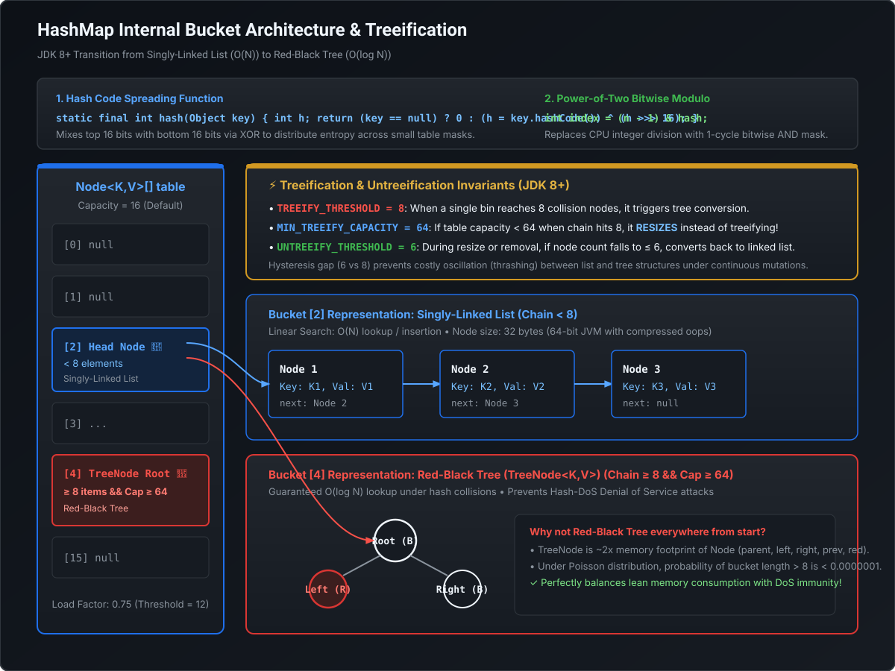
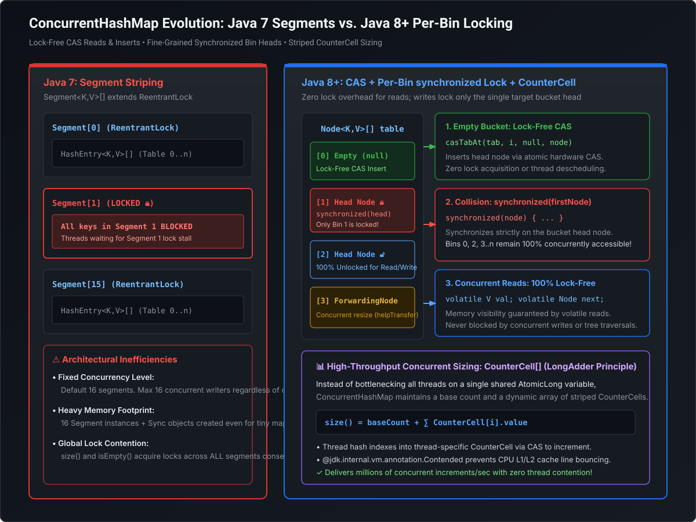

# HashMap & ConcurrentHashMap Under the Hood: Bitwise Math, Treeification & Lock-Free Internals

The internal mechanics of `HashMap` and `ConcurrentHashMap` are among the most frequently tested topics in Principal and Staff Java interviews. Interviewers use this topic to determine whether an engineer understands **bitwise bit-masking, amortized time complexity, hash collision attacks, hardware cache coherence, and lock-free CAS primitives**.

---

## 1. HashMap Architecture & Bitwise Mechanics



A `HashMap` stores key-value pairs in an internal array of nodes: `transient Node<K,V>[] table`.

### A. Why Initial Capacity Must Be a Power of Two
By default, `HashMap` initializes with `DEFAULT_INITIAL_CAPACITY = 16` ($2^4$). If you provide a custom capacity like `new HashMap<>(25)`, the internal table size is rounded up to the next highest power of two (**32**) via `tableSizeFor()`.

#### The Math Behind Bucket Indexing:
To map a 32-bit hash value into an array of length $N$:
- Traditional modulo: $\text{index} = \text{hash} \pmod N$ (Extremely expensive on CPU arithmetic units, taking $\approx 10\text{–}20$ clock cycles).
- **Bitwise Power-of-Two Masking**: When $N$ is strictly a power of two ($N = 2^k$), the modulo operation is mathematically identical to a bitwise AND with $N - 1$:
  $$\text{hash} \pmod N \equiv \text{hash} \ \& \ (N - 1)$$
  A bitwise `&` executes in a **single CPU clock cycle** ($< 0.5\text{ ns}$).

```
Example: Capacity N = 16 (Binary: 0001 0000)
         N - 1 = 15      (Binary: 0000 1111)

Hash Code:    1011 1100 0110 1010
Bitwise AND:  0000 0000 0000 1111  (& 15)
----------------------------------
Bucket Index: 0000 0000 0000 1010  (Index 10)
```

### B. Bitwise Hash Spreading (Perturbation Function)
If you only apply `hash & (N - 1)`, and $N = 16$, **only the lowest 4 bits** of the hash code are used to determine the bucket. The upper 28 bits are completely ignored! 

If several keys produce hash codes that differ in their higher bits but share the same lowest 4 bits, they all collide into the exact same bucket.

To prevent this clustering, Java applies a bitwise perturbation function:
```java
static final int hash(Object key) {
    int h;
    return (key == null) ? 0 : (h = key.hashCode()) ^ (h >>> 16);
}
```
- `h >>> 16` shifts the upper 16 bits down into the lower half.
- The XOR (`^`) blends the impact of the higher bits into the lower bits. When the table index is calculated, the upper bits now influence the bucket destination!

---

## 2. Collision Handling: From Linked List to Red-Black Tree

When two keys produce the same bucket index (`(n - 1) & hash`), a collision occurs.

### A. The Treeification Thresholds
Prior to Java 8, all collisions formed a singly-linked list ($O(N)$ lookup). Attackers exploited this by crafting malicious keys with identical hash codes (Hash-DoS attack), degrading `HashMap.get()` performance from $O(1)$ to $O(N)$ and exhausting server CPUs.

Starting in Java 8, bins transition dynamically:
1. **`TREEIFY_THRESHOLD = 8`**: If a single bucket accumulates **8 elements**, Java checks the overall table capacity.
2. **`MIN_TREEIFY_CAPACITY = 64`**: If table capacity is less than 64, Java **resizes (doubles) the table** instead of treeifying! Resizing splits the bucket and often resolves the collision naturally.
3. **Red-Black Tree Transition**: If bucket size $\ge 8$ **AND** table capacity $\ge 64$, the bucket transforms from a singly-linked `Node<K,V>` into a balanced Red-Black `TreeNode<K,V>`. Search time drops to **$O(\log N)$**.
4. **`UNTREEIFY_THRESHOLD = 6`**: During table resizing, if a tree bucket splits and retains **6 or fewer elements**, it converts back into a singly-linked list.

> [!NOTE]
> **Why is there a gap between 6 and 8? (Hysteresis)**
> If treeification and untreeification both occurred at threshold 8, repeatedly adding and removing a 9th element would cause the bucket to rapidly oscillate between a Tree and a Linked List, triggering continuous allocation overhead. The gap of 2 prevents thrashing.

### B. Load Factor 0.75: The Poisson Distribution Trade-Off
The default `DEFAULT_LOAD_FACTOR = 0.75f` dictates when the table resizes (`threshold = capacity * loadFactor`).
- **Load Factor = 1.0**: Maximizes memory efficiency, but bucket collisions increase significantly, degrading CPU lookup time.
- **Load Factor = 0.5**: Minimizes collisions, but doubles memory footprint and forces frequent resizes.
- **0.75 Math**: Under random hash distributions following Poisson distribution ($P(k) = \frac{e^{-\lambda} \lambda^k}{k!}$), the probability of a bucket reaching size 8 is less than **1 in 10,000,000** ($0.00000006$). Reaching a tree bucket is an extreme anomaly unless a bad hash function or deliberate DoS attack is present.

### C. Resize Re-indexing Trick (No Re-Hashing!)
When `HashMap` doubles its capacity ($N \to 2N$), it does **not** re-calculate `key.hashCode()`.

Because capacity is a power of two, the new index mask gains exactly one new high bit:
```java
// How Java checks where a node moves during resize:
if ((e.hash & oldCap) == 0) {
    // New bit is 0: Stays at current index!
} else {
    // New bit is 1: Moves to (index + oldCap)!
}
```
Elements in a bucket partition cleanly into two sub-lists: **Low-List** (retained at `index`) and **High-List** (shifted to `index + oldCap`).

---

## 3. HashMap vs. Hashtable vs. ConcurrentHashMap

| Feature | `HashMap` | `Hashtable` | `Collections.synchronizedMap()` | `ConcurrentHashMap` (Java 8+) |
| :--- | :--- | :--- | :--- | :--- |
| **Thread Safety** | ❌ No | ✅ Yes | ✅ Yes | ✅ Yes |
| **Locking Mechanism** | None | Coarse `synchronized` on all methods | Coarse `synchronized(mutex)` on object | **Lock-Free CAS** on empty bins + **`synchronized` on Bin Head** |
| **Concurrent Reads** | Thread-unsafe (Infinite loops / nulls) | Blocked by concurrent writes | Blocked by concurrent writes | **100% Lock-Free** (`volatile` reads) |
| **Null Keys / Values** | 1 Null Key, Multiple Null Values | ❌ Throws `NullPointerException` | Depends on backing map | ❌ **Throws `NullPointerException`** |
| **Performance** | Maximum (single-threaded) | Very Poor (global bottleneck) | Poor (global bottleneck) | **Exceptional** (scales linearly with CPU cores) |

### Why Do Concurrent Collections Forbid Nulls?
`ConcurrentHashMap` strictly prohibits `null` keys and `null` values to eliminate ambiguity in concurrent environments:
- In `HashMap`, if `map.get("orderId")` returns `null`, you call `map.containsKey("orderId")` to check if the key is missing or mapped to `null`.
- In `ConcurrentHashMap`, another thread could insert or remove the key between your `get()` and `containsKey()` calls! To avoid this race condition, `null` is forbidden.

---

## 4. ConcurrentHashMap in Java 8+: Lock-Free & Per-Bin Locking



Java 7 used **Segment Striping** (`Segment<K,V>[] extends ReentrantLock`), locking 1 of 16 segments. Concurrency was capped at 16 by default.

**Java 8 completely abandoned Segments** in favor of a hybrid **Lock-Free CAS + Node Synchronization** model:

### A. Case 1: Inserting into an Empty Bucket (Lock-Free CAS)
When adding an entry into a bucket that has not yet collided (`table[i] == null`), **no locks are acquired**.
It attempts an atomic Compare-And-Swap:
```java
// Internal JDK method in ConcurrentHashMap.java
static final <K,V> boolean casTabAt(Node<K,V>[] tab, int i, Node<K,V> c, Node<K,V> v) {
    return U.compareAndSetReference(tab, ((long)i << ASHIFT) + ABASE, c, v);
}
```
If CAS succeeds, insertion completes with zero lock contention!

### B. Case 2: Populated Bucket Collision (`synchronized` on Bin Head)
If the bucket already contains elements (`table[i] != null`), Java synchronizes **only on the first node of that specific bin**:
```java
synchronized (f) { // 'f' is table[i] (the head node)
    if (tabAt(tab, i) == f) {
        // Traverse linked list or TreeNodes to insert/update...
    }
}
```
- **Concurrency Benefit**: If your map has 1,024 buckets, 1,023 buckets remain **100% unlocked**! Hundreds of threads can write to different buckets simultaneously without blocking.

### C. Case 3: Concurrent Reads (`get()`) are 100% Lock-Free
Reads never block and never acquire locks:
```java
static class Node<K,V> implements Map.Entry<K,V> {
    final int hash;
    final K key;
    volatile V val;              // volatile ensures visibility
    volatile Node<K,V> next;     // volatile ensures structural traversal visibility
}
```
Because `val` and `next` are `volatile`, any write committed by a writer thread is immediately visible to any reading thread via hardware memory barriers.

### D. High-Throughput Size Counting via `CounterCell`
If multiple threads update a single shared `AtomicLong` counter every time an entry is added, CPU cores waste massive cycles invalidating each other's L1/L2 cache lines (Cache Line Bouncing).

`ConcurrentHashMap` uses a striped **`CounterCell[]`** array (identical to Java 8 `LongAdder`):
- Threads hash their thread ID to a separate `CounterCell` and CAS their own cell independently.
- `size()` sums the base count + all individual `CounterCell` values:
  $$\text{size} = \text{baseCount} + \sum \text{CounterCell}[i].\text{value}$$
- This guarantees $1,000,000+\text{ ops/sec}$ throughput without contention on map sizing!

---

## 5. Runnable Hands-on POC: Atomicity with `computeIfAbsent`

Paste this self-contained class into IntelliJ to test `ConcurrentHashMap` atomic updates vs race conditions:

```java
import java.util.concurrent.*;
import java.util.concurrent.atomic.AtomicInteger;

public class ConcurrentHashMapMastery {
    private static final ConcurrentHashMap<String, AtomicInteger> accessCount = new ConcurrentHashMap<>();

    public static void main(String[] args) throws InterruptedException {
        int threadCount = 10;
        int operationsPerThread = 1000;
        ExecutorService executor = Executors.newFixedThreadPool(threadCount);
        CountDownLatch latch = new CountDownLatch(threadCount);

        for (int i = 0; i < threadCount; i++) {
            executor.submit(() -> {
                try {
                    for (int j = 0; j < operationsPerThread; j++) {
                        // ✅ ATOMIC: computeIfAbsent guarantees atomic initialization
                        accessCount.computeIfAbsent("API_ENDPOINT", k -> new AtomicInteger(0))
                                   .incrementAndGet();
                    }
                } finally {
                    latch.countDown();
                }
            });
        }

        latch.await();
        executor.shutdown();

        // Expected count: 10 * 1000 = 10000
        System.out.println("Final Counter: " + accessCount.get("API_ENDPOINT").get());
    }
}
```

---

## 6. Staff / Principal Interview Strategy: HashMap & Concurrency

### Classic Traps & Pivot Responses

#### Trap 1: *"Can an infinite loop occur in HashMap in a multi-threaded environment?"*
- **Pivot**: *"In Java 7, **yes**. Java 7 used head-insertion (`addEntry`) during bucket transfer during resizing. Under concurrent execution, two threads reversing the list could cross pointers and form a circular reference (`A.next = B` and `B.next = A`), causing 100% CPU utilization and infinite loop during subsequent `get()` calls. In Java 8+, tail-insertion is used, eliminating the circular pointer loop. However, concurrent updates without synchronization still cause silent data corruption or lost updates, so `ConcurrentHashMap` must always be used."*

#### Trap 2: *"Why is `map.putIfAbsent(k, v)` not always atomic in multi-step workflows?"*
- **Pivot**: *"While `putIfAbsent` itself is atomic, calling `if (!map.containsKey(k)) { map.put(k, compute(v)); }` is a classic 'check-then-act' race condition. Between the check and the put, another thread can intervene. In modern Java, always use `map.computeIfAbsent(k, key -> compute(key))` which executes the mapping function atomically under the target bin lock."*

#### Trap 3: *"What is the memory impact of treeification?"*
- **Pivot**: *"A standard `Node<K,V>` holds 4 references (hash, key, value, next), consuming 32 bytes on a 64-bit JVM with Compressed OOPs. A `TreeNode<K,V>` extends `LinkedHashMap.Entry` and adds parent, left, right, and red/black boolean, consuming roughly **double the memory** ($\approx 56\text{ bytes}$). This is why Java does not use trees by default—trees are strictly a defensive contingency against pathological collisions."*
