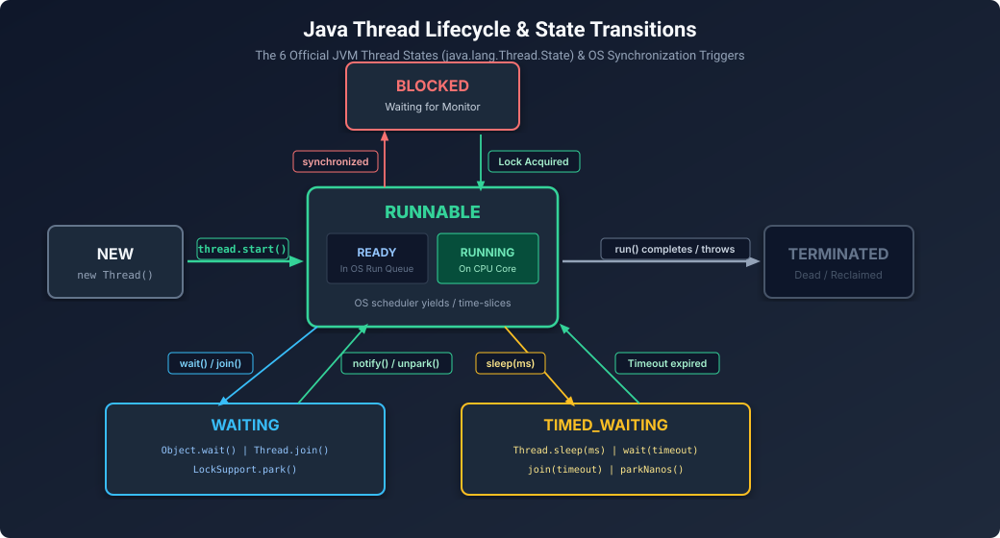

# Java Threading Fundamentals, Lifecycle & Low-Level Coordination

Even in an era of high-level reactive frameworks and virtual threads, senior interviewers constantly test the raw, low-level mechanics of Java threads. Understanding **thread states, monitor acquisition, spurious wakeups, and interrupt handling** is the litmus test for whether an engineer truly understands multi-threaded execution.

---

## 1. Thread Creation: Thread vs. Runnable vs. Callable

```
              ┌────────────────────────┐
              │  Task vs Execution     │
              └───────────┬────────────┘
                          │
         ┌────────────────┴────────────────┐
         ▼                                 ▼
   Runnable / Callable                  Thread
   (Decoupled Task Definition)         (OS Execution Worker)
   - Runnable: void run(), no checked exc  - Extends Thread (Tight coupling)
   - Callable<V>: V call() throws Exception - Manages OS stack & lifecycle
```

### The Three Execution Abstractions
1. **Extending `java.lang.Thread`**:
   - Tightly couples the task to the execution thread.
   - Java does not support multiple class inheritance; extending `Thread` prevents extending any other business class.
   - **Anti-pattern in production.**
2. **Implementing `java.lang.Runnable`**:
   - Decouples the work from the execution mechanism.
   - Signature: `public void run()`. Cannot return a value; cannot throw checked exceptions.
3. **Implementing `java.util.concurrent.Callable<V>`**:
   - Modern task abstraction.
   - Signature: `V call() throws Exception`. Returns a computed value of type `V` and allows throwing checked exceptions.
   - Submitting a `Callable` to an `ExecutorService` returns a `Future<V>` handle for asynchronous retrieval.

---

## 2. The 6 Official JVM Thread States



Defined strictly in `java.lang.Thread.State`:

1. **`NEW`**: A thread instance has been created (`new Thread(...)`), but `start()` has not yet been invoked.
2. **`RUNNABLE`**: The thread is executing in the JVM.
   - *OS Reality*: A `RUNNABLE` JVM thread may either be actively executing on a CPU core (**RUNNING**) or waiting in the operating system's CPU run-queue for its scheduled time-slice (**READY**). The JVM collapses both into `RUNNABLE`.
3. **`BLOCKED`**: The thread is waiting to acquire a **monitor lock** (specifically waiting to enter or re-enter a `synchronized` block or method).
4. **`WAITING`**: The thread is waiting indefinitely for another thread to perform a specific action:
   - `Object.wait()` with no timeout (waiting for `notify()` or `notifyAll()`).
   - `Thread.join()` with no timeout.
   - `LockSupport.park()`.
5. **`TIMED_WAITING`**: The thread is waiting for another thread for up to a specified waiting time:
   - `Thread.sleep(millis)`.
   - `Object.wait(timeout)`.
   - `Thread.join(timeout)`.
   - `LockSupport.parkNanos()` or `LockSupport.parkUntil()`.
6. **`TERMINATED`**: The thread has finished executing its `run()` method (either completed normally or abruptly terminated by an uncaught exception).

> [!IMPORTANT]
> **The Critical Senior Distinction: `BLOCKED` vs. `WAITING`**
> - A thread enters **`BLOCKED`** strictly when competing for an intrinsic `synchronized` monitor lock currently held by another thread.
> - A thread enters **`WAITING`** or **`TIMED_WAITING`** voluntarily by releasing control and waiting for a signal (`wait()`, `join()`, `sleep()`, or explicit `LockSupport.park()` inside `ReentrantLock`).

---

## 3. Low-Level Coordination: `wait()`, `notify()` & `notifyAll()`

These methods belong to `java.lang.Object` (not `Thread`), because every Java object has an intrinsic monitor lock and an internal wait-set queue.

### Question 1: Why MUST `wait()` and `notify()` be inside a `synchronized` block?
If Java allowed calling `wait()` without synchronizing on the object's monitor, a fatal race condition called **Lost Wakeup** would occur:

```
Thread A (Consumer)                       Thread B (Producer)
1. Checks: if (buffer.isEmpty())
   (Evaluates to true)
                                          2. Produces item into buffer
                                          3. Calls: buffer.notify()
                                             (Notification is lost! No one is waiting yet)
4. Calls: buffer.wait()
   (Thread A sleeps FOREVER!)
```
By enforcing that both threads hold the intrinsic lock of the target object, checking the condition and calling `wait()` / `notify()` becomes an atomic critical section. Calling `wait()` outside synchronization immediately throws **`IllegalMonitorStateException`**.

### Question 2: Why MUST `wait()` ALWAYS be called in a `while` loop?
```java
// ❌ DANGEROUS: Using 'if'
if (!condition) {
    lock.wait();
}

// ✅ MANDATORY: Using 'while'
while (!condition) {
    lock.wait();
}
```

Two independent reasons:
1. **Spurious Wakeups**: Under POSIX threads and Linux/Windows kernels, an OS thread can occasionally unpark and wake up from `wait()` **without any thread having called `notify()`**. The `while` loop re-evaluates the business condition upon waking; if it is false, it goes back to sleep.
2. **Multi-Thread Competition (`notifyAll()`)**: If Thread B calls `notifyAll()`, 5 waiting consumer threads wake up simultaneously. Thread 1 acquires the lock, drains the queue, and releases the lock. When Thread 2 acquires the lock, the queue is empty! An `if` statement would proceed to read from an empty queue and crash with `NoSuchElementException`. The `while` loop forces Thread 2 to check the queue size again.

---

## 4. Thread Interruption: Flags & The Lost Interrupt Trap

Thread interruption is a **cooperative cancellation mechanism**. A thread cannot be forcefully killed; it is politely asked to stop via a boolean interrupt flag.

### The Three Interruption Methods:
1. `thread.interrupt()`: Sets the interrupt status flag to `true` on the target thread. If the thread is currently blocked in `sleep()`, `wait()`, or `join()`, the blocking call is aborted, and an **`InterruptedException`** is thrown.
2. `thread.isInterrupted()`: Returns the boolean status of the interrupt flag. **Does not modify the flag.**
3. `Thread.interrupted()` (Static!): Returns the interrupt status of the *current thread* **AND CLEARS the flag** (resets it to `false`).

### The Cardinal Sin: Swallowing `InterruptedException`
When Java throws `InterruptedException`, it **automatically clears the thread's interrupt flag**. If you catch the exception with an empty block, the caller higher up the stack will never know an interrupt occurred!

```java
// ❌ WRONG: Swallowing the interrupt
try {
    Thread.sleep(1000);
} catch (InterruptedException e) {
    // Flag is now CLEARED! Upstream worker loop never exits!
}

// ✅ RIGHT 1: Propagate up the call stack
public void process() throws InterruptedException {
    Thread.sleep(1000);
}

// ✅ RIGHT 2: Restore the interrupt status
try {
    Thread.sleep(1000);
} catch (InterruptedException e) {
    // Re-assert the interrupt flag so caller knows we were canceled
    Thread.currentThread().interrupt();
    logger.warn("Thread was interrupted, aborting task...");
}
```

---

## 5. Daemon Threads & Deprecated APIs

### Daemon Threads
- Standard threads are **User Threads**. The JVM will keep running as long as at least one user thread is alive.
- **Daemon Threads** (`thread.setDaemon(true)`) are background service threads (e.g., GC threads, profilers, timer tasks).
- When all user threads terminate, the JVM **immediately halts and exits**. Any remaining daemon threads are terminated abruptly—their `finally` blocks may not even execute!

### Why `Thread.stop()`, `suspend()`, and `resume()` were Deprecated
- `Thread.stop()` immediately killed the thread on the spot, releasing all locks held. If the thread was mid-way through updating a banking ledger, the data structure was left in an **inconsistent, corrupted state**.
- `Thread.suspend()` froze the thread *without* releasing its locks. If the thread holding the lock was waiting for another thread to resume it, and that other thread needed the lock first, the system entered an **instant, unresolvable deadlock**.

---

## 6. Runnable Hands-on POC: Classic Bounded Blocking Queue

Paste this into IntelliJ to see thread states, monitor synchronization, and `wait()`/`notifyAll()` working in real time:

```java
import java.util.LinkedList;
import java.util.Queue;

public class BoundedBlockingQueuePOC<T> {
    private final Queue<T> queue = new LinkedList<>();
    private final int capacity;

    public BoundedBlockingQueuePOC(int capacity) {
        this.capacity = capacity;
    }

    public synchronized void put(T item) throws InterruptedException {
        // Must use 'while', never 'if'
        while (queue.size() == capacity) {
            System.out.println(Thread.currentThread().getName() + " queue FULL, waiting...");
            wait(); // Releases lock and enters WAITING state
        }
        queue.add(item);
        System.out.println(Thread.currentThread().getName() + " produced: " + item);
        notifyAll(); // Wake up consumers waiting on empty queue
    }

    public synchronized T take() throws InterruptedException {
        // Must use 'while', never 'if'
        while (queue.isEmpty()) {
            System.out.println(Thread.currentThread().getName() + " queue EMPTY, waiting...");
            wait(); // Releases lock and enters WAITING state
        }
        T item = queue.poll();
        System.out.println(Thread.currentThread().getName() + " consumed: " + item);
        notifyAll(); // Wake up producers waiting on full queue
        return item;
    }

    public static void main(String[] args) {
        BoundedBlockingQueuePOC<Integer> q = new BoundedBlockingQueuePOC<>(2);

        // Consumer Thread
        Thread consumer = new Thread(() -> {
            try {
                for (int i = 0; i < 5; i++) {
                    q.take();
                    Thread.sleep(500);
                }
            } catch (InterruptedException e) {
                Thread.currentThread().interrupt();
            }
        }, "Consumer");

        // Producer Thread
        Thread producer = new Thread(() -> {
            try {
                for (int i = 1; i <= 5; i++) {
                    q.put(i);
                }
            } catch (InterruptedException e) {
                Thread.currentThread().interrupt();
            }
        }, "Producer");

        consumer.start();
        producer.start();
    }
}
```

---

## 7. Staff / Principal Interview Strategy: Threading Fundamentals

### Classic Traps & Pivot Responses

#### Trap 1: *"Why do modern enterprise applications almost never use `wait()` and `notify()` directly?"*
- **Pivot**: *"Because intrinsic monitors provide only a single wait-set per object. When you call `notifyAll()`, you wake up **both** waiting producers and waiting consumers, causing a 'thundering herd' of thread wakeups where only one thread can proceed. Modern Java uses `java.util.concurrent.locks.Condition` via `ReentrantLock` (e.g. `notFull.await()` and `notEmpty.await()`), which separates the producer wait-set from the consumer wait-set, providing targeted, zero-waste signaling."*

#### Trap 2: *"How do you diagnose high CPU utilization caused by thread contention in production?"*
- **Pivot**: *"I take 3 consecutive thread dumps spaced 5 seconds apart using `jcmd <PID> Thread.print` or `jstack`. I correlate thread IDs (`nid`) with high-CPU OS thread IDs from `top -H -p <PID>`. In the thread dumps, I look for threads stuck in `BLOCKED (on object monitor)` competing for the same hex address lock, or threads stuck in busy-wait polling loops."*
