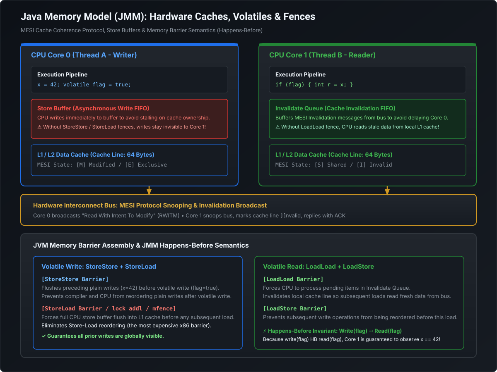

# Java Memory Model (JMM), Volatile Barriers & Atomic CAS Primitives

Understanding concurrency at a Staff/Principal level requires stepping below the syntax of Java and understanding how the **Java Memory Model (JSR-133)** bridges JVM bytecode to modern multi-core CPU architectures (MESI cache coherence, store buffers, instruction pipelining, and memory fences).

---

## 1. Hardware Architecture vs. The Java Memory Model



### Why Multi-Core Hardware Breaks Naive Code
Modern CPUs do not execute instructions one-by-one directly against RAM. RAM access takes $\approx 50\text{–}100\text{ ns}$ ($\approx 200\text{ CPU cycles}$). To avoid stalling, modern CPUs employ:
1. **Multi-Level Caches (L1, L2, L3)**: L1 cache access takes $\approx 1\text{ ns}$ (4 cycles). Data is cached in 64-byte chunks called **Cache Lines**.
2. **Store Buffers**: When a CPU writes a variable, it writes to an asynchronous **Store Buffer** and continues executing immediately without waiting for RAM or other caches to update.
3. **Out-of-Order Instruction Pipelining**: Compilers (JIT) and CPU execution units reorder independent machine instructions to maximize arithmetic logic unit (ALU) throughput.

In a single-threaded program, the hardware guarantees that reordering preserves the *as-if-serial* semantics. **In a multi-threaded program, without explicit memory barriers, another CPU core will observe writes occurring in a completely different order than they were written in source code!**

---

## 2. The Happens-Before Relationship (JSR-133)

The Java Memory Model defines formal **Happens-Before** rules. If action $X$ *happens-before* action $Y$, the memory effects of $X$ (all writes to variables) are guaranteed to be visible to action $Y$.

### The 6 Fundamental Happens-Before Rules:
1. **Program Order Rule**: Each action in a single thread happens-before every action that comes after it in that same thread.
2. **Monitor Lock Rule**: An `unlock` on a monitor lock happens-before every subsequent `lock` on that same monitor.
3. **Volatile Variable Rule**: A write to a `volatile` field happens-before every subsequent read of that same `volatile` field.
4. **Thread Start Rule**: A call to `Thread.start()` on a thread happens-before any action in the started thread.
5. **Thread Termination Rule**: Any action in a thread happens-before any other thread successfully detects that it has terminated (via `Thread.join()` or `Thread.isAlive() == false`).
6. **Transitivity**: If $A$ happens-before $B$, and $B$ happens-before $C$, then $A$ happens-before $C$.

---

## 3. The `volatile` Keyword: Visibility, Ordering & The Atomicity Trap

A `volatile` variable provides two distinct guarantees:
1. **Visibility**: Reads and writes bypass the local CPU store buffers and L1 caches, synchronizing directly with the shared memory subsystem via the MESI bus protocol.
2. **Instruction Ordering (Fences)**: The compiler and CPU are strictly prohibited from reordering reads or writes around the `volatile` access.

### The 4 Low-Level Memory Barriers (Fences)
Under the hood, the JIT compiler inserts hardware memory barrier instructions:
- **`StoreStore` Barrier**: Inserted *before* a volatile write. Ensures all normal writes before the volatile write are committed to memory first.
- **`StoreLoad` Barrier**: Inserted *after* a volatile write. Flushes the CPU's store buffer to RAM before any subsequent read occurs (The most expensive barrier: $\approx 10\text{–}30\text{ ns}$).
- **`LoadLoad` Barrier**: Inserted *after* a volatile read. Ensures the volatile read completes before any subsequent read.
- **`LoadStore` Barrier**: Inserted *after* a volatile read. Prevents subsequent writes from floating ahead of the volatile read.

### The Classic Interview Trap: Why `volatile` Does NOT Guarantee Atomicity
```java
public class VolatileCounter {
    private volatile int count = 0;

    public void increment() {
        count++; // ❌ NOT THREAD-SAFE!
    }
}
```
**Why this breaks under concurrency:**
`count++` is not a single atomic CPU instruction. It compiles into **3 distinct bytecode operations**:
1. `GETFIELD count`: Read the current value of `count` into the operand stack.
2. `ICONST_1` & `IADD`: Add 1 to the value on the stack.
3. `PUTFIELD count`: Write the new value back to `count`.

Even though `PUTFIELD` is volatile and immediately visible, two threads can simultaneously read `count = 5`. Both compute `6`, and both write `6` back. One increment is silently lost!

> [!WARNING]
> `volatile` guarantees **Visibility and Ordering**, but **NEVER Atomicity** for compound read-modify-write operations (`count++`, `check-then-act`).

---

## 4. Double-Checked Locking (DCL) Singleton: The Volatile Bug

```java
public class EnterpriseConfigService {
    // 🚨 MUST BE VOLATILE!
    private static volatile EnterpriseConfigService instance;

    private EnterpriseConfigService() {
        // Expensive initialization...
    }

    public static EnterpriseConfigService getInstance() {
        if (instance == null) { // 1st Check (No locking overhead)
            synchronized (EnterpriseConfigService.class) {
                if (instance == null) { // 2nd Check (Under lock)
                    instance = new EnterpriseConfigService();
                }
            }
        }
        return instance;
    }
}
```

### Why removing `volatile` breaks DCL in Production:
Creating a new object `instance = new EnterpriseConfigService()` involves 3 machine steps:
1. `allocate`: Allocate heap memory.
2. `init`: Call constructor to initialize fields.
3. `assign`: Assign reference pointer to `instance`.

Without `volatile`, the JIT compiler and CPU may reorder instructions to:
**`1 (allocate) -> 3 (assign) -> 2 (init)`**

Thread A executes step 1 and step 3. At this moment, `instance` is **non-null**, but the constructor (step 2) has not yet finished executing!
Thread B calls `getInstance()`. The 1st check `if (instance == null)` evaluates to `false`. Thread B immediately receives a reference to a **partially constructed object with corrupt/default field values** and crashes in production!

Adding `volatile` forces a `StoreStore` barrier between step 2 and step 3, ensuring the object is fully initialized before its reference becomes visible.

---

## 5. Atomic Variables, CAS & The ABA Problem

### Compare-And-Swap (CAS)
Atomic classes (`AtomicInteger`, `AtomicReference`, `AtomicLong`) rely on hardware-supported CPU atomic instructions:
- x86 architecture: `LOCK CMPXCHG` (Compare and Exchange with bus lock).
- ARM architecture: `LDREX` / `STREX` (Load-Linked / Store-Conditional).

```java
// CAS Pseudocode in CPU Hardware:
boolean compareAndSwap(MemoryAddress addr, int expectedVal, int newVal) {
    if (read(addr) == expectedVal) {
        write(addr, newVal);
        return true;
    }
    return false;
}
```
If another thread altered the value in the meantime, CAS returns `false`, and the calling thread loops (optimistic spin-lock) until it succeeds.

### High-Throughput Counters: `AtomicLong` vs. `LongAdder`
- **`AtomicLong` Bottleneck**: Under high contention (e.g. 64 threads incrementing simultaneously), 63 threads fail CAS and spin in tight loops. Multiple CPU cores repeatedly invalidate each other's L1 cache lines (Cache Line Bouncing). Throughput collapses.
- **`LongAdder` (Java 8+)**: Uses **Cell Striping**. It maintains a base value plus an internal array of `Cell` objects (striped counters padded with `@Contended` to prevent False Sharing). Threads hash their thread ID to update separate cells with zero contention. `sum()` aggregates all cells when requested.

### The ABA Problem & `AtomicStampedReference`
Suppose a lock-free stack holds head pointer `A -> B -> C`.
1. Thread 1 reads `A`, prepares to pop it and update head to `B`. Thread 1 is preempted by the OS.
2. Thread 2 pops `A`, pops `B`, and then pushes a *new* object that happens to be allocated at the exact same memory address as `A` (`A' -> C`).
3. Thread 1 wakes up and executes `CAS(head, expected=A, new=B)`.
4. The memory address matches `A`! CAS succeeds, but the stack is now corrupted because `B` was already discarded!

```java
// ✅ REMEDY: AtomicStampedReference (Pointer + Version Stamp)
import java.util.concurrent.atomic.AtomicStampedReference;

public class ABASolution {
    private static final String INITIAL_REF = "NodeA";
    private static final int INITIAL_STAMP = 0;

    private static final AtomicStampedReference<String> ref = 
        new AtomicStampedReference<>(INITIAL_REF, INITIAL_STAMP);

    public static void main(String[] args) {
        int[] stampHolder = new int[1];
        String currentVal = ref.get(stampHolder); // NodeA, stamp = 0

        // CAS verifies BOTH expected reference AND expected integer stamp
        boolean success = ref.compareAndSet(
            currentVal, 
            "NodeB", 
            stampHolder[0], 
            stampHolder[0] + 1 // Stamp increments to 1
        );
        System.out.println("CAS Success: " + success + " | New Stamp: " + ref.getStamp());
    }
}
```

---

## 6. Staff / Principal Interview Strategy: JMM & Atomics

### Classic Traps & Pivot Responses

#### Trap 1: *"Why not just use `synchronized` everywhere instead of worrying about `volatile` or CAS?"*
- **Pivot**: *"Because `synchronized` forces thread suspension and context-switching into the OS kernel when lock contention occurs. Suspending and resuming an OS thread costs $\approx 1,000\text{–}2,000\text{ CPU cycles}$ ($\sim 1\text{–}5\text{ }\mu\text{s}$). In contrast, `volatile` reads take $\sim 1\text{ ns}$ (L1 cache) and atomic CAS takes $\sim 10\text{ ns}$. In high-frequency trading or high-QPS routing paths (e.g. tracking switch transaction metrics), lock-free atomic constructs yield $10\times\text{–}100\times$ higher throughput than monitor locks."*

#### Trap 2: *"What is False Sharing and how does Java prevent it?"*
- **Pivot**: *"False Sharing occurs when two independent variables accessed by different threads reside on the same 64-byte CPU cache line. When Thread 1 writes Variable A, the CPU's MESI protocol invalidates the entire cache line across all other CPU cores, forcing Thread 2 to reload Variable B from L3 or RAM even though Variable B never changed! In Java 8+, the `@jdk.internal.vm.annotation.Contended` annotation inserts 128 bytes of empty padding around fields (as seen in `LongAdder.Cell` and `Thread.threadLocalRandomSeed`) to guarantee that hot variables sit on isolated cache lines."*
