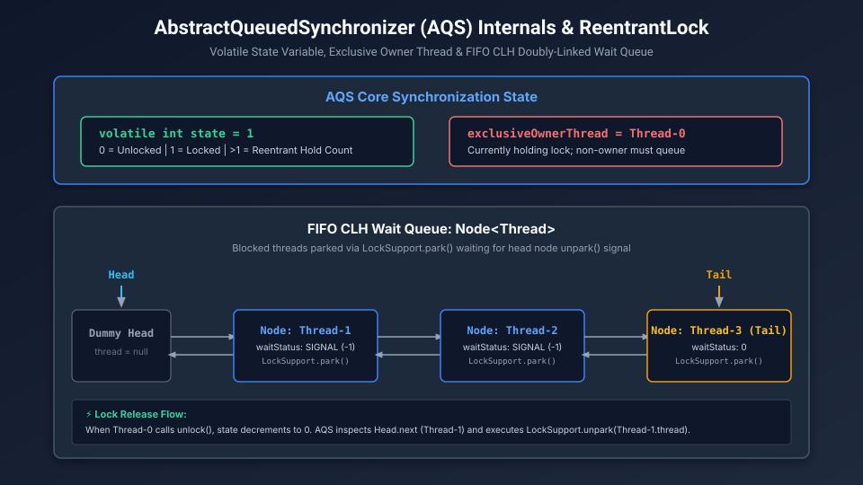

# Explicit Locks, Conditions & The AbstractQueuedSynchronizer (AQS)

While `synchronized` is the built-in monitor mechanism of the Java language, modern enterprise concurrent frameworks (`j.u.c`) are built upon explicit lock abstractions powered by **AQS (AbstractQueuedSynchronizer)**. 

Understanding how AQS manages thread queues with zero kernel locks in uncontended paths is essential for Staff and Principal Engineers.

---

## 1. Intrinsic Monitor Evolution (`synchronized`)

In modern HotSpot JVMs, `synchronized` is not a slow OS mutex by default. It undergoes dynamic lock escalation:

```
Unlocked Object
      │
      ▼  (Thread tries to acquire lock)
Lightweight Locking (Thin Lock)
  ↳ Allocates BasicObjectLock on thread stack
  ↳ CAS Mark Word pointer to stack record
  ↳ ZERO OS kernel transitions!
      │
      ▼  (Contention detected: 2nd thread arrives)
Heavyweight Locking (Fat Lock)
  ↳ Inflates Mark Word to point to native ObjectMonitor in C++ heap
  ↳ Waiting threads park into _EntryList queue
  ↳ Manages OS kernel pthread_mutex transitions
```

> [!NOTE]
> **Biased Locking Deprecation (JEP 374)**: In JDK 15+, Biased Locking was disabled and subsequently removed from HotSpot. In modern multi-threaded architectures (cloud microservices, thread pools), the coordination overhead of revoking biased locks via Stop-The-World safepoints far outweighed the single-threaded performance benefit.

---

## 2. ReentrantLock vs. Synchronized: The Power Matrix

| Capability | `synchronized` | `ReentrantLock` |
| :--- | :--- | :--- |
| **Lock Acquisition** | Implicit (block entry/exit) | Explicit (`lock()` ... `unlock()` in `finally`) |
| **Timeout Support** | ❌ No (blocks indefinitely) | ✅ Yes (`tryLock(5, TimeUnit.SECONDS)`) |
| **Interruptible** | ❌ No (cannot abort wait for lock) | ✅ Yes (`lockInterruptibly()`) |
| **Fairness Policy** | ❌ No (non-deterministic OS scheduling) | ✅ Configurable (`new ReentrantLock(true)`) |
| **Multiple Wait-Sets** | ❌ 1 wait-set per object (`wait/notify`) | ✅ Multiple independent `Condition` objects |
| **Virtual Thread Support** | ⚠️ Pins carrier thread to OS | ✅ **Clean unmounting (No pinning!)** |

### Why Non-Fair Locking is the Default ($10\times$ Throughput)
In `new ReentrantLock(false)` (Non-Fair), when a thread calls `lock()`, it immediately attempts a **fast-path CAS on the state variable**, completely bypassing the queue!
- **Why this is good (Thread Barging)**: If Thread A just finished its time-slice and is actively running on a CPU core with hot L1 caches, letting it "barge" and grab the lock immediately is vastly faster than paying the $\sim 2\text{–}5\text{ }\mu\text{s}$ penalty of unparking and context-switching Thread B from the sleep queue.
- Fair locking enforces strict FIFO ordering, reducing throughput by up to **$90\%$** under heavy contention.

---

## 3. AbstractQueuedSynchronizer (AQS) Architecture

[](images/aqs_reentrant_lock_architecture.svg)

AQS is the foundational framework behind `ReentrantLock`, `Semaphore`, `CountDownLatch`, `ReentrantReadWriteLock`, and `ThreadPoolExecutor.Worker`.

### Core Components of AQS:
1. **Volatile State Variable**:
   ```java
   private volatile int state;
   ```
   - In `ReentrantLock`: `0` means unlocked. `1` means locked. Values `> 1` represent the **reentrant hold count** by the same owner thread.
   - In `Semaphore`: `state` represents the number of remaining permits.
   - In `CountDownLatch`: `state` represents the remaining countdown count.
2. **Exclusive Owner Thread**:
   ```java
   private transient Thread exclusiveOwnerThread;
   ```
   Tracks which thread holds exclusive execution rights.
3. **The CLH Wait Queue**:
   A FIFO doubly-linked list of `Node` objects with `head` and `tail` pointers.
   - Nodes contain thread references, `waitStatus` (`SIGNAL = -1`, `CANCELLED = 1`), and `prev`/`next` pointers.

### The AQS Lock Acquisition Workflow:
```java
// Inside ReentrantLock.NonfairSync
final void lock() {
    if (compareAndSetState(0, 1)) {
        // Fast-path: Succeeded with zero contention!
        setExclusiveOwnerThread(Thread.currentThread());
    } else {
        // Slow-path: Contended! Enter AQS queue
        acquire(1);
    }
}
```
1. **Fast Path**: Thread attempts `CAS(state, 0, 1)`. If state was 0, it becomes the owner in 10 nanoseconds. No queue nodes are allocated!
2. **Slow Path (`acquire(1)`)**:
   - Thread evaluates whether it is the current owner (reentrancy: `state = state + 1`).
   - If not owner, it allocates a `Node` and enqueues it to the `tail` using a CAS loop.
   - It sets `waitStatus = SIGNAL` on the predecessor node.
   - It executes **`LockSupport.park(this)`**, suspending the thread cleanly.

### The AQS Unlock Workflow:
```java
public void unlock() {
    sync.release(1);
}
```
1. Decrements `state`. If `state` reaches `0`, it clears `exclusiveOwnerThread`.
2. Inspects `head.next` (the first waiting thread in queue).
3. Executes **`LockSupport.unpark(head.next.thread)`**, waking the successor thread to acquire the lock.

---

## 4. ReentrantReadWriteLock vs. StampedLock

### The Problem with `ReentrantReadWriteLock`
`ReentrantReadWriteLock` splits access into a Shared Read Lock and an Exclusive Write Lock:
- Multiple threads can read concurrently.
- Only one thread can write (blocking all readers).
- **The Read-Starvation Trap**: In high-throughput read systems (99% reads, 1% writes), reader threads continuously acquire the read lock. Write threads are starved and block indefinitely, unable to acquire the write lock.

### StampedLock: Optimistic Reading Without Locks (Java 8+)
`StampedLock` provides a revolutionary capability: **Optimistic Reads**.
An optimistic read does **NOT** acquire any lock and does **NOT** modify any synchronization state! It simply retrieves an integer version **Stamp**.

```java
import java.util.concurrent.locks.StampedLock;

public class OptimisticPoint {
    private double x, y;
    private final StampedLock sl = new StampedLock();

    // Mutator: Exclusive Write Lock
    public void move(double deltaX, double deltaY) {
        long stamp = sl.writeLock(); // Traditional exclusive lock
        try {
            x += deltaX;
            y += deltaY;
        } finally {
            sl.unlockWrite(stamp);
        }
    }

    // Reader: Optimistic Read (Zero Lock Contention!)
    public double distanceFromOrigin() {
        // 1. Try optimistic read stamp (NO lock acquired!)
        long stamp = sl.tryOptimisticRead();
        double currentX = x;
        double currentY = y;

        // 2. Validate: Did a writer intervene while we read x and y?
        if (!sl.validate(stamp)) {
            // 3. Writer intervened! Fallback to traditional shared read lock
            stamp = sl.readLock();
            try {
                currentX = x;
                currentY = y;
            } finally {
                sl.unlockRead(stamp);
            }
        }

        return Math.sqrt(currentX * currentX + currentY * currentY);
    }
}
```

> [!CAUTION]
> **StampedLock Caveats**:
> 1. `StampedLock` is **NOT reentrant**. If a thread holding a stamp calls another method that requests a lock on the same `StampedLock`, it will deadlock itself!
> 2. It does not implement the `Lock` interface.

---

## 5. Staff / Principal Interview Strategy: Explicit Locks & AQS

### Classic Traps & Pivot Responses

#### Trap 1: *"Why do you always put `lock.unlock()` in a finally block, but `lock.lock()` OUTSIDE the try block?"*
- **Pivot**: *"If you place `lock.lock()` inside the `try` block, and an unchecked exception occurs before or during the `lock()` call (such as `OutOfMemoryError`), the `finally` block will execute and call `unlock()` on a lock that was never acquired, throwing an `IllegalMonitorStateException` that masks the original fatal error. Placing `lock.lock()` immediately before the `try` block ensures the `try` scope only protects resources acquired after lock ownership is guaranteed."*

#### Trap 2: *"Why are `Condition.await()` and `Condition.signal()` superior to `Object.wait()` and `notify()`?"*
- **Pivot**: *"A single intrinsic monitor only supports one wait-set. `ReentrantLock` allows creating multiple independent `Condition` instances via `lock.newCondition()` (e.g., `notFull` and `notEmpty` in `ArrayBlockingQueue`). Producers call `notFull.await()` and signal `notEmpty.signal()`, while consumers call `notEmpty.await()` and signal `notFull.signal()`. This completely eliminates spurious wakeups across heterogeneous thread roles and avoids the CPU waste of `notifyAll()`."*
