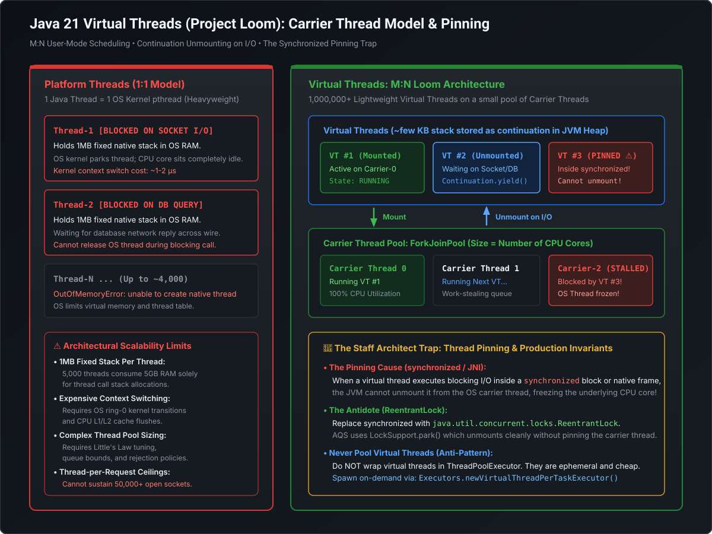

# Java 21 Virtual Threads (Project Loom): Carrier Architecture & The Pinning Trap

Java 21’s formalization of **Virtual Threads (JEP 444)** represents the most significant architectural evolution of the Java runtime since the introduction of Java 5 concurrency utilities. 

For Principal and Staff Engineers, mastering Virtual Threads is not merely about using `Thread.ofVirtual()`; it requires understanding **M:N user-mode scheduling, continuation suspension, carrier thread starvation, and the infamous `synchronized` pinning trap**.

---

## 1. Platform Threads vs. Virtual Threads: Architectural Comparison

[](images/virtual_threads_carrier_model.svg)

| Dimension | Platform Threads (OS Kernel Threads) | Virtual Threads (Project Loom User-Mode) |
| :--- | :--- | :--- |
| **Mapping Ratio** | **1:1** with Operating System Kernel Threads | **M:N** (Millions of Virtual Threads multiplexed onto $N$ Carrier Threads) |
| **Stack Memory** | Fixed **1 MB** reserved memory per thread | Dynamic **few KB** stored directly on the JVM heap; grows/shrinks on demand |
| **Context Switch** | Heavy OS kernel transition ($\sim 1\text{–}5\text{ }\mu\text{s}$) | Extremely fast JVM user-space continuation switch ($\sim 10\text{–}50\text{ ns}$) |
| **Scalability Limit**| $\approx 5,000\text{–}10,000$ threads before OS RAM exhaustion | **$1,000,000+$** concurrent threads per JVM instance |
| **Lifecycle** | Expensive to create; **Must be pooled** (`ThreadPoolExecutor`) | Inexpensive to create; **Never pool!** Create on-demand per task |
| **Optimal Use-Case**| CPU-bound number crunching (crypto, hashing, video encoding)| High-throughput **I/O-bound** workloads (HTTP, JDBC, Kafka, Redis) |

---

## 2. The Continuation Engine: Mounting & Unmounting

Virtual threads are implemented as JVM-managed **Continuations** (`jdk.internal.vm.Continuation`):

```
Virtual Thread Running (Mounted)
       │
       ▼ (Hits blocking socket read / Thread.sleep())
Continuation.yield()
  1. Copies current call frame from OS stack to JVM Heap
  2. Disassociates from OS Carrier Thread
  3. Carrier Thread is instantly FREE to run another Virtual Thread!
       │
       ▼ (OS epoll / kqueue signals: Socket data has arrived!)
Virtual Thread Rescheduled
  1. Scheduler assigns any available Carrier Thread
  2. Restores call frame from JVM Heap back onto the Carrier stack
  3. Resumes execution seamlessly!
```

### The Carrier Thread Pool
Under the hood, the JVM runs a specialized **`ForkJoinPool`** as the carrier engine:
- Default parallelism is equal to the number of available CPU cores:
  `Runtime.getRuntime().availableProcessors()`
- If your server has 8 CPU cores, **only 8 carrier platform threads** are running at the OS level! Those 8 carrier threads seamlessly handle 500,000 active virtual threads doing network I/O.

---

## 3. The Staff Engineer Trap: Thread Pinning

A virtual thread is said to be **"Pinned"** when its underlying continuation is prohibited from unmounting from its carrier thread.

If a pinned virtual thread performs a blocking I/O operation (such as waiting for a slow database query or remote REST call), **it freezes its OS carrier thread**!

```
Pinned Virtual Thread (Holding synchronized) 
               │
               ▼ (Blocks on Slow DB query for 2 seconds)
    CARRIER THREAD STALLED FOR 2 SECONDS!
               │
   If 8 virtual threads get pinned simultaneously:
   ALL 8 CARRIER THREADS ARE DEADLOCKED!
   THE ENTIRE JVM CONCURRENCY COLLAPSES TO ZERO!
```

### When Does Thread Pinning Occur?
1. **Inside a `synchronized` block or method**: The HotSpot monitor implementation associates the monitor lock with the physical OS thread frame.
2. **Inside Native Calls (JNI) or Foreign Functions**: When calling native C/C++ code.

### 🚨 The Antidote: Replace `synchronized` with `ReentrantLock`
Unlike `synchronized`, `ReentrantLock` is built on pure Java AQS primitives (`LockSupport.park()`), which have been fully modernized in Java 21 to integrate with Loom continuations:

```java
// ❌ WRONG: Pins the carrier thread during I/O!
public synchronized String fetchCustomerData(String customerId) {
    return httpClient.send(request, HttpResponse.BodyHandlers.ofString()).body();
}

// ✅ RIGHT: Cleanly unmounts carrier thread during I/O!
private final ReentrantLock lock = new ReentrantLock();

public String fetchCustomerData(String customerId) {
    lock.lock();
    try {
        return httpClient.send(request, HttpResponse.BodyHandlers.ofString()).body();
    } finally {
        lock.unlock();
    }
}
```

### Detecting Pinning in Production
You can diagnose pinned threads by adding this JVM flag at startup:
```bash
-Djdk.tracePinnedThreads=full
```
When a virtual thread blocks while pinned, the JVM prints a complete stack trace highlighting the exact `synchronized` block responsible.

---

## 4. The Anti-Pattern: Never Pool Virtual Threads!

```java
// ❌ CRITICAL ANTI-PATTERN: Pooling Virtual Threads!
ExecutorService badPool = Executors.newFixedThreadPool(100, Thread.ofVirtual().factory());

// ✅ IDIOMATIC JAVA 21: One Virtual Thread Per Task
try (ExecutorService executor = Executors.newVirtualThreadPerTaskExecutor()) {
    executor.submit(() -> processOrder(order1));
    executor.submit(() -> processOrder(order2));
} // Auto-closes and waits for all tasks to complete!
```

### Why Pooling Virtual Threads is an Anti-Pattern:
1. **Zero Resource Savings**: Pooling was invented to amortize the expensive $1\text{ MB}$ allocation and kernel setup cost of platform threads. Virtual threads cost less than allocating a small Java object.
2. **Deadlock Vulnerability**: Thread pools limit concurrency. If tasks running inside a pooled virtual thread submit sub-tasks back to the same pool and wait on their results, the pool quickly deadlocks due to thread starvation!
3. **Limiting Throughput**: Pooling artificially caps concurrent tasks at the pool size (e.g. 100), completely defeating the purpose of Virtual Threads (which are designed to run 50,000+ tasks in parallel).

> [!TIP]
> **How to Bound Concurrency with Virtual Threads**:
> If you need to limit concurrent calls to a downstream database or third-party API, do **not** bound the thread pool. Keep creating a virtual thread per request, and guard the shared resource with a **`java.util.concurrent.Semaphore`**!

---

## 5. Runnable Hands-on POC: Running 100,000 Virtual Threads in IntelliJ

Paste this self-contained class into IntelliJ (configured with JDK 21) to watch 100,000 concurrent tasks execute in under 2 seconds:

```java
import java.time.Duration;
import java.time.Instant;
import java.util.concurrent.Executors;
import java.util.concurrent.atomic.AtomicInteger;

public class VirtualThreadScaleDemo {
    public static void main(String[] args) {
        int taskCount = 100_000;
        AtomicInteger completed = new AtomicInteger(0);

        System.out.println("Launching " + taskCount + " Virtual Threads...");
        Instant start = Instant.now();

        // Java 21 Try-with-resources auto-joins all tasks on close
        try (var executor = Executors.newVirtualThreadPerTaskExecutor()) {
            for (int i = 0; i < taskCount; i++) {
                final int taskId = i;
                executor.submit(() -> {
                    try {
                        // Simulating 500ms of network/database I/O
                        Thread.sleep(Duration.ofMillis(500));
                        completed.incrementAndGet();
                    } catch (InterruptedException e) {
                        Thread.currentThread().interrupt();
                    }
                });
            }
        } // Block exits only when all 100,000 virtual threads have terminated!

        Instant end = Instant.now();
        System.out.println("Finished " + completed.get() + " tasks in " 
            + Duration.between(start, end).toMillis() + " ms!");
    }
}
```

---

## 6. Staff / Principal Interview Strategy: Virtual Threads (Loom)

### Classic Traps & Pivot Responses

#### Trap 1: *"Does Virtual Threads mean reactive programming (WebFlux / Project Reactor) is dead?"*
- **Pivot**: *"For the vast majority of standard enterprise CRUD and microservice backends, **yes, Virtual Threads supersedes reactive programming**. Reactive programming was adopted primarily because platform threads were too heavy for high-concurrency I/O. However, reactive code is notoriously difficult to write, read, trace, and debug (stack traces are disconnected). Virtual Threads restores the simple, imperative, synchronous `thread-per-request` mental model while delivering the same extreme throughput and low memory footprint of non-blocking I/O. Reactive programming remains relevant only for specialized streaming backpressure pipelines or event-driven functional compositions."*

#### Trap 2: *"When should you NOT use Virtual Threads?"*
- **Pivot**: *"Two clear scenarios: First, **CPU-bound workloads** (such as cryptographic hashing, video encoding, or heavy matrix multiplication). Virtual threads provide zero speedup for CPU work because you cannot run more compute than physical CPU cores allow—traditional Platform Threads or `ForkJoinPool` parallel streams are optimal. Second, legacy codebases with deep, unavoidable **`synchronized` blocks wrapping network I/O** or heavy JNI C-library bindings that trigger severe thread pinning and starve the carrier pool."*
