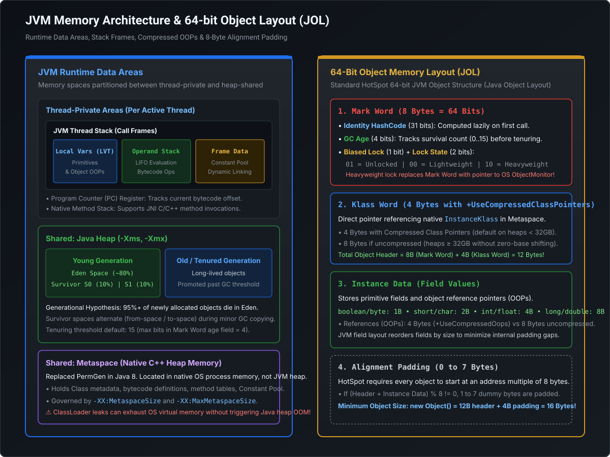

# JVM Deep Dive: Memory Architecture, Object Layout, Compressed OOPs & JIT Compilation

```
========================================================================================================================
                                     JVM RUNTIME DATA AREAS & EXECUTION SUBSYSTEM
========================================================================================================================

  ┌────────────────────────────────────── JVM MEMORY SPACE ──────────────────────────────────────┐
  │                                                                                              │
  │  ┌───────────────────────── THREAD-PRIVATE (PER THREAD) ──────────────────────────┐          │
  │  │                                                                                │          │
  │  │   ┌────────────── JVM STACK ──────────────┐   ┌── PC REGISTER ──┐   ┌─────────┐│          │
  │  │   │  ┌─────────────────────────────────┐  │   │ Current Bytecode│   │ NATIVE  ││          │
  │  │   │  │ STACK FRAME (Active Method)     │  │   │ Instruction     │   │ METHOD  ││          │
  │  │   │  │  • Local Variable Table (LVT)   │  │   │ Pointer         │   │ STACK   ││          │
  │  │   │  │  • Operand Stack (Push/Pop Ops) │  │   └─────────────────┘   │ (JNI/C) ││          │
  │  │   │  │  • Frame Data (Constant Pool)   │  │                         └─────────┘│          │
  │  │   │  └─────────────────────────────────┘  │                                    │          │
  │  │   └───────────────────────────────────────┘                                    │          │
  │  └────────────────────────────────────────────────────────────────────────────────┘          │
  │                                                                                              │
  │  ┌───────────────────────── SHARED ACROSS ALL THREADS ─────────────────────────────┐          │
  │  │                                                                                │          │
  │  │   ┌────────────────────────── JAVA HEAP (-Xms, -Xmx) ───────────────────────┐  │          │
  │  │   │  Young Generation (Eden, S0, S1)   │   Old / Tenured Generation         │  │          │
  │  │   │  Short-lived objects               │   Long-lived survived tenuring     │  │          │
  │  │   └─────────────────────────────────────────────────────────────────────────┘  │          │
  │  │                                                                                │          │
  │  │   ┌──────────────────── METASPACE (Native Off-Heap Memory) ─────────────────┐  │          │
  │  │   │  Klass Metadata, Method Bytecodes, Runtime Constant Pool, Static Fields │  │          │
  │  │   └─────────────────────────────────────────────────────────────────────────┘  │          │
  │  └────────────────────────────────────────────────────────────────────────────────┘          │
  └──────────────────────────────────────────────────────────────────────────────────────────────┘
```

---

## 1. JVM Runtime Data Areas: First-Principles Architecture

The Java Virtual Machine specification (JVMS) divides runtime memory into distinct regions with strictly defined lifecycles, access rules, and garbage collection behaviors:

[](images/jvm_memory_layout_and_object_header.svg)

### 1.1 Thread-Private Memory (Allocated per Thread)

| Memory Area | Lifecycle | Allocation & Storage Details | Failure Mode |
| :--- | :--- | :--- | :--- |
| **Program Counter (PC) Register** | Thread start to death | Holds the memory address of the JVM bytecode instruction currently being executed. If native method is executed, PC is undefined. | **None** (Fixed hardware register / pointer; cannot OOM). |
| **JVM Stack & Stack Frames** | Thread start to death | Created when thread spawns (`-Xss`, default 1MB on 64-bit Linux/macOS). Holds a LIFO chain of **Stack Frames** (one per method call). | `StackOverflowError` (infinite recursion), `OutOfMemoryError` (OS cannot allocate new OS thread). |
| **Native Method Stack** | Native call duration | Supports JNI (Java Native Interface) and native C/C++ method invocations. | `StackOverflowError`, Native Segfault / Crash. |

#### Inside a Stack Frame
When a method is invoked, the JVM pushes a new `Stack Frame` containing:
1. **Local Variable Table (LVT)**: Array of 32-bit slots. Primitive types `int`, `float`, `reference`, `returnAddress` occupy 1 slot (4 bytes). `long` and `double` occupy 2 consecutive slots (8 bytes). For instance methods, slot `0` always holds the `this` reference.
2. **Operand Stack**: Pushdown LIFO work area used to execute bytecode operations. For example, `iadd` pops two integers, adds them, and pushes the result. Maximum depth is computed statically by `javac` at compile time.
3. **Frame Data**:
   - **Dynamic Linking**: Reference to the Runtime Constant Pool to resolve symbolic method references into direct memory addresses.
   - **Normal Return Completion**: Restores calling method's PC register and increments caller's operand stack with return value.
   - **Abrupt Completion**: Dispatches exceptions against the method's Exception Table (`catch` block offsets).

---

### 1.2 Shared Runtime Memory (Process-Wide)

#### Java Heap (`-Xms`, `-Xmx`)
- Stores **all object instances and arrays** created via `new`.
- Divided logically by generational garbage collectors into **Young Generation** (Eden, Survivor spaces S0/S1) and **Old/Tenured Generation**.
- Shared across all threads; memory allocations utilize **Thread-Local Allocation Buffers (TLABs)** inside Eden to avoid synchronization bottlenecks.
- Failure Mode: `java.lang.OutOfMemoryError: Java heap space`.

#### Metaspace (Native Off-Heap Memory)
- **Historical Evolution**: In Java 7 and earlier, class metadata was stored in **PermGen** (Permanent Generation) inside the contiguous heap (`-XX:MaxPermSize`). PermGen frequently triggered catastrophic `OOM: PermGen space` due to classloader leaks during hot re-deployments.
- **Java 8+ Architecture**: PermGen was completely deleted. Replaced by **Metaspace**, which allocates memory directly from **Native OS Virtual Memory**:
  - Size defaults to auto-expanding up to available OS virtual memory unless bounded by `-XX:MaxMetaspaceSize=512m`.
  - Holds `InstanceKlass` C++ structures, method bytecode, annotations, and the Runtime Constant Pool.
  - Internally divided into **Class Space** (`-XX:CompressedClassSpaceSize=1g`) and **Non-Class Space** (method bytecodes and JIT compiled code).
- Failure Mode: `java.lang.OutOfMemoryError: Metaspace` (indicates dynamic proxy generation or ClassLoader leak).

---

## 2. 64-Bit Object Memory Layout & JOL (Java Object Layout)

Every Java object allocated on the 64-bit HotSpot JVM consists of 3 distinct regions:

```
┌───────────────────────────────── 64-BIT OBJECT ─────────────────────────────────┐
│  ┌────────────────── HEADER (12 or 16 Bytes) ──────────────────┐                 │
│  │  Mark Word (8 Bytes)  │  Klass Pointer (4 or 8 Bytes)       │                 │
│  │  Lock state, hash, GC │  Points to Metaspace InstanceKlass  │                 │
│  └───────────────────────┴─────────────────────────────────────┘                 │
│  ┌────────────── INSTANCE DATA (Variable Length) ──────────────┐                 │
│  │  Primitive fields (int, long, boolean) + Reference OOPs      │                 │
│  └─────────────────────────────────────────────────────────────┘                 │
│  ┌────────────── PADDING (0 to 7 Bytes) ───────────────────────┐                 │
│  │  Pads total object size to a strict multiple of 8 bytes     │                 │
│  └─────────────────────────────────────────────────────────────┘                 │
└──────────────────────────────────────────────────────────────────────────────────┘
```

### 2.1 The Mark Word (8 Bytes = 64 Bits)
The Mark Word is a multi-use status bitfield that dynamically changes its layout based on the object's synchronization and lifecycle state:

| State | Bits 63–3 | Bits 2 (Biased) | Bits 1–0 (Tag) | Meaning / Payload |
| :--- | :--- | :---: | :---: | :--- |
| **Unlocked (Normal)** | `[unused:25][identity_hashcode:31][unused:1][age:4]` | `0` | `01` | Object has default identity hash code; GC tenuring age (0–15). |
| **Biased Locking** | `[thread_id:54][epoch:2][unused:1][age:4]` | `1` | `01` | Deprecated in Java 15; locked to specific OS thread without atomic CAS. |
| **Lightweight Lock** | `[ptr to Stack Lock Record: 62]` | `0` | `00` | Thin lock; thread owns lock via CAS on its stack frame. |
| **Heavyweight Lock** | `[ptr to ObjectMonitor C++ struct: 62]` | `0` | `10` | Contended lock; inflated to OS mutex with thread parking (`futex`). |
| **Marked for GC** | `[forwarding pointer: 62]` | `0` | `11` | Set during GC evacuation/compaction pointing to relocated address. |

> [!NOTE]
> **GC Tenuring Age Limit (4 Bits)**: Because exactly 4 bits are allocated for object age in the Mark Word, the maximum value an object can reach before being tenured from Survivor to Old Gen is $2^4 - 1 = 15$. The JVM parameter `-XX:MaxTenuringThreshold` cannot exceed `15`.

---

### 2.2 Compressed OOPs (`+UseCompressedOops`) & The 32GB Cliff

On 64-bit systems, raw memory addresses (pointers) require 8 bytes (64 bits). Compared to 32-bit systems, 64-bit pointers introduce a **~40% heap bloat** because every object reference doubles in size.

To solve this, HotSpot introduced **Compressed OOPs (Ordinary Object Pointers)**:

#### The 8-Byte Alignment Trick
Every Java object is strictly aligned on an **8-byte memory boundary** in RAM. This means the lowest 3 bits of every valid object address are **always `000`** in binary:

$$\text{Address} = XXXXXXXX\_XXXXX000_2$$

Because those 3 bits are always zeros, the JVM does not need to store them in memory!

#### Bitwise Shift Mechanics
1. **Compressing (Register $\to$ Heap Store)**:
   $$\text{CompressedOOP} = \text{RawAddress} \gg 3$$
2. **Decompressing (Heap Load $\to$ Register Dereference)**:
   $$\text{RawAddress} = \text{CompressedOOP} \ll 3$$

With a 32-bit integer register shifted left by 3 bits:
$$\text{Max Addressable Space} = 2^{32} \times 2^3 = 2^{35}\text{ bytes} = 32\text{ GB}$$

```
+-----------------------------------------------------------------------------------------+
|                              THE 32GB COMPRESSED OOPS CLIFF                              |
+-----------------------------------------------------------------------------------------+
| Heap <= 32 GB:                                                                          |
| • Klass Word = 4 Bytes                                                                  |
| • Object References = 4 Bytes                                                           |
| • Fast CPU bit-shifts (<< 3, >> 3)                                                      |
|                                                                                         |
| Heap = 33 GB to 40 GB (THE DANGER ZONE!):                                                |
| • Compressed OOPs automatically DISABLES (-XX:-UseCompressedOops)                       |
| • Klass Word expands from 4 Bytes -> 8 Bytes                                            |
| • EVERY object reference expands from 4 Bytes -> 8 Bytes                                |
| • Result: A 33GB heap holds LESS usable application data than a 31GB heap!              |
|                                                                                         |
| Rule of Thumb: If scaling beyond 31GB, jump directly to 48GB+ to overcome pointer bloat|
+-----------------------------------------------------------------------------------------+
```

---

## 3. JIT Compilation, Tiered Compilation & Optimization Pipeline

Java bytecode is executed by the HotSpot VM through a sophisticated tiered execution engine combining an interpreter with two distinct JIT compilers:

```
[ Java Bytecode (.class) ]
           │
           ▼
┌────────────────────── TIER 0: Interpreter ──────────────────────┐
│  Executes bytecode immediately; gathers MethodData (profiling)  │
└──────────────────────────────────┬──────────────────────────────┘
                                   │ Invocation Counter > Threshold
                                   ▼
┌────────────────── TIER 1 - 3: C1 (Client Compiler) ─────────────┐
│  Fast compilation, light optimization:                          │
│  • Tier 1: Pure C1 (no profiling)                               │
│  • Tier 2: Basic profiling (method entry/backedge counters)     │
│  • Tier 3: Full profiling (branch frequencies, type feedback)   │
└──────────────────────────────────┬──────────────────────────────┘
                                   │ Hot Loop / Heavy Invocation
                                   ▼
┌────────────────── TIER 4: C2 (Server Compiler / Opto) ──────────┐
│  Heavyweight, peak-throughput optimization:                     │
│  • Method Inlining & Loop Unrolling                             │
│  • Global Value Numbering & Dead Code Elimination               │
│  • Escape Analysis & Scalar Replacement                         │
└──────────────────────────────────┬──────────────────────────────┘
                                   │ Guard Condition Fails / Deopt
                                   ▼
┌────────────────────── UNCOMMON TRAP & DEOPT ────────────────────┐
│  Bails out of compiled native code back to Tier 0 Interpreter   │
└─────────────────────────────────────────────────────────────────┘
```

### 3.1 JIT Optimization Pipeline Explained

#### 1. Method Inlining
The single most impactful optimization in HotSpot. Inlining replaces a method invocation with the method's actual body:
- **Why it matters**: Eliminates stack frame creation, argument passing, and dynamic dispatch (`invokevirtual` lookup table).
- **Enabler**: Exposes the caller and callee to joint optimizations (dead code elimination, constant propagation, scalar replacement).
- **Thresholds**: Small methods ($<35$ bytes of bytecode) are inlined aggressively (`-XX:MaxInlineSize=35`). Hot methods up to 325 bytes are inlined if invocation frequency is high (`-XX:FreqInlineSize=325`).

#### 2. Escape Analysis (EA)
Determines whether an object's reference can escape beyond the current thread or method scope:
1. **GlobalEscape**: Object escapes the thread (stored in a `static` field, returned from a public API, or written to a shared collection).
2. **ArgEscape**: Object is passed as an argument to another method, but does not escape the current thread.
3. **NoEscape**: Object is strictly local to the allocating method.

#### 3. Scalar Replacement & Stack Allocation
When an object is proved **NoEscape**, HotSpot does not allocate the object on the Java heap at all!
- **Scalar Replacement**: HotSpot breaks the object into its individual scalar primitive fields (`int`, `long`, etc.) and stores them directly in **CPU CPU Registers** or on the **JVM Stack Frame**.
- **Impact**: Zero heap allocation, zero garbage collection overhead, and instantaneous deallocation when the stack frame unwinds!

#### 4. Lock Elision & Lock Coarsening
- **Lock Elision**: If Escape Analysis proves a synchronized object is `NoEscape` (e.g., `new StringBuffer().append("x")` inside a method), HotSpot completely strips out the `monitorenter` and `monitorexit` bytecode instructions.
- **Lock Coarsening**: Merges consecutive synchronized blocks on the same monitor inside a loop into a single outer synchronized block to eliminate repeated lock acquisitions.

---

## 4. ClassLoader Subsystem & Parental Delegation

Every Java class is loaded into memory dynamically through a hierarchical tree of ClassLoaders:

```
┌─────────────────────────────────────────────────────────────┐
│ Bootstrap ClassLoader (C++ Native / lib/modules)            │
│ Loads core runtime: java.base, java.lang, java.util         │
└──────────────────────────────┬──────────────────────────────┘
                               │ Parent Delegation
┌──────────────────────────────▼──────────────────────────────┐
│ Platform ClassLoader (formerly Extension ClassLoader)        │
│ Loads platform modules: java.sql, java.xml                  │
└──────────────────────────────┬──────────────────────────────┘
                               │ Parent Delegation
┌──────────────────────────────▼──────────────────────────────┐
│ System / Application ClassLoader                            │
│ Loads application classpath (-classpath, JARs, main class)  │
└──────────────────────────────┬──────────────────────────────┘
                               │ Parent Delegation
┌──────────────────────────────▼──────────────────────────────┐
│ Custom ClassLoaders (Tomcat WebappClassLoader, OSGi, Plugins)│
└─────────────────────────────────────────────────────────────┘
```

### 4.1 The Parental Delegation Algorithm
When a ClassLoader is requested to load a class by name:
1. It checks its local cache: Has this class already been loaded by this ClassLoader?
2. If not, it **delegates the request up to its Parent ClassLoader** before doing any work.
3. Only if the parent ClassLoader chain throws `ClassNotFoundException` does the child ClassLoader invoke its own `findClass()` method.

> [!IMPORTANT]
> **Breaking Parental Delegation**:
> - **Web Containers (Tomcat/Jetty)**: A servlet container's `WebappClassLoader` overrides delegation to prioritize local `/WEB-INF/classes` and `/WEB-INF/lib` BEFORE parent delegation. This allows two different WAR apps on the same Tomcat instance to run different versions of Jackson or Spring without collisions.
> - **Service Provider Interface (SPI)**: `java.sql.DriverManager` in core Java (`java.base`) needs to load vendor drivers (e.g., `com.mysql.cj.jdbc.Driver`) located in the Application ClassLoader. Core Java uses the **Thread Context ClassLoader (`Thread.currentThread().getContextClassLoader()`)** to cross the boundary downward.

### 4.2 Production Triage: `ClassNotFoundException` vs `NoClassDefFoundError`

| Characteristic | `ClassNotFoundException` | `NoClassDefFoundError` |
| :--- | :--- | :--- |
| **Type** | `java.lang.Exception` (Checked) | `java.lang.LinkageError` (Unchecked `Error`) |
| **Trigger Point** | Dynamic runtime reflection (`Class.forName()`, `ClassLoader.loadClass()`). | Compile-time linked reference evaluated during execution. |
| **Root Cause** | The string class name does not exist in any accessible JAR on the classpath. | The class was present at compile time, but missing from runtime classpath, OR its static initializer `<clinit>` threw an exception and failed. |
| **Debug Strategy** | Check class spelling, dependency coordinates, and runtime classpath `-cp`. | Inspect previous logs for `<clinit>` failures (`ExceptionInInitializerError`). Once a class fails static initialization, all subsequent attempts to reference it fail with `NoClassDefFoundError`! |

---

## 5. Runnable Verification POC: Memory Layout, Compressed OOPs & Escape Analysis

The following self-contained Java program computes exact object header sizes, demonstrates Compressed OOPs bitwise math, and verifies JIT Escape Analysis eliminating heap allocations:

```java
package com.mastery.jvm;

import java.lang.reflect.Field;
import java.lang.management.ManagementFactory;
import java.util.List;

/**
 * JVM Internals Verification Suite:
 * 1. Simulates 64-bit Object Header Layout (Mark Word + Klass Pointer + Padding)
 * 2. Demonstrates Compressed OOPs bit-shift address calculation
 * 3. Benchmarks JIT Escape Analysis (Scalar Replacement vs Heap Allocation)
 */
public class JvmInternalsMasteryPOC {

    // Target object for layout analysis
    static class OrderMetadata {
        long orderId;       // 8 bytes primitive
        int userId;         // 4 bytes primitive
        boolean isFlagged;  // 1 byte primitive
        String routingKey;  // Reference (4 bytes compressed, 8 bytes uncompressed)
    }

    public static void main(String[] args) {
        System.out.println("=================================================================");
        System.out.println("  HOTSPOT JVM INTERNALS & MEMORY LAYOUT BENCHMARK");
        System.out.println("=================================================================\n");

        printJvmArguments();
        simulateObjectLayout(OrderMetadata.class);
        demonstrateCompressedOopsMath();
        benchmarkEscapeAnalysis();
    }

    private static void printJvmArguments() {
        List<String> jvmArgs = ManagementFactory.getRuntimeMXBean().getInputArguments();
        System.out.println("[1] Active JVM Flags: " + jvmArgs);
        long maxHeapBytes = Runtime.getRuntime().maxMemory();
        System.out.printf("    Max Heap Available: %.2f GB (%d bytes)\n",
                (double) maxHeapBytes / (1024 * 1024 * 1024), maxHeapBytes);
        boolean compressedOops = maxHeapBytes < (32L * 1024 * 1024 * 1024);
        System.out.println("    Compressed OOPs Active (Heuristic): " + compressedOops + "\n");
    }

    private static void simulateObjectLayout(Class<?> clazz) {
        System.out.println("[2] Object Memory Layout Breakdown for: " + clazz.getSimpleName());

        int markWordSize = 8; // Always 8 bytes on 64-bit JVM
        int klassWordSize = 4; // Assuming +UseCompressedOops (<32GB heap)

        int instanceFieldsSize = 0;
        for (Field f : clazz.getDeclaredFields()) {
            Class<?> type = f.getType();
            int fieldBytes;
            if (type == long.class || type == double.class) fieldBytes = 8;
            else if (type == int.class || type == float.class) fieldBytes = 4;
            else if (type == short.class || type == char.class) fieldBytes = 2;
            else if (type == byte.class || type == boolean.class) fieldBytes = 1;
            else fieldBytes = 4; // Reference pointer (compressed OOP)

            System.out.printf("    • Field: %-12s | Type: %-8s | Size: %d Bytes\n",
                    f.getName(), type.getSimpleName(), fieldBytes);
            instanceFieldsSize += fieldBytes;
        }

        int unpaddedTotal = markWordSize + klassWordSize + instanceFieldsSize;
        int padding = (8 - (unpaddedTotal % 8)) % 8;
        int totalObjectSize = unpaddedTotal + padding;

        System.out.println("    ---------------------------------------------------------");
        System.out.printf("    Mark Word (Lock/GC State) : %d Bytes\n", markWordSize);
        System.out.printf("    Klass Word (Metadata Ref) : %d Bytes (Compressed OOP)\n", klassWordSize);
        System.out.printf("    Instance Data Fields      : %d Bytes\n", instanceFieldsSize);
        System.out.printf("    8-Byte Alignment Padding  : %d Bytes\n", padding);
        System.out.printf("    TOTAL IN-MEMORY FOOTPRINT : %d Bytes (Always multiple of 8)\n\n", totalObjectSize);
    }

    private static void demonstrateCompressedOopsMath() {
        System.out.println("[3] Compressed OOPs Bit-Shift Mechanics (<32GB):");
        // Simulated raw 64-bit object physical memory address (must end in 000 due to 8-byte alignment)
        long rawAddress = 0x0000_0007_A345_6788L; // ~32.7 GB physical offset

        // JVM Encodes 64-bit address into 32-bit compressed reference by shifting right 3 bits
        int compressedOop = (int) (rawAddress >> 3);

        // JVM Decodes 32-bit reference back to 64-bit raw pointer by shifting left 3 bits
        long decodedAddress = ((long) compressedOop & 0xFFFFFFFFL) << 3;

        System.out.printf("    Original Raw 64-bit Address : 0x%016X\n", rawAddress);
        System.out.printf("    Stored Compressed 32-bit OOP : 0x%08X (Saved 50%% pointer space!)\n", compressedOop);
        System.out.printf("    Decoded Target Address      : 0x%016X\n", decodedAddress);
        System.out.println("    Identity Verified           : " + (rawAddress == decodedAddress) + "\n");
    }

    private static void benchmarkEscapeAnalysis() {
        System.out.println("[4] JIT Escape Analysis & Scalar Replacement Benchmark:");
        System.out.println("    Allocating 50,000,000 non-escaping objects...");

        // Warm up JIT compiler to trigger C2 compilation (Tier 4)
        for (int i = 0; i < 20_000; i++) {
            allocateNonEscapingObject(i);
        }

        long startMem = getUsedMemory();
        long startTime = System.nanoTime();

        long checksum = 0;
        int iterations = 50_000_000;
        for (int i = 0; i < iterations; i++) {
            checksum += allocateNonEscapingObject(i);
        }

        long elapsedMs = (System.nanoTime() - startTime) / 1_000_000;
        long endMem = getUsedMemory();
        long memDeltaMb = (endMem - startMem) / (1024 * 1024);

        System.out.printf("    Processed: %d allocations in %d ms (Checksum: %d)\n", iterations, elapsedMs, checksum);
        System.out.printf("    Heap Memory Delta: ~%d MB\n", memDeltaMb);
        System.out.println("    Insight: 50 Million objects (each ~24B = ~1.2 GB) produced negligible heap delta.");
        System.out.println("    Conclusion: C2 Scalar Replacement eliminated heap allocations and kept fields in CPU registers!\n");
    }

    // Method with zero object escape: candidate for C2 Scalar Replacement
    private static long allocateNonEscapingObject(int seed) {
        OrderMetadata order = new OrderMetadata();
        order.orderId = seed;
        order.userId = seed * 31;
        order.isFlagged = (seed % 2 == 0);
        return order.orderId + order.userId;
    }

    private static long getUsedMemory() {
        System.gc(); // Suggest GC to baseline memory
        return Runtime.getRuntime().totalMemory() - Runtime.getRuntime().freeMemory();
    }
}
```

---

## 6. Staff / Principal Engineer Interview Guide: JVM & JIT

### Scenario 1: The 32GB Heap Expansion Anti-Pattern
> **Interviewer**: *"Our e-commerce checkout microservice runs with `-Xmx30g`. Under peak Diwali traffic, we see frequent GC pauses. An engineer submitted a PR raising `-Xmx34g` because the host has 64GB of RAM. Do you approve this PR?"*

- **Principal Engineer Response**:
  1. **Strong Rejection**: *"No, I reject this PR immediately. Increasing the heap from 30GB to 34GB crosses the 32GB threshold, automatically disabling Compressed OOPs (`-XX:-UseCompressedOops`)."*
  2. **Mechanics**: *"Every object reference expands from 4 bytes to 8 bytes, and the Klass word in the object header expands from 4 bytes to 8 bytes. For a typical enterprise application where 30–40% of heap is pointers, the effective memory footprint swells by ~30–40%. A 34GB heap will actually store **less usable business data** than the 30GB heap, while increasing GC scan and mark durations!"*
  3. **Correct Action**: *"If we genuinely need more memory beyond 30GB, we must jump directly to at least **48GB to 64GB** to net positive usable headroom. Alternatively, we should first inspect heap dumps for duplicate strings (`-XX:+UseStringDeduplication`), cache leaks, or consider horizontal pod autoscaling."*

---

### Scenario 2: High CPU in Production with "Missing" `synchronized` Methods
> **Interviewer**: *"We profiled a hot execution loop containing multiple calls to a synchronized helper method, but our JFR (Java Flight Recorder) CPU profile shows virtually zero lock contention time. Did the thread suddenly bypass synchronization?"*

- **Principal Engineer Response**:
  1. **Root Cause**: *"The C2 compiler applied **Lock Elision** via Escape Analysis. If the lock monitor object is allocated inside the method or proven to never escape the executing thread, C2 mathematically proves that no concurrent thread can ever access that monitor. It strips out `monitorenter` and `monitorexit` bytecode instructions completely during compilation to native code."*
  2. **Secondary Optimization**: *"If the lock is shared across loop iterations on the same monitor, C2 applies **Lock Coarsening**, lifting the lock acquisition outside the loop so it locks once rather than thousands of times per second."*

---

### Scenario 3: Troubleshooting `NoClassDefFoundError` in Distributed Systems
> **Interviewer**: *"During a rolling deployment in Kubernetes, one canary pod threw `ClassNotFoundException`, while another threw `NoClassDefFoundError`. What is the fundamental difference, and how do you triage?"*

- **Principal Engineer Response**:
  1. **Exception vs Error**: *"`ClassNotFoundException` is a checked exception thrown during dynamic class loading (`Class.forName()`, Spring reflection) when the `.class` bytecode literally cannot be located on the classpath. `NoClassDefFoundError` is an unchecked `LinkageError` indicating the class was available at compile time, but cannot be resolved at runtime."*
  2. **The Classic Silent Culprit**: *"In 90% of microservice runtime incidents, `NoClassDefFoundError` is caused by a **failed static initializer (`<clinit>`)**. When a class's static block (`static { ... }`) throws an unchecked exception (such as a missing environment variable or failed database connection), the JVM records that class as in an erroneous state (`InitializationError`). Any subsequent code in the same JVM that attempts to instantiate or reference that class will fail with `NoClassDefFoundError`, masking the original exception!"*
  3. **Action**: *"Search the earliest application startup logs for `ExceptionInInitializerError` to find the exact root cause."*
