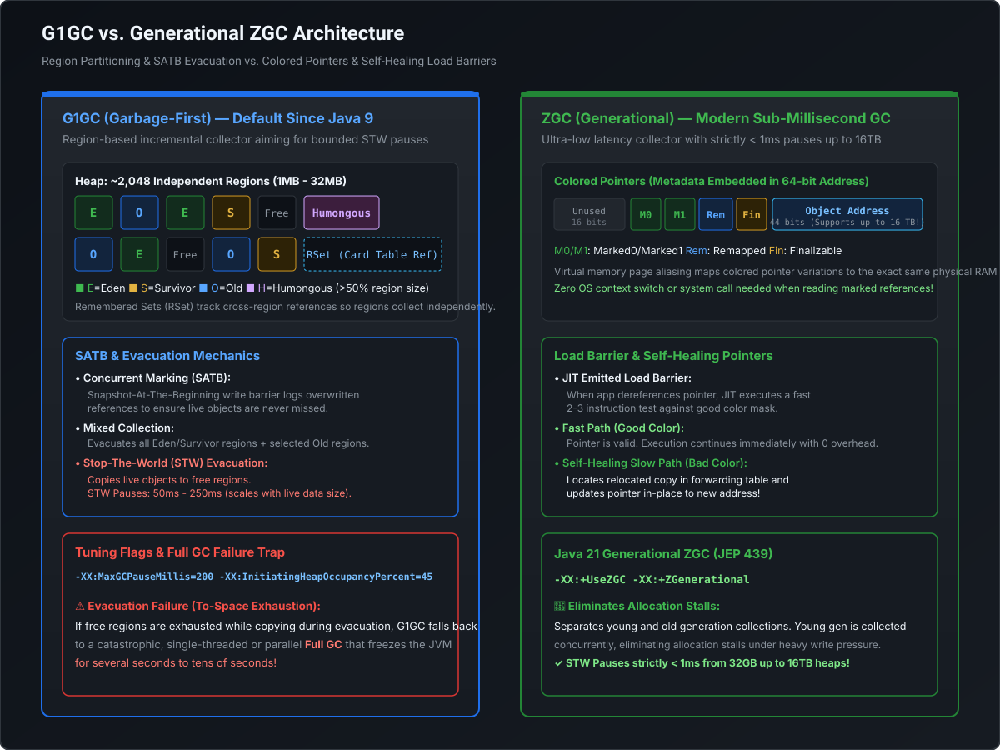

# Garbage Collection Deep Dive: G1GC vs. Generational ZGC Architecture & Low-Latency Tuning

```
========================================================================================================================
                                      HOTSPOT GARBAGE COLLECTION EVOLUTION & LANDSCAPE
========================================================================================================================

  Latency (Pause Time)
     ▲
     │  ┌─────────────────────────────┐
10s  │  │ Serial GC / Parallel GC     │  Throughput King (Batch, Big Data, Offline Processing)
     │  │ Stop-The-World Everything   │  Pauses scale linearly with heap size
     │  └──────────────┬──────────────┘
     │                 │
1s   │                 ▼
     │  ┌─────────────────────────────┐
     │  │ CMS (Concurrent Mark Sweep) │  Deprecated Java 9, Removed Java 14
     │  │ Free-list, Fragmentation    │  Prone to catastrophic Concurrent Mode Failure
     │  └──────────────┬──────────────┘
     │                 │
200ms│                 ▼
     │  ┌─────────────────────────────┐
     │  │ G1GC (Garbage-First)        │  Default since Java 9 (Balanced Throughput & Latency)
     │  │ Region-based, SATB, Mixed GC│  Soft pause goal (-XX:MaxGCPauseMillis=200)
     │  └──────────────┬──────────────┘
     │                 │
     │                 ▼
<1ms │  ┌─────────────────────────────┐  ┌─────────────────────────────┐
     │  │ ZGC (Java 15+ / Java 21 Gen)│  │ Shenandoah (Red Hat)        │  Ultra-Low Latency
     │  │ Colored Pointers, Load Barr.│  │ Brooks Pointers / Load Ref  │  Sub-millisecond pauses
     │  └─────────────────────────────┘  └─────────────────────────────┘  independent of heap size!
     └─────────────────────────────────────────────────────────────────────────────────────────────► Throughput / Footprint
```

---

## 1. The Core Foundations of Garbage Collection

### 1.1 The Weak Generational Hypothesis
Modern JVM garbage collectors are architected around two empirical laws observed across decades of enterprise workloads:
1. **The vast majority of objects die shortly after allocation** ($>95\%$ of objects created in a request-response cycle become unreachable almost immediately).
2. **References from older objects to newer objects are extremely rare**.

This hypothesis dictates segregating heap memory into **Young** and **Old** generations:
- **Young Generation (Minor GC)**: Focuses exclusively on reclaiming short-lived ephemeral objects with high collection frequency and fast evacuation.
- **Old Generation (Major / Full GC)**: Scans survived, tenured objects less frequently because their mortality rate is low.

---

### 1.2 GC Roots & Reachability Graph
An object on the heap is "live" if it can be reached via a directed reference path starting from a **GC Root**:
- **Thread Stack References**: Local variable references and operand stack entries in active stack frames.
- **Static Class Variables**: References stored in `static` fields of loaded classes in Metaspace.
- **JNI Handles**: Global and local native C/C++ references created via JNI.
- **System Classes & Monitor Locks**: Objects held as synchronized lock monitors or loaded by the Bootstrap ClassLoader.

---

### 1.3 Safe Points & Stop-The-World (STW) Mechanics
A garbage collector cannot safely mutate or inspect object graphs if application threads are actively modifying pointer references. HotSpot coordinates pauses via **Safe Points**:
- **Safe Point Polling**: The JIT compiler emits a safe point poll check at the end of every non-inlined method return and loop backedge.
- **Triggering a Pause**: The JVM changes the permissions on a special memory page (the polling page) or sets an atomic global flag.
- **Thread Park**: When an application thread hits a poll instruction, it faults or detects the flag, saves its register state, and transitions into a blocked state (`ThreadState::_thread_blocked`).
- **Time To Safe Point (TTSP)**: The wall-clock time between the GC requesting a safe point and the **last application thread** parking. A long-running counted loop without JIT safe point polling can cause high TTSP (often mistaken for long GC pauses!).

---

## 2. G1GC (Garbage-First) In-Depth Architecture

G1GC was designed to replace CMS as the production-grade, general-purpose garbage collector for multi-gigabyte heaps, balancing high throughput with predictable pause-time targets.

[](images/g1gc_vs_zgc_architecture.svg)

### 2.1 Region-Based Heap Partitioning
Unlike traditional collectors where Young and Old generations are contiguous memory blocks, G1GC partitions the heap into approximately **2,048 equal-sized, non-contiguous Regions**:
- **Region Size**: Ranges from **1 MB to 32 MB** (always a power of 2: 1M, 2M, 4M, 8M, 16M, 32M), computed automatically during startup based on `-Xms` and `-Xmx` (`-XX:G1HeapRegionSize`).
- **Dynamic Roles**: A region is assigned a dynamic role that can change upon each collection cycle:
  - **Eden (E)**: Incoming allocations via Thread-Local Allocation Buffers (TLABs).
  - **Survivor (S)**: Survived at least one Minor GC.
  - **Old (O)**: Long-lived tenured objects.
  - **Humongous (H)**: Any object whose size exceeds **50% of a standard region size**. Humongous objects are allocated in a contiguous sequence of Old regions directly, bypassing Eden to avoid costly copy overhead.

---

### 2.2 Tracking Inter-Region Pointers: Card Tables & Remembered Sets (RSet)
When collecting an Eden region during a Minor GC, how does G1GC know if an object in Eden is referenced by an object residing in an Old Generation region without scanning all of Old Gen?

```
┌────────────────── OLD GENERATION REGION ──────────────────┐
│  Object X ──[ points to ]──► [ Card #42 ]                 │
└─────────────────────────────────┬─────────────────────────┘
                                  │ Card Table Write Barrier
                                  ▼
┌────────────────── EDEN REGION REMEMBERED SET ─────────────┐
│  RSet: "I am referenced by Card #42 of Old Region B"      │
└───────────────────────────────────────────────────────────┘
```

1. **Card Table**: The entire heap is divided into 512-byte blocks called **Cards**. A global byte array (the Card Table) tracks each card. When an application thread modifies an object reference (`obj.field = newChild`), a JIT **Post-Write Barrier** marks the corresponding card as "dirty" (`0x00`).
2. **Concurrent Card Refinement Threads**: Background JVM threads scan dirty card queues and update the destination region's **Remembered Set (RSet)**.
3. **RSet ("Points-into" model)**: Every region maintains its own private RSet. It records the foreign cards from other regions that point into it. During GC, G1GC only scans the RSet of the target region rather than traversing the entire heap!

---

### 2.3 SATB (Snapshot-At-The-Beginning) Concurrent Marking
To mark live objects concurrently while application threads continue writing data, G1GC uses **SATB (Snapshot-At-The-Beginning)**:
- At the start of the marking cycle, G1GC takes a logical "snapshot" of the live object graph.
- **Pre-Write Barrier**: If an application thread overwrites an existing reference during marking (`A.field = C`, replacing reference `B`), G1GC's pre-write barrier catches reference `B` and pushes it onto an SATB buffer before it is lost.
- **Guarantee**: Any object that was reachable at the start of marking (or allocated during marking) is treated as live, preventing premature collection of reachable objects.

---

### 2.4 G1GC Collection Lifecycle

```
[ Young GC ] ──► [ Initial Mark (STW) ] ──► [ Concurrent Mark ] ──► [ Remark (STW) ] ──► [ Cleanup (STW) ] ──► [ Mixed GC (STW) ]
```

1. **Young GC (STW)**: When Eden fills, G1GC evacuates live objects from Eden to Survivor or Old regions.
2. **Initial Mark (STW)**: Piggybacks on a standard Young GC. Marks all GC Roots directly reachable from the stack.
3. **Concurrent Mark**: Background threads traverse the live object graph across Old Gen regions concurrently.
4. **Remark (STW)**: Flushes all remaining SATB write barrier buffers and performs reachability analysis.
5. **Cleanup (STW + Concurrent)**: Identifies regions with **100% garbage** and immediately reclaims them to the free list without copying.
6. **Mixed GC (STW)**: Collects all Young regions **plus** the Old regions with the highest proportion of garbage ("Garbage-First"), respecting the `-XX:MaxGCPauseMillis` target.

---

### 2.5 Critical G1 Failure Mode: Evacuation Failure & To-Space Exhaustion
- **The Problem**: When G1GC performs an evacuation pause, it must allocate space in a destination Survivor or Old region for copied live objects.
- **The Trigger**: If the heap is heavily fragmented or the application allocates faster than G1GC can evacuate, G1 encounters **To-Space Exhaustion** (`to-space exhausted` in GC logs).
- **The Disaster**: G1 fails over to a **Full GC**, which is a single-threaded or parallel Stop-The-World mark-sweep-compact cycle across the **entire heap**, freezing application traffic for seconds or even minutes!

---

## 3. ZGC (Z Garbage Collector) & Java 21 Generational ZGC

ZGC is HotSpot’s ultra-low latency, scalable garbage collector designed to handle heaps from **16 MB to 16 TB** with pause times guaranteed under **1 millisecond**, regardless of heap scale.

### 3.1 Innovation 1: Colored Pointers
ZGC stores reference metadata directly inside the unused high-order bits of **64-bit pointers**, rather than in the object header:

```
+-------------------+--------------------------------+-----------------------------------------------+
| 16 Unused Bits    | 4 Colored Metadata Bits        | 44 Address Bits (Up to 16 Terabytes RAM)      |
+-------------------+--------------------------------+-----------------------------------------------+
                    | Bit 45: Finalizable            |
                    | Bit 44: Remapped               |
                    | Bit 43: Marked1                |
                    | Bit 42: Marked0                |
```

- **Address Space Aliasing**: The JVM uses OS virtual memory system calls (`mmap` on Linux) to alias the 4 different color configurations of an address to the **exact same physical memory page**. The CPU dereferences `Marked0`, `Marked1`, or `Remapped` addresses with zero hardware translation overhead!

---

### 3.2 Innovation 2: Load Barriers & "Self-Healing" Pointers
Traditional collectors (like G1GC) use **Write Barriers** to track object mutations. ZGC inverts this model by using a **Load Barrier (Read Barrier)** executed when a thread dereferences an object field (`Object x = order.customer`):

```
Application Thread reads `order.customer`
                     │
                     ▼
       ┌───────────────────────────┐
       │ Is Pointer Color "Good"?  │
       └─────────────┬─────────────┘
                     │
         ┌───────────┴───────────┐
         │ YES                   │ NO (Points to relocated object)
         ▼                       ▼
   [ Fast Path ]           [ Slow Path: Load Barrier Intercept ]
   Zero latency overhead   1. Look up forward table for new address
   Returns reference       2. Self-Heal: Atomic CAS updates pointer in heap!
                           3. Returns new live object address
```

> [!TIP]
> **Why ZGC Pauses Are <1ms**: ZGC evacuates live objects **concurrently** while the application is running! If an application thread accesses an object that has been relocated, the **Load Barrier intercepts the read, self-heals the reference to the new copy, and continues**. The application never waits for the GC to complete whole-heap evacuation pauses.

---

### 3.3 Innovation 3: Generational ZGC (Java 21 / JEP 439)
In Java 17 and earlier, ZGC was single-generational: it marked and collected the entire heap uniformly. Under high-frequency allocation workloads, single-generation ZGC suffered from **Allocation Stalls** because it could not collect garbage as fast as the application created it.

**Java 21 Generational ZGC (`-XX:+UseZGC -XX:+ZGenerational`) solves this completely**:
- **Young Generation Separated**: Ephemeral young objects are collected in lightweight, high-frequency sub-millisecond sweeps.
- **Dual Load & Store Barriers**: Hardware-optimized barriers track inter-generational pointers with negligible CPU overhead.
- **Results**: Matches or exceeds G1GC throughput while maintaining strict $<1\text{ms}$ maximum pause times!

---

## 4. Collector Architectural Comparison Matrix

| Architectural Dimension | Parallel GC | G1GC (Garbage-First) | Single-Gen ZGC | Generational ZGC (Java 21) |
| :--- | :--- | :--- | :--- | :--- |
| **Primary Design Goal** | Maximum Throughput | Balanced Throughput & Latency | Low Latency ($<1\text{ms}$) | Low Latency + High Allocation Throughput |
| **Typical STW Pauses** | 500ms – 10+ seconds | 50ms – 250ms | 0.2ms – 1.0ms | **0.1ms – 0.5ms** |
| **Pause Time Scaling** | Linear with heap & live set | Sub-linear with heap | **Independent of heap size!** | **Independent of heap size!** |
| **Max Heap Supported** | Terabytes | ~64 GB recommended | 16 TB | 16 TB |
| **Barrier Mechanism** | None | Write Barrier (Post-Card / Pre-SATB) | Load Barrier (Read Barrier) | Load + Store Barriers |
| **Compaction Strategy** | Stop-The-World Full Compaction | STW Mixed GC Copying | Concurrent Relocation | Concurrent Relocation |
| **CPU Overhead** | Minimal (0–2%) | Moderate (5–10%) | Moderate (8–15%) | Low-Moderate (5–8%) |
| **Best Workload Fit** | Batch processing, ETL, Spark | Enterprise Web Apps, Kafka, Default | Financial Order Matching, HFT | Large Heaps, Real-Time Low-Latency Microservices |

---

## 5. Runnable Verification POC: GC Monitoring & Survivor Tenuring Simulation

This standalone Java program simulates heap allocation churn, triggers Young GC evacuations, demonstrates Survivor space promotion, and inspects GC metrics via JMX MXBeans:

```java
package com.mastery.jvm;

import java.lang.management.GarbageCollectorMXBean;
import java.lang.management.ManagementFactory;
import java.lang.management.MemoryPoolMXBean;
import java.util.ArrayList;
import java.util.List;

/**
 * GC Behavior Verification Suite:
 * 1. Simulates high-allocation churn (Young Gen evacuation)
 * 2. Promotes long-lived objects to Old Gen
 * 3. Inspects runtime GarbageCollectorMXBeans and MemoryPool stats
 */
public class GarbageCollectionMasteryPOC {

    // Retained list to force promotion to Old Generation
    private static final List<byte[]> SURVIVOR_SURVIVORS = new ArrayList<>();

    public static void main(String[] args) throws InterruptedException {
        System.out.println("=================================================================");
        System.out.println("  HOTSPOT GARBAGE COLLECTION & RUNTIME JMX INSPECTOR");
        System.out.println("=================================================================\n");

        printActiveCollectors();

        System.out.println("[2] Simulating Allocation Churn & Promotion to Old Gen...");
        long startTime = System.currentTimeMillis();

        for (int cycle = 0; cycle < 10; cycle++) {
            // Allocate 50MB of short-lived transient garbage (dies in Eden)
            for (int i = 0; i < 500; i++) {
                byte[] transientGarbage = new byte[100 * 1024]; // 100 KB
            }

            // Retain 5MB of long-lived data (survives Minor GC -> Promoted to Old)
            SURVIVOR_SURVIVORS.add(new byte[5 * 1024 * 1024]);

            Thread.sleep(100);
        }

        long duration = System.currentTimeMillis() - startTime;
        System.out.printf("    Completed allocation cycle in %d ms\n\n", duration);

        printMemoryPoolUsage();
        printActiveCollectors();
    }

    private static void printActiveCollectors() {
        System.out.println("--- Active Garbage Collectors (JMX MXBeans) ---");
        List<GarbageCollectorMXBean> gcBeans = ManagementFactory.getGarbageCollectorMXBeans();
        for (GarbageCollectorMXBean bean : gcBeans) {
            System.out.printf("  Collector: %-25s | Collections: %4d | Total STW Time: %d ms\n",
                    bean.getName(), bean.getCollectionCount(), bean.getCollectionTime());
        }
        System.out.println();
    }

    private static void printMemoryPoolUsage() {
        System.out.println("--- Memory Pool Utilization ---");
        List<MemoryPoolMXBean> pools = ManagementFactory.getMemoryPoolMXBeans();
        for (MemoryPoolMXBean pool : pools) {
            long usedMb = pool.getUsage().getUsed() / (1024 * 1024);
            long maxMb = pool.getUsage().getMax() / (1024 * 1024);
            System.out.printf("  Pool: %-30s | Used: %4d MB | Max: %4d MB | Type: %s\n",
                    pool.getName(), usedMb, maxMb, pool.getType());
        }
        System.out.println();
    }
}
```

---

## 6. Staff / Principal Engineer Interview Guide: GC Tuning & Strategy

### Scenario 1: G1GC Pause-Time Goal Dilemma
> **Interviewer**: *"Our payment authorization service running G1GC currently has `-XX:MaxGCPauseMillis=200`. During peak traffic, p99 API latency hits 220ms. A developer suggests setting `-XX:MaxGCPauseMillis=20` to eliminate the pause. What will happen?"*

- **Principal Engineer Response**:
  1. **Disaster Forecast**: *"Setting `MaxGCPauseMillis=20` will severely degrade throughput and likely trigger **To-Space Exhaustion and Full GC freezes**."*
  2. **Mechanics**: *"G1GC treats `MaxGCPauseMillis` as a **soft heuristic goal**, not an absolute SLA. In response to a 20ms target, G1 drastically shrinks the Young Generation Eden size to just a few regions so it can evacuate them within 20ms. Because Eden is tiny, it fills up every few milliseconds, causing an endless storm of Minor GCs. As a result, thread allocation is constantly blocked, CPU throughput plunges from 95% to under 60%, and dirty card queues swamp the background refinement threads."*
  3. **Correct Strategy**:
     - Retain `MaxGCPauseMillis=100-200`.
     - Increase heap size `-Xms/-Xmx` or tune `-XX:InitiatingHeapOccupancyPercent (IHOP)` to start concurrent marking earlier (e.g., `-XX:InitiatingHeapOccupancyPercent=40`).
     - If the business strictly demands $<20\text{ms}$ hard SLAs, **migrate the runtime to Java 21 Generational ZGC (`-XX:+UseZGC -XX:+ZGenerational`)**, which achieves $<1\text{ms}$ pauses natively without throughput collapse.

---

### Scenario 2: Selecting GC for Low-Latency Microservices vs ETL Batch Jobs
> **Interviewer**: *"You are standardizing the JVM configuration across our enterprise Kubernetes clusters. We have two core workloads: (1) High-throughput financial ledger processing 100M records nightly via Spring Batch, and (2) Low-latency WebSocket trading gateway. How do you choose collectors?"*

- **Principal Engineer Response**:
  1. **Workload 1 (Spring Batch Ledger)**:
     - **Choice**: **Parallel GC (`-XX:+UseParallelGC`)**.
     - **Justification**: *"Batch ETL cares solely about total time to completion (throughput), not individual request latency. Parallel GC has zero read/write barrier overhead and optimizes pure CPU execution. Pauses of 2–3 seconds do not matter for an offline 4-hour batch job."*
  2. **Workload 2 (WebSocket Trading Gateway)**:
     - **Choice**: **Generational ZGC on Java 21 (`-XX:+UseZGC -XX:+ZGenerational`)**.
     - **Justification**: *"A 100ms G1GC pause causes WebSocket TCP buffer stalls, client disconnects, and SLA breaches on market trade execution. Generational ZGC keeps Stop-The-World pauses under 1 millisecond by relocating live objects concurrently via self-healing load barriers."*

---

### Scenario 3: Diagnosing Humongous Allocation Storms in G1GC
> **Interviewer**: *"Your G1GC logs show frequent Concurrent Mark cycles triggering every 3 minutes, even though total heap usage is only at 30%. What is causing this, and how do you resolve it?"*

- **Principal Engineer Response**:
  1. **Root Cause**: *"This indicates a **Humongous Allocation Storm**. In G1GC, any object allocation exceeding 50% of the region size is classified as Humongous and allocated directly in Old Generation regions. Because Old Gen occupancy rises rapidly, it trips `-XX:InitiatingHeapOccupancyPercent (IHOP)` early, triggering unneeded concurrent marking cycles."*
  2. **Common Culprits**: *"Loading massive JSON/XML payloads, unbounded DB query results into large byte arrays, or multi-megabyte string concatenations."*
  3. **Fix**:
     - Increase G1 region size explicitly: `-XX:G1HeapRegionSize=16m` or `32m` so incoming large payloads fall under the 50% threshold and allocate in Eden.
     - Refactor the application to stream payloads (e.g., Jackson `JsonParser` streaming rather than reading the entire payload into a `byte[]`).
