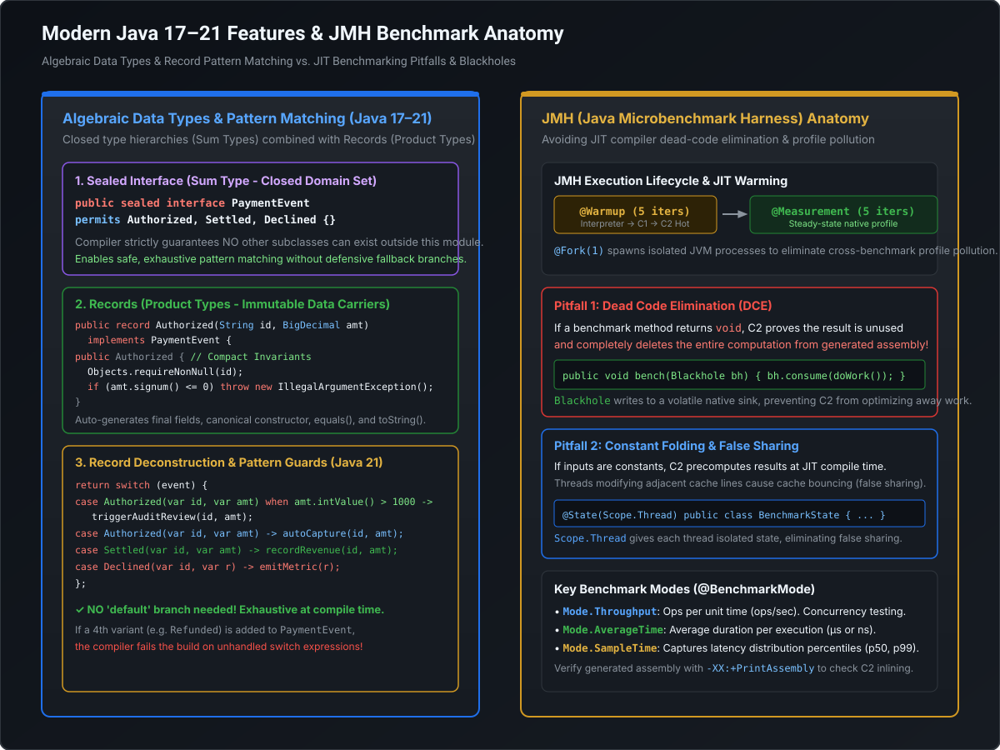

# Modern Java Mastery: Records, Sealed Types, Pattern Matching & Algebraic Data Types (Java 17–21)

```
========================================================================================================================
                          MODERN JAVA (17–21 LTS): TYPE SYSTEM EVOLUTION & PATTERN MATCHING
========================================================================================================================

  ┌───────────────────────────────── ALGEBRAIC DATA TYPES (ADT) IN JAVA ─────────────────────────────────┐
  │                                                                                                      │
  │  ┌────────────────────── SUM TYPE ─────────────────────┐   ┌──────────────── PRODUCT TYPE ───────────┐
  │  │  Sealed Interface / Class (Closed Hierarchy)        │   │  Java Record (Immutable Data Carrier)   │
  │  │  • Strictly limits permitted implementations        │   │  • Final state, transparent components  │
  │  │  • Enforces exhaustive compiler analysis            │   │  • Auto canonical constructor, equals   │
  │  │                                                     │   │  • Safe deserialization by design       │
  │  │  public sealed interface TransactionEvent           │   │                                         │
  │  │      permits Authorized, Settled, Declined {}       │   │  public record Authorized(              │
  │  │                                                     │   │      String txId, BigDecimal amount     │
  │  │                                                     │   │  ) implements TransactionEvent {}       │
  │  └─────────────────────────────┬───────────────────────┘   └────────────────────┬────────────────────┘
  │                                │                                                │
  │                                └───────────────────────┬────────────────────────┘
  │                                                        ▼
  │  ┌───────────────────────── EXHAUSTIVE PATTERN MATCHING (JAVA 21) ───────────────────────────────────┐
  │  │                                                                                                   │
  │  │  return switch (event) {                                                                          │
  │  │      case Authorized(var id, var amt) when amt.compareTo(HIGH_VAL) > 0 -> routeHighValue(id);     │
  │  │      case Authorized(var id, var amt)                                  -> routeStandard(id);       │
  │  │      case Settled(var id, var amt)                                     -> recordLedger(id, amt);   │
  │  │      case Declined(var id, var reason)                                 -> alertRisk(id, reason);   │
  │  │  }; // ✓ NO 'default' branch! Adding a new permitted subtype fails compilation immediately.        │
  │  └───────────────────────────────────────────────────────────────────────────────────────────────────┘
  └──────────────────────────────────────────────────────────────────────────────────────────────────────┘
```

---

## 1. Why Modern Java (17 to 21) is Non-Negotiable for Tech Leaders

For years, enterprise Java was burdened by boilerplate: verbose POJOs, defensive copy constructor overhead, error-prone `equals()`/`hashCode()` implementations, and brittle casting (`instanceof` followed immediately by explicit cast).

Starting in **Java 17 LTS** and finalized in **Java 21 LTS**, Java's type system underwent its most significant architectural leap since generics in Java 5:

[](images/modern_java_features_and_jmh.svg)

1. **Elimination of Ceremonial Boilerplate**: Records replace 100+ lines of Lombok or manual POJO code with a single transparent line.
2. **Algebraic Data Types (ADTs)**: The combination of **Sum Types** (`sealed` interfaces) and **Product Types** (`record` data carriers) brings functional language guarantees (Haskell, Scala, Rust) into type-safe enterprise Java.
3. **Exhaustiveness Guarantees**: Compilers verify that every possible subtype branch is explicitly handled at build time, eliminating silent `NullPointerException` and unexpected `default` fall-throughs in production microservices.

---

## 2. Java Records: Deep Dive into Immutable Data Carriers

A **Record** (`record`) is a specialized, transparent carrier for immutable data introduced as a standard language feature in Java 16.

### 2.1 What the Compiler Generates Under the Hood
When you write:
```java
public record PaymentRequest(String transactionId, BigDecimal amount, Currency currency) {}
```

The Java compiler automatically synthesizes:
- A `final` class extending `java.lang.Record`. (Records cannot extend any other class because Java does not support multiple class inheritance).
- `private final` fields corresponding to each component.
- Public read accessors named after the components: `transactionId()`, `amount()`, `currency()` (**Note**: Record accessors do NOT follow the JavaBeans `getXXX()` naming convention).
- A **Canonical Constructor** matching the component declaration list.
- Value-based implementations of `equals()`, `hashCode()`, and `toString()`.

---

### 2.2 The Compact Constructor: Validation & Normalization
The primary purpose of a Record's constructor is validation and defensive normalization. Records introduce the **Compact Constructor** syntax, which omits the parameter list and explicit field assignments:

```java
public record Money(BigDecimal amount, String currencyCode) {

    // Compact Constructor: Implicitly receives (BigDecimal amount, String currencyCode)
    public Money {
        Objects.requireNonNull(amount, "Amount cannot be null");
        Objects.requireNonNull(currencyCode, "Currency code cannot be null");

        if (amount.compareTo(BigDecimal.ZERO) < 0) {
            throw new IllegalArgumentException("Negative monetary balance not allowed: " + amount);
        }

        // Defensive normalization: parameter mutations here are assigned to the final fields!
        currencyCode = currencyCode.toUpperCase().trim();
    }
}
```

> [!IMPORTANT]
> In a compact constructor, you mutate the constructor parameters directly (`currencyCode = currencyCode.trim()`). The compiler automatically inserts `this.amount = amount; this.currencyCode = currencyCode;` at the end of the constructor block.

---

### 2.3 Record Serialization Security: Immunity to RCE Exploits
In standard Java classes, traditional serialization (`implements Serializable`) is one of the most dangerous attack vectors in the history of enterprise software (e.g., Apache Commons Collections RCE). This is because standard serialization bypasses constructors, instantiating objects by reflecting directly onto uninitialized heap memory.

**Records fundamentally fix this security flaw**:
- The JVM specification mandates that Records **MUST be deserialized using the Canonical Constructor**.
- The `readObject()`, `readResolve()`, and `serialPersistentFields` overrides are completely ignored for records.
- Invariants enforced in the canonical or compact constructor **cannot be bypassed** by a tampered serialized byte stream!

---

## 3. Sealed Classes & Interfaces: Sum Types

A `sealed` class or interface restricts which other classes or interfaces may extend or implement it:

```java
public sealed interface OrderCommand
    permits PlaceOrder, CancelOrder, EscalateDispute {
}
```

### 3.1 Strict Compiler Rules for Sealed Hierarchies
1. **Explicit Permission**: Every permitted subclass must be listed in the `permits` clause (unless defined in the same source file, in which case `permits` can be inferred).
2. **Co-location Requirement**: All permitted subclasses must belong to the **same Java module** (or the same package if using the unnamed classpath module).
3. **Mandatory Modifier Choice**: Every permitted subclass must declare exactly one of three modifiers:
   - `final`: The class cannot be extended any further (closes the branch).
   - `sealed`: The class continues to restrict subclassing with its own `permits` list.
   - `non-sealed`: The class deliberately re-opens that branch to unrestricted inheritance.

```
                  ┌──────────────────────────────┐
                  │ sealed interface Result<T>   │
                  └──────────────┬───────────────┘
                                 │ permits
                 ┌───────────────┴───────────────┐
                 ▼                               ▼
  ┌─────────────────────────────┐ ┌─────────────────────────────┐
  │ final record Success<T>(...)│ │ final record Failure<T>(...)│
  └─────────────────────────────┘ └─────────────────────────────┘
```

---

## 4. Pattern Matching Evolution: Java 16 to Java 21

### 4.1 Pattern Matching for `instanceof` (Java 16)
Eliminates redundant casting boilerplate:

```java
// Legacy Java 8 / 11 Approach:
if (obj instanceof String) {
    String s = (String) obj; // Redundant, dangerous cast
    System.out.println(s.toLowerCase());
}

// Modern Java 16+ Pattern Matching:
if (obj instanceof String s && !s.isBlank()) { // Pattern variable 's' in scope immediately
    System.out.println(s.toLowerCase());
}
```

---

### 4.2 Pattern Matching for `switch` & Guard Clauses (Java 21)
Java 21 enables `switch` statements and expressions over arbitrary reference types with pattern matching, type deconstruction, and boolean `when` guard clauses:

```java
public String categorizeTransaction(PaymentMethod payment) {
    return switch (payment) {
        case CreditCard c when c.isForeign() -> "International Credit Card (3% fee)";
        case CreditCard c                    -> "Domestic Credit Card (1.5% fee)";
        case UpiPayment u                    -> "Instant UPI Settlement (0% fee)";
        case CryptoPayment k                 -> "Crypto Rails (Gas fee variable)";
        case null                            -> "Null payment rejected";
    };
}
```

---

### 4.3 Record Pattern Deconstruction (Java 21 / JEP 440)
Instead of extracting fields via accessors, Java 21 allows **deconstructing records directly in the case clause**:

```java
// Given: record Point(int x, int y) {}
// Given: record Circle(Point center, int radius) {}

public void inspectShape(Object shape) {
    switch (shape) {
        // Nested Record Deconstruction:
        case Circle(Point(var x, var y), var radius) when radius > 100 ->
            System.out.printf("Massive circle centered at (%d, %d) with radius %d\n", x, y, radius);

        case Circle(var center, var radius) ->
            System.out.println("Standard circle centered at " + center);

        default -> System.out.println("Unknown shape");
    }
}
```

---

## 5. Architectural Synergy: Algebraic Data Types (ADTs)

In type theory:
- **Product Type**: Type $T = A \times B$ (has an instance of $A$ AND $B$). Represented in Java by **Records**.
- **Sum Type**: Type $T = A + B$ (an instance is EITHER $A$ OR $B$, from a closed set). Represented in Java by **Sealed Interfaces**.

Combining Sealed Interfaces and Records delivers **True Algebraic Data Types**:

```
Algebraic Data Type = Sealed Hierarchy (Sum) + Records (Product) + Exhaustive Switch (Deconstruction)
```

### Why This Eliminates Entire Classes of Production Bugs:
1. **No Runtime Fallthrough**: Because the compiler knows all permitted subtypes of a sealed hierarchy, it proves exhaustiveness at compile time.
2. **The Breaking Change Warning**: If an engineer adds a new subtype `Refunded` to `sealed interface TransactionEvent`, **every `switch` in the codebase that processes `TransactionEvent` fails to compile immediately**. The developer is forced to handle the new state across all consumers before code can ever be committed or deployed!

---

## 6. Runnable Verification POC: Complete Financial Settlement State Machine

The following self-contained Java program implements an enterprise-grade financial event processing engine using Sealed Hierarchies, Records with Compact Validation Constructors, Nested Record Pattern Deconstruction, and Java 21 Guard Clauses:

```java
package com.mastery.modern;

import java.math.BigDecimal;
import java.time.Instant;
import java.util.List;
import java.util.Objects;
import java.util.UUID;

/**
 * Enterprise Financial Settlement Engine (Java 21):
 * Demonstrates Sealed Hierarchies (Sum Types), Records (Product Types),
 * Compact Constructors, Record Deconstruction, and Exhaustive Pattern Matching.
 */
public class ModernJavaPatternMatchingPOC {

    // 1. Value Record with Compact Validation Constructor
    public record Money(BigDecimal amount, String currency) {
        public Money {
            Objects.requireNonNull(amount, "Amount cannot be null");
            Objects.requireNonNull(currency, "Currency cannot be null");
            if (amount.compareTo(BigDecimal.ZERO) < 0) {
                throw new IllegalArgumentException("Negative amounts prohibited: " + amount);
            }
            currency = currency.toUpperCase().trim();
        }
    }

    // 2. Sealed Hierarchy (Sum Type) defining closed set of payment events
    public sealed interface PaymentEvent
            permits PaymentEvent.Authorized, PaymentEvent.Settled, PaymentEvent.Declined {

        UUID transactionId();
        Instant timestamp();

        // 3. Permitted Product Types (Records)
        record Authorized(UUID transactionId, Instant timestamp, Money money, String merchantId)
                implements PaymentEvent {}

        record Settled(UUID transactionId, Instant timestamp, Money money, String clearingNetwork)
                implements PaymentEvent {}

        record Declined(UUID transactionId, Instant timestamp, String reasonCode, int severityLevel)
                implements PaymentEvent {}
    }

    public static void main(String[] args) {
        System.out.println("=================================================================");
        System.out.println("  MODERN JAVA 21: SEALED ADT & RECORD PATTERN MATCHING POC");
        System.out.println("=================================================================\n");

        UUID tx1 = UUID.randomUUID();
        UUID tx2 = UUID.randomUUID();
        UUID tx3 = UUID.randomUUID();

        List<PaymentEvent> batch = List.of(
                new PaymentEvent.Authorized(tx1, Instant.now(), new Money(new BigDecimal("15000.00"), "USD"), "MERCH-99"),
                new PaymentEvent.Authorized(tx2, Instant.now(), new Money(new BigDecimal("45.50"), "eur "), "MERCH-12"),
                new PaymentEvent.Settled(tx1, Instant.now(), new Money(new BigDecimal("15000.00"), "USD"), "FEDWIRE"),
                new PaymentEvent.Declined(tx3, Instant.now(), "INSUFFICIENT_FUNDS", 2)
        );

        for (PaymentEvent event : batch) {
            String routingDecision = processEvent(event);
            System.out.println(routingDecision);
        }
    }

    /**
     * Exhaustive Switch Expression with Record Deconstruction & Guard Clauses (Java 21)
     * NOTE: No 'default' branch is required! The compiler mathematically proves exhaustiveness.
     */
    public static String processEvent(PaymentEvent event) {
        return switch (event) {
            // Nested Record Pattern Deconstruction with Guard Clause:
            case PaymentEvent.Authorized(var txId, var ts, Money(var amt, var curr), var merch)
                    when amt.compareTo(new BigDecimal("10000.00")) >= 0 ->
                    String.format("[HIGH-VALUE AUDIT] Tx: %s | Amount: %s %s | Merchant: %s -> Routed to Compliance",
                            txId, amt, curr, merch);

            case PaymentEvent.Authorized(var txId, var ts, Money(var amt, var curr), var merch) ->
                    String.format("[FAST-TRACK AUTH] Tx: %s | Amount: %s %s -> Instant Authorization",
                            txId, amt, curr);

            case PaymentEvent.Settled(var txId, var ts, Money(var amt, var curr), var network) ->
                    String.format("[LEDGER SETTLED] Tx: %s | Settled via: %s | Amount: %s %s",
                            txId, network, amt, curr);

            case PaymentEvent.Declined(var txId, var ts, var reason, var severity) when severity >= 3 ->
                    String.format("[CRITICAL ALERT] Tx: %s | Blocked for: %s | Severity: %d -> Alerting Risk Desk",
                            txId, reason, severity);

            case PaymentEvent.Declined(var txId, var ts, var reason, var severity) ->
                    String.format("[NORMAL DECLINE] Tx: %s | Declined: %s (Severity: %d)",
                            txId, reason, severity);
        };
    }
}
```

---

## 7. Staff / Principal Engineer Interview Guide: Modern Java & Types

### Scenario 1: Lombok vs. Java Records Migration
> **Interviewer**: *"Our legacy microservice heavily uses Project Lombok (`@Data`, `@Value`, `@Builder`). Now that we are migrating to Java 21, an architect proposes ripping out Lombok entirely in favor of Java Records. What is your assessment?"*

- **Principal Engineer Response**:
  1. **Nuanced Architectural Stance**: *"Java Records are not a 1:1 replacement for Lombok's `@Data` because Records are strictly **immutable data carriers**, whereas `@Data` generates mutable JavaBeans with setters."*
  2. **Where Records Must Replace Lombok**:
     - Replace `@Value`, DTOs, Kafka event payloads, API response schemas, and Map keys with Records.
     - **Benefits**: Native compiler support (no annotation processor classpath hacks), reflection and serialization safety, built-in structural pattern matching deconstruction in Java 21, and zero hidden byte-weaving bugs during major JDK upgrades.
  3. **Where Caution is Required**:
     - **JPA / Hibernate Entities**: Records cannot be JPA entities because the JPA specification mandates a default no-arg constructor, non-final classes, and lazy proxying (which requires mutable proxy subclasses). JPA entities should remain standard classes, while Projection DTOs should be Records!
     - **Builder Pattern**: If an object has 15 optional fields, Records require a verbose 15-parameter constructor call. For complex construction with multiple optional configurations, either write a compact static Builder alongside the record or use `with...` wither methods.

---

### Scenario 2: Refactoring Fragile Visitor Patterns with Sealed Types
> **Interviewer**: *"In our pricing engine, we have a complex Gang-of-Four Visitor Pattern with 12 visit methods to evaluate discounts across different product categories. Adding a new product type requires modifying every single Visitor class. How does Modern Java modernize this?"*

- **Principal Engineer Response**:
  1. **The Flaw of Classic Visitor Pattern**: *"The GoF Visitor Pattern was an object-oriented workaround for Java's lack of double-dispatch and pattern matching. It forces an unnatural inverted dependency (`accept(Visitor v)`) and creates enormous boilerplate."*
  2. **The Modern Java 21 Solution**:
     - Model the product hierarchy as a `sealed interface Product permits Book, Electronics, Subscription`.
     - Implement the pricing calculation as a pure function using a **Pattern Matching `switch` expression**.
  3. **The Architectural Win**:
     - The business logic is localized in a single pricing method rather than scattered across 12 visitor classes.
     - **Exhaustiveness Guarantee**: When a junior engineer adds `sealed interface Product permits ..., StreamingService`, the compiler immediately flags the pricing switch statement as unhandled at build time, preventing runtime production bugs without requiring any Visitor infrastructure!
