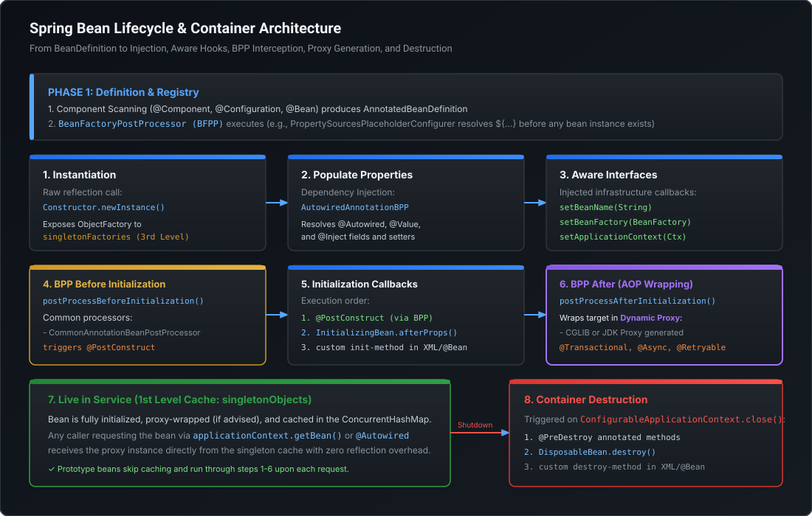

# Spring Bean Lifecycle, Container Internals & Scopes Mastery

Enterprise Java systems built on Spring Boot rely on the Inversion of Control (IoC) container to manage component lifecycles, configuration injection, and cross-cutting infrastructure concerns. At the Staff and Principal Engineer level, interviewers probe far beyond basic `@Component` and `@Autowired` annotations; they test your mental model of **container boot sequences, `BeanPostProcessor` mechanics, proxy generation timing, prototype-in-singleton traps, and circular dependency resolution in the three-level cache**.

---

## 1. Container Architecture: `BeanFactory` vs. `ApplicationContext`

The Spring container is structured as a layered abstraction hierarchy:

```
                  ┌────────────────────────┐
                  │      BeanFactory       │  (org.springframework.beans.factory)
                  │   Root SPI Interface   │  - Lazy bean loading by default
                  └───────────┬────────────┘  - Pure DI & BeanDefinition registry
                              │ extends
                  ┌───────────▼────────────┐
                  │   ApplicationContext   │  (org.springframework.context)
                  │   Enterprise Engine    │  - Eager singleton pre-instantiation
                  └───────────┬────────────┘  - AOP, Event publishing, i18n, Environment
                              │ implemented by
                  ┌───────────▼────────────────────────────┐
                  │ ConfigurableApplicationContext         │
                  │ (AnnotationConfigApplicationContext /  │
                  │  AnnotationConfigServletWebServerAppCtx│
                  └────────────────────────────────────────┘
```

### The Architectural Contrast

| Dimension | `BeanFactory` | `ApplicationContext` |
| :--- | :--- | :--- |
| **Package** | `org.springframework.beans.factory` | `org.springframework.context` |
| **Initialization Strategy** | **Lazy**: Beans are instantiated only when explicitly requested via `getBean()`. | **Eager**: All singleton beans are pre-instantiated upon container startup (`refresh()`). |
| **Enterprise Features** | Minimal footprint: strictly dependency resolution and lifecycle management. | MessageSource (i18n), ApplicationEvent publisher, Environment profiles, AOP integration. |
| **Production Usage** | Constrained edge devices or lightweight micro-containers. | Standard runtime for all Spring Boot 3 enterprise services. |
| **Underlying Workhorse** | Implemented directly by `DefaultListableBeanFactory`. | Holds an internal delegate instance of `DefaultListableBeanFactory`. |

> [!NOTE]
> When `ApplicationContext.getBean()` is called, it delegates directly to its internal `DefaultListableBeanFactory`, which maintains the `BeanDefinitionMap` and the three-level singleton cache.

---

## 2. The Complete Spring Bean Lifecycle

Every managed Spring bean transitions through a deterministic pipeline from metadata parsing to container shutdown:



### Phase 1: Definition & Registration
1. **Component Scanning**: Classpath scanners find classes annotated with `@Component`, `@Service`, `@Repository`, or `@Configuration` / `@Bean`.
2. **BeanDefinition Creation**: Metadata (class name, scope, lazy status, constructor args, factory method) is stored as an instance of `BeanDefinition` inside `BeanDefinitionRegistry`.
3. **`BeanFactoryPostProcessor` (BFPP) Execution**: Runs *before* any bean instance is created. Custom BFPPs (such as `PropertySourcesPlaceholderConfigurer`) resolve property tokens (`${db.url}`) inside bean definitions.

### Phase 2: Instantiation & Dependency Injection
4. **Bean Instantiation**: Reflection invokes constructor (`Constructor.newInstance()`) or factory method. At this moment, fields are still `null`.
5. **Early Singleton Exposure**: For singletons, an `ObjectFactory` wrapping the raw instance is placed into the 3rd level cache (`singletonFactories`) to support circular reference resolution.
6. **Property Population (DI)**: `AutowiredAnnotationBeanPostProcessor` resolves dependencies and injects fields and setter properties (`@Autowired`, `@Value`).

### Phase 3: Aware Hooks & Interception
7. **`Aware` Interface Callbacks**: Spring checks if the bean implements container-aware interfaces:
   - `BeanNameAware.setBeanName(String)`
   - `BeanFactoryAware.setBeanFactory(BeanFactory)`
   - `ApplicationContextAware.setApplicationContext(ApplicationContext)`
8. **`BeanPostProcessor.postProcessBeforeInitialization()`**: Custom hooks execute on the raw instance. Specifically, `CommonAnnotationBeanPostProcessor` triggers `@PostConstruct` methods.
9. **Initialization Callbacks**:
   - Methods annotated with `@PostConstruct` execute first.
   - `InitializingBean.afterPropertiesSet()` executes second.
   - Custom `initMethod` defined in `@Bean(initMethod = "init")` executes third.
10. **`BeanPostProcessor.postProcessAfterInitialization()`**:
    - **CRITICAL ARCHITECTURAL STEP**: AOP dynamic proxies (CGLIB or JDK Dynamic Proxy) are generated here!
    - Infrastructure processors (e.g., `AbstractAutoProxyCreator`) inspect annotations (`@Transactional`, `@Async`, `@Retryable`, custom `@Aspect`) and return a proxy instance wrapping the target bean.

### Phase 4: Ready in Service & Destruction
11. **Singleton Caching**: The fully initialized and proxy-wrapped bean is placed into `singletonObjects` (1st level cache).
12. **Container Teardown**: When `ConfigurableApplicationContext.close()` is invoked:
    - Methods annotated with `@PreDestroy` execute first.
    - `DisposableBean.destroy()` executes second.
    - Custom `destroyMethod` defined in `@Bean(destroyMethod = "cleanup")` executes third.

---

## 3. `BeanPostProcessor` vs. `BeanFactoryPostProcessor`

Confusing these two extension interfaces is an immediate red flag in Staff-level interviews:

```
               ApplicationContext.refresh()
                           │
                           ▼
          ┌───────────────────────────────────┐
          │   BeanFactoryPostProcessor (BFPP) │
          │   - Modifies BeanDefinition       │
          │   - No bean instances exist yet   │
          └────────────────┬──────────────────┘
                           │
                           ▼
               [ Instantiate All Beans ]
                           │
                           ▼
          ┌───────────────────────────────────┐
          │     BeanPostProcessor (BPP)       │
          │   - Operates on LIVE instances    │
          │   - Generates AOP dynamic proxies │
          └───────────────────────────────────┘
```

### Architectural Distinctions

```java
// 1. BFPP: Operates on metadata BEFORE beans are instantiated
@Component
public class CustomBeanFactoryPostProcessor implements BeanFactoryPostProcessor {
    @Override
    public void postProcessBeanFactory(ConfigurableListableBeanFactory beanFactory) throws BeansException {
        BeanDefinition bd = beanFactory.getBeanDefinition("orderService");
        bd.setLazyInit(true); // Mutates definition before instantiation
    }
}

// 2. BPP: Operates on LIVE instances during instantiation
@Component
public class CustomAuditBeanPostProcessor implements BeanPostProcessor {
    @Override
    public Object postProcessAfterInitialization(Object bean, String beanName) throws BeansException {
        if (bean instanceof Auditable) {
            // Can wrap bean in custom proxy or instrument metrics
            return Proxy.newProxyInstance(...);
        }
        return bean; // Return unmodified or wrapped
    }
}
```

> [!CAUTION]
> **BFPP Early Initialization Trap**: If a `BeanFactoryPostProcessor` attempts to inject or retrieve a standard bean via `getBean()`, that bean is forced to instantiate **prematurely**. It will bypass subsequently registered `BeanPostProcessors` (including AOP proxy creators), leaving the bean without transaction management, security checks, or async execution!

---

## 4. Bean Scopes & The Prototype-in-Singleton Injection Trap

### Core Scopes in Spring 6 / Boot 3
- **`singleton` (Default)**: Exactly one shared instance per `ApplicationContext`. Stateless services, repositories, and controllers.
- **`prototype`**: A new instance is created every time the bean is requested from the container. Stateful builders, session trackers, or request context bags.
- **Web Scopes** (WebApplicationContext only):
  - `request`: One instance per HTTP request lifecycle.
  - `session`: One instance per HTTP session.
  - `application`: One instance per `ServletContext`.

### The Prototype-in-Singleton Bug
When a prototype bean is injected into a singleton bean via standard `@Autowired`:

```java
@Component
@Scope(ConfigurableBeanFactory.SCOPE_PROTOTYPE)
public class TokenValidator {
    private final String instanceId = UUID.randomUUID().toString();
    // Stateful parsing logic
}

@Service // Singleton by default
public class AuthService {
    @Autowired
    private TokenValidator tokenValidator; // TRAP!

    public void authenticate(String token) {
        // tokenValidator is injected ONCE when AuthService is instantiated.
        // It NEVER creates a new instance for subsequent authenticate() calls!
    }
}
```

Because `AuthService` is a singleton created once at startup, its fields are populated once. The `TokenValidator` instance becomes frozen inside the singleton, destroying prototype behavior and causing catastrophic race conditions in multi-threaded environments.

### The 3 Production Solutions

#### Solution A: `ObjectProvider<T>` (Recommended for Modern Spring)
```java
@Service
public class AuthService {
    private final ObjectProvider<TokenValidator> tokenValidatorProvider;

    public AuthService(ObjectProvider<TokenValidator> tokenValidatorProvider) {
        this.tokenValidatorProvider = tokenValidatorProvider;
    }

    public void authenticate(String token) {
        // Retrieves a freshly instantiated prototype on every invocation
        TokenValidator validator = tokenValidatorProvider.getObject();
        validator.validate(token);
    }
}
```

#### Solution B: `@Lookup` Method Injection (CGLIB Bytecode Subclassing)
```java
@Service
public abstract class AuthService {
    public void authenticate(String token) {
        TokenValidator validator = getValidator(); // Dynamically overridden by Spring CGLIB
        validator.validate(token);
    }

    @Lookup
    protected abstract TokenValidator getValidator();
}
```

#### Solution C: Scoped Proxy (`proxyMode = ScopedProxyMode.TARGET_CLASS`)
```java
@Component
@Scope(value = ConfigurableBeanFactory.SCOPE_PROTOTYPE, proxyMode = ScopedProxyMode.TARGET_CLASS)
public class TokenValidator {
    // Spring injects a CGLIB proxy into AuthService.
    // Every method call on the proxy delegates to a freshly created target instance!
}
```

---

## 5. Circular Dependencies & Spring's Three-Level Cache

A circular dependency occurs when `Bean A` requires `Bean B`, and `Bean B` requires `Bean A`:

```
                 ┌───────────────┐
                 │     Bean A    │
                 └───────┬───────┘
                         │ @Autowired Bean B
                         ▼
                 ┌───────────────┐
                 │     Bean B    │
                 └───────┬───────┘
                         │ @Autowired Bean A
                         ▼
                 ┌───────────────┐
                 │     Bean A    │ (Cycle!)
                 └───────────────┘
```

### The Three-Level Cache in `DefaultSingletonBeanRegistry`

Spring resolves setter/field circular dependencies via three internal `ConcurrentHashMap` caches:

```java
// Level 1: Fully initialized, ready-to-use singletons
Map<String, Object> singletonObjects = new ConcurrentHashMap<>(256);

// Level 2: Early exposed instances (instantiated, but properties not yet set; uninitialized)
Map<String, Object> earlySingletonObjects = new ConcurrentHashMap<>(16);

// Level 3: Factories capable of producing early instances or early AOP proxies
Map<String, ObjectFactory<?>> singletonFactories = new HashMap<>(16);
```

### Step-by-Step Resolution Trace
1. **Instantiate A**: Spring calls `Constructor.newInstance()` for `Bean A`.
2. **Expose A to Level 3**: An `ObjectFactory` that generates `Bean A` (or an early AOP proxy if advised) is stored in `singletonFactories.put("beanA", factory)`.
3. **Populate A's Properties**: Spring sees `Bean A` requires `Bean B`. It calls `getBean("beanB")`.
4. **Instantiate B**: `Bean B` is instantiated via reflection.
5. **Expose B to Level 3**: `singletonFactories.put("beanB", factoryB)`.
6. **Populate B's Properties**: `Bean B` requires `Bean A`. It calls `getBean("beanA")`.
7. **Cache Lookup for A**:
   - Level 1 (`singletonObjects`): Miss (A is not finished).
   - Level 2 (`earlySingletonObjects`): Miss.
   - Level 3 (`singletonFactories`): **HIT!**
8. **Promote to Level 2**: The factory is executed to create an early reference to `Bean A` (or early proxy), stored in `earlySingletonObjects.put("beanA", earlyA)`, and removed from `singletonFactories`.
9. **Inject into B**: The early reference to `Bean A` is injected into `Bean B`.
10. **Finish B**: `Bean B` finishes initialization and moves to Level 1 (`singletonObjects`).
11. **Inject into A**: `Bean B` is injected into `Bean A`.
12. **Finish A**: `Bean A` completes initialization and moves to Level 1 (`singletonObjects`).

### Why Constructor Injection Fails on Circular Dependencies
If `Bean A` and `Bean B` use constructor injection:
- To instantiate `Bean A`, Spring must evaluate `new BeanA(beanB)`.
- But `beanB` does not exist yet.
- Spring tries to instantiate `Bean B`: `new BeanB(beanA)`.
- Neither constructor can finish executing, meaning **neither bean can be instantiated to be placed into the Level 3 cache**.
- Result: **`BeanCurrentlyInCreationException`**.

### The Spring Boot 3 Paradigm Shift
In Spring Boot 2.6 and Spring Framework 6 / Boot 3:
- **`spring.main.allow-circular-references=false` by default.**
- If any circular reference exists (even setter/field injection), container boot **fails immediately**.

#### Architectural Justification for Banning Circular Dependencies:
1. **Smell of Flawed Domain Boundaries**: Circular dependencies signal high coupling and a violation of the Single Responsibility Principle (SRP).
2. **Deadlocks in Virtual Threads / Concurrency**: Circular initialization sequences during multi-threaded bean resolution risk JVM monitor deadlocks.
3. **GraalVM AOT Compilation Breakdown**: Ahead-Of-Time (AOT) static analysis for GraalVM native images cannot reliably build closed-world graphs with cyclic dependencies.

#### Staff-Level Refactoring Strategy:
- **Option 1 (Domain Event Decoupling)**: Replace direct call `A -> B` with `ApplicationEventPublisher.publishEvent(new OrderCreatedEvent(...))` and `@EventListener` in B.
- **Option 2 (Mediator Service)**: Extract the shared coordination logic into a third service `Service C` that both `A` and `B` depend upon hierarchically.
- **Option 3 (`@Lazy` Injection - Short-term workaround)**: Annotate one injection point with `@Lazy` to inject a proxy that defers resolution until first method invocation.

---

## 6. Runnable Verification POC: Bean Lifecycle & Scopes

Save and execute this self-contained class to observe exact lifecycle callback order and prototype injection behavior:

```java
package com.mastery.spring.core;

import org.springframework.beans.BeansException;
import org.springframework.beans.factory.BeanFactory;
import org.springframework.beans.factory.BeanFactoryAware;
import org.springframework.beans.factory.BeanNameAware;
import org.springframework.beans.factory.DisposableBean;
import org.springframework.beans.factory.InitializingBean;
import org.springframework.beans.factory.ObjectProvider;
import org.springframework.beans.factory.config.BeanPostProcessor;
import org.springframework.beans.factory.config.ConfigurableBeanFactory;
import org.springframework.context.ApplicationContext;
import org.springframework.context.ApplicationContextAware;
import org.springframework.context.annotation.AnnotationConfigApplicationContext;
import org.springframework.context.annotation.Bean;
import org.springframework.context.annotation.Configuration;
import org.springframework.context.annotation.Scope;

import jakarta.annotation.PostConstruct;
import jakarta.annotation.PreDestroy;
import java.util.UUID;

public class SpringBeanLifecycleAndScopesPOC {

    // 1. Prototype Bean demonstrating unique instantiation
    public static class WorkerTask {
        private final String taskId = UUID.randomUUID().toString().substring(0, 8);

        public WorkerTask() {
            System.out.println("  [WorkerTask Prototype] Created with ID: " + taskId);
        }

        public void execute() {
            System.out.println("  [WorkerTask " + taskId + "] Running task on thread: " + Thread.currentThread().getName());
        }
    }

    // 2. Lifecycle demonstration bean
    public static class MasterService implements BeanNameAware, BeanFactoryAware, ApplicationContextAware, InitializingBean, DisposableBean {
        private final ObjectProvider<WorkerTask> taskProvider;
        private String beanName;

        public MasterService(ObjectProvider<WorkerTask> taskProvider) {
            System.out.println("[Phase 2: Instantiation] MasterService constructor called.");
            this.taskProvider = taskProvider;
        }

        @Override
        public void setBeanName(String name) {
            this.beanName = name;
            System.out.println("[Phase 3: Aware Interface] setBeanName called: " + name);
        }

        @Override
        public void setBeanFactory(BeanFactory beanFactory) throws BeansException {
            System.out.println("[Phase 3: Aware Interface] setBeanFactory called.");
        }

        @Override
        public void setApplicationContext(ApplicationContext applicationContext) throws BeansException {
            System.out.println("[Phase 3: Aware Interface] setApplicationContext called.");
        }

        @PostConstruct
        public void postConstruct() {
            System.out.println("[Phase 3: BPP Hook] @PostConstruct triggered.");
        }

        @Override
        public void afterPropertiesSet() {
            System.out.println("[Phase 3: InitializingBean] afterPropertiesSet triggered.");
        }

        public void customInit() {
            System.out.println("[Phase 3: Custom Init] custom init-method triggered.");
        }

        public void performWork() {
            System.out.println("\n--- [Phase 4: In Service] Executing Business Work ---");
            WorkerTask task1 = taskProvider.getObject();
            WorkerTask task2 = taskProvider.getObject();
            task1.execute();
            task2.execute();
            System.out.println("Distinct prototype instances verified: " + (!task1.equals(task2)));
        }

        @PreDestroy
        public void preDestroy() {
            System.out.println("[Phase 5: Destruction] @PreDestroy triggered.");
        }

        @Override
        public void destroy() {
            System.out.println("[Phase 5: DisposableBean] destroy() triggered.");
        }

        public void customDestroy() {
            System.out.println("[Phase 5: Custom Destroy] custom destroy-method triggered.");
        }
    }

    // 3. Custom BeanPostProcessor observing lifecycle
    public static class DiagnosticBeanPostProcessor implements BeanPostProcessor {
        @Override
        public Object postProcessBeforeInitialization(Object bean, String beanName) throws BeansException {
            if (bean instanceof MasterService) {
                System.out.println("[Phase 3: BeanPostProcessor] postProcessBeforeInitialization for: " + beanName);
            }
            return bean;
        }

        @Override
        public Object postProcessAfterInitialization(Object bean, String beanName) throws BeansException {
            if (bean instanceof MasterService) {
                System.out.println("[Phase 3: BeanPostProcessor] postProcessAfterInitialization (AOP proxy generation point) for: " + beanName);
            }
            return bean;
        }
    }

    @Configuration
    public static class AppConfig {
        @Bean
        @Scope(ConfigurableBeanFactory.SCOPE_PROTOTYPE)
        public WorkerTask workerTask() {
            return new WorkerTask();
        }

        @Bean(initMethod = "customInit", destroyMethod = "customDestroy")
        public MasterService masterService(ObjectProvider<WorkerTask> taskProvider) {
            return new MasterService(taskProvider);
        }

        @Bean
        public static DiagnosticBeanPostProcessor diagnosticBPP() {
            return new DiagnosticBeanPostProcessor();
        }
    }

    public static void main(String[] args) {
        System.out.println("================ STARTING APPLICATION CONTEXT ================");
        AnnotationConfigApplicationContext context = new AnnotationConfigApplicationContext(AppConfig.class);

        MasterService service = context.getBean(MasterService.class);
        service.performWork();

        System.out.println("\n================ CLOSING APPLICATION CONTEXT ================");
        context.close();
        System.out.println("================ CONTAINER TERMINATED ================");
    }
}
```

---

## 7. Staff / Principal Interview Strategy: Container Mechanics

### Classic Traps & High-Leverage Responses

#### Trap 1: *"Can an AOP proxy wrap an early reference during circular dependency resolution?"*
- **Principal Counter**: *"Yes, but only because Spring leverages the 3rd level cache (`singletonFactories`). When `Bean A` is instantiated, Spring registers a `SmartInstantiationAwareBeanPostProcessor` callback in `singletonFactories`. If `Bean B` needs `Bean A` before `A` completes initialization, `getEarlyBeanReference()` is called on that factory. If `Bean A` requires an AOP proxy, the proxy is generated **early** and stored in `earlySingletonObjects` (2nd level cache). Later, when `Bean A` reaches `postProcessAfterInitialization()`, Spring detects that the early proxy was already generated and avoids wrapping it a second time."*

#### Trap 2: *"Why does Spring Boot 3 forbid circular dependencies by default, and how would you resolve an organizational deadlock where two teams' services depend on each other?"*
- **Principal Counter**: *"Circular dependencies break clean architectural boundaries and prevent GraalVM AOT compilation. When two domain services have cyclic dependencies, I reject setting `spring.main.allow-circular-references=true`. Instead, I apply DDD bounded-context isolation: either extract the shared behavior into a downstream orchestrator service, or decouple the interaction using an asynchronous domain event via `ApplicationEventPublisher`. If immediate sync interaction is mandatory, inject an `ObjectProvider<ServiceB>` to defer dependency resolution until runtime."*

#### Trap 3: *"Why does calling `@Autowired` on a prototype bean inside a singleton violate thread-safety?"*
- **Principal Counter**: *"Because Spring performs dependency injection only once when the singleton is instantiated. The prototype instance is resolved at startup and cached within the singleton's field reference. If multiple threads invoke methods on the singleton that mutate state inside that shared prototype instance, you incur race conditions and data corruption. The solution is either injecting `ObjectProvider<T>` or configuring the prototype bean with `proxyMode = ScopedProxyMode.TARGET_CLASS` so every method call dynamically targets a thread-safe, freshly created instance."*
