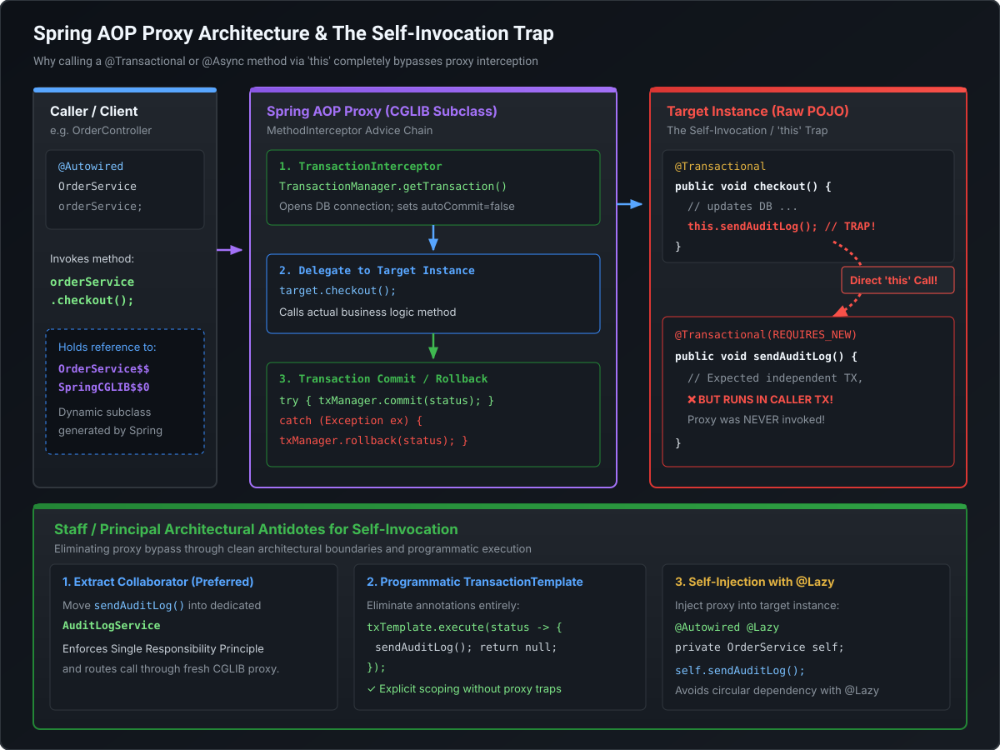

# Spring AOP Mechanics, Dynamic Proxies & `@Transactional` Internals

Declarative enterprise features in Spring—including transaction management (`@Transactional`), asynchronous processing (`@Async`), resilience retries (`@Retryable`), and role-based security (`@PreAuthorize`)—are implemented via Aspect-Oriented Programming (AOP). For Staff and Principal Engineers, understanding the underlying **proxy mechanics (JDK vs CGLIB), thread-bound transaction contexts, connection starvation traps with `REQUIRES_NEW`, and the infamous self-invocation vulnerability** is non-negotiable for designing resilient, high-throughput microservices.

---

## 1. AOP Proxy Mechanics: JDK Dynamic Proxies vs. CGLIB

Spring AOP does not modify target bytecodes at compile time by default; instead, it generates **runtime dynamic wrapper proxies** that intercept method invocations.

```
                      Client Invocations
                              │
                              ▼
                 ┌────────────────────────┐
                 │  Does target implement │
                 │      interfaces?       │
                 └───────┬────────┬───────┘
                     YES │        │ NO (or proxyTargetClass=true)
                         ▼        ▼
       ┌────────────────────┐  ┌────────────────────┐
       │ JDK Dynamic Proxy  │  │    CGLIB Proxy     │
       │ java.lang.reflect  │  │ Bytecode Subclass  │
       │      .Proxy        │  │   via ASM Engine   │
       └────────────────────┘  └────────────────────┘
```

### The Architectural Contrast

| Dimension | JDK Dynamic Proxy | CGLIB Proxy (`Enhancer`) |
| :--- | :--- | :--- |
| **Underlying Mechanism** | `java.lang.reflect.Proxy` and `InvocationHandler` | Subclasses the target class via ASM bytecode generation |
| **Interface Requirement** | **Mandatory**: Target class must implement at least one interface. | **None**: Can proxy concrete classes directly without interfaces. |
| **Method Interception** | Intercepts only methods defined on the implemented interfaces. | Overrides all non-`final` public/protected methods. |
| **`final` Restrictions** | Can proxy `final` classes if proxying via interface. | **Cannot proxy `final` classes or `final` methods** (cannot subclass). |
| **Constructor Execution** | Target constructor is called once. | Target constructor is called **twice** (once for target, once for proxy subclass). |
| **Spring Boot 3 Default** | Opt-in via `spring.aop.proxy-target-class=false`. | **Default standard (`spring.aop.proxy-target-class=true`)**. |

> [!IMPORTANT]
> **Why Spring Boot Defaults to CGLIB**:
> Historical Spring defaulted to JDK dynamic proxies if an interface was present. However, if a developer injected the concrete class (`@Autowired private OrderServiceImpl service`) instead of the interface (`OrderService`), Spring failed with a `BeanNotOfRequiredTypeException` because JDK proxies implement the interface, but do **not** extend the concrete class. Spring Boot eliminated this brittle behavior by defaulting to CGLIB (`proxyTargetClass = true`) everywhere.

---

## 2. The `@Transactional` Self-Invocation Trap

The single most prevalent production bug in Spring enterprise applications is the **AOP self-invocation bypass**:



### The Failure Mechanics
Consider this standard service implementation:

```java
@Service
public class OrderService {

    @Autowired
    private OrderRepository orderRepository;

    public void processOrder(Order order) {
        // Step 1: Execute in caller's context
        orderRepository.save(order);

        // Step 2: Attempting to invoke an isolated, new transaction for audit logging
        this.writeAuditLog(order); // TRAP!
    }

    @Transactional(propagation = Propagation.REQUIRES_NEW)
    public void writeAuditLog(Order order) {
        // Writes to audit log table...
    }
}
```

### Why It Fails
1. External callers (`OrderController`) hold a reference to the **CGLIB proxy** (`OrderService$$EnhancerBySpringCGLIB`).
2. Calling `orderService.processOrder(order)` reaches the proxy. Because `processOrder` has no `@Transactional`, the proxy delegates directly to the raw target instance.
3. Inside `processOrder()`, the method executes `this.writeAuditLog(order)`.
4. In the JVM, **`this` always points to the raw target instance**, never to the surrounding proxy!
5. As a result, the invocation never passes through Spring's `TransactionInterceptor`. The `@Transactional(propagation = Propagation.REQUIRES_NEW)` annotation is **completely bypassed and ignored**.
6. If an exception occurs later, the audit log rolls back with the parent transaction—violating audit compliance.

---

## 3. The 3 Staff-Level Architectural Antidotes

### Antidote 1: Extract Collaborator Service (Architectural Best Practice)
The cleanest object-oriented solution is respecting the **Single Responsibility Principle (SRP)**. Auditing is a distinct domain concern and belongs in its own component:

```java
@Service
public class AuditService {
    @Transactional(propagation = Propagation.REQUIRES_NEW)
    public void writeAuditLog(Order order) {
        // Executed through AuditService's CGLIB proxy!
        // Guaranteed independent transaction lifecycle.
    }
}

@Service
public class OrderService {
    private final AuditService auditService;

    public OrderService(AuditService auditService) {
        this.auditService = auditService;
    }

    public void processOrder(Order order) {
        orderRepository.save(order);
        auditService.writeAuditLog(order); // Crosses proxy boundary successfully
    }
}
```

### Antidote 2: Programmatic Demarcation via `TransactionTemplate`
Eliminate reflection and proxy overhead by managing transactions explicitly with Spring's callback template:

```java
@Service
public class OrderService {
    private final TransactionTemplate requiresNewTxTemplate;

    public OrderService(PlatformTransactionManager txManager) {
        this.requiresNewTxTemplate = new TransactionTemplate(txManager);
        this.requiresNewTxTemplate.setPropagationBehavior(TransactionDefinition.PROPAGATION_REQUIRES_NEW);
    }

    public void processOrder(Order order) {
        orderRepository.save(order);

        // Programmatic boundary guarantees new physical transaction
        requiresNewTxTemplate.execute(status -> {
            writeAuditLogInternal(order);
            return null;
        });
    }

    private void writeAuditLogInternal(Order order) {
        // Raw private method; no proxy required
    }
}
```

### Antidote 3: Self-Injection via `ObjectProvider` or `@Lazy`
If domain restructuring is blocked by legacy constraints, inject the proxy into the target instance:

```java
@Service
public class OrderService {
    @Autowired
    @Lazy
    private OrderService self; // Injects the CGLIB proxy instance

    public void processOrder(Order order) {
        orderRepository.save(order);
        self.writeAuditLog(order); // Invokes method ON THE PROXY!
    }

    @Transactional(propagation = Propagation.REQUIRES_NEW)
    public void writeAuditLog(Order order) { ... }
}
```

---

## 4. `@Transactional` Propagation Deep Dive

Spring manages logical versus physical transactions using 7 propagation levels defined in `TransactionDefinition`:

```
               Outer Transaction Active (Tx 1)
                             │
     ┌───────────────────────┴───────────────────────┐
     ▼                                               ▼
PROPAGATION_REQUIRED                           PROPAGATION_REQUIRES_NEW
- Joins Tx 1                                   - Suspends Tx 1
- Shares single DB Connection                  - Borrows SECOND DB Connection
- Rollback in child rolls back parent          - Completely isolated commit/rollback
```

### Propagation Comparison Matrix

| Propagation Level | Existing Transaction Present? | No Existing Transaction? |
| :--- | :--- | :--- |
| **`REQUIRED`** (Default) | Joins existing transaction. | Creates new physical transaction. |
| **`REQUIRES_NEW`** | **Suspends** existing transaction; creates **new independent** transaction. | Creates new physical transaction. |
| **`NESTED`** | Creates a **JDBC Savepoint** within existing transaction. | Creates new physical transaction. |
| **`SUPPORTS`** | Joins existing transaction. | Executes non-transactionally. |
| **`NOT_SUPPORTED`** | **Suspends** existing transaction; executes non-transactionally. | Executes non-transactionally. |
| **`MANDATORY`** | Joins existing transaction. | **Throws `TransactionRequiredException`**. |
| **`NEVER`** | **Throws `IllegalTransactionStateException`**. | Executes non-transactionally. |

---

## 5. The Production Deadlock: `REQUIRES_NEW` & HikariCP Starvation

Using `REQUIRES_NEW` inside high-throughput distributed systems carries a catastrophic connection pool starvation hazard.

```
Thread Pool (10 Worker Threads)               HikariCP Connection Pool (Size = 10)
  Thread 1 [Tx Outer] ───────────────────────────► Conn 1 (Acquired)
  Thread 2 [Tx Outer] ───────────────────────────► Conn 2 (Acquired)
  ...
  Thread 10 [Tx Outer] ──────────────────────────► Conn 10 (Acquired)

  Now, Thread 1 reaches REQUIRES_NEW ────────────► Requests Conn 11 (Pool Empty! BLOCKS!)
  Thread 2 reaches REQUIRES_NEW ─────────────────► Requests Conn 12 (Pool Empty! BLOCKS!)
  ...
  💥 ALL 10 THREADS ARE SLEEPING WAITING FOR CONNECTIONS HELD BY THEMSELVES!
```

### The Failure Mathematics
1. Consider a microservice configured with **10 HTTP worker threads** and a **HikariCP pool of 10 connections**.
2. Under peak load, 10 concurrent requests arrive simultaneously.
3. Each worker thread enters an outer method with `@Transactional(REQUIRED)` and acquires a database connection (`Conn 1` through `Conn 10`).
4. Each thread then calls a nested method annotated with `@Transactional(REQUIRES_NEW)`.
5. Spring **suspends** the outer transaction (holding on to the active connection) and requests a **second connection** from HikariCP for the new transaction.
6. The connection pool has 0 available connections. All 10 worker threads block inside `HikariCP.getConnection()` waiting for `connectionTimeout` (default: 30 seconds).
7. None of the outer transactions can ever complete or release their first connection because they are blocked waiting for their own nested transaction!
8. **Result**: Complete container thread starvation, cascading latency spikes, and 100% request timeouts.

> [!TIP]
> **HikariCP Formula for `REQUIRES_NEW`**:
> If a request flow uses nested `REQUIRES_NEW`, the minimum pool size must satisfy:
> $$\text{Pool Size} \ge \text{Max Threads} \times (\text{Max Nested Transactions} + 1)$$
> Better yet: Avoid holding synchronous database transactions across nested business operations. Use asynchronous outbox tables or event streaming.

---

## 6. Rollback Rules & `readOnly` Performance Optimization

### Rollback Mechanics: Unchecked vs. Checked Exceptions
By default, Spring rolls back transactions strictly on **unchecked exceptions** (`RuntimeException` and `Error`):

```java
// 1. DEFAULT BEHAVIOR: Rolls back automatically
@Transactional
public void processPayment() {
    throw new IllegalArgumentException("Invalid payment"); // Rolls back!
}

// 2. CHECKED EXCEPTION TRAP: Commits transaction!
@Transactional
public void processOrder() throws IOException {
    throw new IOException("Disk failure"); // DOES NOT ROLL BACK! Transaction commits!
}

// 3. PRODUCTION REMEDY: Explicit rollbackFor
@Transactional(rollbackFor = Exception.class)
public void processOrderSafe() throws IOException {
    throw new IOException("Disk failure"); // Rolls back cleanly
}
```

### The `readOnly = true` Optimization
Configuring `@Transactional(readOnly = true)` provides critical performance advantages in high-scale systems:

1. **Hibernate Snapshot Elimination**:
   - In standard read-write transactions, Hibernate takes an in-memory snapshot copy of every loaded entity to detect mutations during dirty checking at flush time.
   - When `readOnly = true`, Hibernate sets `FlushMode.MANUAL`. It skips taking snapshots and skips dirty checking entirely, reducing heap allocations and CPU cycles by up to 30%.
2. **JDBC Driver Routing to Read Replicas**:
   - Advanced JDBC connection pools (such as AWS Aurora JDBC Driver or MySQL Connector/J) inspect `connection.isReadOnly()`.
   - Read-only connections are routed directly to database Read Replicas, offloading read pressure from the Primary writer node.
3. **Database Engine Locking Hints**:
   - In PostgreSQL and Oracle, read-only transactions optimize snapshot isolation visibility checks, avoiding snapshot retention bottlenecks.

---

## 7. Runnable Verification POC: AOP Dynamic Proxy & Propagation

Save and execute this self-contained class to demonstrate proxy interception and method invocation mechanics:

```java
package com.mastery.spring.core;

import org.springframework.context.annotation.AnnotationConfigApplicationContext;
import org.springframework.context.annotation.Bean;
import org.springframework.context.annotation.Configuration;
import org.springframework.context.annotation.EnableAspectJAutoProxy;
import org.aspectj.lang.ProceedingJoinPoint;
import org.aspectj.lang.annotation.Around;
import org.aspectj.lang.annotation.Aspect;

public class TransactionalAopProxyPOC {

    // 1. Business Service demonstrating the Self-Invocation Trap
    public static class PaymentService {

        public void processPaymentDirect() {
            System.out.println("  [Target] Executing processPaymentDirect()...");
            // Self-invocation via 'this'
            System.out.println("  [Target] Calling this.recordAudit()...");
            this.recordAudit(); // Bypasses aspect proxy!
        }

        public void recordAudit() {
            System.out.println("  [Target] Executing recordAudit() - Should have transaction!");
        }
    }

    // 2. Simulated Transaction Aspect intercepting recordAudit()
    @Aspect
    public static class MockTransactionAspect {

        @Around("execution(* com.mastery.spring.core.TransactionalAopProxyPOC.PaymentService.recordAudit(..))")
        public Object manageTransaction(ProceedingJoinPoint pjp) throws Throwable {
            System.out.println("  >>> [AOP Proxy Interceptor] >>> STARTING SIMULATED TRANSACTION <<<");
            try {
                Object result = pjp.proceed();
                System.out.println("  <<< [AOP Proxy Interceptor] <<< COMMITTING SIMULATED TRANSACTION <<<");
                return result;
            } catch (Throwable t) {
                System.out.println("  <<< [AOP Proxy Interceptor] <<< ROLLING BACK SIMULATED TRANSACTION <<<");
                throw t;
            }
        }
    }

    @Configuration
    @EnableAspectJAutoProxy(proxyTargetClass = true) // Enforces CGLIB proxy
    public static class TestConfig {
        @Bean
        public PaymentService paymentService() {
            return new PaymentService();
        }

        @Bean
        public MockTransactionAspect mockTransactionAspect() {
            return new MockTransactionAspect();
        }
    }

    public static void main(String[] args) {
        AnnotationConfigApplicationContext context = new AnnotationConfigApplicationContext(TestConfig.class);
        PaymentService proxy = context.getBean(PaymentService.class);

        System.out.println("Class of injected PaymentService: " + proxy.getClass().getName());
        System.out.println("Is CGLIB Proxy? " + proxy.getClass().getName().contains("$$"));

        System.out.println("\n--- TEST 1: Direct Call on Proxy (Intercepted) ---");
        proxy.recordAudit();

        System.out.println("\n--- TEST 2: Self-Invocation via processPaymentDirect (Bypassed!) ---");
        proxy.processPaymentDirect();

        context.close();
    }
}
```

---

## 8. Staff / Principal Interview Strategy: AOP & Transactions

### Classic Traps & High-Leverage Responses

#### Trap 1: *"Can `@Transactional` be applied to `private` or `protected` methods?"*
- **Principal Counter**: *"With standard Spring AOP proxies, no. Dynamic proxies (both JDK and CGLIB) intercept only `public` methods because JDK proxies reflect interface declarations and CGLIB overrides subclass methods. Invoking a `private` method with `@Transactional` will compile without errors, but Spring's `TransactionInterceptor` will silently ignore the annotation. If private method transaction demarcation is strictly necessary, you must use compile-time or load-time bytecode weaving via native **AspectJ** (`ajc`), not runtime dynamic proxies."*

#### Trap 2: *"Why did our database transactions remain uncommitted even though no exception was thrown out of the `@Transactional` method?"*
- **Principal Counter**: *"This typically occurs when a child method with `Propagation.REQUIRED` throws an exception that is caught and swallowed by an outer `try-catch` block in the parent method. When the child method fails, Spring's `TransactionAspectSupport` marks the physical transaction as `rollbackOnly`. When the parent method completes normally and attempts to commit, the transaction manager discovers the `rollbackOnly` flag and throws an `UnexpectedRollbackException`. To handle errors without poisoning the parent transaction, isolate the child method using `Propagation.REQUIRES_NEW` or perform error handling before the transactional boundary."*

#### Trap 3: *"Does `@Transactional(readOnly = true)` prevent SQL write operations at the JDBC/driver level?"*
- **Principal Counter**: *"Not universally. It depends on the database vendor and driver implementation. For example, in MySQL/Oracle, the driver may enforce read-only semantics at the connection level, but in H2 or certain JDBC drivers, calling `INSERT` or `UPDATE` inside a `readOnly = true` transaction will still execute unless Hibernate's flush mode prevents it. The primary benefit of `readOnly = true` is application-side performance: Hibernate disables dirty-checking snapshot storage in the persistence context, drastically reducing memory footprint and CPU overhead."*
