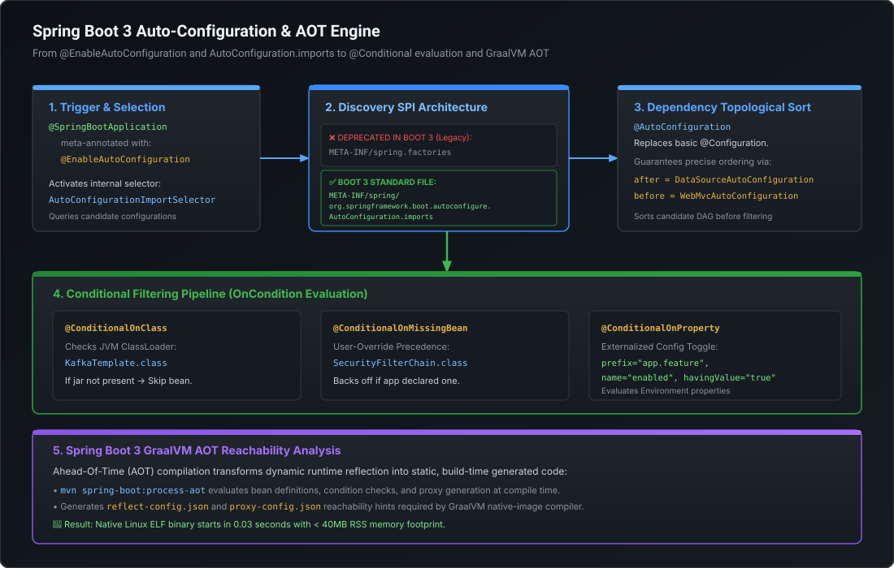

# Spring Boot 3 Auto-Configuration, Custom Starters & GraalVM AOT

Spring Boot's widespread adoption is fueled by its opinionated "convention over configuration" runtime. At the Staff and Principal Engineer level, you are expected to understand the precise mechanics behind **how the framework auto-configures thousands of components, how to architect resilient custom enterprise starters, how Jakarta EE 10 rewrites the ecosystem, and how GraalVM Ahead-Of-Time (AOT) compilation dismantles 25 years of dynamic JVM reflection**.

---

## 1. Auto-Configuration Mechanics & The Discovery SPI Shift

Auto-configuration is not magic; it is a deterministic conditional scanning and configuration engine:



### The Invocation Chain
1. Application entry point is annotated with `@SpringBootApplication`, which is a meta-annotation composed of:
   - `@SpringBootConfiguration` (specialized `@Configuration`)
   - `@ComponentScan` (user code discovery)
   - `@EnableAutoConfiguration` (activates framework auto-configuration)
2. `@EnableAutoConfiguration` imports `AutoConfigurationImportSelector`.
3. `AutoConfigurationImportSelector.selectImports()` locates and loads candidates from the classpath.

### The Spring Boot 2.x vs. Spring Boot 3.x SPI Paradigm Shift

In Spring Boot 2.x and earlier:
- Candidate configurations were registered in `META-INF/spring.factories` under the key:
  `org.springframework.boot.autoconfigure.EnableAutoConfiguration=\...`
- The file was a monolithic comma-separated properties file shared by listeners, initializers, and auto-configurations.

In Spring Boot 3.x / Spring Framework 6:
- **`META-INF/spring.factories` for auto-configuration is officially deprecated.**
- Auto-configurations **must** be declared in:
  `META-INF/spring/org.springframework.boot.autoconfigure.AutoConfiguration.imports`
- Each line in this file contains a single, fully qualified class name.
- Candidate classes must be annotated with `@AutoConfiguration` (introduced in Spring Boot 2.7 / 3.0) rather than standard `@Configuration`.

#### Architectural Reasons for the Change:
1. **O(1) Streaming Class Loading**: Reading a line-delimited plain text file avoids loading and parsing large monolithic properties files, speeding up container startup.
2. **GraalVM AOT Processing**: Static ahead-of-time analysis requires explicit, unbundled descriptor lists to generate reachability metadata without runtime regex parsing.
3. **Clean Ordering Semantics**: `@AutoConfiguration` provides built-in `before`, `after`, and `beforeName`/`afterName` attributes to establish topological sort orders across independent third-party libraries.

---

## 2. The Conditional Evaluation Pipeline (`@Conditional`)

An auto-configuration class is only activated if all its `@Conditional` guard clauses evaluate to `true`. If any condition fails, the class is discarded with zero heap allocation.

### Core Conditionals in Production

| Annotation | Evaluation Trigger | Production Use Case |
| :--- | :--- | :--- |
| **`@ConditionalOnClass`** | Target class exists on ClassLoader. | Activating `KafkaAutoConfiguration` only if `kafka-clients.jar` is on the classpath. |
| **`@ConditionalOnMissingBean`** | No matching bean exists in the container. | Providing a default `ObjectMapper` or `SecurityFilterChain` that yields if the user provides their own. |
| **`@ConditionalOnProperty`** | Matches property key and expected value. | Toggling features via `app.audit.enabled=true`. |
| **`@ConditionalOnWebApplication`** | Container is a Web environment (`SERVLET` or `REACTIVE`). | Instantiating Tomcat/Jetty for Servlet vs Netty for WebFlux. |
| **`@ConditionalOnMissingClass`** | Target class is absent from ClassLoader. | Falling back to embedded H2 if PostgreSQL driver is absent. |

> [!IMPORTANT]
> **Staff Ordering Rule: Class-Level vs. Bean-Level Conditionals**
> Always place `@ConditionalOnClass` at the **class level** of the configuration, not on individual `@Bean` methods. If placed on a `@Bean` method, the JVM may encounter a `NoClassDefFoundError` during class loading when parsing method return types before the conditional evaluation even begins!

---

## 3. Anatomy of an Enterprise-Grade Custom Starter

In large-scale organizations (such as Mastercard, Uber, or Netflix), platform teams build custom starters to standardize logging, security tokens, distributed tracing, and database multi-tenancy across hundreds of microservices.

### The Clean Two-Module Architecture
A production starter must be divided into two separate Maven/Gradle modules:

```
my-enterprise-starter/
├── my-enterprise-spring-boot-autoconfigure/  (Contains actual code, configs & BPPs)
└── my-enterprise-spring-boot-starter/        (Empty dependency-aggregator pom.xml)
```

### 1. The Configuration Properties Class (Type-Safe & Validated)
```java
package com.mastery.starter.properties;

import org.springframework.boot.context.properties.ConfigurationProperties;
import org.springframework.validation.annotation.Validated;
import jakarta.validation.constraints.NotBlank;
import jakarta.validation.constraints.Positive;
import java.time.Duration;

@ConfigurationProperties(prefix = "mastery.resilience")
@Validated // JSR-380 validation enforced at container boot
public class MasteryResilienceProperties {

    @NotBlank
    private String clusterId = "prod-pune-az1";

    @Positive
    private int maxRetries = 3;

    private Duration timeout = Duration.ofMillis(500);

    // Getters and Setters
    public String getClusterId() { return clusterId; }
    public void setClusterId(String clusterId) { this.clusterId = clusterId; }
    public int getMaxRetries() { return maxRetries; }
    public void setMaxRetries(int maxRetries) { this.maxRetries = maxRetries; }
    public Duration getTimeout() { return timeout; }
    public void setTimeout(Duration timeout) { this.timeout = timeout; }
}
```

### 2. The Auto-Configuration Class
```java
package com.mastery.starter.autoconfigure;

import com.mastery.starter.client.ResilienceClient;
import com.mastery.starter.properties.MasteryResilienceProperties;
import org.springframework.boot.autoconfigure.AutoConfiguration;
import org.springframework.boot.autoconfigure.condition.ConditionalOnClass;
import org.springframework.boot.autoconfigure.condition.ConditionalOnMissingBean;
import org.springframework.boot.autoconfigure.condition.ConditionalOnProperty;
import org.springframework.boot.context.properties.EnableConfigurationProperties;
import org.springframework.context.annotation.Bean;

@AutoConfiguration
@ConditionalOnClass(ResilienceClient.class)
@EnableConfigurationProperties(MasteryResilienceProperties.class)
@ConditionalOnProperty(prefix = "mastery.resilience", name = "enabled", havingValue = "true", matchIfMissing = true)
public class MasteryResilienceAutoConfiguration {

    @Bean
    @ConditionalOnMissingBean
    public ResilienceClient resilienceClient(MasteryResilienceProperties properties) {
        return new ResilienceClient(properties.getClusterId(), properties.getMaxRetries(), properties.getTimeout());
    }
}
```

### 3. The Registration File
File path: `src/main/resources/META-INF/spring/org.springframework.boot.autoconfigure.AutoConfiguration.imports`
```properties
com.mastery.starter.autoconfigure.MasteryResilienceAutoConfiguration
```

---

## 4. Spring Boot 3 & Jakarta EE 10 Migration

Spring Boot 3 represents the largest ecosystem shift in over a decade by adopting **Jakarta EE 10** and establishing a **Java 17+ baseline**.

### Key Breaking Changes & Upgrades

1. **Namespace Transition (`javax.*` $\to$ `jakarta.*`)**:
   - `javax.persistence.*` $\to$ `jakarta.persistence.*` (JPA)
   - `javax.servlet.*` $\to$ `jakarta.servlet.*` (Servlets)
   - `javax.validation.*` $\to$ `jakarta.validation.*` (Bean Validation)
   - `javax.annotation.*` $\to$ `jakarta.annotation.*` (`@PostConstruct`, `@PreDestroy`)
   - Any legacy dependency on the classpath still importing `javax.servlet` will trigger `ClassNotFoundException` or fail to bind to Tomcat 10+ / Jetty 11+.

2. **Declarative HTTP Interfaces (`@HttpExchange`)**:
   - Spring Framework 6 introduces built-in declarative HTTP clients, replacing third-party OpenFeign:
   ```java
   @HttpExchange("/api/v1/orders")
   public interface OrderClient {
       @GetExchange("/{id}")
       OrderResponse getOrderById(@PathVariable("id") String id);

       @PostExchange
       OrderResponse createOrder(@RequestBody CreateOrderRequest request);
   }

   // Configuration
   @Bean
   public OrderClient orderClient(RestClient.Builder builder) {
       RestClient restClient = builder.baseUrl("https://orders.internal.domain").build();
       RestClientAdapter adapter = RestClientAdapter.create(restClient);
       HttpServiceProxyFactory factory = HttpServiceProxyFactory.builderFor(adapter).build();
       return factory.createClient(OrderClient.class);
   }
   ```

---

## 5. GraalVM AOT Compilation & Native Image Reachability

GraalVM Native Image compiles Spring Boot applications directly into standalone, platform-specific machine binaries (e.g. Linux ELF x86-64 executable).

### The Closed-World Assumption
Standard JVM execution is dynamic: classes can be loaded dynamically at runtime via `Class.forName()`, proxies can be synthesized at runtime via ASM, and reflection can invoke any method.

GraalVM enforces the **Closed-World Assumption**:
- At build time, the compiler statically analyzes all reachable bytecode from `main()`.
- Any class, method, or field accessed via reflection, dynamic proxy, or JNI **must be explicitly registered in ahead-of-time reachability metadata**, or it will be omitted from the binary, resulting in runtime crashes.

```
       Spring Boot 3 Source Code
                   │
                   ▼ [ mvn spring-boot:process-aot ]
       Ahead-Of-Time (AOT) Engine
       - Evaluates @Conditional annotations at BUILD TIME
       - Pre-computes BeanDefinitions into static Java source code
       - Generates reflect-config.json and proxy-config.json
                   │
                   ▼ [ native-image compiler ]
       Standalone Native Linux Binary
       - Starts in 0.03 seconds (30 ms)
       - Uses 35 MB RSS RAM (vs 400 MB on JVM)
```

### Implementing `RuntimeHintsRegistrar` for Dynamic Code
If your enterprise code uses reflection or dynamic proxies that Spring's AOT engine cannot infer statically:

```java
public class CustomSecurityRuntimeHints implements RuntimeHintsRegistrar {
    @Override
    public void registerHints(RuntimeHints hints, ClassLoader classLoader) {
        // Register reflection hints for dynamic JSON payloads
        hints.reflection().registerType(
            SecurityTokenPayload.class,
            MemberCategory.INVOKE_DECLARED_CONSTRUCTORS,
            MemberCategory.INVOKE_DECLARED_METHODS
        );

        // Register resource hints for bundled certificates
        hints.resources().registerPattern("certs/ca-bundle.pem");
    }
}

// Attach to Configuration
@Configuration
@ImportRuntimeHints(CustomSecurityRuntimeHints.class)
public class SecurityAotConfig { }
```

### JVM vs. GraalVM Native Image Trade-Offs

| Metric | HotSpot JVM (JIT) | GraalVM Native Image (AOT) |
| :--- | :--- | :--- |
| **Startup Time** | $1.5\text{–}6.0\text{ seconds}$ | **$0.02\text{–}0.05\text{ seconds}$ ($20\text{–}50\text{ ms}$)** |
| **Memory Footprint (RSS)**| $300\text{–}800\text{ MB}$ | **$30\text{–}60\text{ MB}$** |
| **Peak Throughput** | **HIGHER** (JIT compiler profiles runtime hotspots, inlines code dynamically, and optimizes loops) | **LOWER by 5–15%** (Static optimizations cannot adapt to runtime profiling) |
| **Build Time** | $10\text{–}30\text{ seconds}$ | **$3\text{–}8\text{ minutes}$** (Heavy compile-time analysis) |
| **Ideal Workload** | Long-running, high-throughput Tier-0 services ($>50\text{k}$ TPS). | Serverless (AWS Lambda, Fargate scale-to-zero), fast-restart CLI tools. |

---

## 6. Runnable Verification POC: Auto-Configuration Simulator

Save and execute this self-contained class to observe how conditional auto-configuration evaluates and registers components dynamically:

```java
package com.mastery.spring.boot;

import org.springframework.boot.autoconfigure.condition.ConditionalOnMissingBean;
import org.springframework.boot.autoconfigure.condition.ConditionalOnProperty;
import org.springframework.context.annotation.AnnotationConfigApplicationContext;
import org.springframework.context.annotation.Bean;
import org.springframework.context.annotation.Configuration;
import org.springframework.core.env.MapPropertySource;

import java.util.Map;

public class CustomStarterAndAutoConfigPOC {

    // 1. Service Abstraction
    public interface EncryptionService {
        String encrypt(String rawText);
    }

    // 2. Default Starter Implementation
    public static class AesEncryptionService implements EncryptionService {
        @Override
        public String encrypt(String rawText) {
            return "[AES-256 Default Starter Encrypted]: " + rawText;
        }
    }

    // 3. Custom User Implementation
    public static class HardwareRsaEncryptionService implements EncryptionService {
        @Override
        public String encrypt(String rawText) {
            return "[HSM RSA Custom User Encrypted]: " + rawText;
        }
    }

    // 4. Starter Auto-Configuration with Conditionals
    @Configuration
    @ConditionalOnProperty(name = "mastery.crypto.enabled", havingValue = "true", matchIfMissing = true)
    public static class CryptoAutoConfiguration {

        @Bean
        @ConditionalOnMissingBean(EncryptionService.class)
        public EncryptionService defaultEncryptionService() {
            System.out.println("  [Auto-Config] No user EncryptionService found. Registering AesEncryptionService.");
            return new AesEncryptionService();
        }
    }

    // 5. User Configuration providing a custom override
    @Configuration
    public static class UserCustomOverrideConfig {
        @Bean
        public EncryptionService customEncryptionService() {
            System.out.println("  [User App] Registering custom HardwareRsaEncryptionService.");
            return new HardwareRsaEncryptionService();
        }
    }

    public static void main(String[] args) {
        System.out.println("=== SCENARIO 1: Starter Default (No User Override) ===");
        try (AnnotationConfigApplicationContext ctx = new AnnotationConfigApplicationContext()) {
            ctx.register(CryptoAutoConfiguration.class);
            ctx.refresh();

            EncryptionService service = ctx.getBean(EncryptionService.class);
            System.out.println("Result: " + service.encrypt("Confidential Payload"));
        }

        System.out.println("\n=== SCENARIO 2: User Override (@ConditionalOnMissingBean Backs Off) ===");
        try (AnnotationConfigApplicationContext ctx = new AnnotationConfigApplicationContext()) {
            ctx.register(UserCustomOverrideConfig.class, CryptoAutoConfiguration.class);
            ctx.refresh();

            EncryptionService service = ctx.getBean(EncryptionService.class);
            System.out.println("Result: " + service.encrypt("Confidential Payload"));
        }

        System.out.println("\n=== SCENARIO 3: Disabled by Property ===");
        try (AnnotationConfigApplicationContext ctx = new AnnotationConfigApplicationContext()) {
            ctx.getEnvironment().getPropertySources().addFirst(
                new MapPropertySource("testProperties", Map.of("mastery.crypto.enabled", "false"))
            );
            ctx.register(CryptoAutoConfiguration.class);
            ctx.refresh();

            boolean exists = ctx.containsBean("defaultEncryptionService");
            System.out.println("Was auto-configured bean registered? " + exists);
        }
    }
}
```

---

## 7. Staff / Principal Interview Strategy: Auto-Configuration & AOT

### Classic Traps & High-Leverage Responses

#### Trap 1: *"Why did Spring Boot 3 discard `spring.factories` in favor of `AutoConfiguration.imports`?"*
- **Principal Counter**: *"Three architectural reasons: First, performance—parsing monolithic comma-delimited properties files introduced linear classpath scanning overhead on every boot. Second, modularity—`spring.factories` conflated listeners, environment post-processors, and auto-configurations into a single key-value schema. Third and most critically, GraalVM AOT compilation: ahead-of-time reachability analysis requires explicit, deterministic descriptor files to analyze class dependencies at build time without evaluating dynamic runtime property reflection."*

#### Trap 2: *"When would you recommend AGAINST compiling a Spring Boot 3 microservice with GraalVM Native Image?"*
- **Principal Counter**: *"I advise against native images for long-running, CPU-intensive Tier-0 transaction backends requiring maximum peak throughput (e.g. switch processing $>50\text{k}$ TPS). HotSpot's C2 JIT compiler uses dynamic runtime profiling (PGO) to aggressively inline hot methods, deoptimize rare branches, and re-order bytecode instructions based on live production traffic patterns—routinely beating static AOT binary throughput by 5–15%. GraalVM AOT is optimal for serverless workloads (AWS Lambda cold-start mitigation), scale-to-zero container fleets, and memory-constrained sidecars."*

#### Trap 3: *"How do you diagnose why an expected auto-configuration failed to activate in production?"*
- **Principal Counter**: *"I pass `--debug` or `-Ddebug=true` upon startup to generate Spring Boot's **ConditionEvaluationReport**. The report groups all auto-configuration classes into 'Positive matches' (why they loaded) and 'Negative matches' (exact conditional that failed). For a live running service without restarting, I query the `/actuator/conditions` endpoint, which renders the complete evaluation tree in JSON, identifying whether it was missing a classpath library, failed a `@ConditionalOnProperty`, or was overridden by a user bean."*
