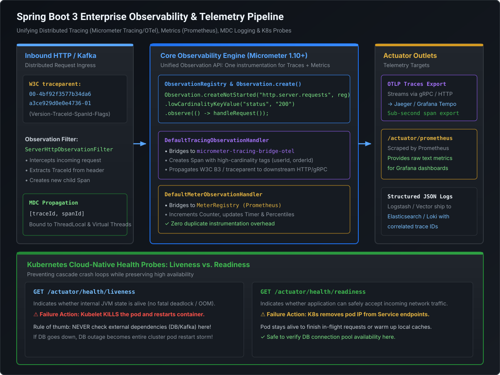

# Spring Boot 3 Production Observability, Micrometer & Telemetry

Modern high-throughput distributed microservices cannot be operated as black boxes. For Staff and Principal Engineers, observability is not merely slapping `@Timed` on a method or exposing `/actuator/health`. It requires mastering **the unified Spring Boot 3 Observation API, distributed context propagation via W3C Trace Context, context preservation across Java 21 Virtual Threads, Kubernetes probe architecture, and enterprise Actuator security lockdown**.

---

## 1. The Architectural Shift: Sleuth $\to$ Micrometer Tracing & Observation API

Prior to Spring Boot 3, developers relied on **Spring Cloud Sleuth** for distributed tracing and **Micrometer** for metrics. This created architectural duplication: engineers had to instrument both a tracer span and a timer meter for the same critical business operation.

[](images/production_observability_pipeline.svg)

### The Spring Boot 3 Paradigm
In Spring Boot 3 / Spring Framework 6:
- **Spring Cloud Sleuth is deprecated and superseded by Micrometer Tracing.**
- Spring introduces the unified **`Observation` API** (`io.micrometer.observation.Observation`):
  - A single instrumentation point emits **both** a metric (timer/counter) and a distributed trace span.
  - Pluggable observation handlers translate events to Prometheus, OpenTelemetry (OTel), Zipkin, or Wavefront without modifying business logic.

```java
// Spring Boot 3 Unified Observation
Observation.createNotStarted("payment.process", observationRegistry)
    .lowCardinalityKeyValue("tenant.id", "mastercard-us") // Metric tag (bounded values)
    .highCardinalityKeyValue("order.id", orderId)         // Tracing tag (unbounded UUID)
    .observe(() -> executePayment(order));
```

> [!IMPORTANT]
> **Cardinality Discipline: High vs. Low Cardinality**
> - **Low Cardinality**: Keys with a small, finite set of values (HTTP method, status code, region). Safe for **time-series metrics** (Prometheus).
> - **High Cardinality**: Keys with unbounded or infinite values (UUIDs, user IDs, credit card tokens). If emitted as metric tags, they cause **cardinality explosions**, consuming gigabytes of TSDB memory and crashing Prometheus. Emitted **strictly as tracing tags / span attributes**.

---

## 2. Distributed Tracing & W3C Trace Context Propagation

In microservice meshes, a single user transaction spans dozens of independent network hops across HTTP, gRPC, and Kafka.

### The W3C `traceparent` Standard
Spring Boot 3 natively enforces the W3C Trace Context specification via HTTP headers:

```
traceparent: 00-4bf92f3577b34da6a3ce929d0e0e4736-00f067aa0ba902b7-01
              │  └──────────────┬───────────────┘ └───────┬──────┘ └─┬┘
           Version          Trace ID                  Parent ID   Flags
           (Always 00)    (32-hex chars)           (16-hex chars)  (01=Sampled)
```

1. **Trace ID**: Shared by every microservice participating in the distributed call tree.
2. **Span ID**: Unique identifier for the specific unit of work in the current service.
3. **Trace Flags**: `01` signals that the trace is recorded and sampled for telemetry backends.

### Automated Context Propagation Across Threads
When an inbound request arrives:
1. `ServerHttpObservationFilter` extracts the `traceparent` header.
2. A new child span is created and placed into the **MDC (Mapped Diagnostic Context)** via SLF4J:
   ```json
   {
     "timestamp": "2026-11-10T14:32:01.102Z",
     "level": "INFO",
     "service": "order-service",
     "traceId": "4bf92f3577b34da6a3ce929d0e0e4736",
     "spanId": "00f067aa0ba902b7",
     "message": "Processing settlement authorization"
   }
   ```
3. Outbound HTTP calls via `RestClient` or `WebClient` automatically inject the modified `traceparent` header to propagate context downstream.

> [!CAUTION]
> **Virtual Threads & MDC Leaks**:
> Java 21 Virtual Threads share carrier OS threads. If legacy code binds context to `ThreadLocal` without calling `try-finally { MDC.clear(); }`, subsequent virtual tasks scheduled on the same carrier thread can leak cross-tenant trace context. With Spring Boot 3.2+ and `spring.threads.virtual.enabled=true`, always leverage Micrometer's `ContextRegistry` or standard Scoped Values.

---

## 3. Kubernetes Cloud-Native Probes: Liveness vs. Readiness

Kubernetes relies on HTTP probes to determine pod orchestration actions. Confusing liveness and readiness probes is one of the most common causes of **cascading microservice outages**.

```
                   ┌──────────────────────────────┐
                   │    Incoming Network Call     │
                   └──────────────┬───────────────┘
                                  │
                                  ▼
           ┌──────────────────────────────────────────────┐
           │          Is Readiness Probe UP?              │
           └──────────────┬────────────────┬──────────────┘
                      YES │                │ NO
                          ▼                ▼
                  [ Route Traffic ]   [ Remove from K8s Service ]
                                      [ Pod stays alive to heal ]
```

### The Architectural Contrast

| Dimension | Liveness Probe (`/actuator/health/liveness`) | Readiness Probe (`/actuator/health/readiness`) |
| :--- | :--- | :--- |
| **Purpose** | Detects if the internal process is deadlocked, corrupted, or in an unrecoverable state. | Detects if the pod is currently capable of serving live network traffic. |
| **Kubelet Action on Failure** | **Kills the pod** (`SIGKILL`) and restarts a fresh container. | **Removes pod IP** from the K8s Service load balancer endpoints. Pod is NOT killed. |
| **What to Check** | Internal JVM health, fatal thread deadlocks, local disk corruption. | Local cache warm-up, rate limit limits, downstream DB availability (cautiously). |
| **FATAL MISTAKE** | **Checking external databases or Kafka brokers in Liveness.** | Checking non-critical asynchronous background workers. |

### The Cascade Failure Trap
If your team adds a database connectivity check to the **Liveness probe**:
1. The database suffers a temporary 5-second network hiccup.
2. The liveness probe on all 50 microservice pods fails simultaneously.
3. Kubernetes immediately **kills all 50 pods at the exact same moment**.
4. 50 new pods start up and hammer the already struggling database with simultaneous connection pool initializations.
5. **Result**: Total enterprise blackout triggered entirely by an incorrect probe configuration!

### Spring Boot 3 Availability Event Model
You can dynamically transition readiness states programmatically without touching container files:

```java
@Service
public class CacheWarmupService {

    private final ApplicationEventPublisher eventPublisher;

    public CacheWarmupService(ApplicationEventPublisher eventPublisher) {
        this.eventPublisher = eventPublisher;
    }

    public void warmup() {
        // Mark NOT READY while populating local Redis cache
        AvailabilityChangeEvent.publish(eventPublisher, this, ReadinessState.REFUSING_TRAFFIC);

        try {
            loadHugeProductCatalogIntoMemory();
            // Transition back to READY once warm
            AvailabilityChangeEvent.publish(eventPublisher, this, ReadinessState.ACCEPTING_TRAFFIC);
        } catch (Exception e) {
            // Remains out of K8s load balancer rotation until healed
        }
    }
}
```

---

## 4. Actuator Security Lockdown & Production Sizing

Default Actuator configurations expose dangerous administrative attack vectors. A Staff Engineer must enforce zero-trust hardening on all management endpoints.

### Hardening Checklist in `application.yml`

```yaml
# 1. Isolate Actuator on a dedicated, non-public internal management port
management:
  server:
    port: 8081 # Blocked by AWS ALB / Ingress Controller from external public internet
    address: 127.0.0.1 # Or internal VPC subnet CIDR

  # 2. Expose ONLY required operational endpoints
  endpoints:
    web:
      exposure:
        include: "health,prometheus,info" # NEVER expose 'env', 'beans', 'heapdump'

  # 3. Configure Health details visibility
  endpoint:
    health:
      probes:
        enabled: true # Enables /actuator/health/liveness and readiness
      show-details: when-authorized # Never 'always' in production (leaks DB IPs/versions)
      roles: "PLATFORM_ADMIN"

  # 4. Prometheus Metric Scraping Optimization
  prometheus:
    metrics:
      export:
        enabled: true
        step: 1m
```

> [!CAUTION]
> **CVE Exposure: `/actuator/env` and `/actuator/heapdump`**
> Exposing `/actuator/env` allows unauthorized attackers to view environment variables, including decrypted AWS secrets and database credentials. Exposing `/actuator/heapdump` allows downloading raw heap dumps containing unencrypted customer data, private keys, and passwords.

---

## 5. Configuration Hierarchy & `@ConfigurationProperties` Validation

Spring Boot uses a 17-level externalized configuration priority hierarchy. When debugging why a configuration property did not take effect, understanding precedence is critical:

```
 HIGHEST PRECEDENCE (Overrides all below)
 1. Command-line arguments (--server.port=9090)
 2. Java System properties (-Dserver.port=9090)
 3. OS Environment variables (SERVER_PORT=9090)
 4. Profile-specific application-{profile}.yml outside packaged jar
 5. Profile-specific application-{profile}.yml inside packaged jar
 6. Default application.yml inside packaged jar
 LOWEST PRECEDENCE
```

### Type-Safe, Immutable Properties with JSR-380 Validation
Modern Spring Boot 3 enforces immutable records with constructor binding:

```java
@ConfigurationProperties(prefix = "payment.gateway")
@Validated
public record PaymentGatewayProperties(
    @NotBlank
    @Pattern(regexp = "^https://.*", message = "Gateway URL must be TLS secured")
    String endpointUrl,

    @Min(100)
    @Max(5000)
    int connectTimeoutMs,

    @Positive
    int poolSize
) {}
```
If a deployment engineer deploys a Helm chart with `endpointUrl: "http://insecure-endpoint"`, the container **fails immediately at boot time with a clear validation error**, preventing runtime security vulnerabilities.

---

## 6. Runnable Verification POC: Observation API & Metrics

Save and execute this self-contained class to demonstrate the unified Observation API recording both latency metrics and simulated trace context:

```java
package com.mastery.spring.boot;

import io.micrometer.core.instrument.MeterRegistry;
import io.micrometer.core.instrument.simple.SimpleMeterRegistry;
import io.micrometer.observation.Observation;
import io.micrometer.observation.ObservationHandler;
import io.micrometer.observation.ObservationRegistry;

public class ObservationAndMetricsPOC {

    // Custom Tracing Observation Handler
    public static class DiagnosticTracingHandler implements ObservationHandler<Observation.Context> {
        @Override
        public void onStart(Observation.Context context) {
            System.out.println("  >>> [TRACE SPAN START] Observation: " + context.getName());
        }

        @Override
        public void onStop(Observation.Context context) {
            System.out.println("  <<< [TRACE SPAN END] Observation: " + context.getName() + " | Duration: " + context.getDuration());
            context.getLowCardinalityKeyValues().forEach(kv ->
                System.out.println("      Metric Tag (Low Cardinality): " + kv.getKey() + "=" + kv.getValue())
            );
            context.getHighCardinalityKeyValues().forEach(kv ->
                System.out.println("      Span Attribute (High Cardinality): " + kv.getKey() + "=" + kv.getValue())
            );
        }

        @Override
        public boolean supportsContext(Observation.Context context) {
            return true;
        }
    }

    public static void main(String[] args) {
        // Setup Micrometer Observation Engine
        ObservationRegistry registry = ObservationRegistry.create();
        MeterRegistry meterRegistry = new SimpleMeterRegistry();

        // Register custom tracing handler
        registry.observationConfig().observationHandler(new DiagnosticTracingHandler());

        System.out.println("=== EXECUTING INSTRUMENTED BUSINESS OPERATION ===");
        String transactionId = "tx-99482-auth";

        // Single call creates Trace Span and Records Metric Timer
        String result = Observation.createNotStarted("settlement.authorize", registry)
            .lowCardinalityKeyValue("route", "MASTERCARD_AUTH_SWITCH") // Low cardinality for Prometheus
            .highCardinalityKeyValue("transaction.id", transactionId)   // High cardinality for Tracing
            .observe(() -> {
                try {
                    System.out.println("    [Business Core] Performing sub-millisecond authorization check...");
                    Thread.sleep(50); // Simulate network latency
                    return "APPROVED_AUTH_200";
                } catch (InterruptedException e) {
                    Thread.currentThread().interrupt();
                    return "ERROR";
                }
            });

        System.out.println("\nExecution Outcome: " + result);
    }
}
```

---

## 7. Staff / Principal Interview Strategy: Observability & Resilience

### Classic Traps & High-Leverage Responses

#### Trap 1: *"Why should you never include User ID or Credit Card Token as a Micrometer tag in Prometheus?"*
- **Principal Counter**: *"Because Prometheus stores metrics as multi-dimensional time series indexed by label values. Every distinct combination of metric name and label key-value pairs instantiates a new time series in memory. Adding a high-cardinality label like User ID or Transaction UUID causes a **cardinality explosion**—generating millions of short-lived time series that exhaust TSDB RAM and induce crash loops in Prometheus scrapers. Unbounded identifiers must be attached strictly as **distributed trace span attributes or log MDCs**, while Prometheus tags must remain strictly low-cardinality enums."*

#### Trap 2: *"How do you design Kubernetes health checks to prevent cascading outages during a database failover?"*
- **Principal Counter**: *"I decouple Liveness from external dependencies. The Liveness probe checks **only local internal process health** (JVM deadlocks, out-of-memory states). If the database goes down, the pod is still technically alive; killing and restarting it will only worsen DB connection pressure. Instead, the database health is wired to the **Readiness probe** (or handled via localized circuit breakers). When the DB fails, the Readiness probe marks the pod as `UNREADY`, causing Kubernetes to smoothly detach it from the Service endpoint router while the container waits for the database failover to complete."*

#### Trap 3: *"How do you secure Spring Boot Actuator endpoints in a zero-trust enterprise architecture?"*
- **Principal Counter**: *"Three layers: Network isolation, path restrictions, and least-privilege exposure. First, I bind `management.server.port` to an internal port (e.g. 8081) that is unreachable via the public API gateway or ingress controller. Second, in `management.endpoints.web.exposure.include`, I strictly allow-list `health,prometheus` and explicitly exclude dangerous endpoints like `env`, `beans`, and `heapdump`. Third, I require mutual TLS (mTLS) or dedicated Prometheus service account credentials to scrape the management port."*
