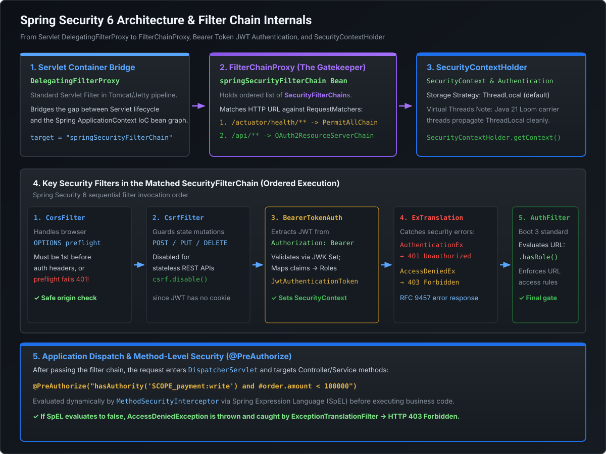

# Spring Security 6 Architecture, SecurityFilterChain & OAuth2 JWT Mastery

Enterprise identity and access management in modern microservices requires strict zero-trust enforcement. In Spring Security 6 (shipped with Spring Boot 3), the legacy inheritance model has been completely eradicated in favor of a **stateless, component-based filter pipeline**. Staff and Principal Engineers must understand **how `FilterChainProxy` dispatches requests, how `SecurityContextHolder` manages thread-local state, how OAuth2 Resource Server validates stateless JWT tokens at sub-millisecond latencies, and how to map custom identity provider claims into Spring authorities**.

---

## 1. The Spring Security 6 Architecture: Filter Chain Mechanics

Spring Security does not execute inside Spring MVC; it intercepts requests at the **Servlet container boundary** before `DispatcherServlet` is ever invoked:

[](images/security_filter_chain_architecture.svg)

### The Ingress Dispatch Sequence
1. **`DelegatingFilterProxy` (Servlet Filter)**:
   - Registered in Tomcat / Jetty's standard servlet filter pipeline.
   - It acts as an architectural bridge: it has zero security logic itself, but delegates every request to a Spring-managed bean named `springSecurityFilterChain`.
2. **`FilterChainProxy` (The Master Controller)**:
   - Holds an ordered `List<SecurityFilterChain>`.
   - Compares the incoming HTTP request against the URL patterns of each chain (`RequestMatcher`).
   - Routes the request into the **first matching filter chain**.
3. **`SecurityFilterChain` (The Execution Pipeline)**:
   - An ordered sequence of security filters (typically 12–15 filters) that sequentially inspect, authenticate, and authorize the request.

---

## 2. The Spring Security 6 Paradigm Shift: No More Adapters

### The Legacy Anti-Pattern (Spring Boot 2.x)
In Spring Boot 2.x, security was configured by subclassing `WebSecurityConfigurerAdapter` and overriding `configure(HttpSecurity http)`. This tightly coupled security rules to a rigid class hierarchy and made multi-chain configurations error-prone.

```java
// ❌ OBSOLETE IN SPRING SECURITY 6 / BOOT 3 (Class completely removed)
@Configuration
public class LegacySecurityConfig extends WebSecurityConfigurerAdapter {
    @Override
    protected void configure(HttpSecurity http) throws Exception {
        http.authorizeRequests().anyRequest().authenticated();
    }
}
```

### The Modern Component Standard (Spring Boot 3.x)
Spring Security 6 enforces standalone `@Bean` methods returning `SecurityFilterChain`:

```java
@Configuration
@EnableWebSecurity
@EnableMethodSecurity // Replaces deprecated @EnableGlobalMethodSecurity
public class ModernSecurityConfig {

    @Bean
    @Order(1) // Evaluated FIRST
    public SecurityFilterChain actuatorFilterChain(HttpSecurity http) throws Exception {
        http
            .securityMatcher("/actuator/**") // Matches ONLY actuator endpoints
            .authorizeHttpRequests(auth -> auth
                .requestMatchers("/actuator/health/**", "/actuator/prometheus").permitAll()
                .anyRequest().hasRole("OPS_ADMIN")
            )
            .httpBasic(Customizer.withDefaults());
        return http.build();
    }

    @Bean
    @Order(2) // Evaluated SECOND: Business API
    public SecurityFilterChain apiFilterChain(HttpSecurity http) throws Exception {
        http
            .securityMatcher("/api/**")
            .csrf(csrf -> csrf.disable()) // Safe for stateless REST APIs using JWT
            .sessionManagement(session -> session.sessionCreationPolicy(SessionCreationPolicy.STATELESS))
            .authorizeHttpRequests(auth -> auth
                .requestMatchers(HttpMethod.GET, "/api/v1/public/**").permitAll()
                .requestMatchers("/api/v1/admin/**").hasRole("ADMIN")
                .anyRequest().authenticated()
            )
            .oauth2ResourceServer(oauth2 -> oauth2
                .jwt(jwt -> jwt.jwtAuthenticationConverter(customJwtAuthenticationConverter()))
            );
        return http.build();
    }
}
```

---

## 3. `SecurityContextHolder` & Thread-Local Propagation

The authenticated principal is stored in the `SecurityContext`:

```java
SecurityContext context = SecurityContextHolder.getContext();
Authentication authentication = context.getAuthentication();
String username = authentication.getName();
Collection<? extends GrantedAuthority> authorities = authentication.getAuthorities();
```

### Storage Strategies
`SecurityContextHolder` delegates storage to a pluggable `SecurityContextHolderStrategy`:

1. **`MODE_THREADLOCAL` (Default)**:
   - Binds the context to the current OS thread using `java.lang.ThreadLocal`.
   - Optimal for traditional synchronous Servlet architectures (one thread per request).
2. **`MODE_INHERITABLETHREADLOCAL`**:
   - Uses `InheritableThreadLocal` to propagate security context to child threads spawned via `new Thread()`.
   - **Production Trap**: Dangerous with thread pools (`ExecutorService`) because worker threads are reused across distinct requests, causing cross-tenant credential leakage.
3. **`MODE_GLOBAL`**:
   - Single static context across all threads (desktop/CLI apps only).

### Spring Security 6 Filter Shift: `SecurityContextHolderFilter`
In Spring Security 5, `SecurityContextPersistenceFilter` stored the context in the HTTP session at the end of the request.
In Spring Security 6:
- Replaced by **`SecurityContextHolderFilter`**.
- It guarantees that the `SecurityContext` is explicitly established from storage and **guaranteed to be cleared from ThreadLocal in a `finally` block**, preventing thread pool poisoning.

---

## 4. OAuth2 Resource Server & Stateless JWT Architecture

In high-scale cloud-native ecosystems (such as enterprise financial microservices or AWS architectures), services do not maintain server-side sessions. Instead, they act as **OAuth2 Resource Servers**, validating incoming JSON Web Tokens (JWT) issued by an Identity Provider (IdP) like Keycloak, Okta, or AWS Cognito.

```
 Client (Mobile / Web)       Spring Boot Resource Server          IdP (Keycloak / Okta)
          │                               │                                 │
          │ 1. Request with Bearer JWT    │                                 │
          ├──────────────────────────────►│                                 │
          │                               │ 2. Fetch Public Keys (Cached)   │
          │                               ├────────────────────────────────►│
          │                               │    GET /.well-known/jwks.json   │
          │                               │◄────────────────────────────────┤
          │                               │    JWK Set (RSA Public Keys)    │
          │                               │                                 │
          │                               │ 3. Cryptographic Verification:  │
          │                               │    - Check RSA Signature        │
          │                               │    - Validate exp, nbf, iss, aud│
          │                               │    - Extract Custom Roles       │
          │                               │                                 │
          │ 4. 200 OK / 401 Unauthorized  │                                 │
          │◄──────────────────────────────┤                                 │
```

### 1. Externalized Application Configuration
```yaml
spring:
  security:
    oauth2:
      resourceserver:
        jwt:
          # URL to fetch IdP Public Key Set (JWKS)
          jwk-set-uri: https://idp.enterprise.internal/realms/enterprise/protocol/openid-connect/certs
          issuer-uri: https://idp.enterprise.internal/realms/enterprise
```

### 2. Custom Claim-to-Authority Converter
Most enterprise IdPs do not place roles in the default Spring `scope` or `scp` claim. Keycloak, for instance, places roles inside nested JSON objects: `{"realm_access": {"roles": ["ADMIN", "PAYMENT_OPERATOR"]}}`.

Without a custom converter, Spring Security fails to map these roles, denying authorized requests.

```java
@Component
public class KeycloakRealmRoleConverter implements Converter<Jwt, AbstractAuthenticationToken> {

    private final JwtGrantedAuthoritiesConverter defaultAuthoritiesConverter = new JwtGrantedAuthoritiesConverter();

    @Override
    public AbstractAuthenticationToken convert(Jwt jwt) {
        // 1. Extract standard OAuth2 scopes (SCOPE_read, SCOPE_write)
        Collection<GrantedAuthority> authorities = new HashSet<>(defaultAuthoritiesConverter.convert(jwt));

        // 2. Extract nested realm_access.roles
        Map<String, Object> realmAccess = jwt.getClaim("realm_access");
        if (realmAccess != null && realmAccess.containsKey("roles")) {
            @SuppressWarnings("unchecked")
            List<String> roles = (List<String>) realmAccess.get("roles");
            roles.stream()
                .map(role -> new SimpleGrantedAuthority("ROLE_" + role.toUpperCase())) // Spring expects "ROLE_" prefix
                .forEach(authorities::add);
        }

        return new JwtAuthenticationToken(jwt, authorities, extractPrincipalUsername(jwt));
    }

    private String extractPrincipalUsername(Jwt jwt) {
        // Fall back to preferred_username or sub
        return jwt.hasClaim("preferred_username") 
            ? jwt.getClaimAsString("preferred_username") 
            : jwt.getSubject();
    }
}
```

### 3. Custom Token Validator (Audience & Clock Skew)
Enterprise security requires validating that the token was explicitly intended for this microservice (`aud` claim) and handling clock drift:

```java
@Bean
public JwtDecoder jwtDecoder(OAuth2ResourceServerProperties properties) {
    NimbusJwtDecoder jwtDecoder = NimbusJwtDecoder
        .withJwkSetUri(properties.getJwt().getJwkSetUri())
        .jwsAlgorithm(SignatureAlgorithm.RS256)
        .build();

    OAuth2TokenValidator<Jwt> defaultWithIssuer = JwtValidators.createDefaultWithIssuer(properties.getJwt().getIssuerUri());
    OAuth2TokenValidator<Jwt> audienceValidator = new DelegatingOAuth2TokenValidator<>(
        defaultWithIssuer,
        new AudienceValidator("enterprise-payment-gateway")
    );

    jwtDecoder.setJwtValidator(audienceValidator);
    return jwtDecoder;
}

public class AudienceValidator implements OAuth2TokenValidator<Jwt> {
    private final String expectedAudience;

    public AudienceValidator(String expectedAudience) {
        this.expectedAudience = expectedAudience;
    }

    @Override
    public OAuth2TokenValidatorResult validate(Jwt jwt) {
        if (jwt.getAudience().contains(expectedAudience)) {
            return OAuth2TokenValidatorResult.success();
        }
        OAuth2Error error = new OAuth2Error("invalid_token", "The token audience does not match this service", null);
        return OAuth2TokenValidatorResult.failure(error);
    }
}
```

---

## 5. Runnable Verification POC: Mock JWT Authentication

Save and execute this self-contained class to demonstrate how Spring Security processes and extracts authorities from a decoded JWT:

```java
package com.mastery.spring.security;

import org.springframework.core.convert.converter.Converter;
import org.springframework.security.authentication.AbstractAuthenticationToken;
import org.springframework.security.core.GrantedAuthority;
import org.springframework.security.core.authority.SimpleGrantedAuthority;
import org.springframework.security.oauth2.jwt.Jwt;
import org.springframework.security.oauth2.server.resource.authentication.JwtAuthenticationToken;

import java.time.Instant;
import java.util.*;
import java.util.stream.Collectors;

public class SpringSecurityOAuth2JwtPOC {

    // Custom Converter extracting Keycloak-style roles
    public static class CustomJwtRoleConverter implements Converter<Jwt, AbstractAuthenticationToken> {
        @Override
        public AbstractAuthenticationToken convert(Jwt jwt) {
            Set<GrantedAuthority> authorities = new HashSet<>();

            // 1. Extract standard scopes
            String scope = jwt.getClaimAsString("scope");
            if (scope != null) {
                Arrays.stream(scope.split(" "))
                    .map(s -> new SimpleGrantedAuthority("SCOPE_" + s))
                    .forEach(authorities::add);
            }

            // 2. Extract Keycloak realm_access roles
            Map<String, Object> realmAccess = jwt.getClaim("realm_access");
            if (realmAccess != null && realmAccess.containsKey("roles")) {
                @SuppressWarnings("unchecked")
                List<String> roles = (List<String>) realmAccess.get("roles");
                roles.stream()
                    .map(role -> new SimpleGrantedAuthority("ROLE_" + role.toUpperCase()))
                    .forEach(authorities::add);
            }

            return new JwtAuthenticationToken(jwt, authorities, jwt.getClaimAsString("preferred_username"));
        }
    }

    public static void main(String[] args) {
        // Construct a Mock Decoded JWT
        Map<String, Object> headers = Map.of("alg", "RS256", "typ", "JWT");
        Map<String, Object> claims = Map.of(
            "sub", "user-uuid-10029",
            "preferred_username", "ankit.staff.lead",
            "scope", "payment:read payment:write",
            "realm_access", Map.of("roles", List.of("settlement_operator", "admin")),
            "iss", "https://idp.enterprise.internal/realms/enterprise",
            "exp", Instant.now().plusSeconds(3600)
        );

        Jwt mockJwt = new Jwt("mock-token-value", Instant.now(), Instant.now().plusSeconds(3600), headers, claims);

        CustomJwtRoleConverter converter = new CustomJwtRoleConverter();
        AbstractAuthenticationToken authToken = converter.convert(mockJwt);

        System.out.println("=== DECODED AUTHENTICATION TOKEN ===");
        System.out.println("Principal Username: " + authToken.getName());
        System.out.println("Is Authenticated?  " + authToken.isAuthenticated());
        System.out.println("\nExtracted Granted Authorities:");
        authToken.getAuthorities().forEach(auth -> System.out.println("  -> " + auth.getAuthority()));

        // Verification checks
        boolean hasAdminRole = authToken.getAuthorities().stream()
            .anyMatch(a -> a.getAuthority().equals("ROLE_ADMIN"));
        boolean hasWriteScope = authToken.getAuthorities().stream()
            .anyMatch(a -> a.getAuthority().equals("SCOPE_payment:write"));

        System.out.println("\nSecurity Evaluation:");
        System.out.println("Has ROLE_ADMIN? " + hasAdminRole);
        System.out.println("Has SCOPE_payment:write? " + hasWriteScope);
    }
}
```

---

## 6. Staff / Principal Interview Strategy: Security & OAuth2

### Classic Traps & High-Leverage Responses

#### Trap 1: *"Why should you disable CSRF protection in stateless REST APIs using Bearer JWT authentication?"*
- **Principal Counter**: *"Cross-Site Request Forgery (CSRF) exploits ambient browser credential storage—specifically HTTP cookies that the browser attaches automatically to cross-origin requests. In stateless microservices utilizing `Authorization: Bearer <JWT>`, the browser does not automatically attach the header; client JavaScript must explicitly inject it into the request. Because malicious third-party sites cannot force the browser to emit a custom `Authorization` header without an explicit CORS pre-flight permit, CSRF attacks are fundamentally impossible on stateless token-based architectures. Keeping CSRF enabled introduces unnecessary CPU overhead and breaks client integration by requiring anti-CSRF token handshakes."*

#### Trap 2: *"How does an OAuth2 Resource Server maintain sub-millisecond validation latencies without calling the Identity Provider (IdP) on every request?"*
- **Principal Counter**: *"It never performs synchronous IdP token introspection over the network on every call. Instead, Spring Security's `NimbusJwtDecoder` performs local, offline cryptographic validation. Upon startup, it fetches the IdP's JSON Web Key Set (JWKS) via `jwk-set-uri` and caches the RSA public keys locally in memory with an automated TTL refresh. When a request arrives, the signature is verified locally using CPU-bound asymmetric math ($<0.2\text{ ms}$). Only the public keys are fetched periodically; no network calls occur during the request processing path."*

#### Trap 3: *"Why did Spring Security 6 completely remove `WebSecurityConfigurerAdapter`?"*
- **Principal Counter**: *"The adapter pattern forced single-inheritance coupling, encouraging massive monolithic configuration classes that conflated multiple architectural boundaries (CORS, CSRF, URL authorization, authentication providers). In complex microservices with multiple distinct filter chains (e.g. mTLS on Actuator, JWT on public APIs, Basic Auth on legacy webhooks), overriding a single `configure(HttpSecurity)` method resulted in fragile, hard-to-test side effects. Spring Security 6 enforces a component-based paradigm where independent `SecurityFilterChain` beans declare explicit `securityMatcher` filters and orderings, enabling isolated testing, modular configuration, and static AOT compilation."*
