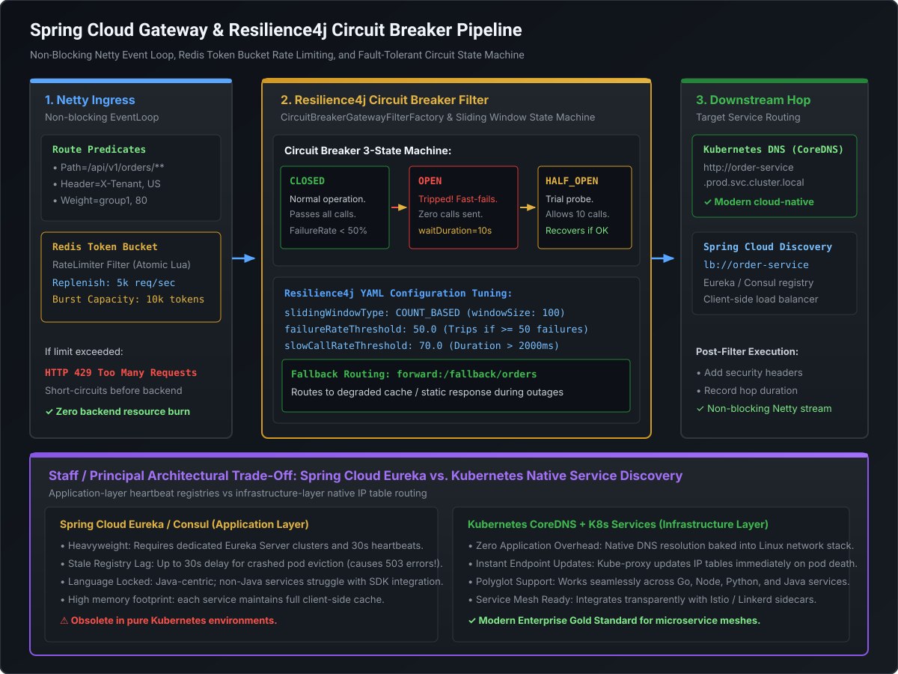

# Spring Cloud Gateway, Resilience4j Circuit Breakers & Service Discovery

At high transaction volumes ($>50\text{k}$ TPS), synchronous distributed microservices face cascading latency amplification and thread exhaustion. If a single downstream dependency slows down, upstream services can collapse within seconds. In modern cloud architectures, **Spring Cloud Gateway provides non-blocking reactive ingress routing, Redis token buckets enforce rate limiting, Resilience4j isolates fault domains, and Kubernetes native discovery supersedes legacy application-layer registries like Eureka**.

---

## 1. Spring Cloud Gateway Architecture: Reactive Non-Blocking Ingress

Unlike legacy Spring Cloud Zuul (which relied on blocking Servlet threads), **Spring Cloud Gateway is built natively on Netty, Project Reactor, and Spring WebFlux**.



### The Ingress Processing Mechanics
1. **Netty EventLoop**: Requests arrive over asynchronous non-blocking sockets. A small pool of worker threads (typically matching CPU core count) handles thousands of concurrent connections without thread-per-request overhead.
2. **Route Predicate Handler Mapping**: Matches incoming requests against route rules (`Path`, `Method`, `Header`, `Host`, `Weight`).
3. **Filtering Web Handler**: Executes a composite chain of `GatewayFilter` instances:
   - **Pre-Filters**: Execute before the request is routed downstream (e.g. JWT validation, rate limiting, header manipulation).
   - **Routing Filter**: Dispatches the request to the downstream URI via Netty `HttpClient`.
   - **Post-Filters**: Execute after the downstream response returns (e.g. adding security headers, calculating hop latency, metrics logging).

---

## 2. Distributed Rate Limiting via Redis Token Bucket

To protect downstream microservices from denial-of-service (DoS) spikes or rogue consumers, Spring Cloud Gateway includes a high-performance **Redis-backed Token Bucket rate limiter**.

```
                Incoming HTTP Requests
                          │
                          ▼
             ┌─────────────────────────┐
             │ KeyResolver Identifies  │
             │ Consumer (API Key / IP) │
             └────────────┬────────────┘
                          │
                          ▼
            [ Execute Redis Lua Script ]
            - Checks current token count
            - Calculates replenished tokens based on elapsed time
                          │
            ┌─────────────┴─────────────┐
            ▼                           ▼
      Tokens Available?           Bucket Empty?
            │                           │
            ▼                           ▼
    [ Consume 1 Token ]        [ Reject Immediately ]
    Forward Downstream         HTTP 429 Too Many Requests
```

### The Production Configuration
```yaml
spring:
  cloud:
    gateway:
      routes:
        - id: order-service-route
          uri: http://order-service.prod.svc.cluster.local:8080
          predicates:
            - Path=/api/v1/orders/**
          filters:
            - name: RequestRateLimiter
              args:
                redis-rate-limiter.replenishRate: 1000 # 1,000 requests per second steady-state
                redis-rate-limiter.burstCapacity: 2000 # Allows temporary bursts up to 2,000
                redis-rate-limiter.requestedTokens: 1
                key-resolver: "#{@apiKeyResolver}"
```

### Type-Safe KeyResolver Bean (Multi-Tenant Rate Limiting)
Rate limiting by IP address in corporate environments is flawed because thousands of users share corporate NAT gateways. A Staff Engineer rate-limits by **authenticated API key or JWT tenant**:

```java
@Configuration
public class RateLimiterConfig {

    @Bean
    public KeyResolver apiKeyResolver() {
        return exchange -> {
            // 1. Check for dedicated API Key header
            String apiKey = exchange.getRequest().getHeaders().getFirst("X-API-KEY");
            if (apiKey != null && !apiKey.isBlank()) {
                return Mono.just(apiKey);
            }

            // 2. Fall back to JWT Tenant ID or remote IP
            String tenantId = exchange.getRequest().getHeaders().getFirst("X-Tenant-ID");
            if (tenantId != null && !tenantId.isBlank()) {
                return Mono.just(tenantId);
            }

            // Fallback to client IP
            return Mono.just(Objects.requireNonNull(exchange.getRequest().getRemoteAddress()).getAddress().getHostAddress());
        };
    }
}
```

---

## 3. Resilience4j Integration & Circuit Breaker Mechanics

**Resilience4j** is the lightweight, functional fault tolerance library designed specifically for Java 17+ and functional programming (replacing deprecated Netflix Hystrix).

### The Circuit Breaker 3-State Machine
1. **`CLOSED` (Normal Operation)**:
   - All requests flow to the downstream dependency.
   - Measures failure rate over a sliding window (e.g. last 100 calls).
   - If failure rate exceeds `failureRateThreshold` (e.g. 50%), state transitions to **`OPEN`**.
2. **`OPEN` (Short-Circuited / Failing Fast)**:
   - **Zero downstream calls are made!** Requests fail fast immediately or route to a fallback handler.
   - Prevents overwhelming an already failing downstream database or service.
   - Starts a wait timer (e.g. `waitDurationInOpenState: 10s`). When the timer expires, transitions to **`HALF_OPEN`**.
3. **`HALF_OPEN` (Trial Probe Phase)**:
   - Permits a configurable number of test probe calls (e.g. `permittedNumberOfCallsInHalfOpenState: 10`).
   - If the probe failure rate is below the threshold, the circuit recovers back to **`CLOSED`**.
   - If failures persist, it transitions back to **`OPEN`** for another cooldown period.

### Gateway Circuit Breaker Filter Configuration
```yaml
spring:
  cloud:
    gateway:
      routes:
        - id: payment-service-route
          uri: http://payment-service.prod.svc.cluster.local:8080
          predicates:
            - Path=/api/v1/payments/**
          filters:
            - name: CircuitBreaker
              args:
                name: paymentServiceCircuitBreaker
                fallbackUri: forward:/fallback/payment-degraded

resilience4j:
  circuitbreaker:
    instances:
      paymentServiceCircuitBreaker:
        slidingWindowType: COUNT_BASED
        slidingWindowSize: 100 # Evaluates last 100 calls
        failureRateThreshold: 50.0 # Open if >= 50% fail
        slowCallRateThreshold: 75.0 # Open if >= 75% take > 1000ms
        slowCallDurationThreshold: 1000ms
        waitDurationInOpenState: 10000ms # Stay OPEN for 10 seconds
        permittedNumberOfCallsInHalfOpenState: 10
        automaticTransitionFromOpenToHalfOpenEnabled: true

  timelimiter:
    instances:
      paymentServiceCircuitBreaker:
        timeoutDuration: 1500ms # Hard SLA timeout
```

### Implementing the Fallback Controller
```java
@RestController
@RequestMapping("/fallback")
public class GatewayFallbackController {

    @GetMapping("/payment-degraded")
    public ResponseEntity<Map<String, Object>> paymentFallback() {
        return ResponseEntity.status(HttpStatus.SERVICE_UNAVAILABLE).body(Map.of(
            "status", "DEGRADED",
            "message", "Payment processing is temporarily degraded. Queued for asynchronous retry.",
            "retryAfterSeconds", 10
        ));
    }
}
```

---

## 4. Service Discovery Trade-Offs: Eureka/Consul vs. Kubernetes Native

In early microservice architectures (2014–2018), application-layer service registries like Netflix Eureka and HashiCorp Consul were mandatory. In modern containerized Kubernetes environments, this architecture is an **anti-pattern**.

### Architectural Comparison Matrix

| Dimension | Spring Cloud Eureka / Consul | Kubernetes Native (CoreDNS + Services) |
| :--- | :--- | :--- |
| **Layer** | Application Layer (JVM library) | Infrastructure / OS Network Layer |
| **Discovery Mechanism** | Java client heartbeats (30s interval); local in-memory registry cache | Standard Linux DNS resolution (`order-service.prod.svc.cluster.local`) |
| **Stale Cache Lag** | **High ($30\text{–}60\text{ seconds}$)**: Dead pods remain in client cache until heartbeat eviction, triggering 503 errors. | **Near Instantaneous**: `kube-proxy` updates iptables / IPVS within milliseconds of pod termination. |
| **Polyglot Support** | Very poor. Non-Java microservices (Go, Python, Rust) require complex sidecars. | **100% Universal**: Works across every language with zero custom SDK dependencies. |
| **Resource Overhead** | Requires deploying and maintaining dedicated Eureka Server clusters. | **Zero extra clusters**: Built natively into the K8s control plane. |
| **Health Checks** | Application heartbeats. | Native K8s Liveness & Readiness Probes. |
| **Modern Recommendation** | **Legacy / Deprecated** for Kubernetes deployments. | **Industry Standard** for all modern cloud deployments. |

> [!TIP]
> **Staff Architectural Stance**:
> If interviewing for a cloud-native organization deploying to AWS EKS or GCP GKE, explicitly advocate for **Kubernetes Native Service Discovery**. Point out that keeping Eureka inside Kubernetes duplicates routing, introduces cache-invalidation race conditions during rolling deployments, and locks the team into Java-only dependencies.

---

## 5. Runnable Verification POC: Resilience4j Circuit Breaker

Save and execute this self-contained class to observe the circuit breaker state transitions in real time:

```java
package com.mastery.spring.cloud;

import io.github.resilience4j.circuitbreaker.CircuitBreaker;
import io.github.resilience4j.circuitbreaker.CircuitBreakerConfig;
import io.github.resilience4j.circuitbreaker.CircuitBreakerRegistry;

import java.io.IOException;
import java.time.Duration;
import java.util.function.Supplier;

public class Resilience4jCircuitBreakerPOC {

    public static void main(String[] args) throws InterruptedException {
        // 1. Build Custom CircuitBreaker Configuration
        CircuitBreakerConfig config = CircuitBreakerConfig.custom()
            .failureRateThreshold(50.0f) // Open if >= 50% calls fail
            .slidingWindowType(CircuitBreakerConfig.SlidingWindowType.COUNT_BASED)
            .slidingWindowSize(4) // Small window for immediate demonstration
            .minimumNumberOfCalls(4)
            .waitDurationInOpenState(Duration.ofMillis(1000)) // Stay OPEN for 1 second
            .permittedNumberOfCallsInHalfOpenState(2)
            .build();

        CircuitBreakerRegistry registry = CircuitBreakerRegistry.of(config);
        CircuitBreaker circuitBreaker = registry.circuitBreaker("paymentSwitchCB");

        // Event Listeners for State Changes
        circuitBreaker.getEventPublisher()
            .onStateTransition(event -> System.out.println("  >>> [CIRCUIT STATE TRANSITION] >>> " + event.getStateTransition()));

        System.out.println("Initial Circuit State: " + circuitBreaker.getState());

        // 2. Simulate Calls
        Supplier<String> failingCall = () -> { throw new RuntimeException("Downstream Switch Timeout!"); };
        Supplier<String> healthyCall = () -> "TRANSACTION_SUCCESS_200";

        System.out.println("\n--- STEP 1: Sending 4 Consecutive Failing Requests ---");
        for (int i = 1; i <= 4; i++) {
            try {
                Supplier<String> decorated = CircuitBreaker.decorateSupplier(circuitBreaker, failingCall);
                decorated.get();
            } catch (Exception e) {
                System.out.println("Call " + i + " failed: " + e.getMessage());
            }
        }

        System.out.println("\nCircuit State after failures: " + circuitBreaker.getState());

        System.out.println("\n--- STEP 2: Attempting call while OPEN (Fails Fast without calling downstream) ---");
        try {
            Supplier<String> decorated = CircuitBreaker.decorateSupplier(circuitBreaker, healthyCall);
            decorated.get();
        } catch (Exception e) {
            System.out.println("Immediate Rejection: " + e.getClass().getSimpleName() + " - " + e.getMessage());
        }

        System.out.println("\n--- STEP 3: Waiting 1.1 seconds for cooldown timer... ---");
        Thread.sleep(1100);

        System.out.println("\n--- STEP 4: Sending Probe Calls in HALF_OPEN State ---");
        for (int i = 1; i <= 2; i++) {
            Supplier<String> decorated = CircuitBreaker.decorateSupplier(circuitBreaker, healthyCall);
            String result = decorated.get();
            System.out.println("Probe Call " + i + " response: " + result);
        }

        System.out.println("\nFinal Circuit State: " + circuitBreaker.getState() + " (Fully Recovered!)");
    }
}
```

---

## 6. Staff / Principal Interview Strategy: Gateway & Resilience

### Classic Traps & High-Leverage Responses

#### Trap 1: *"Why does Spring Cloud Gateway dramatically outperform legacy Zuul 1.x under high concurrency?"*
- **Principal Counter**: *"Because of the fundamental concurrency model: Zuul 1.x was built on standard Servlet blocking I/O, where every incoming HTTP request pinned a dedicated operating system thread for its entire lifecycle. Under high concurrency or downstream latency, the Tomcat worker thread pool was quickly exhausted, causing queuing and thread-context-switching thrashing. Spring Cloud Gateway runs on Netty and Project Reactor, using an event-driven, non-blocking asynchronous event loop. A small fixed pool of worker threads can multiplex hundreds of thousands of concurrent connections using epoll/kqueue socket notifications, maintaining flat memory usage and low latencies."*

#### Trap 2: *"How do you prevent a distributed rate limiter in Redis from becoming a single point of failure (SPOF) or latency bottleneck?"*
- **Principal Counter**: *"Two architectural layers: Redis clustering with pipelining, and client-side fallback. In Spring Cloud Gateway, the Redis Token Bucket executes an atomic Lua script over Redis Cluster or AWS ElastiCache with multi-AZ read/write replicas ($<1\text{ ms}$ latency). Furthermore, we configure a circuit breaker around the rate limiter itself (`fail-open` policy): if Redis experiences latency spikes or partition failures, the gateway logs an alert and allows requests to pass through unthrottled rather than blocking business traffic. At high volumes, we also combine it with in-memory local token buckets (e.g. Bucket4j) as a first-tier filter before hitting Redis."*

#### Trap 3: *"Why is Netflix Eureka considered an anti-pattern when deploying microservices to Kubernetes?"*
- **Principal Counter**: *"Because Kubernetes already provides battle-tested, infrastructure-level service discovery via CoreDNS and `kube-proxy`. Running Eureka inside Kubernetes creates redundant architectural complexity: every pod must run a Eureka client, poll for updates, and register heartbeats. When a pod dies, Eureka's 30-second heartbeat eviction lag leaves dead endpoints in the client cache, causing intermittent HTTP 503 errors during rolling updates. Conversely, Kubernetes updates endpoint iptables immediately upon pod termination, requires zero client libraries, and natively supports polyglot services."*
