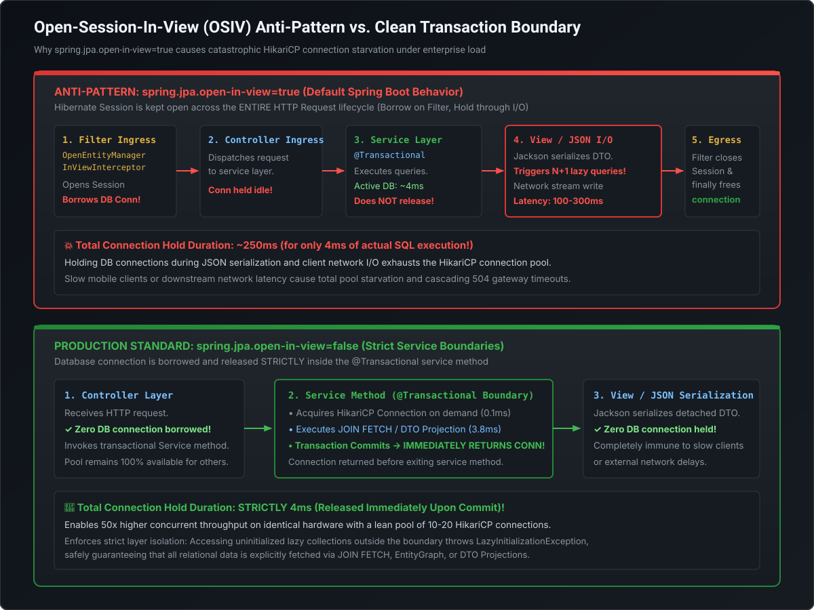

# Open-Session-In-View (OSIV) Anti-Pattern & HikariCP Pool Sizing

Database connection exhaustion is the number one cause of cascading microservice collapse under production load. When an incident occurs, inexperienced teams reflexively increase the connection pool size from 10 to 100, which only accelerates the database's collapse. At the Staff and Principal Engineer level, you must master **why the default Open-Session-In-View (OSIV) setting in Spring Boot is an enterprise liability, how to safely disable it, and how to size HikariCP connection pools using Little's Law and hardware queuing theory**.

---

## 1. The Open-Session-In-View (OSIV) Anti-Pattern

In Spring Boot web applications using Spring Data JPA, the following configuration property defaults to `true`:

```yaml
spring.jpa.open-in-view: true # ⚠️ DANGEROUS DEFAULT ANTI-PATTERN!
```

[](images/osiv_connection_leak_vs_clean_boundary.svg)

### Why Spring Boot Defaults to `true`
Spring Boot enables OSIV by default as a developer convenience: it prevents junior developers from seeing `org.hibernate.LazyInitializationException` when rendering entities in views or serializing them to JSON via Jackson.

### The Architectural Catastrophe Under Load
When `spring.jpa.open-in-view=true`:
1. Spring registers `OpenEntityManagerInViewInterceptor` at the Servlet filter layer.
2. The Hibernate `Session` is opened **before the request ever reaches the Controller**.
3. In modern Hibernate/JPA setups, as soon as the first query is executed in a `@Transactional` service, a physical **JDBC database connection is borrowed from HikariCP**.
4. The service finishes its business logic and transaction in **4 milliseconds**.
5. **THE LEAK**: The database connection is **NOT released back to HikariCP**! The connection remains pinned to the HTTP worker thread while:
   - Jackson serializes the domain objects into JSON.
   - Any lazy collections referenced by Jackson trigger **hidden, uncontrolled secondary SQL queries**.
   - The server writes the response bytes over the network to the client (which could take 200–500 ms over slow mobile 4G networks or client WAN).
6. **Result**: A physical database connection is held for **250 milliseconds** to perform **4 milliseconds** of actual SQL computation!

### Sizing Mathematics: The Collapse
- Suppose your service handles 200 concurrent requests with a HikariCP pool of 20 connections.
- With OSIV disabled: Each query takes 4ms. 20 connections can process $\frac{20 \text{ conns} \times 1000\text{ ms}}{4\text{ ms}} = \mathbf{5,000 \text{ requests/sec}}$.
- With OSIV enabled: Each request holds the connection for 200ms (due to slow network/JSON rendering). 20 connections can process $\frac{20 \text{ conns} \times 1000\text{ ms}}{200\text{ ms}} = \mathbf{100 \text{ requests/sec}}$.
- A mere 120 concurrent users will completely saturate the connection pool, causing all other incoming requests to block until they hit `connectionTimeout` (30 seconds) and crash with `Connection is not available, request timed out after 30000ms`.

---

## 2. The Production Standard: Disabling OSIV

In high-scale enterprise microservices, OSIV must be explicitly disabled:

```yaml
spring:
  jpa:
    open-in-view: false # ✅ PRODUCTION REQUIREMENT!
```

### Handling `LazyInitializationException` Professionally
When OSIV is disabled, attempting to access an uninitialized lazy proxy outside a `@Transactional` boundary will immediately throw:
`org.hibernate.LazyInitializationException: could not initialize proxy - no Session`

This exception is not a bug—**it is a valuable design signal** indicating that the service boundary is leaking un-fetched relational assumptions into the presentation layer.

#### The 3 Solutions:
1. **DTO Constructor Projections**: Map the required fields directly from the repository into immutable Records (zero lazy loading possible).
2. **`JOIN FETCH` in Repository**: Eagerly fetch the required associations within the `@Transactional` service method.
3. **Dynamic `@EntityGraph`**: Declare the required fetch tree for that specific API endpoint.

---

## 3. HikariCP Connection Pool Mastery

HikariCP is the default, ultra-high-performance JDBC connection pool in Spring Boot. Sizing a connection pool is an exercise in queueing theory and hardware concurrency.

```
       Bigger is NOT Better: The Myth of the 100-Connection Pool
                               │
       ┌───────────────────────┴───────────────────────┐
       ▼                                               ▼
  10 Connections on 8-Core DB                    100 Connections on 8-Core DB
  - 8 connections execute on cores              - 8 connections execute on cores
  - 2 connections wait in OS queue              - 92 connections thrash in OS queue
  - Minimal CPU context switching               - Massive CPU context switching & RAM thrash
  - Sub-millisecond latency                     - Disk spindle contention & thread deadlocks
  - Maximum Transaction Throughput              - 💥 Degradation & Timeout Collapse!
```

### The Brett Wooldridge Pool Sizing Formula
The lead author of HikariCP established the empirical formula for connection pool sizing:

$$\text{Pool Size} = \text{Core Count} \times 2 + \text{Effective Spindle Count}$$

- **Core Count**: Number of physical CPU cores on the database server.
- **Effective Spindle Count**: Number of concurrent I/O channels (1 for spinning disks, $2\text{–}4$ for high-IOPS NVMe SSDs, or 0 if data fits entirely in the database buffer pool memory).

#### Example:
For an 8-core AWS Aurora PostgreSQL instance with data residing in the buffer cache:
$$\text{Pool Size} = 8 \times 2 + 1 = \mathbf{17 \text{ connections}}$$
A pool size of **15–20 connections per microservice instance** routinely outperforms a pool of 100 connections by 300% while keeping database CPU utilization healthy!

---

## 4. Little's Law in Connection Sizing

In queuing theory, **Little's Law** defines the relationship between concurrency, arrival rate, and service time:

$$L = \lambda \times W$$

- $L$: Average number of concurrent database connections required.
- $\lambda$: Request arrival rate (transactions per second, TPS).
- $W$: Average time a connection is held (service duration in seconds).

### Production Calculation Example
- Target Microservice Load: $\lambda = 2,000 \text{ TPS}$.
- Clean Architecture (OSIV disabled, optimized indexes): Average DB query duration $W = 5 \text{ ms} = 0.005 \text{ seconds}$.
- Total Concurrent Connections Needed across the fleet:
  $$L = 2,000 \times 0.005 = \mathbf{10 \text{ connections}}$$
- If the microservice is deployed across 5 Kubernetes pods, each pod needs an average pool size of only **2 connections**! Configuring `maximumPoolSize: 10` per pod provides a $5\times$ safety headroom.

---

## 5. Production HikariCP Configuration Template

```yaml
spring:
  datasource:
    hikari:
      pool-name: MasteryPaymentHikariPool

      # 1. Pool Sizing (Enforce Fixed Pool in Production)
      maximum-pool-size: 20
      minimum-idle: 20 # Keep minimum-idle == maximum-pool-size to avoid resize latency thrash!

      # 2. Timeouts & Lifecycles
      connection-timeout: 3000ms # Time a thread will wait for a connection before failing (3s, not 30s!)
      idle-timeout: 600000ms     # 10 minutes (ignored when minimum-idle == max-pool-size)
      max-lifetime: 1740000ms    # 29 minutes (MUST be 1-2 min shorter than DB/AWS firewall idle timeout)

      # 3. Connection Validation & Leak Detection
      validation-timeout: 1000ms # Fast validation query check
      leak-detection-threshold: 2000ms # Logs a warning with stack trace if connection held > 2 seconds!
```

> [!IMPORTANT]
> **The Critical `max-lifetime` Rule**:
> `max-lifetime` must always be configured **shorter** than any stateful network firewall, AWS ALB, or database TCP idle timeout (typically 30 minutes in AWS). If `max-lifetime` is longer than the network timeout, the firewall will silently drop the TCP connection (`RST`), and the application will encounter intermittent `SocketException: Connection reset by peer` when borrowing idle connections!

---

## 6. Runnable Verification POC: Pool Sizing & Little's Law Calculator

Save and execute this self-contained class to calculate optimal pool sizes and simulate Little's Law capacity planning:

```java
package com.mastery.spring.jpa;

public class HikariPoolSizingAndLittleLawPOC {

    public static void calculatePoolSizing(int dbCpuCores, int diskSpindles, double targetTps, double avgQueryDurationMs, int podCount) {
        System.out.println("================ HIKARICP POOL SIZING ANALYSIS ================");
        System.out.printf("Hardware Inputs: DB Cores = %d | Spindles = %d%n", dbCpuCores, diskSpindles);
        System.out.printf("Workload Inputs: Target TPS = %.0f | Avg Query Duration = %.1f ms | Pod Fleet = %d pods%n",
            targetTps, avgQueryDurationMs, podCount);

        // 1. Brett Wooldridge Formula
        int maxDatabasePoolCapacity = (dbCpuCores * 2) + diskSpindles;
        System.out.printf("%n[Rule 1: Hardware Upper Limit]%n");
        System.out.printf("Maximum recommended connections for ENTIRE database = %d connections%n", maxDatabasePoolCapacity);

        // 2. Little's Law (L = lambda * W)
        double durationSeconds = avgQueryDurationMs / 1000.0;
        double requiredConcurrency = targetTps * durationSeconds;
        System.out.printf("%n[Rule 2: Little's Law Capacity Requirement]%n");
        System.out.printf("Total active connections needed across fleet (L = lambda * W) = %.2f connections%n", requiredConcurrency);

        // 3. Per-Pod Allocation
        double connectionsPerPod = requiredConcurrency / podCount;
        int recommendedPoolSizePerPod = (int) Math.ceil(connectionsPerPod * 2.5); // 2.5x safety headroom for spikes
        recommendedPoolSizePerPod = Math.max(recommendedPoolSizePerPod, 10); // Minimum sensible pool size

        System.out.printf("%n[Recommended Production Sizing]%n");
        System.out.printf("Average active connections per pod = %.2f%n", connectionsPerPod);
        System.out.printf("Recommended maximumPoolSize per pod (with 2.5x headroom) = %d%n", recommendedPoolSizePerPod);
        System.out.printf("Total connections requested by all %d pods = %d (Must be <= DB Max: %d)%n",
            podCount, recommendedPoolSizePerPod * podCount, maxDatabasePoolCapacity * 2);
    }

    public static void main(String[] args) {
        // Scenario 1: Clean Architecture (OSIV Disabled - Fast Queries 4ms)
        System.out.println(">>> SCENARIO 1: Clean Architecture (OSIV Disabled - 4ms avg query) <<<");
        calculatePoolSizing(8, 1, 3000.0, 4.0, 6);

        System.out.println("\n\n>>> SCENARIO 2: OSIV Anti-Pattern (Connection Held 200ms during JSON rendering) <<<");
        calculatePoolSizing(8, 1, 3000.0, 200.0, 6);
    }
}
```

---

## 7. Staff / Principal Interview Strategy: OSIV & HikariCP

### Classic Traps & High-Leverage Responses

#### Trap 1: *"Why does increasing HikariCP `maximumPoolSize` from 20 to 100 often DECREASE overall throughput under peak load?"*
- **Principal Counter**: *"Because of CPU core contention, cache line thrashing, and database internal locking. A database server with 8 physical cores can physically execute only 8 SQL queries simultaneously. If you allow 100 active connections, the operating system kernel must rapidly context-switch between 100 threads, blowing CPU L1/L2 caches and increasing thread scheduling overhead. Furthermore, multiple connections competing for row locks and buffer pool latches create lock thrashing. Restricting the connection pool to $CoreCount \times 2 + Spindles$ queues requests cleanly in the application layer, allowing the database to execute queries at line rate with zero CPU thrashing."*

#### Trap 2: *"Why is `minimumIdle` recommended to match `maximumPoolSize` in production microservices?"*
- **Principal Counter**: *"To prevent latency spikes and connection allocation stalls during sudden traffic surges. If `minimumIdle` is 5 and `maximumPoolSize` is 20, a sudden burst of requests forces HikariCP to initiate 15 physical TCP handshakes, TLS negotiations, and database authentication sequences synchronously on the request processing path. Creating a database connection can take 50–200 ms. Setting `minimumIdle == maximumPoolSize` creates a fixed-size pool at startup, eliminating runtime connection creation overhead and keeping latency flat."*

#### Trap 3: *"Why should `maxLifetime` always be shorter than database or AWS firewall idle timeouts?"*
- **Principal Counter**: *"Intermediate network infrastructure (such as AWS NAT Gateways, firewalls, or load balancers) silently drop stateful TCP connections that remain idle past their inactivity timeout (e.g. 30 minutes) by sending a TCP FIN or dropping subsequent packets without warning. If HikariCP's `maxLifetime` is 30 minutes or longer, the connection pool may hand an application thread a 'zombie' connection that has already been severed by the firewall, resulting in `Connection reset by peer` errors. Sizing `maxLifetime` to 28 or 29 minutes guarantees HikariCP gracefully retires and re-establishes connections before the network tier terminates them."*
