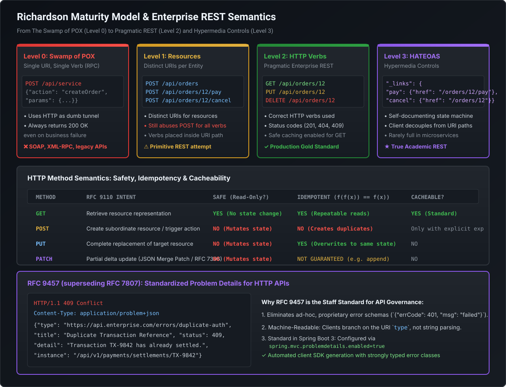

# Enterprise REST Resource Modeling, HTTP Semantics & RFC 9457

Representational State Transfer (REST) is the universal protocol foundation for external APIs, public developer ecosystems, and microservice integration. While junior engineers view REST as simply "JSON over HTTP with `@RestController`," Staff and Principal Engineers are expected to enforce **principled resource modeling, strict HTTP verb semantics (safety vs. idempotency), machine-readable error contracts via RFC 9457 (superseding RFC 7807), and a pragmatic, battle-tested critique of the Richardson Maturity Model and HATEOAS**.

---

## 1. The Richardson Maturity Model & Industry Reality

In 2008, Leonard Richardson formulated a 4-tier model to categorize the architectural maturity of web services:

[](images/richardson_maturity_and_rest_semantics.svg)

### The Four Tiers of REST Maturity

#### Level 0: The Swamp of POX (Plain Old XML / Remote Procedure Calls)
- **Mechanics**: Single URI endpoint (e.g. `/api/service`), single HTTP verb (`POST`), and all dispatch logic packed inside the request body.
- **Failures**: Treats HTTP purely as a dumb transport tunnel; always returns `HTTP 200 OK`, even when the database query failed or the server crashed.
- **Examples**: XML-RPC, SOAP, GraphQL, gRPC-web, and legacy enterprise RPCs.

#### Level 1: Individual Resources
- **Mechanics**: Introduces distinct URIs for different domain entities (`/api/orders`, `/api/customers/123`).
- **Failures**: Continues to abuse `POST` for all interactions, encoding verbs directly into the URI path (e.g., `POST /api/orders/123/cancel`, `POST /api/orders/123/update`).

#### Level 2: HTTP Verbs & Status Codes (Pragmatic Enterprise REST)
- **Mechanics**: Uses standard HTTP methods according to RFC specifications (`GET`, `POST`, `PUT`, `PATCH`, `DELETE`) and leverages semantic HTTP status codes (`200`, `201`, `204`, `400`, `404`, `409`, `422`).
- **Status**: **The architectural standard for 95% of modern enterprise APIs** (Stripe, GitHub, Twilio, AWS, Mastercard).

#### Level 3: Hypermedia Controls (HATEOAS)
- **Mechanics**: *Hypermedia As The Engine Of Application State*. Responses include relational hypermedia links (`_links`) instructing the client which state transitions are currently valid based on domain rules.

### The Staff Critique: Why the Industry Rejects HATEOAS
While Level 3 is championed in academic circles, almost all major tech firms (Stripe, Google, AWS, Netflix) intentionally stop at **Level 2 (Pragmatic REST)**.

#### Concrete Production Failure Modes of HATEOAS:
1. **Network Payload Bloat**: In high-throughput microservices ($>50\text{k}$ TPS), embedding nested `_links` objects in every record inflates JSON payloads by 30–50%, consuming gigabytes of egress bandwidth and draining mobile device batteries.
2. **Brittle Client Automation**: Mobile and Single-Page Applications (SPAs) do not dynamically build UIs by discovering links at runtime. Frontends are pre-compiled with hardcoded routes, rendering dynamic link discovery useless.
3. **Loss of Static Type Safety**: In modern client ecosystems (TypeScript, Swift, Kotlin), developers generate static typed clients using **OpenAPI 3.0 / Swagger specifications**. HATEOAS actively fights static code generation by relying on runtime hypermedia navigation.

---

## 2. Resource Modeling: Nouns, Pluralization & State Transitions

Clean REST APIs model business domains as **nouns (resources)**, avoiding RPC verb-pollution.

### 1. Naming Conventions & Pluralization
- **Always use plural nouns**: `/v1/orders`, `/v1/customers`, `/v1/accounts`.
- **Kebab-case for multi-word paths**: `/v1/payment-methods`, `/v1/audit-logs` (never snake_case or camelCase in URI paths).
- **Hierarchical nesting (Maximum 2 levels deep)**:
  - Good: `/v1/orders/{orderId}/line-items/{itemId}`
  - Bad (Anti-pattern: Deep nesting): `/v1/users/{userId}/accounts/{accId}/orders/{orderId}/payments/{payId}`
  - Solution: Flatten deep relationships into top-level resources with query filters:
    `/v1/payments?orderId={orderId}`

### 2. Modeling Non-CRUD State Transitions
A common design dilemma: *"How do I model actions that aren't pure CRUD, like cancelling an order or approving a loan?"*

| Anti-Pattern (RPC in REST) | Production Pattern A: Sub-Resource | Production Pattern B: Partial Delta (PATCH) |
| :--- | :--- | :--- |
| `POST /orders/123/cancel` | `POST /orders/123/cancellations` (Creates a Cancellation domain record) | `PATCH /orders/123` with payload `{"status": "CANCELLED"}` |
| `POST /loans/456/approve` | `POST /loans/456/approvals` (Creates an Approval entity with audit metadata) | `PATCH /loans/456` with payload `{"state": "APPROVED"}` |
| `POST /cards/789/lock` | `PUT /cards/789/lock-state` with payload `{"locked": true}` | `PATCH /cards/789` with payload `{"isLocked": true}` |

> [!TIP]
> **Staff Modeling Rule**:
> Modeling a business action as a **Sub-Resource** (e.g. `POST /orders/{id}/cancellations`) is architecturally superior when the action requires audit metadata (who cancelled, reason, timestamp) or triggers complex compensating sagas. Use `PATCH` for simple state-machine status transitions.

---

## 3. HTTP Verbs: Safety vs. Idempotency Mechanics

The HTTP/1.1 and HTTP/2 RFC specifications define two fundamental guarantees for method semantics:

```
                                  HTTP Methods
                                       │
                   ┌───────────────────┴───────────────────┐
                   ▼                                       ▼
             Safe Methods                         Idempotent Methods
        (Must NEVER mutate state)             (N calls == 1 call result)
        - GET, HEAD, OPTIONS                  - GET, HEAD, OPTIONS
                                              - PUT (Full replacement)
                                              - DELETE (Removal)
```

### Safety vs. Idempotency Matrix

| HTTP Verb | Safe? | Idempotent? | Cacheable? | RFC Payload Semantics |
| :--- | :--- | :--- | :--- | :--- |
| **`GET`** | **YES** | **YES** | **YES** | Read-only representation. Must never alter server state. |
| **`HEAD`** | **YES** | **YES** | **YES** | Identical to `GET`, but server returns zero response body (headers only). |
| **`POST`** | **NO** | **NO** | **NO** (Default) | Submits an entity for processing; creates duplicate resources on retry. |
| **`PUT`** | **NO** | **YES** | **NO** | Replaces the target resource **entirely** with the request payload. |
| **`PATCH`** | **NO** | **NO** (Strict RFC) | **NO** | Applies a partial delta to the target resource. |
| **`DELETE`**| **NO** | **YES** | **NO** | Removes the resource. Calling `DELETE /orders/123` 5 times yields the same final state. |

### `PUT` vs. `PATCH` (The Technical Distinction)
- **`PUT` (Full Replacement)**:
  The client sends the entire representation of the resource. If the resource has 10 fields and the client provides only 3, the remaining 7 fields are erased or reset to defaults!
- **`PATCH` (Partial Delta)**:
  The client sends only the fields to be mutated.
  *Two RFC Standards*:
  1. **JSON Merge Patch (RFC 7396)**: Sending `{"email": "new@domain.com"}` updates only that field. Keys set to `null` are deleted.
  2. **JSON Patch (RFC 6902)**: Array of atomic operation instructions:
     `[{"op": "replace", "path": "/email", "value": "new@domain.com"}]`.

---

## 4. HTTP Status Codes: The Staff & Principal Standard

Using the correct HTTP status code is essential for intermediate proxies, edge caches (Cloudflare, AWS CloudFront), API gateways, and client circuit breakers.

```
┌────────────────────────────────────────────────────────────────────────┐
│ 2xx Success       │ 200 OK, 201 Created, 202 Accepted, 204 No Content  │
├───────────────────┼────────────────────────────────────────────────────┤
│ 3xx Redirection   │ 301 Moved Permanently, 304 Not Modified (ETag hit) │
├───────────────────┼────────────────────────────────────────────────────┤
│ 4xx Client Errors │ 400 Bad Request, 401 Unauthorized, 403 Forbidden,  │
│                   │ 404 Not Found, 409 Conflict, 422 Unprocessable,    │
│                   │ 429 Too Many Requests                              │
├───────────────────┼────────────────────────────────────────────────────┤
│ 5xx Server Errors │ 500 Internal Error, 502 Bad Gateway,               │
│                   │ 503 Service Unavailable, 504 Gateway Timeout       │
└────────────────────────────────────────────────────────────────────────┘
```

### Critical Status Code Semantics

#### `201 Created` vs. `202 Accepted`
- **`201 Created`**: The resource was synchronously persisted. **Must** include a `Location` header pointing to the newly created URI:
  ```http
  HTTP/1.1 201 Created
  Location: https://api.mastercard.com/v1/orders/ord_98421
  ```
- **`202 Accepted`**: The request was validated and accepted, but processing has **not finished**. Used for asynchronous queues, Kafka ingestion, or batch jobs. Should return a link to a status poll endpoint:
  ```json
  {
    "status": "PROCESSING",
    "jobId": "job-5501",
    "checkStatusUrl": "/v1/jobs/job-5501"
  }
  ```

#### `401 Unauthorized` vs. `403 Forbidden`
- **`401 Unauthorized`**: *Authentication failure*. The caller provided no credentials, an expired JWT, or an invalid API key. Intermediate gateways may challenge with `WWW-Authenticate`.
- **`403 Forbidden`**: *Authorization failure*. The caller's identity is verified, but their roles or scopes are insufficient to access this specific resource. Resending credentials will **not** alter the outcome.

#### `409 Conflict` vs. `422 Unprocessable Content`
- **`409 Conflict`**: State collision with the current state of the database. Examples: unique constraint violation (duplicate email), optimistic locking version mismatch (`ObjectOptimisticLockingFailureException`), or attempting to cancel an order that has already shipped.
- **`422 Unprocessable Content`** (RFC 9110): The JSON syntax is well-formed, but semantic validation rules failed. Example: `amount: -50.00` or `endDate` is before `startDate`. (Superior to generic `400 Bad Request`).

#### `502 Bad Gateway` vs. `503 Service Unavailable` vs. `504 Gateway Timeout`
- **`502 Bad Gateway`**: The gateway received an invalid or crashed response (TCP RST / connection refused) from the downstream microservice.
- **`503 Service Unavailable`**: The service is temporarily overloaded or its Resilience4j circuit breaker is `OPEN`. Clients should retry after the interval specified in the `Retry-After: 30` header.
- **`504 Gateway Timeout`**: The gateway waited for the downstream service to reply, but the downstream request timed out past the SLA threshold.

---

## 5. RFC 9457: Standardized Problem Details for HTTP APIs

Prior to standard error specifications, every company invented proprietary, brittle error formats (`{"err": 102, "msg": "failed"}`).

In 2023, the IETF ratified **RFC 9457 (Problem Details for HTTP APIs)**, officially superseding RFC 7807.

### Standard Problem Details JSON Schema (`application/problem+json`)

```json
{
  "type": "https://api.mastercard.com/errors/insufficient-credit-limit",
  "title": "Insufficient Credit Limit",
  "status": 409,
  "detail": "Requested authorization amount $12,500 exceeds available credit $8,200.",
  "instance": "/v1/payments/authorizations/auth_991823",
  "invalid-params": [
    {
      "name": "amount",
      "reason": "Exceeds remaining available credit limit"
    }
  ]
}
```

### The 5 Standard RFC 9457 Members
1. **`type` (URI reference, Required)**: A stable URI reference identifying the error problem type. Serves as the machine-readable programmatic error identifier for client SDKs.
2. **`title` (String, Required)**: Short, human-readable summary of the problem type. Must not change from occurrence to occurrence.
3. **`status` (Integer, Required)**: The HTTP status code generated by the origin server (`409`, `422`, `404`).
4. **`detail` (String, Optional)**: Human-readable explanation specific to this specific occurrence of the problem.
5. **`instance` (URI reference, Optional)**: Identifies the specific resource instance where the error occurred.

### Native Spring Boot 3 Implementation
Spring Boot 3 / Spring Framework 6 has native support for RFC 9457 via the `org.springframework.http.ProblemDetail` class:

```yaml
# application.yml
spring:
  mvc:
    problemdetails:
      enabled: true # Automatically formats all Spring validation errors as RFC 9457
```

```java
@RestControllerAdvice
public class GlobalApiExceptionHandler extends ResponseEntityExceptionHandler {

    @ExceptionHandler(InsufficientFundsException.class)
    public ProblemDetail handleInsufficientFunds(InsufficientFundsException ex, HttpServletRequest request) {
        ProblemDetail problem = ProblemDetail.forStatusAndDetail(
            HttpStatus.CONFLICT,
            ex.getMessage()
        );
        problem.setType(URI.create("https://api.mastercard.com/errors/insufficient-funds"));
        problem.setTitle("Insufficient Account Balance");
        problem.setInstance(URI.create(request.getRequestURI()));
        problem.setProperty("timestamp", Instant.now());
        problem.setProperty("availableBalance", ex.getAvailableBalance());
        return problem;
    }
}
```

---

## 6. Runnable Verification POC: RFC 9457 Error Generation

Save and execute this self-contained class to observe RFC 9457 error serialization in action:

```java
package com.mastery.api.rest;

import java.net.URI;
import java.time.Instant;
import java.util.HashMap;
import java.util.List;
import java.util.Map;

public class RestRfc9457ProblemDetailPOC {

    // RFC 9457 Immutable Record Model
    public record ProblemDetail(
        URI type,
        String title,
        int status,
        String detail,
        URI instance,
        Instant timestamp,
        Map<String, Object> extensionProperties
    ) {
        public static Builder builder() { return new Builder(); }

        public static class Builder {
            private URI type = URI.create("about:blank");
            private String title;
            private int status;
            private String detail;
            private URI instance;
            private final Map<String, Object> extensions = new HashMap<>();

            public Builder type(String uri) { this.type = URI.create(uri); return this; }
            public Builder title(String title) { this.title = title; return this; }
            public Builder status(int status) { this.status = status; return this; }
            public Builder detail(String detail) { this.detail = detail; return this; }
            public Builder instance(String uri) { this.instance = URI.create(uri); return this; }
            public Builder property(String key, Object val) { this.extensions.put(key, val); return this; }

            public ProblemDetail build() {
                return new ProblemDetail(type, title, status, detail, instance, Instant.now(), extensions);
            }
        }
    }

    public static void main(String[] args) {
        System.out.println("=== GENERATING RFC 9457 (application/problem+json) RESPONSE ===");

        ProblemDetail problem = ProblemDetail.builder()
            .status(422)
            .type("https://api.mastercard.com/errors/invalid-payment-payload")
            .title("Semantic Validation Failure")
            .detail("The currency code must match the merchant acquiring region.")
            .instance("/v1/payments/settlements/tx_4492")
            .property("invalidFields", List.of(
                Map.of("field", "currency", "rejectedValue", "JPY", "expected", "USD"),
                Map.of("field", "amount", "rejectedValue", -10.50, "rule", "Must be positive")
            ))
            .build();

        System.out.println("HTTP/1.1 " + problem.status() + " Unprocessable Content");
        System.out.println("Content-Type: application/problem+json\n");
        System.out.println("JSON Representation:");
        System.out.printf("""
        {
          "type": "%s",
          "title": "%s",
          "status": %d,
          "detail": "%s",
          "instance": "%s",
          "timestamp": "%s",
          "invalidFields": %s
        }
        %n""",
            problem.type(), problem.title(), problem.status(),
            problem.detail(), problem.instance(), problem.timestamp(),
            problem.extensionProperties().get("invalidFields")
        );

        System.out.println("Client can branch programmatically on problem.type URI without string parsing!");
    }
}
```

---

## 7. Staff / Principal Interview Strategy: REST Architecture

### Classic Traps & High-Leverage Responses

#### Trap 1: *"Why does our API return HTTP 400 instead of 422 for a request with valid JSON syntax that fails a business validation rule?"*
- **Principal Counter**: *"Because legacy systems conflated all client failures into generic `400 Bad Request`. In modern RFC standards (RFC 9110 and RFC 9457), **`400 Bad Request` is reserved strictly for syntax, framing, or protocol errors** (malformed JSON brackets, invalid byte encodings, unparseable headers). When the JSON syntax is perfectly well-formed and schema-compliant, but the payload violates domain business rules (e.g. transfer amount exceeds daily limit), returning **`422 Unprocessable Content`** signals to API gateways and client SDKs that the network packet was valid, allowing client UI forms to highlight specific field validation errors rather than treating the call as a corrupt network request."*

#### Trap 2: *"How do you design a high-scale asynchronous payment API where the backend transaction takes several minutes to settle?"*
- **Principal Counter**: *"I never hold an open HTTP socket waiting for background settlement; that ties up gateway worker threads and triggers client timeout retries. Instead, I return **`HTTP 202 Accepted`** immediately. The response payload returns an asynchronous job token and a `Location` header pointing to a queryable resource: `Location: /v1/settlements/jobs/{jobId}`. The client polls the status endpoint using exponential backoff with jitter. Once background processing concludes via Kafka or an event bus, the status resource transitions to `COMPLETED` and references the final domain entity (`/v1/settlements/{settlementId}`). For modern mobile clients, we also emit a Server-Sent Event (SSE) or webhook notification to eliminate polling entirely."*

#### Trap 3: *"Why did tech leaders at Google, Stripe, and AWS intentionally abandon HATEOAS (Richardson Maturity Level 3)?"*
- **Principal Counter**: *"Because HATEOAS prioritizes runtime hypermedia discovery over developer experience and type safety. In enterprise systems, clients don't dynamically wander through an API like a web crawler; they consume statically typed SDKs compiled from **OpenAPI 3.0 or Protobuf specifications**. Embedding dynamic `_links` across tens of thousands of records causes massive payload overhead and memory bloat without solving any real business problem. Furthermore, if a server alters a link relation dynamically, compile-time type-checked clients cannot verify the change until runtime crashes occur. Pragmatic REST (Level 2) with OpenAPI governance delivers clean URLs, cacheable GET semantics, and predictable developer ergonomics."*
