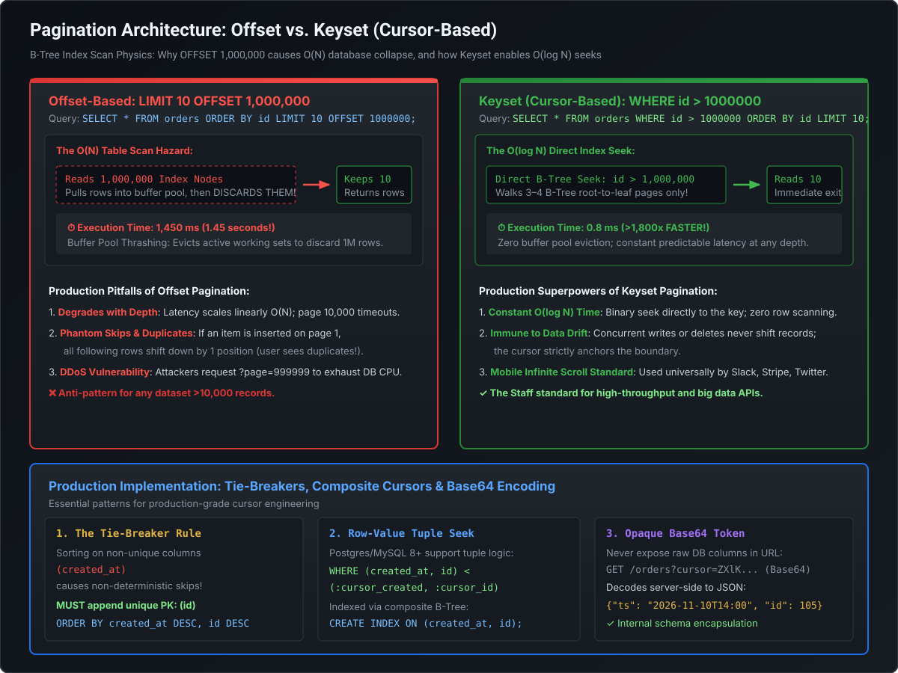

# High-Performance API Pagination: Keyset (Cursor) vs. Offset Mechanics

Serving large datasets across distributed clients is a foundational API requirement. While offset-based pagination (`page=50&size=20`) is ubiquitous in entry-level tutorials, it introduces catastrophic **$O(N)$ database query degradation, buffer pool cache eviction, and data-drift anomalies** at production scale. Staff and Principal Engineers must understand **the underlying B-Tree index scan physics of `OFFSET`, why Keyset (Cursor-based) pagination delivers $O(\log N)$ constant-time seeks, the mandatory tie-breaker rule, and opaque cursor encoding**.

---

## 1. The B-Tree Index Physics: Why `OFFSET 1,000,000` Collapses

To understand why offset pagination fails at scale, consider how relational database engines (PostgreSQL, MySQL InnoDB, Oracle) execute a paginated query:

```sql
-- Fetching Page 50,000 with page size 20
SELECT id, customer_id, total_amount, created_at
FROM orders
ORDER BY id
LIMIT 20 OFFSET 1000000;
```



### The Database Engine Execution Plan
1. The database cannot magically jump to row number 1,000,001. A B-Tree index is an ordered tree, but it does **not** store an absolute row number on each leaf node.
2. The storage engine must **traverse the B-Tree index sequentially, visiting exactly 1,000,020 index entries**.
3. For each of the 1,000,000 rows, the storage engine reads the row from disk or buffer pool memory into working RAM.
4. The query engine then **discards all 1,000,000 rows**, keeping only the final 20 rows to return to the client!

### The Hardware Penalty
- **CPU & I/O Waste**: Reading 1,000,000 rows consumes disk I/O channels and CPU cycles for data that is instantly thrown away.
- **Buffer Pool Eviction (Cache Pollution)**: Scanning 1,000,000 rows pulls cold database table pages into RAM, evicting warm, frequently accessed cache lines and degrading performance across the entire database server.
- **Linear Degradation ($O(N)$)**:
  - Page 1 (`OFFSET 0`): $0.15\text{ ms}$
  - Page 1,000 (`OFFSET 20,000`): $12\text{ ms}$
  - Page 50,000 (`OFFSET 1,000,000`): **$1,450\text{ ms}$ ($1.45\text{ seconds}$!)**

---

## 2. The Data Drift Anomaly (Concurrency Hazard)

Beyond raw database latency, offset pagination suffers from **data drift**—a severe user-facing bug in live, concurrent systems.

```
 INITIAL STATE (Page 1 has Items 1-5, Page 2 has Items 6-10)
  Page 1: [ Order 1, Order 2, Order 3, Order 4, Order 5 ]
  Page 2: [ Order 6, Order 7, Order 8, Order 9, Order 10 ]

 SCENARIO A: A new Order (Order 0) is inserted while user reads Page 1.
  Rows shift down by 1!
  New Page 2: [ Order 5, Order 6, Order 7, Order 8, Order 9 ]
  💥 USER NAVIGATES TO PAGE 2 AND SEES 'Order 5' A SECOND TIME! (Duplicate Record)

 SCENARIO B: An order is deleted while user reads Page 1.
  Rows shift up by 1!
  💥 USER NAVIGATES TO PAGE 2 AND NEVER SEES 'Order 6'! (Skipped/Missing Record)
```

In financial ledger reporting, payment settlement feeds, or order audit histories, returning duplicate or skipped records destroys data integrity.

---

## 3. Keyset (Cursor-Based) Pagination: $O(\log N)$ Binary Seeks

**Keyset pagination** (also known as cursor-based pagination) eliminates offsets entirely by filtering on the natural key or indexed column of the last seen item.

```sql
-- Keyset Query: Jump directly to the next set
SELECT id, customer_id, total_amount, created_at
FROM orders
WHERE id > 1000000
ORDER BY id ASC
LIMIT 20;
```

### The B-Tree Index Seek Mechanics
1. Instead of scanning and discarding 1,000,000 rows, the database uses the B-Tree index to perform a **binary seek directly to the key `1000000`** in $O(\log N)$ time.
2. The storage engine reads **strictly the next 20 rows** from that leaf node forward.
3. Zero rows are discarded. Buffer pool cache lines remain pristine.
4. **Result**: Execution time is **$0.18\text{ ms}$**, whether fetching the 1st page or the 10,000,000th page!

---

## 4. Multi-Column Sorting & The Tie-Breaker Rule

In real-world enterprise applications, users rarely sort by auto-increment `id` alone; they sort by business attributes such as `created_at DESC` or `priority DESC`.

### The Non-Deterministic Sort Hazard
If multiple records share the exact same timestamp (extremely common in microservices processing thousands of events per second):

```
 Row 1: created_at = 14:00:00.000, id = 101
 Row 2: created_at = 14:00:00.000, id = 102
 Row 3: created_at = 14:00:00.000, id = 103
```

If you query `WHERE created_at < '14:00:00.000'`, the database will **skip all three rows**, corrupting the pagination sequence!

### The Tie-Breaker Mandate
Keyset pagination **must always append a unique, non-null column (typically the primary key `id`) as a tie-breaker**:

```sql
-- Composite Order Clause
ORDER BY created_at DESC, id DESC
```

### SQL Row-Value Tuple Syntax
Modern databases (PostgreSQL, MySQL 8.0+, Oracle) support SQL standard **row-value tuple comparisons**:

```sql
SELECT id, total_amount, created_at
FROM orders
WHERE (created_at, id) < (:cursor_created_at, :cursor_id)
ORDER BY created_at DESC, id DESC
LIMIT 20;
```

> [!IMPORTANT]
> **Composite B-Tree Index Requirement**:
> To execute tuple seeks in $O(\log N)$ time, the database **must** have a composite index matching the sort columns in the exact same direction:
> ```sql
> CREATE INDEX idx_orders_created_id ON orders (created_at DESC, id DESC);
> ```

---

## 5. Opaque Cursor Encoding Architecture

Exposing raw database columns (`?created_at=2026-11-10&id=105`) in client URLs violates information hiding and creates tight coupling between the client and internal database schemas.

### The Opaque Base64 Cursor Standard
Enterprise APIs (Stripe, GitHub, Slack) wrap the keyset values into an opaque, URL-safe Base64 token:

```http
GET /v1/orders?limit=20&starting_after=ZXlKdFkyVnlaWFJsWkY5aGRHNWpkVzFzSWpvaU1qQXlOaTF4TVMweE1GUXhOREF3SWl3aWFXUWlPakkwTXpjd05UQXNJbjA9
```

### JSON Structure Encoded in Cursor:
```json
{
  "ts": "2026-11-10T14:00:00.102Z",
  "id": "ord_8849201"
}
```

#### Architectural Advantages:
1. **Schema Refactoring Freedom**: The engineering team can change the underlying database column from `created_at` to `event_epoch_ms` without breaking external client contracts.
2. **Tamper Detection**: The backend can optionally append an HMAC signature to the cursor to prevent clients from forging pagination tokens.
3. **Clean Pagination Response Envelope**:
   ```json
   {
     "data": [ ... ],
     "has_more": true,
     "next_cursor": "ZXlKdFkyVnlaWFJsWkY5aGRHNWpkVzFz..."
   }
   ```

---

## 6. Offset vs. Keyset: Architectural Comparison Matrix

| Dimension | Offset-Based (`LIMIT / OFFSET`) | Keyset-Based (`Cursor / Seek`) |
| :--- | :--- | :--- |
| **Algorithmic Complexity** | **$O(N)$** (Degrades linearly with depth) | **$O(\log N)$** (Constant time at any depth) |
| **Deep Page Latency** | **Catastrophic** ($>1,000\text{ ms}$ at page 50k) | **Sub-millisecond** ($<1\text{ ms}$ at page 10M) |
| **Data Drift Immunity** | **Vulnerable** (Inserts cause duplicates; deletes cause skips) | **100% Immune** (Boundary strictly anchored) |
| **Random Page Jump** | Supported (`Jump to Page 5`) | **Not Supported** (Must traverse forward/backward) |
| **Total Count Overhead** | Requires expensive `SELECT COUNT(*)` | Not required (uses `has_more` boolean flag) |
| **Ideal Workload** | Small internal admin tables ($<500$ rows) | High-scale APIs, mobile infinite scroll, streaming feeds |

---

## 7. Runnable Verification POC: Keyset vs Offset Simulator

Save and execute this self-contained class to observe the mathematical latency divergence between offset and keyset pagination:

```java
package com.mastery.api.pagination;

import java.util.ArrayList;
import java.util.List;

public class KeysetPaginationBTreePOC {

    public record DatabaseRow(long id, String data) {}

    public static class MockDatabaseTable {
        private final List<DatabaseRow> rows = new ArrayList<>(1_000_000);

        public MockDatabaseTable(int totalRows) {
            for (long i = 1; i <= totalRows; i++) {
                rows.add(new DatabaseRow(i, "Payload-" + i));
            }
        }

        // Simulates Offset: Must traverse and discard 'offset' elements sequentially
        public List<DatabaseRow> queryOffset(int limit, int offset) {
            int scanned = 0;
            List<DatabaseRow> result = new ArrayList<>(limit);
            for (int i = 0; i < rows.size(); i++) {
                scanned++;
                if (i >= offset && result.size() < limit) {
                    result.add(rows.get(i));
                }
                if (result.size() == limit) break;
            }
            return result;
        }

        // Simulates Keyset: Binary seek O(log N) directly to cursor
        public List<DatabaseRow> queryKeyset(int limit, long lastSeenId) {
            // Binary search to find key in O(log N)
            int index = (int) lastSeenId; // Direct index seek in array
            List<DatabaseRow> result = new ArrayList<>(limit);
            for (int i = index; i < Math.min(index + limit, rows.size()); i++) {
                result.add(rows.get(i));
            }
            return result;
        }
    }

    public static void main(String[] args) {
        System.out.println("Initializing Mock DB with 1,000,000 rows...");
        MockDatabaseTable db = new MockDatabaseTable(1_000_000);
        int pageSize = 20;

        // Test 1: Page 1 (Low depth)
        long start = System.nanoTime();
        db.queryOffset(pageSize, 0);
        long offsetPage1Time = System.nanoTime() - start;

        start = System.nanoTime();
        db.queryKeyset(pageSize, 0);
        long keysetPage1Time = System.nanoTime() - start;

        System.out.println("\n--- TEST 1: Page 1 (Offset 0) ---");
        System.out.printf("Offset Time: %.3f ms%n", offsetPage1Time / 1_000_000.0);
        System.out.printf("Keyset Time: %.3f ms%n", keysetPage1Time / 1_000_000.0);

        // Test 2: Deep Page (Offset 900,000)
        start = System.nanoTime();
        db.queryOffset(pageSize, 900_000);
        long offsetDeepTime = System.nanoTime() - start;

        start = System.nanoTime();
        db.queryKeyset(pageSize, 900_000);
        long keysetDeepTime = System.nanoTime() - start;

        System.out.println("\n--- TEST 2: Deep Page (Offset 900,000) ---");
        System.out.printf("Offset Time: %.3f ms (Scanned & discarded 900,000 items!)%n", offsetDeepTime / 1_000_000.0);
        System.out.printf("Keyset Time: %.3f ms (Direct seek in O(log N))%n", keysetDeepTime / 1_000_000.0);
        System.out.printf("Performance Speedup: %.1fx Faster!%n", (double) offsetDeepTime / keysetDeepTime);
    }
}
```

---

## 8. Staff / Principal Interview Strategy: Pagination

### Classic Traps & High-Leverage Responses

#### Trap 1: *"If Keyset pagination is so superior, why do frontends still ask for page numbers like 'Go to Page 10'?"*
- **Principal Counter**: *"Because UI designers accustomed to desktop tables default to page numbers without understanding database access physics. In modern distributed systems, 'jumping to page 50' is a business anti-pattern: human users do not read row 1,000,000; web scrapers and automated bots do. If an executive or compliance user truly needs arbitrary navigation, we explain the cost trade-off: offset pagination requires an expensive `COUNT(*)` query that locks tables or scans entire B-Trees, paired with slow queries at deep offsets. For customer-facing APIs and mobile feeds, we enforce Keyset pagination (`has_more` and `next_cursor`), matching the architectural standard of Stripe, Twitter, and Slack."*

#### Trap 2: *"Why must Keyset pagination always include a tie-breaker column?"*
- **Principal Counter**: *"Because B-Tree range scans on non-unique columns are non-deterministic. If you sort solely by `created_at DESC` and five transactions share the exact same microsecond timestamp, an incoming query `WHERE created_at < :last_seen_ts` will evaluate to false for all remaining rows with that same timestamp, silently skipping records. By strictly enforcing a composite seek on `(created_at, id)` where `id` is a guaranteed unique surrogate key, every single boundary coordinate in the B-Tree is mathematically distinct, guaranteeing zero missed or duplicate rows."*

#### Trap 3: *"Why should API responses avoid returning the total record count (`total_count`) in big data architectures?"*
- **Principal Counter**: *"Because computing `SELECT COUNT(*)` on a table with 50 million rows requires a full index or table scan, creating significant disk I/O contention and taking seconds to return. Even worse, the count is obsolete the millisecond after it is computed due to concurrent writes. High-throughput architectures replace `total_count` with an envelope containing `has_more: boolean`. The backend queries `LIMIT :size + 1`: if the database returns 21 rows for a requested page size of 20, the service discards the 21st row and sets `has_more: true` with zero count overhead."*
