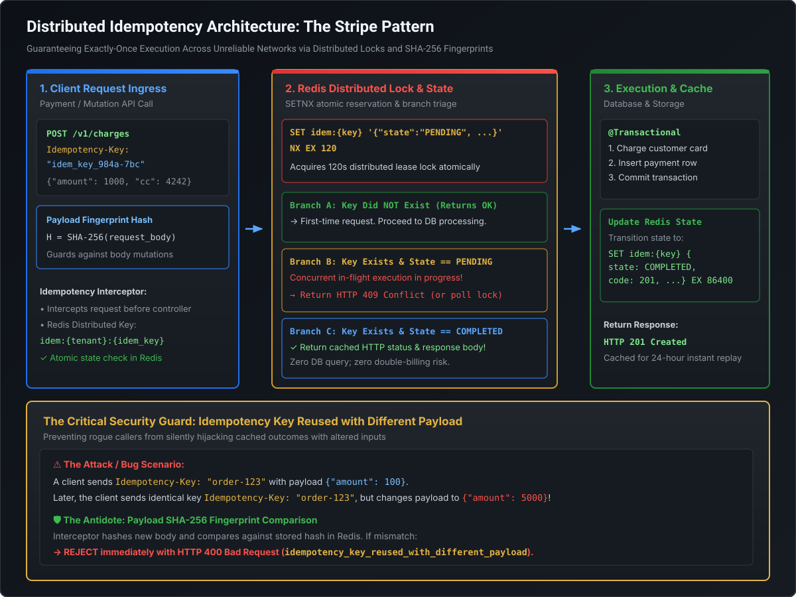

# Distributed Idempotency Pipelines, Safe Retries & API Versioning

In distributed financial rails, e-commerce checkouts, and microservice architectures, networks are inherently unreliable. Packets drop, TCP connections reset, and gateways time out. When a client encounters a network failure during a payment call, it must retry. Without **distributed idempotency guarantees, an automated retry will charge the customer a second time**. At the Staff and Principal Engineer level, you are expected to master **the Stripe-style distributed idempotency pipeline, SHA-256 payload fingerprinting, atomic Redis distributed locking, exponential backoff with jitter, and enterprise API versioning governance**.

---

## 1. The Distributed Idempotency Pipeline: The Stripe Architecture

An operation is **idempotent** if making $N$ identical requests produces the exact same server state and side-effects as making a single request:

$$f(f(x)) = f(x)$$

While HTTP `GET`, `PUT`, and `DELETE` are semantically idempotent by specification, `POST` is **non-idempotent**. To make `POST` mutations idempotent across distributed networks, we implement the **Idempotency-Key Architecture**:



### The 4-Phase Pipeline Execution Trace

#### Phase 1: Client Ingress & Fingerprinting
1. Client generates a unique `Idempotency-Key` (typically a UUID v4) and passes it in the HTTP header:
   ```http
   POST /v1/charges
   Idempotency-Key: 7b34f8a1-89ce-4a6c-901e-ef183c274da5
   Content-Type: application/json

   {"amount": 5000, "currency": "USD", "customer": "cus_99182"}
   ```
2. The API Gateway or Idempotency Filter computes a cryptographic SHA-256 hash of the request body:
   $$H = \text{SHA-256}(\text{Canonicalized JSON Request Body})$$

#### Phase 2: Distributed Lock & State Evaluation in Redis
The filter queries Redis for key `idempotency:7b34f8a1-89ce-4a6c-901e-ef183c274da5`:

- **Branch A (Key Exists & State == `COMPLETED`)**:
  - The request was already executed successfully in the past.
  - The filter extracts the cached HTTP status code and response payload from Redis.
  - It **short-circuits immediately**, returning the cached response directly to the client ($<1\text{ ms}$).
  - **Zero database queries, zero payment provider charges, zero downstream side-effects!**

- **Branch B (Key Exists & State == `PROCESSING`)**:
  - A previous request with this identical key is **currently executing** on another thread or pod.
  - The filter returns **`HTTP 409 Conflict`** (or halts and polls Redis with a 2-second timeout), preventing concurrent race conditions.

- **Branch C (Key Exists BUT Payload Fingerprint Mismatches)**:
  - If the incoming SHA-256 hash does not match the stored hash:
  - The client is attempting to reuse an existing idempotency key with different parameters!
  - Reject immediately with **`HTTP 400 Bad Request`**:
    `{"error": "idempotency_key_reused_with_different_payload"}`.

- **Branch D (Key Does NOT Exist - First Arrival)**:
  - Atomically acquire a distributed lock via Redis `SETNX`:
    ```redis
    SET idempotency:7b34f8a1... {"state":"PROCESSING","hash":"H..."} NX EX 120
    ```
  - Lock TTL (e.g. 120 seconds) prevents permanent deadlocks if the server container crashes mid-execution.

#### Phase 3: Transactional Execution
The request enters the application layer and executes business logic inside a database transaction (`@Transactional`).

#### Phase 4: Atomic State Transition & Long-Term Caching
Upon transaction commit, the filter updates Redis:
```redis
SET idempotency:7b34f8a1... {"state":"COMPLETED","status":201,"body":"{...}"} EX 86400
```
- Sets a **24-hour TTL (86,400 seconds)**, allowing the client to safely replay retries throughout the business day.
- Returns `HTTP 201 Created` to the client.

---

## 2. Safe Retries, Deduplication & Exponential Backoff with Jitter

When a network failure occurs, how should the client retry?

### The 3 Failure Scenarios

```
 Scenario 1: Request dropped BEFORE reaching server ──────► Safe to retry (Zero server execution)
 Scenario 2: Server crashes DURING execution ─────────────► DB Transaction rolls back; safe to retry
 Scenario 3: Execution SUCCEEDS, but Response dropped! ───► 💥 CATASTROPHE WITHOUT IDEMPOTENCY!
                                                            (Customer is charged on initial call;
                                                             retry charges customer a second time!)
```

### The Mathematics of Exponential Backoff with Jitter
If 10,000 mobile clients encounter a temporary 2-second gateway timeout and all retry at exact fixed intervals (e.g. every 1 second), they form a **synchronized thundering herd**, crashing the recovering service repeatedly.

The production standard (developed by AWS Architecture) is **Exponential Backoff with Full Jitter**:

$$T_{\text{sleep}} = \text{random}(0, \min(T_{\max}, T_{\text{base}} \times 2^{\text{attempt}}))$$

```java
public class BackoffUtil {
    private static final long BASE_MS = 200;
    private static final long MAX_MS = 10_000;

    public static long calculateSleepWithFullJitter(int attempt) {
        long exponentialBackoff = Math.min(MAX_MS, BASE_MS * (1L << attempt));
        return ThreadLocalRandom.current().nextLong(0, exponentialBackoff + 1);
    }
}
```
*Full Jitter* breaks synchronization across clients, spreading the retry distribution smoothly across the timeline.

---

## 3. Enterprise API Versioning Strategies

APIs evolve. How do you introduce breaking schema changes without breaking thousands of external clients?

```
                                  API Versioning Dimensions
                                              │
        ┌───────────────────────────┬─────────┴─────────────────┬───────────────────────────┐
        ▼                           ▼                           ▼                           ▼
    URI Path                  Custom Header             Accept Negotiation            Query Param
   /v1/orders              X-API-Version: 2            Accept: ...vnd.v2+json          /orders?v=2
  (Universal Std)         (Stripe Evolution)              (Strict REST)             (Anti-Pattern)
```

### Architectural Comparison Matrix

| Strategy | Syntax Example | Pros | Cons | Production Adopters |
| :--- | :--- | :--- | :--- | :--- |
| **URI Path** | `https://api.domain.com/v1/orders` | • 100% visible in browser & logs.<br>• Easiest to route at API Gateway (ALB, Nginx).<br>• Fully cacheable on CDNs. | • Blurs resource URI pureness.<br>• Heavy duplication across controllers. | **Universal Industry Standard** (Stripe, Twilio, Google, AWS) |
| **Custom Header** | `X-API-Version: 2026-11-01` | • Keeps URI path clean.<br>• Enables date-based micro-versioning. | • Invisible in browser URL bar.<br>• Requires `Vary: X-API-Version` on all caching proxies. | **Stripe Internal Architecture** |
| **Content Negotiation** | `Accept: application/vnd.company.v2+json` | • Strict academic REST compliance.<br>• Resource URI never changes. | • Difficult to test via browser.<br>• High routing complexity in gateways.<br>• CDN caching configuration overhead. | **GitHub API** |
| **Query Parameter** | `https://api.domain.com/orders?version=2` | • Easy to test ad-hoc in browser. | • Fragile routing.<br>• Prone to query-string pollution.<br>• Incompatible with clean URL routing. | **Anti-Pattern** |

### The Stripe Date-Based Versioning Architecture
Stripe uses a unique architectural pattern:
1. The core backend always executes on the **latest canonical domain model**.
2. When a client with an older version header (e.g. `Stripe-Version: 2019-05-16`) calls the API:
   - An **Inbound Request Transformer** cascades backward transformations, converting the legacy payload into the modern format.
   - The modern service processes the request.
   - An **Outbound Response Transformer** cascades forward transformations, shaping modern domain fields back into the legacy JSON schema.
3. This eliminates maintaining multiple parallel versions of microservice codebases!

---

## 4. Runnable Verification POC: Stripe Idempotency Pipeline

Save and execute this self-contained class to observe how the idempotency engine handles duplicate retries and catches payload tampering:

```java
package com.mastery.api.idempotency;

import java.nio.charset.StandardCharsets;
import java.security.MessageDigest;
import java.security.NoSuchAlgorithmException;
import java.util.HexFormat;
import java.util.Map;
import java.util.concurrent.ConcurrentHashMap;

public class StripeIdempotencyPipelinePOC {

    public enum State { PROCESSING, COMPLETED }

    public record CachedResponse(int statusCode, String payload) {}
    public record IdempotencyRecord(State state, String payloadHash, CachedResponse response) {}

    // Simulated Distributed In-Memory Storage (Representing Redis)
    public static class MockRedisStorage {
        private final Map<String, IdempotencyRecord> store = new ConcurrentHashMap<>();

        public synchronized IdempotencyRecord get(String key) {
            return store.get(key);
        }

        public synchronized boolean setnx(String key, String payloadHash) {
            if (store.containsKey(key)) {
                return false; // Lock already held or key exists
            }
            store.put(key, new IdempotencyRecord(State.PROCESSING, payloadHash, null));
            return true;
        }

        public synchronized void complete(String key, String payloadHash, CachedResponse response) {
            store.put(key, new IdempotencyRecord(State.COMPLETED, payloadHash, response));
        }
    }

    // Idempotency Filter
    public static class IdempotencyEngine {
        private final MockRedisStorage redis = new MockRedisStorage();

        public String processCharge(String idempotencyKey, String jsonPayload) {
            String hash = computeSha256(jsonPayload);

            IdempotencyRecord existing = redis.get(idempotencyKey);
            if (existing != null) {
                // Check 1: Fingerprint validation
                if (!existing.payloadHash().equals(hash)) {
                    return "HTTP 400 Bad Request: Idempotency-Key reused with different payload parameters!";
                }

                // Check 2: State evaluation
                if (existing.state() == State.PROCESSING) {
                    return "HTTP 409 Conflict: Concurrent request in flight. Please retry shortly.";
                }

                if (existing.state() == State.COMPLETED) {
                    return "HTTP 200 OK (REPLAY FROM CACHE - ZERO DB MUTATION): " + existing.response().payload();
                }
            }

            // Acquire Distributed Lock
            boolean locked = redis.setnx(idempotencyKey, hash);
            if (!locked) {
                return "HTTP 409 Conflict: Race condition detected. Another thread acquired lock.";
            }

            try {
                // Simulate Database Transaction & External Card Network Charge
                System.out.println("  >>> [Database & Card Network] CHARGING CUSTOMER CARD ($50.00)...");
                String responseBody = "{\"charge_id\": \"ch_99182\", \"status\": \"SUCCEEDED\", \"amount\": 5000}";

                // Update Redis to COMPLETED
                redis.complete(idempotencyKey, hash, new CachedResponse(201, responseBody));
                return "HTTP 201 Created (FRESH EXECUTION): " + responseBody;
            } catch (Exception e) {
                // Remove lock on failure
                return "HTTP 500 Internal Error";
            }
        }

        private String computeSha256(String input) {
            try {
                MessageDigest digest = MessageDigest.getInstance("SHA-256");
                byte[] hash = digest.digest(input.getBytes(StandardCharsets.UTF_8));
                return HexFormat.of().formatHex(hash);
            } catch (NoSuchAlgorithmException e) {
                throw new RuntimeException(e);
            }
        }
    }

    public static void main(String[] args) {
        IdempotencyEngine engine = new IdempotencyEngine();

        String idempotencyKey = "client-tx-uuid-7718";
        String validPayload = "{\"amount\": 5000, \"currency\": \"USD\"}";
        String tamperedPayload = "{\"amount\": 99999, \"currency\": \"USD\"}";

        System.out.println("=== 1. INITIAL REQUEST (FRESH EXECUTION) ===");
        String resp1 = engine.processCharge(idempotencyKey, validPayload);
        System.out.println("Result: " + resp1);

        System.out.println("\n=== 2. RETRY IDENTICAL REQUEST (NETWORK TIMEOUT SIMULATION) ===");
        String resp2 = engine.processCharge(idempotencyKey, validPayload);
        System.out.println("Result: " + resp2);

        System.out.println("\n=== 3. TAMPERED PAYLOAD (SAME KEY, DIFFERENT BODY) ===");
        String resp3 = engine.processCharge(idempotencyKey, tamperedPayload);
        System.out.println("Result: " + resp3);
    }
}
```

---

## 5. Staff / Principal Interview Strategy: Idempotency & Versioning

### Classic Traps & High-Leverage Responses

#### Trap 1: *"Why is checking an `Idempotency-Key` in the database table via a unique constraint insufficient for high-scale distributed systems?"*
- **Principal Counter**: *"A database unique constraint only catches duplicate primary keys at SQL `INSERT` time. It fails in three critical areas: First, latency—every duplicate request traverses the entire network stack, connects to the database, and forces a row lock attempt before throwing a constraint violation. Second, response replay—a DB unique constraint rejects the second request with a SQL error, but it does not cache or replay the original HTTP response body (e.g. `201 Created` with charge token), forcing clients to write complex exception-recovery logic. Third, request in-flight collisions—two concurrent requests hitting the database simultaneously can cause deadlock exceptions. Storing state in Redis with `SETNX` acts as a fast ($<1\text{ ms}$) distributed lock that protects downstream databases while caching the full HTTP response for deterministic replay."*

#### Trap 2: *"What happens if the service crashes after charging a customer's credit card but BEFORE updating the Redis idempotency key to `COMPLETED`?"*
- **Principal Counter**: *"This is the classic dual-write distributed boundary problem. To guarantee consistency: First, the initial Redis lock must have an expiration TTL (e.g. 120 seconds) so the key does not remain locked forever in `PROCESSING`. Second, the internal business database must store the `idempotency_key` and transaction state inside the **same atomic database transaction** that records the charge. If the server crashes before updating Redis, the client retries after the lock TTL expires; the service checks the primary database, discovers that the charge already committed, populates Redis retroactively, and returns the successful charge response without recharging the card."*

#### Trap 3: *"Why does URI path versioning (`/v1/` vs `/v2/`) remain the industry standard despite breaking pure REST principles?"*
- **Principal Counter**: *"Because software architecture is about optimizing the entire delivery lifecycle, not just academic protocol purity. URI path versioning provides unambiguous, zero-ambiguity routing for API Gateways, Kubernetes Ingresses, AWS Application Load Balancers, and CDNs. Caching proxies can effortlessly cache `/v1/` and `/v2/` assets independently without requiring complex `Vary: Accept` header inspection. For client developers, `/v1/` is immediately visible in browser URLs, Postman, and server access logs. While header and content-negotiation versioning look elegant on paper, they introduce high cognitive overhead and caching landmines in real-world production networks."*
