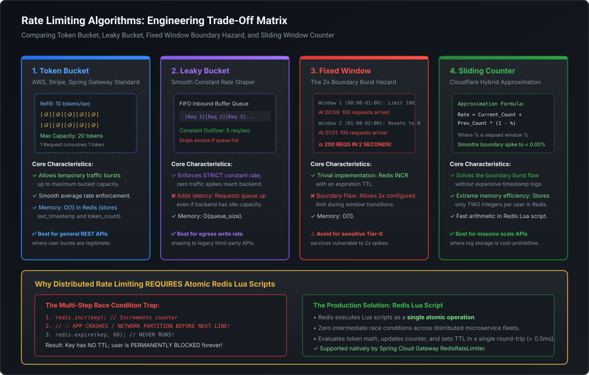

# High-Throughput Rate Limiting Algorithms & Distributed Redis Lua Scripts

Rate limiting is the first line of defense for public APIs and distributed microservices. It protects downstream databases from cascading collapse, prevents denial-of-service (DoS) resource exhaustion, enforces multi-tenant SLA monetization tiers, and smooths out bursty traffic profiles. At the Staff and Principal Engineer level, you must master **the mathematical trade-offs across all 5 rate-limiting algorithms, atomic Redis Lua script execution, boundary burst prevention, and fail-open vs. fail-closed cluster failover mechanics**.

---

## 1. The 5 Core Rate Limiting Algorithms

Every rate limiter makes an engineering compromise between **burst accommodation, memory footprint, compute overhead, and strict rate smoothing**:

[](images/rate_limiting_algorithms_comparison.svg)

### Algorithm Comparison Matrix

| Algorithm | Accommodates Bursts? | Enforces Smooth Rate? | Memory Complexity | Concurrency Hazard | Ideal Production Use Case |
| :--- | :--- | :--- | :--- | :--- | :--- |
| **Token Bucket** | **YES** (Up to capacity) | Average rate | **$O(1)$** (2 numbers) | Race condition on update | **General REST APIs** (AWS, Stripe, Spring Gateway) |
| **Leaky Bucket** | **NO** (Strictly smoothed) | **YES** (Constant outflow) | **$O(\text{Queue Size})$** | Queue overflow drops packets | **Egress write shaping** to third-party partner APIs |
| **Fixed Window** | **YES** ($2\times$ burst flaw) | **NO** (Spiky at edges) | **$O(1)$** (1 counter) | Double-rate boundary spike | Low-criticality internal scripts, basic tiering |
| **Sliding Log** | **NO** | **YES** (Strict sliding) | **$O(M)$** (Unbounded log) | High RAM consumption in Redis | Low-volume, ultra-strict compliance operations |
| **Sliding Counter**| **YES** (Controlled) | **YES** (Smoothed) | **$O(1)$** (2 integers) | None (Atomic Lua math) | **Massive-scale APIs** (Cloudflare, Akamai edge) |

---

## 2. In-Depth Algorithm Mechanics

### 1. Token Bucket
- **Concept**: A bucket has a maximum capacity $B$. Tokens are added continuously at a constant refill rate $R$ (tokens per second).
- **Execution**: When a request arrives, it checks if at least 1 token is available. If yes, it decrements the token count and proceeds; if no, the request is rejected with `HTTP 429 Too Many Requests`.
- **Why It Shines**: Allows legitimate user bursts (e.g. loading a dashboard that fires 15 concurrent REST calls) while guaranteeing that the long-term consumption never exceeds $R$.
- **Storage**: In Redis, you only store two values: `tokens` (floating point) and `last_updated_timestamp`.

### 2. Leaky Bucket
- **Concept**: A bucket is implemented as a FIFO queue with a maximum capacity $C$. Inbound requests enter the queue. The queue drains (dispatches to backend) at a **strictly constant outflow rate**.
- **Execution**: If requests arrive faster than the drain rate, the queue fills. If a request arrives when the queue is full, it is dropped immediately.
- **Why It Shines**: Ideal when downstream databases cannot handle bursts (e.g. legacy banking mainframes that crash if hit with $>50$ concurrent requests).

### 3. Fixed Window Counter (The $2\times$ Boundary Burst Flaw)
- **Concept**: Time is sliced into fixed windows (e.g. 1 minute: 12:00:00 to 12:01:00). A counter increments per request. If counter $> \text{Limit}$, reject.
- **The Fatal Flaw**:
  - Limit: 100 requests per minute.
  - At 12:00:59, client sends 100 requests (Permitted!).
  - At 12:01:00, the window resets.
  - At 12:01:01, client sends another 100 requests (Permitted!).
  - **Result**: The server receives **200 requests in 2 seconds**—twice the configured capacity!

### 4. Sliding Window Counter (Cloudflare Hybrid Approximation)
To eliminate the boundary burst flaw without storing expensive timestamp logs in Redis, Cloudflare popularized the **Sliding Window Counter**:

$$\text{Current Rate} = \text{Count}_{\text{current}} + \text{Count}_{\text{previous}} \times \left(1 - \frac{\text{Elapsed Time in Current Window}}{\text{Window Size}}\right)$$

#### Numerical Walkthrough:
- Rate Limit: 100 requests per minute.
- Previous Window (12:00–12:01): 80 requests recorded.
- Current Window (12:01–12:02): 30 requests recorded so far.
- Current Timestamp is 12:01:15 (15 seconds into the 60-second window: $\frac{15}{60} = 25\%$ elapsed, meaning $75\%$ of the previous window still overlaps).
- Estimated Requests:
  $$30 + 80 \times (1 - 0.25) = 30 + 80 \times 0.75 = 30 + 60 = \mathbf{90 \text{ requests}}$$
- Since $90 < 100$, the request is permitted!
- **Storage**: Requires storing only **two integer counters** per user in Redis, offering $O(1)$ memory with an error rate of less than $0.05\%$.

---

## 3. Distributed Rate Limiting via Atomic Redis Lua Scripts

Executing rate limiting across distributed microservices requires atomic operations.

### The Race Condition of `INCR` + `EXPIRE`
```java
// ❌ PRODUCTION TRAP: Non-atomic multi-command execution
Long current = redis.incr(userKey);
if (current == 1) {
    // 💥 CRASH OR PARTITION OCCURS HERE!
    redis.expire(userKey, 60); // NEVER EXECUTES!
}
```
If the container crashes between `INCR` and `EXPIRE`, the key is created without a TTL. The counter increments forever, permanently locking out the customer!

### Production Redis Lua Script: Token Bucket Algorithm
Redis executes Lua scripts as a **single, uninterruptible atomic transaction**, guaranteeing zero race conditions across thousands of concurrent pods:

```lua
-- KEYS[1]: Token Bucket Key (e.g. rate:user:101)
-- ARGV[1]: Max Capacity
-- ARGV[2]: Refill Rate (tokens/sec)
-- ARGV[3]: Current Timestamp (epoch seconds)
-- ARGV[4]: Requested Tokens (usually 1)

local key = KEYS[1]
local capacity = tonumber(ARGV[1])
local refill_rate = tonumber(ARGV[2])
local now = tonumber(ARGV[3])
local requested = tonumber(ARGV[4])

-- Retrieve current state
local data = redis.call("HMGET", key, "tokens", "last_updated")
local tokens = tonumber(data[1])
local last_updated = tonumber(data[2])

if not tokens then
    -- First arrival: initialize full bucket
    tokens = capacity
    last_updated = now
else
    -- Calculate replenished tokens based on elapsed time
    local elapsed = math.max(0, now - last_updated)
    tokens = math.min(capacity, tokens + (elapsed * refill_rate))
    last_updated = now
end

if tokens >= requested then
    -- Consume token and update Redis
    tokens = tokens - requested
    redis.call("HMSET", key, "tokens", tokens, "last_updated", last_updated)
    redis.call("EXPIRE", key, math.ceil(capacity / refill_rate) * 2)
    return {1, math.floor(tokens)} -- [Allowed = true, Remaining Tokens]
else
    -- Reject request
    return {0, math.floor(tokens)} -- [Allowed = false, Remaining Tokens]
end
```

---

## 4. Resilience & Redis Cluster Failover: Fail-Open vs. Fail-Closed

What happens when Redis experiences network latency spikes, node restarts, or network partitions?

```
                      Is Redis Cluster Reachable?
                                   │
                 ┌─────────────────┴─────────────────┐
                 ▼                                   ▼
          Fail-Open Policy                    Fail-Closed Policy
      (Allow traffic through)             (Reject traffic HTTP 429/503)
                 │                                   │
                 ▼                                   ▼
      Prioritizes AVAILABILITY            Prioritizes SECURITY
      Preferred for B2C & E-Commerce      Mandatory for Financial Banking / Auth
```

### The Staff Recommendation: Multi-Tiered Rate Limiting
1. **Tier 1 (In-Memory Local Filter via Bucket4j / Caffeine)**:
   - Evaluated inside the JVM process memory ($<0.01\text{ ms}$).
   - Filters extreme brute-force volumetric attacks before hitting Redis.
2. **Tier 2 (Distributed Redis Cluster)**:
   - Synchronizes global user quotas across all Kubernetes pods.
   - Guarded by a **Resilience4j Circuit Breaker**:
     - If Redis call takes $> 10\text{ ms}$ or fails, the circuit breaker opens.
     - Fallback policy activates: **Fail-Open with local fallback limit**, logging a high-priority alert without dropping valid customer transactions.

---

## 5. Runnable Verification POC: Sliding Window Counter

Save and execute this self-contained class simulating Cloudflare's Sliding Window Counter algorithm:

```java
package com.mastery.api.ratelimit;

import java.time.Instant;
import java.util.Map;
import java.util.concurrent.ConcurrentHashMap;

public class SlidingWindowCounterPOC {

    public static class SlidingWindowRateLimiter {
        private final int limit;
        private final long windowSizeSeconds;
        // Key -> Map of WindowStartEpoch -> Count
        private final Map<String, Map<Long, Integer>> storage = new ConcurrentHashMap<>();

        public SlidingWindowRateLimiter(int limit, long windowSizeSeconds) {
            this.limit = limit;
            this.windowSizeSeconds = windowSizeSeconds;
        }

        public synchronized boolean isAllowed(String clientId, Instant now) {
            long currentEpoch = now.getEpochSecond();
            long currentWindow = currentEpoch / windowSizeSeconds;
            long previousWindow = currentWindow - 1;

            storage.putIfAbsent(clientId, new ConcurrentHashMap<>());
            Map<Long, Integer> clientWindows = storage.get(clientId);

            int currentCount = clientWindows.getOrDefault(currentWindow, 0);
            int previousCount = clientWindows.getOrDefault(previousWindow, 0);

            // Calculate percentage of time elapsed in current window
            long timeIntoCurrentWindow = currentEpoch % windowSizeSeconds;
            double weight = 1.0 - ((double) timeIntoCurrentWindow / windowSizeSeconds);

            double estimatedRate = currentCount + (previousCount * weight);

            System.out.printf("  [Check @ %s] CurrCount=%d, PrevCount=%d, Weight=%.2f -> EstRate=%.2f / Limit=%d%n",
                now, currentCount, previousCount, weight, estimatedRate, limit);

            if (estimatedRate < limit) {
                clientWindows.put(currentWindow, currentCount + 1);
                return true;
            } else {
                return false; // Rate limit exceeded!
            }
        }
    }

    public static void main(String[] args) {
        System.out.println("=== SIMULATING SLIDING WINDOW COUNTER (Limit: 5 req / 10s) ===");
        SlidingWindowRateLimiter limiter = new SlidingWindowRateLimiter(5, 10);
        String client = "merchant_user_99";

        Instant baseTime = Instant.parse("2026-11-10T14:00:00Z");

        // Window 1: Send 4 requests at t = 8s
        System.out.println("\n--- Window 1 (t = 8s): Sending 4 requests ---");
        for (int i = 1; i <= 4; i++) {
            boolean allowed = limiter.isAllowed(client, baseTime.plusSeconds(8));
            System.out.println("  Request " + i + ": " + (allowed ? "ALLOWED" : "REJECTED (HTTP 429)"));
        }

        // Window 2: Send 3 requests at t = 12s (2s into Window 2)
        // With Fixed Window, all 3 would be allowed (4+3=7 in 4 seconds!).
        // Sliding Window will weight previous count and catch the burst!
        System.out.println("\n--- Window 2 (t = 12s): Sending 3 requests (2s after window reset) ---");
        for (int i = 1; i <= 3; i++) {
            boolean allowed = limiter.isAllowed(client, baseTime.plusSeconds(12));
            System.out.println("  Request " + i + ": " + (allowed ? "ALLOWED" : "REJECTED (HTTP 429)"));
        }
    }
}
```

---

## 6. Staff / Principal Interview Strategy: Rate Limiting

### Classic Traps & High-Leverage Responses

#### Trap 1: *"Why does the Fixed Window Counter algorithm permit twice the configured rate limit?"*
- **Principal Counter**: *"Because time is quantized into rigid boundaries. If a client configured for 100 requests per minute sends 100 requests during the final second of Window 1 ($t = 59\text{s}$), the counter resets to zero at $t = 60\text{s}$. If the client immediately sends another 100 requests at $t = 61\text{s}$, the fixed window algorithm permits all of them, resulting in **200 requests within a 2-second interval**. For sensitive backend services, this boundary burst can trigger CPU spikes and database pool exhaustion. The solution is using **Token Bucket** (which caps burst by capacity) or **Sliding Window Counter** (which smooths boundary spikes using weighted previous-window math)."*

#### Trap 2: *"Why should you use an atomic Redis Lua script instead of standard multi-threaded Java synchronization for rate limiting?"*
- **Principal Counter**: *"Because in-process Java locks (`synchronized`, `ReentrantLock`) protect only a single JVM process. Modern microservices run across tens or hundreds of horizontally scaled Kubernetes pods. If pod A and pod B handle requests for the same tenant concurrently, in-memory counters in Java cannot synchronize global quota consumption. Storing the rate state in Redis allows all pods to share a centralized counter. Furthermore, using a Lua script guarantees that checking the balance, replenishing tokens based on elapsed time, decrementing the counter, and setting the key TTL execute **as an atomic, single-hop transaction in Redis memory** ($<0.5\text{ ms}$), eliminating multi-pod race conditions without distributed lock contention."*

#### Trap 3: *"How do you rate-limit unauthenticated public endpoints without punishing corporate office users behind a shared NAT IP?"*
- **Principal Counter**: *"Rate-limiting solely by IP address is flawed because thousands of corporate employees or university students share the exact same outbound NAT gateway IP. Limiting by IP would cause one user's burst to lock out the entire company. To solve this on unauthenticated endpoints (e.g. login or public search), we construct a **composite client fingerprint**: we hash the Client IP + `User-Agent` + `Accept-Language` headers, combined with a lightweight frontend cryptographic proof-of-work token or invisible CAPTCHA (e.g. Cloudflare Turnstile). This isolates malicious bots while allowing legitimate shared-IP corporate users to operate unimpeded."*
