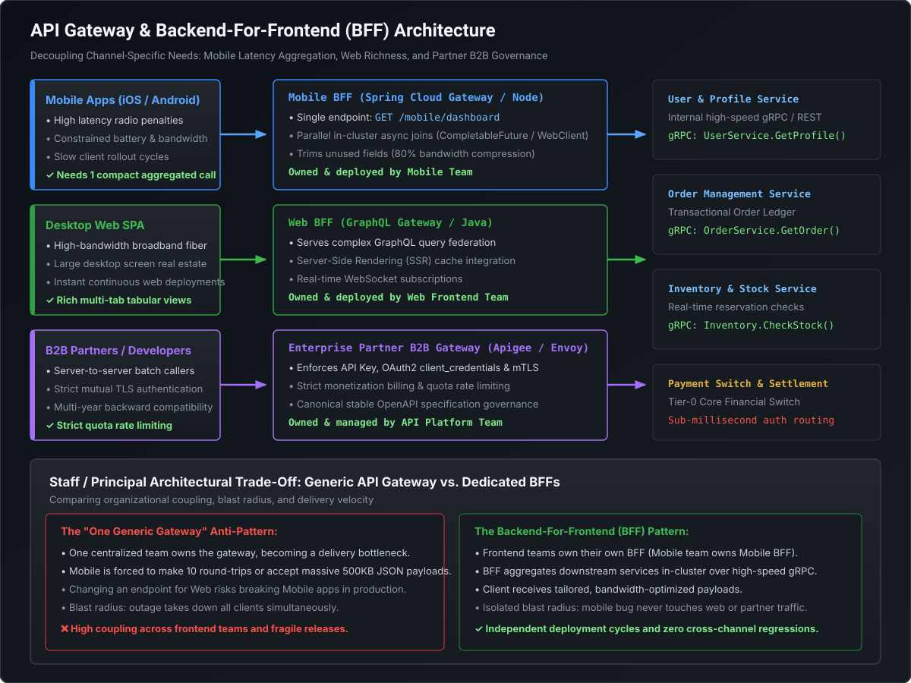

# API Gateway Patterns, Throttling & Backend-For-Frontend (BFF) Architecture

In modern cloud-native architectures, client applications never communicate directly with internal domain microservices. Exposing hundreds of microservices directly introduces security chaos, tight client-server coupling, network chattiness, and protocol mismatches. Instead, **an API Gateway acts as the single entry point, orchestrating cross-cutting concerns (authentication, rate limiting, SSL termination), providing client-specific Backend-For-Frontend (BFF) adapters, and enforcing graceful degradation under load**.

---

## 1. API Gateway Core Responsibilities

An API Gateway sits at the perimeter between the public internet and internal cluster networks:

```
 Internet (Clients)                      Perimeter Gateway                       Internal Cluster
 ─────────────────                      ─────────────────                       ────────────────
                                   ┌───────────────────────────┐
                                   │    Edge API Gateway       │
 HTTP/1.1 or HTTP/2                │ - SSL / TLS Termination   │            High-Speed Internal
 Inbound Requests  ───────────────►│ - Centralized JWT Auth    ├──────────► gRPC / HTTP/2 Calls
                                   │ - Rate Limiting & Quotas  │            to Microservices
                                   │ - Header Enrichment       │
                                   │ - Edge Circuit Breaking   │
                                   └───────────────────────────┘
```

### The 6 Core Cross-Cutting Functions
1. **SSL/TLS Termination**: Decrypts incoming HTTPS traffic at the edge, offloading expensive cryptographic handshakes from downstream microservices.
2. **Centralized Authentication & Token Introspection**: Validates incoming OAuth2 Bearer JWTs, checks signature against cached IdP JWK sets, and rejects unauthorized traffic before it enters the VPC.
3. **Header Enrichment & Context Injection**: Extracts claims from the validated JWT and injects trusted internal headers for downstream microservices:
   - `X-User-Id: user-88491`
   - `X-Tenant-Id: mastercard-us`
   - `X-User-Roles: ROLE_OPERATOR,ROLE_ADMIN`
   - Downstream microservices can trust these headers implicitly because the gateway strips any spoofed inbound client headers!
4. **Dynamic Request Routing & Path Rewriting**: Dispatches `/v1/orders/**` to the Order Service cluster and `/v1/payments/**` to the Payment Service cluster.
5. **Protocol Translation**: Accepts standard JSON/REST over HTTP/1.1 from web browsers and translates them into high-speed binary **gRPC over HTTP/2** for internal microservice communication.
6. **Edge Circuit Breaking & Fallback**: Sits in front of critical services to fail fast and return degraded fallback responses when downstreams experience outages.

---

## 2. Throttling Headers & Client Backpressure Contracts

When rate limiting traffic, the API Gateway must communicate transparent quota telemetry to clients via standardized HTTP headers.

### Standard Rate Limit Response Headers (IETF Draft Standard)

```http
HTTP/1.1 200 OK
Content-Type: application/json
X-RateLimit-Limit: 1000
X-RateLimit-Remaining: 42
X-RateLimit-Reset: 1731252000
```

1. **`X-RateLimit-Limit`**: The maximum number of requests permitted within the current window (e.g. 1,000 per hour).
2. **`X-RateLimit-Remaining`**: Number of remaining requests allowed before rejection. Client SDKs inspect this to voluntarily slow down traffic before hitting the ceiling.
3. **`X-RateLimit-Reset`**: Unix epoch timestamp (seconds) indicating exactly when the current rate-limit window resets.

### Handling the Rejection: `HTTP 429 Too Many Requests`
When the token bucket is empty, the gateway must return `HTTP 429` with an explicit **`Retry-After` header**:

```http
HTTP/1.1 429 Too Many Requests
Content-Type: application/problem+json
Retry-After: 30
X-RateLimit-Limit: 1000
X-RateLimit-Remaining: 0
X-RateLimit-Reset: 1731252030

{
  "type": "https://api.mastercard.com/errors/rate-limit-exceeded",
  "title": "API Rate Limit Exceeded",
  "status": 429,
  "detail": "Quota of 1,000 requests per minute exceeded for API Key 'key_live_998'. Please wait 30 seconds before retrying.",
  "instance": "/v1/payments/charges"
}
```

> [!IMPORTANT]
> **The `Retry-After` Header Contract**:
> `Retry-After: 30` instructs the client to sleep for exactly 30 seconds before retrying. Well-engineered client SDKs automatically inspect `Retry-After` to pause outbound dispatchers, preventing rogue loops from hammering the gateway while throttled.

---

## 3. The Backend-For-Frontend (BFF) Pattern

As organizations grow, client applications diverge in form factor, bandwidth constraints, and user experience requirements.

[](images/api_gateway_bff_architecture.svg)

### The Anti-Pattern: "The One Generic Gateway"
Early microservice adoptions deployed a single, monolithic API gateway shared by mobile apps, desktop web browsers, and third-party B2B partners.

#### Why It Fails in Production:
1. **The Over-Fetching vs. Chattiness Dilemma**:
   - Mobile phones on 4G networks suffer high round-trip latency. Loading a product page by making 7 separate REST calls over cellular radio drains battery and takes 3 seconds.
   - If the generic gateway provides an aggregated endpoint (`/product-details`), it includes all 80 fields required by the desktop web interface. The mobile app discards 85% of the data, wasting cellular bandwidth.
2. **Coupling and Deployment Blockers**:
   - The web team needs an updated field; changing the shared endpoint risks breaking legacy mobile apps running on older iOS/Android versions in the wild.
   - The gateway team becomes an organizational bottleneck for every frontend release.

### The BFF Solution: Channel-Specific Edge Gateways
Under the **Backend-For-Frontend (BFF)** pattern (pioneered by Sam Newman and SoundCloud), each client channel is served by its own lightweight, specialized gateway:

#### 1. Mobile BFF (iOS / Android)
- **Extreme Aggregation**: A single call (`GET /mobile/checkout-screen`) dispatches concurrent internal gRPC calls to User, Order, Inventory, and Payment services.
- **Payload Trimming**: Strips 80% of unused domain fields, reducing payload size from $120\text{ KB}$ down to $3.5\text{ KB}$.
- **Image Transcoding**: Dynamically transforms JPEG/PNG assets into compressed WebP format tailored to the client device screen DPI.

#### 2. Web SPA BFF (Desktop Browser)
- **Rich Analytics**: Supports massive data tables, multi-column sorting, pagination, and CSV exports.
- **Session Management**: Converts stateful browser `HttpOnly` secure cookies into internal Bearer JWT tokens for internal microservices.
- **Server-Side Rendering (SSR)**: Integrates directly with Next.js or Nuxt engines for SEO rendering.

#### 3. Partner B2B Public Gateway
- **Strict Monetization & Quotas**: Enforces strict tier-based rate limiting per API key.
- **mTLS & AppSec**: Requires Mutual TLS certificates and IP allow-listing.
- **Contract Governance**: Strict OpenAPI 3.0 schema compliance and backward-compatibility validation.

---

## 4. Edge Circuit Breakers & Graceful Degradation

If the internal Recommendation Service or Review Service experiences a crash loop, the API Gateway must prevent downstream latency from cascading to the client.

```
 Client Request: GET /v1/products/101
                     │
                     ▼
             [ API Gateway ]
                     │
     ┌───────────────┴───────────────┐
     ▼                               ▼
[ Product Core Service ]    [ Recommendations Service ]
Returns Product Data (10ms)  💥 Latency Spike! 5000ms Timeout!
     │                               │
     │                      [ Circuit Breaker TRIPS! ]
     │                      Executes Fallback Handler
     │                               │
     ▼                               ▼
 [ Combine Data ] ◄─────── [ Return Empty Recommendations List ]
     │
     ▼
 Return 200 OK to Mobile Client with Degraded Flag:
 {"product": {...}, "recommendations": [], "degraded": true}
```

### Architectural Antidote: Degraded Fallbacks
Rather than returning a blank screen or `HTTP 500 Internal Server Error`, the gateway gracefully degrades the response:
- **E-Commerce**: If the Personalization Service is down, return top 10 bestselling items from a local Redis cache.
- **Banking**: If the real-time FX currency converter is offline, use the last-known cached exchange rate from 1 hour ago and flag the response with `"exchangeRateEstimated": true`.

---

## 5. Runnable Verification POC: API Gateway BFF Aggregator

Save and execute this self-contained class simulating how a Mobile BFF aggregates multiple microservice calls and trims payloads:

```java
package com.mastery.api.gateway;

import java.util.List;
import java.util.concurrent.CompletableFuture;

public class ApiGatewayBffRoutingPOC {

    // Internal Microservice Responses (Full Enterprise Domain Models)
    public record UserProfile(String id, String name, String email, String ssn, String addressLine, String creditRating) {}
    public record OrderItem(String itemId, String title, double price, int stock, String manufacturerSecret) {}

    // Mobile BFF Tailored Response (Ultra-Compact: < 100 bytes)
    public record MobileCheckoutView(String customerName, int totalItems, double totalAmount, boolean eligibleForDiscount) {}

    // Simulated Internal Microservices
    public static class InternalMicroservices {
        public UserProfile fetchUserProfile(String userId) {
            // Internal call
            return new UserProfile(userId, "Ankit Seth", "ankit@mastery.com", "999-00-1111", "Pune, India", "EXCELLENT");
        }

        public List<OrderItem> fetchCartItems(String cartId) {
            // Internal call
            return List.of(
                new OrderItem("item-1", "Mechanical Keyboard", 120.00, 15, "MFG-INTERNAL-CODE-99"),
                new OrderItem("item-2", "USB-C Hub", 45.00, 4, "MFG-INTERNAL-CODE-44")
            );
        }
    }

    // The Mobile BFF Service
    public static class MobileBffGateway {
        private final InternalMicroservices services = new InternalMicroservices();

        public MobileCheckoutView getCheckoutScreen(String userId, String cartId) {
            long start = System.currentTimeMillis();

            // Execute concurrent asynchronous gRPC calls internally
            CompletableFuture<UserProfile> userFuture = CompletableFuture.supplyAsync(() ->
                services.fetchUserProfile(userId));

            CompletableFuture<List<OrderItem>> cartFuture = CompletableFuture.supplyAsync(() ->
                services.fetchCartItems(cartId));

            // Wait for both internal hops to complete
            CompletableFuture.allOf(userFuture, cartFuture).join();

            UserProfile user = userFuture.join();
            List<OrderItem> items = cartFuture.join();

            // Aggregation and Payload Trimming: Strip SSN, secrets, and raw addresses
            double total = items.stream().mapToDouble(OrderItem::price).sum();
            boolean discount = "EXCELLENT".equals(user.creditRating());

            System.out.printf("  [Mobile BFF] Aggregated 2 microservices in %d ms%n", System.currentTimeMillis() - start);
            return new MobileCheckoutView(user.name(), items.size(), total, discount);
        }
    }

    public static void main(String[] args) {
        System.out.println("=== EXECUTING MOBILE BACKEND-FOR-FRONTEND (BFF) ===");
        MobileBffGateway bff = new MobileBffGateway();

        MobileCheckoutView view = bff.getCheckoutScreen("usr-101", "cart-550");

        System.out.println("\nTransmitted Mobile Payload (Zero sensitive data, zero over-fetching):");
        System.out.printf("""
        {
          "customer": "%s",
          "itemsCount": %d,
          "totalToPay": $%.2f,
          "discountApplied": %b
        }
        %n""", view.customerName(), view.totalItems(), view.totalAmount(), view.eligibleForDiscount());
    }
}
```

---

## 6. Staff / Principal Interview Strategy: Gateway & BFF

### Classic Traps & High-Leverage Responses

#### Trap 1: *"Why should you avoid putting business logic inside an API Gateway?"*
- **Principal Counter**: *"Because putting business logic in an API Gateway violates the Single Responsibility Principle and creates a distributed monolith. When teams embed validation rules, data transformations, or complex pricing algorithms into the gateway, the gateway becomes tightly coupled to multiple domain teams, requiring continuous re-deployments and risking outages for unrelated routes. The API Gateway should strictly be an **infrastructure traffic router**: handling SSL termination, rate limiting, token authentication, and telemetry. Business logic belongs strictly inside domain microservices or specialized, frontend-owned BFF services."*

#### Trap 2: *"When does the Backend-For-Frontend (BFF) pattern become an operational liability?"*
- **Principal Counter**: *"When the team structure does not mirror the architecture (Conway's Law violation). If a central backend team is forced to maintain 4 different BFFs (Mobile BFF, Web BFF, Partner BFF, IoT BFF), they become overwhelmed by UI-specific change requests, creating severe delivery friction. The BFF pattern works effectively **only when the frontend team owns its respective BFF codebase** (e.g. the iOS/Android team writes the Mobile BFF). If team ownership cannot be distributed, or if client interfaces share identical payloads, a single unified gateway or a GraphQL aggregation layer is architecturally superior."*

#### Trap 3: *"How do you handle rate-limit backpressure when downstream microservices begin throttling the API Gateway?"*
- **Principal Counter**: *"Through layered backpressure propagation: The gateway must never buffer unlimited downstream requests in memory; doing so leads to out-of-memory crashes. When downstream services begin returning `HTTP 429` or latency breaches SLA thresholds, the gateway's **Resilience4j Circuit Breaker trips to `OPEN`**, failing fast immediately. Concurrently, the gateway injects `Retry-After` headers and returns `HTTP 429` to upstream clients, pushing the backpressure all the way to the edge of the network where client SDKs pause outbound dispatching."*
