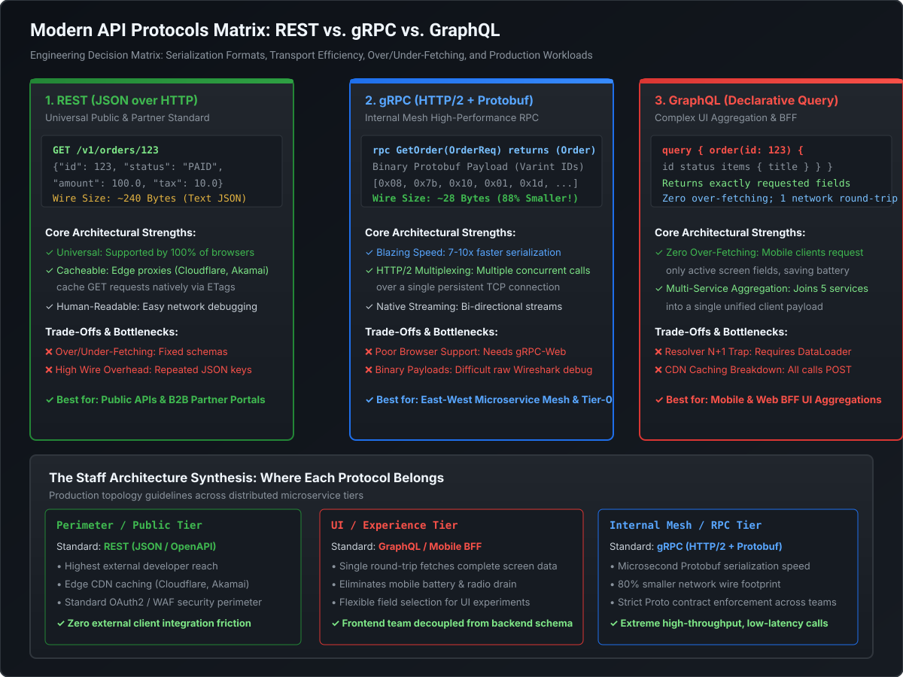

# Modern Protocols Matrix: REST vs. gRPC vs. GraphQL

## 1. High-Scale Protocol Architectural Matrix

In modern distributed systems, selecting a communication protocol is an architectural decision dictated by network topologies, latency budgets, payload characteristics, and consumer autonomy. The table below outlines the definitive trade-off matrix evaluated in Staff and Principal technical reviews:

| Dimension | REST (Representational State Transfer) | gRPC (Google Remote Procedure Call) | GraphQL |
| :--- | :--- | :--- | :--- |
| **Primary Transport** | HTTP/1.1 or HTTP/2 | HTTP/2 (Strict Requirement) | HTTP/1.1 or HTTP/2 |
| **Wire Serialization** | JSON, XML, Form-encoded (Textual) | Protocol Buffers (Binary Varint / TLV) | JSON (Textual over HTTP POST/GET) |
| **Network Efficiency** | Moderate to Low (Textual field keys repeated per message) | **Maximum** (~70–85% smaller payload than JSON) | High (Client selects only required fields, zero over-fetching) |
| **Serialization Overhead** | High (String parsing, reflection, heavy CPU allocation) | **Minimal** (Bit-shifting, zero-copy byte buffers, ~7–10x faster than JSON) | Moderate to High (AST parsing, field resolver tree execution, JSON serialization) |
| **Connection Model** | Request/Response; Keep-Alive pool; TCP HoL blocking | Persistent HTTP/2 multiplexed streams over a single TCP socket | Request/Response; WebSocket for subscriptions |
| **Communication Patterns** | Unary (Client-Initiated Request-Response) | Unary, Server-Streaming, Client-Streaming, Bidirectional Streaming | Request-Response (Queries/Mutations), Server-Push (Subscriptions) |
| **Contract Enforcement** | Optional / Advisory (OpenAPI / JSON Schema) | **Strict & Mandatory** (Proto3 `.proto` IDL compiler generates stubs) | **Strict & Mandatory** (GraphQL Schema Definition Language - SDL) |
| **HTTP Edge Caching** | **Native** (GET requests cached by CDNs, Varnish, reverse proxies via ETags & `Cache-Control`) | Complex / Non-standard (Custom application-level caching, no native HTTP proxy caching) | Poor out-of-the-box (Almost all queries use HTTP POST; requires Automated Persisted Queries - APQ) |
| **Browser Compatibility** | Universal (100% native in fetch, XHR, curl) | Requires `grpc-web` proxy (Envoy) due to missing browser HTTP/2 frame control | Universal (Standard HTTP POST/GET JSON) |
| **Load Balancing Topology** | Simple L4 / L7 proxies (HAProxy, AWS ALB, NGINX) | **Complex**: Requires L7 Stream-Aware LB (Envoy) or Client-Side LB; L4 proxies pin all traffic to one pod | Standard L7 proxies |
| **Primary Production Fit** | Public developer APIs, B2B partner gateways, simple CRUD | Internal microservice-to-microservice mesh, high-throughput RPCs, real-time telemetry streaming | Frontend-to-Backend aggregation (BFF), mobile apps with constrained bandwidth, multifaceted data graphs |

---

## 2. Architectural Blueprint

The following diagram illustrates where each protocol belongs across an enterprise tier topology, including serialization mechanics and transport boundaries:



---

## 3. gRPC & Protocol Buffers Internals

### 3.1 HTTP/2 Transport & Binary Framing

gRPC mandates HTTP/2 as its underlying transport layer. Unlike HTTP/1.1, which transmits plain-text messages delimited by CRLF (`\r\n`) and requires multiple TCP connections to achieve parallelism, HTTP/2 establishes a **single persistent TCP connection** between client and server, slicing data into discrete, binary-encoded frames.

```
+-------------------------------------------------------------------+
|                     Single TCP Connection                         |
|                                                                   |
| Stream 1: [HEADERS] -------> [DATA] ----------------> [DATA (EOS)]|
| Stream 3:         [HEADERS] --------> [DATA (EOS)]                |
| Stream 5: [HEADERS] --------------------------------> [DATA (EOS)]|
+-------------------------------------------------------------------+
```

#### Key HTTP/2 Frame Types in gRPC:
1. **`HEADERS` Frame**: Carries metadata, including path (e.g., `/:path = /orders.OrderService/GetOrder`), content-type (`application/grpc`), authorization tokens, and custom metadata.
2. **`DATA` Frame**: Contains the actual serialized Protobuf payload. The first 5 bytes represent the **gRPC Compression Flag** (1 byte: `0` for uncompressed, `1` for compressed) + **Message Length** (4 bytes, big-endian unsigned integer).
3. **`SETTINGS` Frame**: Negotiates connection parameters such as `SETTINGS_MAX_CONCURRENT_STREAMS` and `SETTINGS_INITIAL_WINDOW_SIZE` during the initial handshake.
4. **`WINDOW_UPDATE` Frame**: Implements hop-by-hop flow control at both the connection and individual stream levels, preventing a fast sender from exhausting the socket receive buffer of a slow receiver.
5. **`RST_STREAM` Frame**: Enables immediate cancellation of an active RPC stream without tearing down the underlying TCP connection.

#### Head-of-Line (HoL) Blocking: Application vs. Transport Layer
- **HTTP/1.1 HoL Blocking (Application Layer)**: If request A takes 500ms and request B takes 5ms, request B cannot be served over the same socket until request A completes. Pipelining failed in practice due to buggy intermediaries.
- **HTTP/2 Stream Multiplexing**: Eliminates application-layer HoL blocking by interleaving frames across multiple streams over a single TCP connection.
- **TCP HoL Blocking (Kernel / Transport Layer)**: If a single IP packet is lost in transit, the OS TCP receive window (`sk_receive_queue`) halts delivery of **all** multiplexed HTTP/2 streams to user space until the lost segment is retransmitted (TCP cumulative ACK). gRPC over HTTP/3 (QUIC / UDP) completely eliminates TCP HoL blocking by making packet loss isolation stream-native.

### 3.2 Protocol Buffers (Proto3) Wire Format: Bit-Level Mechanics

Protocol Buffers achieve radical wire-size reduction and microsecond serialization speeds by stripping field names entirely from the wire and encoding numbers using variable-length quantities (**Varints**) and Tag-Length-Value (**TLV**) records.

#### 1. Wire Types
Every encoded field on the wire begins with a **Key** header computed as:
$$\text{Key} = (\text{Field Number} \ll 3) \mid \text{Wire Type}$$

| Wire Type | Type ID | Meaning | Used For |
| :--- | :--- | :--- | :--- |
| **Varint** | `0` | Variable-length integer | `int32`, `int64`, `uint32`, `bool`, `enum`, `sint32`, `sint64` |
| **64-bit** | `1` | Fixed 8 bytes | `fixed64`, `sfixed64`, `double` |
| **Length-delimited** | `2` | Length varint followed by bytes | `string`, `bytes`, embedded sub-messages, packed repeated fields |
| **32-bit** | `5` | Fixed 4 bytes | `fixed32`, `sfixed32`, `float` |

#### 2. Varint Encoding Mechanics
A varint encodes integers using 1 to 10 bytes depending on magnitude. Each byte utilizes:
- **MSB (Most Significant Bit - Bit 7)**: Continuation flag (`1` = more bytes follow; `0` = last byte).
- **Lower 7 Bits**: The payload bits in little-endian order.

For example, encoding the integer `300`:
1. Binary: `00000001 00101100` (9 bits)
2. Slice into 7-bit groups: `0000010` and `0101100`
3. Reverse for little-endian: `0101100` followed by `0000010`
4. Set MSB:
   - First byte (more follow): `10101100` = `0xAC`
   - Second byte (last byte): `00000010` = `0x02`
5. Wire Output: `AC 02` (Only 2 bytes instead of 4-byte standard int32!).

#### 3. Why Tag Numbers Are Immutable
Because the wire only carries `(Field Number << 3 | Wire Type)`, changing a field number in a `.proto` file breaks backwards and forwards binary compatibility completely. The receiver interprets the payload using its compiled schema tag mappings:
- **Rule 1**: Never change the numeric tag of an existing field.
- **Rule 2**: If deprecating a field, mark it `reserved <tag_number>, <field_name>;` to prevent future engineers from reusing the slot.
- **Rule 3**: In Proto3, all scalar fields are optional by default. Unknown fields received by a modernized or older binary are preserved in an internal byte buffer (`UnknownFieldSet`) to prevent data loss across multi-hop forwarding proxies.

### 3.3 The 4 RPC Communication Models

```
1. Unary RPC:              Client -----[Request]-----> Server
                           Client <----[Response]----- Server

2. Server Streaming RPC:   Client -----[Request]-----> Server
                           Client <---[Stream Msg 1]-- Server
                           Client <---[Stream Msg 2]-- Server
                           Client <---[Stream Msg N]-- Server

3. Client Streaming RPC:   Client ----[Stream Msg 1]-> Server
                           Client ----[Stream Msg 2]-> Server
                           Client ----[Stream Msg N]-> Server
                           Client <----[Response]----- Server

4. Bidirectional RPC:      Client ----[Stream Msg 1]-> Server
                           Client <---[Stream Msg 1]-- Server
                           Client ----[Stream Msg 2]-> Server
                           Client <---[Stream Msg 2]-- Server
```

### 3.4 The gRPC Load Balancing Problem (L4 vs. L7)

A classic operational trap encountered by engineering teams transitioning from REST to gRPC is placing gRPC services behind standard Layer 4 (TCP) load balancers (such as AWS Network Load Balancer or TCP-mode HAProxy):

```
+-----------------------------------------------------------------------------------+
|                        THE gRPC L4 LOAD BALANCING FAILURE                         |
|                                                                                   |
| Client Pod 1 ---\ (Single TCP Socket)                                             |
| Client Pod 2 ----+=======> [ Layer 4 TCP LB ] =======> [ Service Instance A ]     |
| Client Pod 3 ---/                                       (100% Traffic - OOM!)     |
|                                                                                   |
|                                                        [ Service Instance B ]     |
|                                                         (0% Traffic - IDLE)       |
+-----------------------------------------------------------------------------------+
```

#### Why L4 Load Balancing Fails:
Because gRPC multiplexes thousands of RPC calls over a **single long-lived TCP connection**, an L4 load balancer only balances the *initial TCP three-way handshake*. Once established, all subsequent RPC calls from that client travel across the same socket to the same single backend pod. As new backend pods scale up during an autoscaling event, they receive zero traffic.

#### Production Solutions:
1. **L7 Proxy Load Balancing (Recommended for Service Mesh)**: Place an L7 reverse proxy (such as Envoy) between callers and services. Envoy parses HTTP/2 frames, decodes stream IDs, and round-robins individual streams across all active backend pods.
2. **Client-Side Load Balancing (High Performance / Low Latency)**: The gRPC client uses a Name Resolver (e.g., DNS or Consul/Eureka) to obtain the IP addresses of all healthy backend pods. The gRPC Channel maintains a subchannel pool to each backend pod and distributes RPC calls using a client-side picker (e.g., `RoundRobinLoadBalancer` or `PickFirstLoadBalancer`).
3. **Lookaside Load Balancing (xDS Control Plane)**: Clients query an external control plane (such as Istio or gRPC Traffic Director) using the xDS protocol. The control plane instructs the client which backends to connect to and provides real-time weights based on backend CPU and latency metrics.

---

## 4. GraphQL Architecture & Engineering Challenges

GraphQL provides a typed, graph-based query language that allows clients to declare the exact shape and fields of the data required. While this eliminates over-fetching and under-fetching on mobile networks, it introduces complex server-side performance and security challenges.

```
                  +-----------------------------------+
                  |        Client GraphQL Query       |
                  | query { order(id: 1) { items } }  |
                  +-----------------+-----------------+
                                    |
                                    v
                  +-----------------------------------+
                  |        1. Query Lexing & Parsing  |
                  | (String -> Abstract Syntax Tree)  |
                  +-----------------+-----------------+
                                    |
                                    v
                  +-----------------------------------+
                  |       2. Schema Validation        |
                  | (Validates types against SDL)     |
                  +-----------------+-----------------+
                                    |
                                    v
                  +-----------------------------------+
                  |     3. Field Execution Tree       |
                  | Resolvers executed asynchronously |
                  +-----------------------------------+
```

### 4.1 The GraphQL $N+1$ Query Trap

Consider a query fetching 50 orders along with the user who placed each order:

```graphql
query GetOrdersWithUsers {
  orders(limit: 50) {
    id
    totalAmount
    user {
      id
      name
      email
    }
  }
}
```

#### The Naive Resolver Execution Cascade:
1. The top-level resolver `Query.orders` executes **1 SQL query**:
   ```sql
   SELECT id, total_amount, user_id FROM orders LIMIT 50;
   ```
2. The GraphQL execution engine encounters the nested `user` field for each of the 50 order objects. It invokes the `Order.user` resolver 50 times:
   ```sql
   SELECT id, name, email FROM users WHERE id = 101;
   SELECT id, name, email FROM users WHERE id = 102;
   -- ... 48 more separate SQL queries!
   ```
3. Total database trips: $1 + 50 = 51$ queries. Under high concurrency, database connection pools are instantly depleted, causing thread starvation and high latency.

### 4.2 The Solution: Facebook DataLoader Pattern

The DataLoader pattern solves the $N+1$ problem by decoupling resolver invocations from actual data fetching via **Batching** and **Per-Request Caching**.

```
Resolver 1: load(101) ---\
Resolver 2: load(102) ----+==> [ DataLoader Buffer ] ==(Next Tick)==> SELECT * FROM users
Resolver 3: load(101) ---/     (Deduplicates to: [101, 102])          WHERE id IN (101, 102);
```

#### Mechanics of DataLoader:
1. **Deferred Promise / Future Queuing**: When `Order.user` is invoked, instead of issuing a database query immediately, it calls `userDataLoader.load(order.getUserId())`, which returns a deferred promise/future and places the ID in an in-memory batch queue.
2. **Event Loop Tick / Dispatch Phase**: In Java (via `java-dataloader` and Spring for GraphQL), DataLoader collects all keys requested during the execution of that specific level of the GraphQL AST. Once that AST breadth completes, it flushes the batch function:
   ```sql
   SELECT id, name, email FROM users WHERE id IN (101, 102, ...);
   ```
3. **Array Alignment Rule**: The batch loading function must return a list of values of the **exact same length and order** as the input list of keys. If a key has no corresponding record, `null` or an exception must be placed at that exact index.
4. **Per-Request Memoization**: DataLoader maintains an in-memory cache scoped strictly to the lifecycle of a single HTTP request. If 10 orders were placed by user `101`, `SELECT ... WHERE id = 101` is fetched exactly once, and all 10 resolvers resolve to the same memory reference.
   > [!CAUTION]
   > DataLoader caches must **never** be shared across multiple concurrent HTTP requests. Sharing DataLoader caches across requests causes catastrophic data leakage across tenants and violates authorization boundaries.

### 4.3 GraphQL Security Hardening in Production

Because GraphQL gives clients the freedom to compose arbitrary queries, open endpoints are vulnerable to denial-of-service (DoS) attacks and schema exploitation:

#### 1. Deep Recursive Query Attacks (Query Depth Limiting)
An attacker constructs a circular query exploiting graph relationships:
```graphql
query MaliciousDepthQuery {
  user(id: 1) {
    friends {
      friends {
        friends {
          friends {
            # ... 50 levels deep!
          }
        }
      }
    }
  }
}
```
*Defense*: Enforce a `MaxQueryDepthInstrumentation` filter that parses the incoming AST before execution. Reject any query where node depth exceeds the configured threshold (e.g., maximum depth $\le 7$).

#### 2. Query Complexity / Cost Analysis
Even a shallow query can exhaust database CPU through massive cartesian product expansions:
```graphql
query ExpensiveCartesianQuery {
  authors(limit: 1000) {
    books(limit: 1000) {
      reviews(limit: 1000) {
        comments(limit: 1000) { id }
      }
    }
  }
}
```
*Defense*: Assign a numeric cost to every field in the schema (e.g., scalar fields = 1 point; list relationships = 10 points $\times \text{limit}$). If the calculated total complexity score exceeds a hard ceiling (e.g., 500 points), reject the query with `HTTP 400 Bad Request` prior to resolver execution.

#### 3. Automatic Persisted Queries (APQ)
In enterprise production deployments, arbitrary ad-hoc GraphQL queries are banned from external clients.
- **Workflow**: During the frontend build/CI pipeline, all valid GraphQL queries are hashed (SHA-256) and registered with the API Gateway or GraphQL server.
- **Runtime**: The client sends only the query hash via standard `HTTP GET`:
  ```
  GET /graphql?extensions={"persistedQuery":{"sha256Hash":"ecf4ed52e4..."}}
  ```
- **Benefits**:
  1. Prevents attackers from sending unauthorized, unbounded queries.
  2. Reduces network bandwidth (32-byte hash instead of a 5KB query string).
  3. Restores native edge CDN caching (`HTTP GET` with Cache-Control headers).

---

## 5. Runnable Verification Suite

The following self-contained Java benchmark demonstrates the wire serialization footprint and CPU processing differential between JSON and binary Protobuf-style Varint encoding, followed by an in-memory simulation of the DataLoader batching mechanics solving the $N+1$ query trap:

```java
package com.engineering.mastery.protocols;

import java.io.ByteArrayOutputStream;
import java.io.IOException;
import java.nio.ByteBuffer;
import java.nio.charset.StandardCharsets;
import java.util.*;
import java.util.concurrent.*;
import java.util.concurrent.atomic.AtomicInteger;

/**
 * ProtocolSerializationBenchmarkPOC
 *
 * Demonstrates:
 * 1. Wire-size footprint comparison: Textual JSON vs. Binary Varint/TLV encoding.
 * 2. Serialization and deserialization performance differential.
 * 3. GraphQL N+1 Query Cascade vs. DataLoader Batching mechanics.
 */
public class ProtocolSerializationBenchmarkPOC {

    // =========================================================================
    // 1. Data Model
    // =========================================================================
    public record OrderRecord(long id, String status, double amount, long userId) {}
    public record UserRecord(long id, String name, String email) {}

    // =========================================================================
    // 2. Binary Protobuf-Style Varint & TLV Serializer
    // =========================================================================
    public static class ProtoEncoder {

        public static byte[] encodeVarint(long value) {
            ByteArrayOutputStream out = new ByteArrayOutputStream();
            while ((value & ~0x7FL) != 0) {
                out.write((int) ((value & 0x7F) | 0x80));
                value >>>= 7;
            }
            out.write((int) (value & 0x7F));
            return out.toByteArray();
        }

        public static long decodeVarint(ByteBuffer buffer) {
            long result = 0;
            int shift = 0;
            while (buffer.hasRemaining()) {
                byte b = buffer.get();
                result |= (long) (b & 0x7F) << shift;
                if ((b & 0x80) == 0) {
                    return result;
                }
                shift += 7;
            }
            throw new IllegalArgumentException("Malformed varint");
        }

        public static byte[] serializeOrder(OrderRecord order) throws IOException {
            ByteArrayOutputStream out = new ByteArrayOutputStream();

            // Field 1: int64 id (Wire type 0: Varint) -> Tag = (1 << 3) | 0 = 8
            out.write(encodeVarint((1 << 3) | 0));
            out.write(encodeVarint(order.id()));

            // Field 2: string status (Wire type 2: Length-delimited) -> Tag = (2 << 3) | 2 = 18
            byte[] statusBytes = order.status().getBytes(StandardCharsets.UTF_8);
            out.write(encodeVarint((2 << 3) | 2));
            out.write(encodeVarint(statusBytes.length));
            out.write(statusBytes);

            // Field 3: double amount (Wire type 1: 64-bit) -> Tag = (3 << 3) | 1 = 25
            out.write(encodeVarint((3 << 3) | 1));
            ByteBuffer doubleBuf = ByteBuffer.allocate(8);
            doubleBuf.putDouble(order.amount());
            out.write(doubleBuf.array());

            // Field 4: int64 userId (Wire type 0: Varint) -> Tag = (4 << 3) | 0 = 32
            out.write(encodeVarint((4 << 3) | 0));
            out.write(encodeVarint(order.userId()));

            return out.toByteArray();
        }

        public static OrderRecord deserializeOrder(byte[] data) {
            ByteBuffer buf = ByteBuffer.wrap(data);
            long id = 0;
            String status = null;
            double amount = 0.0;
            long userId = 0;

            while (buf.hasRemaining()) {
                long tag = decodeVarint(buf);
                int fieldNumber = (int) (tag >>> 3);
                int wireType = (int) (tag & 0x07);

                switch (fieldNumber) {
                    case 1 -> id = decodeVarint(buf);
                    case 2 -> {
                        int len = (int) decodeVarint(buf);
                        byte[] strBytes = new byte[len];
                        buf.get(strBytes);
                        status = new String(strBytes, StandardCharsets.UTF_8);
                    }
                    case 3 -> {
                        amount = buf.getDouble();
                    }
                    case 4 -> userId = decodeVarint(buf);
                    default -> throw new IllegalStateException("Unknown field tag: " + fieldNumber);
                }
            }
            return new OrderRecord(id, status, amount, userId);
        }
    }

    // =========================================================================
    // 3. Simulated DataLoader Engine
    // =========================================================================
    public static class MockDatabase {
        private final AtomicInteger queryCounter = new AtomicInteger(0);
        private final Map<Long, UserRecord> userTable = new ConcurrentHashMap<>();

        public MockDatabase() {
            for (long i = 1; i <= 200; i++) {
                userTable.put(i, new UserRecord(i, "User-" + i, "user" + i + "@enterprise.com"));
            }
        }

        public int getQueryCount() {
            return queryCounter.get();
        }

        public UserRecord findUserById(long id) {
            queryCounter.incrementAndGet();
            simulateLatency(2); // 2ms network roundtrip
            return userTable.get(id);
        }

        public List<UserRecord> findUsersByIds(Collection<Long> ids) {
            queryCounter.incrementAndGet();
            simulateLatency(3); // 3ms single batch query
            List<UserRecord> result = new ArrayList<>();
            for (Long id : ids) {
                result.add(userTable.get(id));
            }
            return result;
        }

        private void simulateLatency(long ms) {
            try {
                Thread.sleep(ms);
            } catch (InterruptedException ignored) {}
        }
    }

    public static class SimpleDataLoader<K, V> {
        private final java.util.function.Function<List<K>, List<V>> batchFunction;
        private final List<K> batchQueue = Collections.synchronizedList(new ArrayList<>());
        private final Map<K, CompletableFuture<V>> futureCache = new ConcurrentHashMap<>();

        public SimpleDataLoader(java.util.function.Function<List<K>, List<V>> batchFunction) {
            this.batchFunction = batchFunction;
        }

        public CompletableFuture<V> load(K key) {
            return futureCache.computeIfAbsent(key, k -> {
                batchQueue.add(k);
                return new CompletableFuture<>();
            });
        }

        public void dispatch() {
            List<K> keysToFetch;
            synchronized (batchQueue) {
                if (batchQueue.isEmpty()) return;
                keysToFetch = new ArrayList<>(batchQueue);
                batchQueue.clear();
            }

            List<V> results = batchFunction.apply(keysToFetch);
            for (int i = 0; i < keysToFetch.size(); i++) {
                K key = keysToFetch.get(i);
                V val = results.get(i);
                futureCache.get(key).complete(val);
            }
        }
    }

    // =========================================================================
    // 4. Execution & Verification Runner
    // =========================================================================
    public static void main(String[] args) throws Exception {
        System.out.println("================================================================================");
        System.out.println("     MODERN PROTOCOLS VERIFICATION POC: SERIALIZATION & DATALOADER BENCHMARK    ");
        System.out.println("================================================================================\n");

        // PART 1: Wire Size & Serialization Footprint
        OrderRecord sampleOrder = new OrderRecord(987654321L, "COMPLETED_DELIVERY_CONFIRMED", 1250.75, 5544332211L);

        // A. JSON Representation
        String jsonPayload = String.format(Locale.US, "{\"id\":%d,\"status\":\"%s\",\"amount\":%.2f,\"userId\":%d}",
                sampleOrder.id(), sampleOrder.status(), sampleOrder.amount(), sampleOrder.userId());
        byte[] jsonBytes = jsonPayload.getBytes(StandardCharsets.UTF_8);

        // B. Binary Protobuf-Style Representation
        byte[] protoBytes = ProtoEncoder.serializeOrder(sampleOrder);
        OrderRecord deserializedProto = ProtoEncoder.deserializeOrder(protoBytes);

        System.out.println("--- [1. Wire Size & Payload Overhead Comparison] ---");
        System.out.printf(Locale.US, "JSON Wire Size:   %d Bytes | Content: %s%n", jsonBytes.length, jsonPayload);
        System.out.printf(Locale.US, "Binary Wire Size: %d Bytes | Wire Reduction: %.2f%%%n",
                protoBytes.length, ((1.0 - ((double) protoBytes.length / jsonBytes.length)) * 100));
        System.out.printf(Locale.US, "Deserialized Match: %b (ID: %d, Status: %s, Amount: %.2f)%n%n",
                sampleOrder.equals(deserializedProto), deserializedProto.id(), deserializedProto.status(), deserializedProto.amount());

        // PART 2: Throughput & Speed Benchmark (100,000 iterations)
        int iterations = 100_000;
        System.out.println("--- [2. CPU Serialization Performance: 100,000 Iterations] ---");

        long startJson = System.nanoTime();
        for (int i = 0; i < iterations; i++) {
            String s = String.format(Locale.US, "{\"id\":%d,\"status\":\"%s\",\"amount\":%.2f,\"userId\":%d}",
                    sampleOrder.id(), sampleOrder.status(), sampleOrder.amount(), sampleOrder.userId());
            byte[] b = s.getBytes(StandardCharsets.UTF_8);
        }
        long durationJsonMs = (System.nanoTime() - startJson) / 1_000_000;

        long startProto = System.nanoTime();
        for (int i = 0; i < iterations; i++) {
            byte[] b = ProtoEncoder.serializeOrder(sampleOrder);
        }
        long durationProtoMs = (System.nanoTime() - startProto) / 1_000_000;

        System.out.printf(Locale.US, "JSON Serialization Time:   %d ms%n", durationJsonMs);
        System.out.printf(Locale.US, "Binary Varint/TLV Time:    %d ms (Speedup: %.2fx faster)%n%n",
                durationProtoMs, (double) durationJsonMs / durationProtoMs);

        // PART 3: GraphQL N+1 Query Cascade vs. DataLoader Batching
        System.out.println("--- [3. GraphQL N+1 Trap vs. DataLoader Batching (50 Orders)] ---");
        List<OrderRecord> orders = new ArrayList<>();
        Random rng = new Random(42);
        for (long i = 1; i <= 50; i++) {
            // Assign random user IDs between 1 and 20 (inducing shared users)
            orders.add(new OrderRecord(i, "PENDING", 100.0 + i, (long) (rng.nextInt(20) + 1)));
        }

        // Test A: Naive GraphQL Resolvers (N+1 Queries)
        MockDatabase naiveDb = new MockDatabase();
        long startNaive = System.currentTimeMillis();
        for (OrderRecord ord : orders) {
            UserRecord u = naiveDb.findUserById(ord.userId()); // 1 DB call per order!
        }
        long durationNaive = System.currentTimeMillis() - startNaive;
        System.out.printf("Naive Execution:      %d DB Queries Executed | Total Time: %d ms%n",
                naiveDb.getQueryCount(), durationNaive);

        // Test B: DataLoader with Batching + Memoization Cache
        MockDatabase dataLoaderDb = new MockDatabase();
        SimpleDataLoader<Long, UserRecord> userLoader = new SimpleDataLoader<>(dataLoaderDb::findUsersByIds);

        long startDataLoader = System.currentTimeMillis();
        List<CompletableFuture<UserRecord>> futures = new ArrayList<>();
        for (OrderRecord ord : orders) {
            futures.add(userLoader.load(ord.userId())); // Collects keys in batchQueue & caches futures
        }
        // End of GraphQL AST execution level -> dispatch batched load
        userLoader.dispatch();
        CompletableFuture.allOf(futures.toArray(new CompletableFuture[0])).join();
        long durationDataLoader = System.currentTimeMillis() - startDataLoader;

        System.out.printf("DataLoader Execution: %d DB Queries Executed | Total Time: %d ms%n",
                dataLoaderDb.getQueryCount(), durationDataLoader);
        System.out.printf("Efficiency Gain:      %.1fx fewer database calls, %.1fx latency improvement%n",
                (double) naiveDb.getQueryCount() / dataLoaderDb.getQueryCount(),
                (double) durationNaive / Math.max(1, durationDataLoader));

        System.out.println("\n================================================================================");
        System.out.println("                      VERIFICATION COMPLETED SUCCESSFULLY                       ");
        System.out.println("================================================================================");
    }
}
```

---

## 6. Staff / Principal Interview Strategy

### 6.1 The "Protocol Selection" Dilemma
When an interviewer asks: *"We are designing a new distributed payment processing platform. Should we build it on REST, gRPC, or GraphQL?"*

#### The Staff Engineer Architecture Response:
1. **Never answer with a single protocol**. A high-scale enterprise architecture never uses one protocol universally.
2. **Deconstruct by Network Tier and Consumer Autonomy**:
   - **Perimeter / Public Tier (REST)**: Public merchant integration requires REST over HTTPS with OpenAPI 3.0 documentation. External merchants use diverse runtimes (Python, Node, Go, PHP, bash/curl) where binary Protobuf or GraphQL AST parsing creates unnecessary integration friction. Furthermore, payment status inquiries (`GET /v1/payments/{id}`) benefit from HTTP CDN edge caching.
   - **Internal Service Mesh Tier (gRPC)**: Communication between the API Gateway, Payment Orchestrator, Ledger Engine, and Fraud Detection Service must be gRPC over HTTP/2. The latency budget is tight ($\le 15\text{ms}$ p99), payloads are high-frequency, and strict Proto3 IDL schemas eliminate runtime JSON parsing discrepancies across teams. Multiplexing over single TCP sockets reduces connection overhead across Kubernetes clusters.
   - **Backends-for-Frontends / Experience Tier (GraphQL)**: For the administrative merchant dashboard and mobile apps, place a GraphQL BFF in front of internal microservices. The mobile app can retrieve transaction lists, merchant metadata, and settlement graphs in a single network round-trip, completely eliminating mobile radio battery drain from cascading HTTP calls.

### 6.2 The gRPC Load Balancing Trap
When an interviewer asks: *"We deployed our gRPC service on Kubernetes behind an AWS NLB and autoscaled from 2 pods to 20 pods during a flash sale. However, CPU on pod 1 hit 100% and crashed, while pods 3 to 20 had 0% CPU utilization. Why?"*

#### The First-Principles Deep Dive:
- State clearly: *"AWS NLB operates at Layer 4 (TCP). Because gRPC establishes a persistent HTTP/2 connection and multiplexes all subsequent RPC requests over that single TCP stream, the NLB routed the client's initial TCP handshake to pod 1 and left the TCP connection pinned there indefinitely."*
- Propose the concrete production solution:
  1. Deploy an **Envoy sidecar proxy** (Istio/Linkerd) or internal Envoy ingress gateway that understands Layer 7 HTTP/2 frames, distributing individual stream requests across backend pods.
  2. Alternatively, configure **Client-Side Load Balancing** with a headless Kubernetes service and round-robin subchannel pooling inside the gRPC client stub.
  3. Ensure active HTTP/2 keep-alives and set `MAX_CONNECTION_AGE` (e.g., 5 to 10 minutes) on the server to gracefully terminate long-lived connections, forcing clients to re-resolve DNS and balance connections across newly scaled pods.

### 6.3 Defending GraphQL at Scale
When an interviewer challenges: *"GraphQL gives clients too much power and opens backend databases to devastating DoS attacks and connection pool exhaustion. How do you govern this?"*

#### The Principal Defense Blueprint:
1. **Banning Arbitrary Queries in Production**: Explain **Automatic Persisted Queries (APQ)**. During CI/CD build time, the frontend extracts all queries and generates a cryptographic hash registry. In production, the gateway rejects any arbitrary query payload that does not match a known SHA-256 hash.
2. **Query Depth & Complexity Budgeting**: For open internal APIs, implement static AST analyzers that calculate complexity score and tree depth before the query reaches the execution engine. Any query exceeding predefined limits is short-circuited with `HTTP 400`.
3. **Mandatory DataLoader Pattern**: Mandate that all relational fields traverse a request-scoped DataLoader batching pipeline, strictly forbidding direct database queries inside nested field resolvers to eliminate $N+1$ query cascades.
4. **Disable Schema Introspection**: Ensure `introspection` is disabled in public production environments to prevent automated attackers from mapping schema entity graphs and vulnerabilities.
