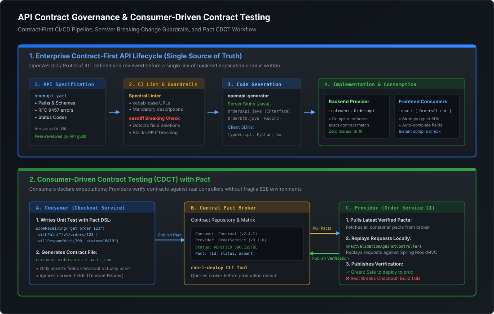

# API Contract Governance, OpenAPI & Consumer-Driven Contract Testing

## 1. Contract-First Design vs. The Code-First Anti-Pattern

In high-scale enterprise engineering, APIs represent legally binding network contracts between autonomous engineering teams, external partners, and mobile applications. The methodology used to design and govern these contracts directly dictates production reliability, cross-team velocity, and system evolution.

```
                      CODE-FIRST ANTI-PATTERN (Fragile & Drifting)
                      
   [ Java Controller ] --(Reflection)--> [ Swagger / Springdoc ] ---> [ Drifting API Spec ]
          |                                                                   |
     Refactoring                                                       Silent Production
    Breaks Contract                                                     Client Outages!
    
------------------------------------------------------------------------------------------
                     CONTRACT-FIRST METHODOLOGY (Robust & Governed)
                     
   [ OpenAPI 3.0 Spec ] --(Lint & Breaking Check)--> [ Git Source of Truth ]
          |                                                   |
          +--(openapi-generator)------------------------------+
          |                                                   |
          v                                                   v
   [ Provider Interface ]                              [ Consumer SDKs ]
   (Compiler Enforces)                                 (Type-Safe Clients)
```

### 1.1 The Fatal Flaws of Code-First Development
Under the Code-First approach, engineers write Java/Spring controllers, annotate them with `@Operation` or `@ApiResponse` annotations, and rely on libraries like `springdoc-openapi` to generate documentation dynamically at runtime:
1. **Accidental Breaking Changes**: A developer renames an internal getter on a Java DTO or changes a field type from `Integer` to `Long`. Jackson serializes the change, and the live API contract mutates silently without compiler warnings or code-review friction.
2. **Internal Domain Leakage**: Database entity structures (JPA `@Entity`) frequently bleed into the API payload, exposing internal database column names, lazy-loading proxies, and unintended internal state.
3. **Zero Consumer Collaboration**: Frontend, mobile, and partner teams cannot begin integration until backend implementation is complete and deployed to a shared staging environment.
4. **Poor Documentation Quality**: Descriptions, parameter constraints, and RFC 9457 error responses are treated as secondary annotations, frequently omitted or left stale.

### 1.2 The Contract-First Paradigm
Under Contract-First design:
- The API is authored as an **OpenAPI 3.0 / 3.1 YAML** or **Protobuf IDL** specification before a single line of backend implementation code is written.
- The specification acts as a standalone artifact versioned in Git and undergoes rigorous peer review by API guilds and consumer stakeholders.
- Build tools (`openapi-generator-maven-plugin` or `buf` for gRPC) generate both the **provider interfaces** (which backend controllers implement) and **consumer client SDKs** (TypeScript, Go, Python, Java).
- If an engineer attempts to alter an API response without updating the specification, the Java compiler refuses to build the application.

---

## 2. Architectural Blueprint: Contract Governance & CDCT Pipeline

The following diagram illustrates the complete enterprise contract lifecycle, from Git-backed OpenAPI specification to automated CI/CD linting, code generation, and Pact Consumer-Driven Contract Testing:

[](images/api_contract_governance_cdct.svg)

---

## 3. OpenAPI 3.0 Specification Architecture

An enterprise-grade OpenAPI 3.0 specification must be modular, strongly typed, and explicit regarding error conditions and pagination semantics.

### 3.1 Production OpenAPI 3.0 Contract Specification (`openapi.yaml`)

```yaml
openapi: 3.0.3
info:
  title: Order Processing Service API
  version: 2.1.0
  description: Mission-critical order lifecycle orchestration API.
servers:
  - url: https://api.enterprise.com/v2
    description: Production Gateway
paths:
  /orders:
    post:
      summary: Create a new order
      operationId: createOrder
      tags:
        - Orders
      parameters:
        - name: Idempotency-Key
          in: header
          required: true
          description: Unique UUID v4 idempotency token
          schema:
            type: string
            format: uuid
            example: "9b1deb4d-3b7d-4bad-9bdd-2b0d7b3dcb6d"
      requestBody:
        required: true
        content:
          application/json:
            schema:
              $ref: '#/components/schemas/CreateOrderRequest'
      responses:
        '201':
          description: Order created successfully
          headers:
            Location:
              schema:
                type: string
                example: "/orders/ord_987654321"
          content:
            application/json:
              schema:
                $ref: '#/components/schemas/OrderResponse'
        '400':
          description: Malformed payload or validation error
          content:
            application/problem+json:
              schema:
                $ref: '#/components/schemas/ProblemDetail'
        '409':
          description: Idempotency conflict or concurrent request in-flight
          content:
            application/problem+json:
              schema:
                $ref: '#/components/schemas/ProblemDetail'
        '422':
          description: Semantic business rule violation
          content:
            application/problem+json:
              schema:
                $ref: '#/components/schemas/ProblemDetail'

components:
  schemas:
    CreateOrderRequest:
      type: object
      required:
        - customerId
        - currency
        - items
      properties:
        customerId:
          type: string
          example: "cust_100293"
        currency:
          type: string
          minLength: 3
          maxLength: 3
          example: "USD"
        items:
          type: array
          minItems: 1
          items:
            $ref: '#/components/schemas/OrderItem'

    OrderItem:
      type: object
      required:
        - sku
        - quantity
        - unitPrice
      properties:
        sku:
          type: string
          example: "SKU-MACBOOK-PRO-16"
        quantity:
          type: integer
          minimum: 1
          example: 2
        unitPrice:
          type: number
          format: double
          minimum: 0.01
          example: 2499.00

    OrderResponse:
      type: object
      required:
        - id
        - customerId
        - status
        - totalAmount
        - createdAt
      properties:
        id:
          type: string
          example: "ord_987654321"
        customerId:
          type: string
          example: "cust_100293"
        status:
          type: string
          enum: [PENDING, PROCESSING, PAID, FULFILLED, CANCELLED]
          example: "PAID"
        totalAmount:
          type: number
          format: double
          example: 4998.00
        createdAt:
          type: string
          format: date-time
          example: "2026-11-10T12:00:00Z"

    # RFC 9457 Standardized Problem Details Schema
    ProblemDetail:
      type: object
      required:
        - type
        - title
        - status
        - detail
        - instance
      properties:
        type:
          type: string
          format: uri
          example: "https://api.enterprise.com/errors/insufficient-inventory"
        title:
          type: string
          example: "Insufficient Inventory"
        status:
          type: integer
          example: 422
        detail:
          type: string
          example: "Item SKU-MACBOOK-PRO-16 has only 1 unit remaining in stock."
        instance:
          type: string
          example: "/orders/ord_987654321/items"
        timestamp:
          type: string
          format: date-time
          example: "2026-11-10T12:00:01Z"
        invalidParams:
          type: array
          items:
            type: object
            properties:
              name:
                type: string
              reason:
                type: string
```

### 3.2 OpenAPI Generator Maven Integration

To enforce compile-time compliance on the backend provider, configure `openapi-generator-maven-plugin` in `pom.xml`:

```xml
<plugin>
    <groupId>org.openapitools</groupId>
    <artifactId>openapi-generator-maven-plugin</artifactId>
    <version>7.4.0</version>
    <executions>
        <execution>
            <goals>
                <goal>generate</goal>
            </goals>
            <configuration>
                <inputSpec>${project.basedir}/src/main/resources/openapi.yaml</inputSpec>
                <generatorName>spring</generatorName>
                <apiPackage>com.enterprise.orders.api</apiPackage>
                <modelPackage>com.enterprise.orders.model</modelPackage>
                <configOptions>
                    <interfaceOnly>true</interfaceOnly>
                    <useSpringBoot3>true</useSpringBoot3>
                    <useJakartaEe>true</useJakartaEe>
                    <skipDefaultInterface>true</skipDefaultInterface>
                    <unhandledException>true</unhandledException>
                </configOptions>
            </configuration>
        </execution>
    </executions>
</plugin>
```

#### The Provider Controller Implementation:
```java
@RestController
public class OrdersApiController implements OrdersApi {

    private final OrderService orderService;

    public OrdersApiController(OrderService orderService) {
        this.orderService = orderService;
    }

    @Override
    public ResponseEntity<OrderResponse> createOrder(
            String idempotencyKey,
            CreateOrderRequest createOrderRequest) {
        
        OrderResponse response = orderService.processOrder(idempotencyKey, createOrderRequest);
        return ResponseEntity
                .status(HttpStatus.CREATED)
                .location(URI.create("/orders/" + response.getId()))
                .body(response);
    }
}
```
If the YAML contract changes, the `OrdersApi` interface updates upon compilation, forcing the developer to resolve discrepancies immediately.

---

## 4. Breaking vs. Non-Breaking Change Taxonomy

Semantic Versioning (**SemVer 2.0.0**: `MAJOR.MINOR.PATCH`) governs API evolution. Understanding what constitutes a breaking change at the network serialization layer is critical for zero-downtime microservice architectures.

### 4.1 Definitive Change Classification Matrix

| Change Type | Operation | Classification | SemVer Bump | Architectural Rationale |
| :--- | :--- | :--- | :--- | :--- |
| **Endpoint Removal** | Delete existing URL path | **BREAKING** | **MAJOR** | Existing clients receive `HTTP 404 Not Found`. |
| **HTTP Verb Removal** | Delete `POST` or `PUT` from path | **BREAKING** | **MAJOR** | Clients receive `HTTP 405 Method Not Allowed`. |
| **Field Deletion** | Remove field from Response JSON | **BREAKING** | **MAJOR** | Clients attempting to read `response.totalAmount` encounter `NullPointerException` or `undefined`. |
| **Field Renaming** | Rename `customerId` → `accountId` | **BREAKING** | **MAJOR** | Mechanically identical to deleting `customerId` and adding `accountId`. |
| **New Required Field** | Add required field to Request JSON | **BREAKING** | **MAJOR** | Older clients omit the field; backend returns `HTTP 400 Bad Request`. |
| **Type Mutation** | Change `id` from `integer` → `string` | **BREAKING** | **MAJOR** | Strongly typed clients (Java/Go/Swift) fail JSON deserialization. |
| **Constraint Narrowing** | Reduce `maxLength` from 100 → 50 | **BREAKING** | **MAJOR** | Valid client payloads that previously succeeded now fail with validation errors. |
| **Status Code Mutation** | Change success code `201` → `200` | **BREAKING** | **MAJOR** | Clients checking `response.status == 201` take error branches. |
| **New Endpoint** | Add `/orders/{id}/tracking` | Non-Breaking | MINOR | Existing client workflows remain completely unaffected. |
| **New Optional Field** | Add optional field to Request JSON | Non-Breaking | MINOR | Older clients omit it without validation failure. |
| **New Response Field** | Add `loyaltyPoints` to Response JSON | Non-Breaking | MINOR | Safe **if and only if** clients adhere to Postel's Law / Tolerant Reader. |
| **Constraint Widening** | Increase `maxLength` from 50 → 100 | Non-Breaking | MINOR | All previously valid payloads continue to succeed. |

### 4.2 Postel's Law & The Tolerant Reader Pattern

> *"Be conservative in what you send, be liberal in what you accept."* — Jon Postel (RFC 793)

To ensure that adding new response fields remains non-breaking across distributed clients, all consumers must implement the **Tolerant Reader Pattern**:
1. **Ignore Unknown Fields**: In Jackson, configure:
   ```java
   objectMapper.configure(DeserializationFeature.FAIL_ON_UNKNOWN_PROPERTIES, false);
   ```
2. **Selective Extraction**: Clients should parse only the exact sub-fields they require for their business logic, rather than performing strict schema validation on the entire returned entity.
3. **Resilient Enums**: When deserializing string enums, configure fallback defaults (e.g., `UNKNOWN`) so that new enum variants introduced on the backend do not trigger client-side deserialization crashes.

---

## 5. Automated Contract CI/CD Guardrails

Manual pull-request reviews cannot reliably catch subtle breaking changes across hundreds of microservices. Enterprise governance mandates automated CI/CD guardrails:

```
[ Developer PR ] 
       |
       v
[ Spectral Linter ] -------------(Fails on style/RFC 9457 violations)-----> [ Block PR ]
       | (Passes)
       v
[ oasdiff Breaking-Check ] ------(Fails if breaking changes on non-major)--> [ Block PR ]
       | (Passes)
       v
[ Merge & Publish to Artifactory / API Portal ]
```

### 5.1 Style & Consistency Linting with Spectral
Spectral enforces enterprise design guidelines across all OpenAPI files:

```yaml
# .spectral.yaml
extends: "spectral:oas"
rules:
  # Enforce kebab-case URLs
  paths-kebab-case:
    description: "API paths must be lowercase kebab-case."
    message: "{{property}} must be kebab-case"
    severity: error
    given: "$.paths[*]~"
    then:
      function: pattern
      functionOptions:
        match: "^(/[a-z0-9]+(-[a-z0-9]+)*)+$"

  # Enforce RFC 9457 Problem Details for all 4xx/5xx responses
  rfc-9457-error-responses:
    description: "All error responses must use application/problem+json"
    severity: error
    given: "$.paths[*][*].responses[?(@property >= 400 && @property < 600)].content"
    then:
      field: "application/problem+json"
      function: defined
```

### 5.2 Automated Breaking Change Detection with `oasdiff`
In your CI pipeline (GitHub Actions / GitLab CI), execute `oasdiff` comparing the PR branch against the target `main` branch:

```bash
# Fail CI build if any breaking change is introduced without a major version increment
oasdiff breaking \
  --base https://raw.githubusercontent.com/enterprise/orders-spec/main/openapi.yaml \
  --revision src/main/resources/openapi.yaml \
  --fail-on ERR
```
If an engineer deleted a field or added a required parameter, `oasdiff` emits an error and blocks the pull request automatically.

---

## 6. Consumer-Driven Contract Testing (CDCT) with Pact

### 6.1 The End-to-End (E2E) Environment Scaling Crisis
Traditional enterprise integration testing relies on shared staging environments where 50+ microservices are deployed simultaneously. This approach collapses at scale:
- **Environment Instability**: If Service C is down for maintenance, Service A's integration tests fail despite Service A having zero defects.
- **Slow Feedback Loops**: Tests take hours to execute, delaying deployment pipelines.
- **Flaky Test Suites**: Network timeouts and shared database test data collisions induce intermittent false alarms.

### 6.2 The CDCT Paradigm Shift
Consumer-Driven Contract Testing (**CDCT**) inverts the testing dynamic:
1. **Consumer Defines the Contract**: The consumer (e.g., `Checkout Service`) writes a unit test using the Pact DSL declaring: *"When I send `GET /orders/123`, I expect `HTTP 200` with JSON containing at least `id` and `status`."*
2. **Pact File Generation**: Executing the consumer unit test spins up a lightweight local mock server and outputs an immutable JSON contract: `checkout-orderservice.json`.
3. **Publication to Pact Broker**: The consumer's CI pipeline publishes the contract to a centralized **Pact Broker**.
4. **Provider Verification**: During the provider's (`Order Service`) CI build, Pact pulls all active consumer contracts from the broker, replays the requests against the Order Service's local controllers (using Spring MockMVC), and asserts that the actual responses fulfill every consumer's expectations.
5. **Pre-Deployment Gatekeeper (`can-i-deploy`)**: Before deploying either service to production, the CD pipeline executes:
   ```bash
   pact-broker can-i-deploy \
     --pacticipant OrderService --version 3.1.0 \
     --to-environment production
   ```
   If the new Order Service version breaks any existing verified consumer version currently running in production, deployment is halted immediately.

---

## 7. Runnable Verification Suite

The following self-contained Java verification suite implements a production-grade **Contract Compatibility Validator**. It parses base and candidate API specifications, evaluates field additions, deletions, type mutations, and constraint changes, outputs a SemVer breaking-change report, and demonstrates the Consumer Tolerant Reader behavior:

```java
package com.engineering.mastery.governance;

import java.util.*;

/**
 * ContractCompatibilityValidatorPOC
 *
 * Demonstrates:
 * 1. Contract-First Breaking vs. Non-Breaking change detection algorithm.
 * 2. Automated evaluation of field removals, required parameter additions, and type changes.
 * 3. Tolerant Reader pattern resilience when consuming evolving payloads.
 */
public class ContractCompatibilityValidatorPOC {

    // =========================================================================
    // 1. Contract Metamodel
    // =========================================================================
    public enum HttpMethod { GET, POST, PUT, DELETE, PATCH }
    public enum DataType { STRING, INTEGER, DOUBLE, BOOLEAN, OBJECT, ARRAY }

    public record FieldSchema(
            String name,
            DataType type,
            boolean required,
            Integer maxLength
    ) {}

    public record EndpointContract(
            String path,
            HttpMethod method,
            Map<String, FieldSchema> requestFields,
            Map<String, FieldSchema> responseFields,
            int successStatusCode
    ) {}

    public record ApiSpecification(
            String version,
            Map<String, EndpointContract> endpoints
    ) {}

    // =========================================================================
    // 2. Breaking Change Detection Engine
    // =========================================================================
    public record CompatibilityViolation(
            String endpointKey,
            String rule,
            String message,
            boolean isBreaking
    ) {}

    public static class ContractDiffEngine {

        public static List<CompatibilityViolation> compare(ApiSpecification base, ApiSpecification candidate) {
            List<CompatibilityViolation> violations = new ArrayList<>();

            // Rule 1: Check for Deleted Endpoints (BREAKING)
            for (String endpointKey : base.endpoints().keySet()) {
                if (!candidate.endpoints().containsKey(endpointKey)) {
                    violations.add(new CompatibilityViolation(
                            endpointKey,
                            "ENDPOINT_DELETED",
                            "Endpoint was removed from specification",
                            true
                    ));
                }
            }

            // Inspect shared endpoints
            for (Map.Entry<String, EndpointContract> entry : candidate.endpoints().entrySet()) {
                String key = entry.getKey();
                EndpointContract candidateEp = entry.getValue();

                if (!base.endpoints().containsKey(key)) {
                    // New endpoint added (NON-BREAKING)
                    violations.add(new CompatibilityViolation(
                            key,
                            "ENDPOINT_ADDED",
                            "New endpoint introduced (Minor version bump required)",
                            false
                    ));
                    continue;
                }

                EndpointContract baseEp = base.endpoints().get(key);

                // Rule 2: Check Success Status Code Changes (BREAKING)
                if (baseEp.successStatusCode() != candidateEp.successStatusCode()) {
                    violations.add(new CompatibilityViolation(
                            key,
                            "STATUS_CODE_MUTATED",
                            String.format("Success status code changed from %d to %d",
                                    baseEp.successStatusCode(), candidateEp.successStatusCode()),
                            true
                    ));
                }

                // Rule 3: Check Request Field Changes
                // A. Adding a NEW REQUIRED field to request is BREAKING
                for (FieldSchema candReq : candidateEp.requestFields().values()) {
                    FieldSchema baseReq = baseEp.requestFields().get(candReq.name());
                    if (baseReq == null && candReq.required()) {
                        violations.add(new CompatibilityViolation(
                            key,
                            "REQUEST_FIELD_NEW_REQUIRED",
                            String.format("Added mandatory request field '%s'. Older clients will fail with 400 Bad Request.", candReq.name()),
                            true
                        ));
                    }
                }

                // Rule 4: Check Response Field Changes
                // A. Removing an existing response field is BREAKING
                for (FieldSchema baseResp : baseEp.responseFields().values()) {
                    FieldSchema candResp = candidateEp.responseFields().get(baseResp.name());
                    if (candResp == null) {
                        violations.add(new CompatibilityViolation(
                            key,
                            "RESPONSE_FIELD_DELETED",
                            String.format("Deleted response field '%s'. Existing consumers reading this field will crash.", baseResp.name()),
                            true
                        ));
                    } else if (baseResp.type() != candResp.type()) {
                        // B. Changing field data type is BREAKING
                        violations.add(new CompatibilityViolation(
                            key,
                            "FIELD_TYPE_MUTATED",
                            String.format("Field '%s' changed data type from %s to %s",
                                    baseResp.name(), baseResp.type(), candResp.type()),
                            true
                        ));
                    }
                }

                // Rule 5: Check Constraint Narrowing (e.g., reduced maxLength)
                for (FieldSchema candReq : candidateEp.requestFields().values()) {
                    FieldSchema baseReq = baseEp.requestFields().get(candReq.name());
                    if (baseReq != null && baseReq.maxLength() != null && candReq.maxLength() != null) {
                        if (candReq.maxLength() < baseReq.maxLength()) {
                            violations.add(new CompatibilityViolation(
                                key,
                                "CONSTRAINT_NARROWED",
                                String.format("Request field '%s' maxLength tightened from %d to %d",
                                        candReq.name(), baseReq.maxLength(), candReq.maxLength()),
                                true
                            ));
                        }
                    }
                }

                // Rule 6: Check for Non-Breaking Response Additions
                for (FieldSchema candResp : candidateEp.responseFields().values()) {
                    if (!baseEp.responseFields().containsKey(candResp.name())) {
                        violations.add(new CompatibilityViolation(
                            key,
                            "RESPONSE_FIELD_ADDED",
                            String.format("Added new response field '%s' (Safe for Tolerant Readers)", candResp.name()),
                            false
                        ));
                    }
                }
            }

            return violations;
        }
    }

    // =========================================================================
    // 3. Tolerant Reader Consumer Simulation
    // =========================================================================
    public static class TolerantReaderClient {

        public static Map<String, Object> parseResponse(Map<String, Object> rawPayload, Set<String> expectedFields) {
            Map<String, Object> consumed = new HashMap<>();
            for (String field : expectedFields) {
                if (rawPayload.containsKey(field)) {
                    consumed.put(field, rawPayload.get(field));
                } else {
                    System.err.printf("[WARN] Missing expected contract field '%s'!%n", field);
                }
            }
            // Unknown fields in rawPayload are silently and safely ignored!
            return consumed;
        }
    }

    // =========================================================================
    // 4. Verification Runner
    // =========================================================================
    public static void main(String[] args) {
        System.out.println("================================================================================");
        System.out.println("      API CONTRACT GOVERNANCE & COMPATIBILITY VALIDATION TEST SUITE            ");
        System.out.println("================================================================================\n");

        // 1. Baseline Specification (v1.0.0)
        Map<String, FieldSchema> v1Req = new HashMap<>();
        v1Req.put("customerId", new FieldSchema("customerId", DataType.STRING, true, 50));
        v1Req.put("amount", new FieldSchema("amount", DataType.DOUBLE, true, null));

        Map<String, FieldSchema> v1Resp = new HashMap<>();
        v1Resp.put("orderId", new FieldSchema("orderId", DataType.STRING, true, null));
        v1Resp.put("status", new FieldSchema("status", DataType.STRING, true, null));
        v1Resp.put("totalAmount", new FieldSchema("totalAmount", DataType.DOUBLE, true, null));

        EndpointContract v1OrderEndpoint = new EndpointContract(
                "/orders", HttpMethod.POST, v1Req, v1Resp, 201
        );

        ApiSpecification baseSpec = new ApiSpecification(
                "1.0.0", Map.of("POST /orders", v1OrderEndpoint)
        );

        // 2. Candidate Specification (Simulating dangerous PR modifications)
        Map<String, FieldSchema> v2Req = new HashMap<>();
        // Modified customerId maxLength tightened from 50 to 20 (BREAKING!)
        v2Req.put("customerId", new FieldSchema("customerId", DataType.STRING, true, 20));
        v2Req.put("amount", new FieldSchema("amount", DataType.DOUBLE, true, null));
        // Added NEW MANDATORY request field (BREAKING!)
        v2Req.put("taxIdentificationNumber", new FieldSchema("taxIdentificationNumber", DataType.STRING, true, 30));

        Map<String, FieldSchema> v2Resp = new HashMap<>();
        v2Resp.put("orderId", new FieldSchema("orderId", DataType.STRING, true, null));
        // Deleted "status" response field! (BREAKING!)
        // Mutated "totalAmount" from DOUBLE to STRING! (BREAKING!)
        v2Resp.put("totalAmount", new FieldSchema("totalAmount", DataType.STRING, true, null));
        // Added "loyaltyPointsEarned" (NON-BREAKING for tolerant readers)
        v2Resp.put("loyaltyPointsEarned", new FieldSchema("loyaltyPointsEarned", DataType.INTEGER, false, null));

        EndpointContract v2OrderEndpoint = new EndpointContract(
                "/orders", HttpMethod.POST, v2Req, v2Resp, 201
        );

        ApiSpecification candidateSpec = new ApiSpecification(
                "1.1.0", Map.of("POST /orders", v2OrderEndpoint)
        );

        // 3. Execute Compatibility Diff
        System.out.println("--- [1. Evaluating API Specification Pull Request Diff] ---");
        List<CompatibilityViolation> violations = ContractDiffEngine.compare(baseSpec, candidateSpec);

        long breakingCount = violations.stream().filter(CompatibilityViolation::isBreaking).count();
        long nonBreakingCount = violations.stream().filter(v -> !v.isBreaking()).count();

        for (CompatibilityViolation v : violations) {
            String tag = v.isBreaking() ? "[BREAKING - MAJOR REQUIRED]" : "[NON-BREAKING - MINOR OK]";
            System.out.printf("%-28s %-25s | %s%n", tag, v.rule(), v.message());
        }

        System.out.println("\n--- [2. Governance Verdict & CI/CD Gatekeeper] ---");
        System.out.printf("Total Detected Issues: %d (%d Breaking, %d Non-Breaking)%n",
                violations.size(), breakingCount, nonBreakingCount);

        if (breakingCount > 0) {
            System.out.println("❌ CI BUILD FAILED: Pull request contains breaking changes without a SemVer MAJOR version bump!");
        } else {
            System.out.println("✓ CI BUILD PASSED: Contract evolution is backwards-compatible.");
        }

        // 4. Tolerant Reader Pattern Verification
        System.out.println("\n--- [3. Tolerant Reader Consumer Resilience Test] ---");
        Set<String> legacyConsumerExpectedFields = Set.of("orderId", "totalAmount");
        Map<String, Object> liveProviderPayload = Map.of(
                "orderId", "ord_555",
                "totalAmount", 1250.50,
                "loyaltyPointsEarned", 250, // Unknown new field
                "serverInternalTrace", "node-cluster-us-east-04" // Metadata field
        );

        Map<String, Object> parsed = TolerantReaderClient.parseResponse(liveProviderPayload, legacyConsumerExpectedFields);
        System.out.println("Provider Raw Payload:   " + liveProviderPayload);
        System.out.println("Consumer Consumed View: " + parsed);
        System.out.println("Tolerant Reader Status: Successfully digested payload without failure!");

        System.out.println("\n================================================================================");
        System.out.println("                      VERIFICATION COMPLETED SUCCESSFULLY                       ");
        System.out.println("================================================================================");
    }
}
```

---

## 8. Staff / Principal Interview Strategy

### 8.1 Designing an Enterprise API Governance Program
When an interviewer asks: *"You join a 1,000-engineer organization where teams frequently deploy breaking API changes that cause production outages for mobile and web clients. How do you design and roll out an enterprise API governance program?"*

#### The Staff / Principal Execution Framework:
1. **Never propose a manual "Architecture Review Board" (ARB)**: Manual gates create organizational friction, slow deployment velocity to a crawl, and incentivize engineers to bypass governance entirely.
2. **Shift-Left Automated Tooling in CI/CD**:
   - Establish a **Git-backed Central API Catalog** (Monorepo or multi-repo registry).
   - Integrate **Spectral** into git pre-commit hooks and CI pipelines to enforce naming conventions, URL hierarchies, and RFC 9457 error contracts automatically.
   - Run **`oasdiff`** as a mandatory GitHub Actions pull-request gatekeeper. If an engineer introduces a breaking change (such as deleting a field or adding a mandatory parameter) without bumping the path version (e.g. `/v2`), the PR merge button is disabled.
3. **Consumer-Driven Contract Testing (Pact / CDCT)**:
   - Eliminate fragile end-to-end testing environments. Mandate that consumer teams write Pact tests that publish contracts to an enterprise Pact Broker.
   - Integrate `can-i-deploy` CLI checks into release pipelines. If a provider tries to deploy code that violates a registered production consumer's contract, the CD pipeline rejects the release before traffic is routed.
4. **Automated SDK Generation**: Maintain automated pipelines that generate TypeScript, Python, and Java client libraries upon spec merge, publishing versioned packages to internal registries (e.g., Artifactory, internal npm).

### 8.2 Safe API Deprecation at High Scale
When an interviewer asks: *"We have a legacy endpoint `/v1/checkout` used by thousands of merchants. How do you deprecate and shut it down without breaking external businesses?"*

#### The Battle-Tested Multi-Phase Deprecation Protocol:
1. **Phase 1: Telemetry & Consumer Attribution**:
   - Instrument the API Gateway to log client identity tokens (OAuth `client_id` or API keys) per endpoint. Construct a real-time dashboard of who is still calling `/v1/checkout`.
2. **Phase 2: Standardized Deprecation Headers (RFC 8594)**:
   - Return standard IETF deprecation headers on all responses from the endpoint:
     ```http
     Deprecation: @1735689600
     Sunset: Wed, 11 Nov 2026 00:00:00 GMT
     Link: <https://api.enterprise.com/docs/v2-migration>; rel="sunset"
     ```
   - Automated client monitors and developer dashboards parse these headers to trigger proactive migration alerts.
3. **Phase 3: Brownout Testing (Chaos Deprecation)**:
   - 3 to 6 months prior to permanent shutdown, initiate **scheduled brownouts** (temporary fault injection).
   - During scheduled low-traffic windows (e.g., Tuesday at 02:00 UTC for 15 minutes), the gateway returns `HTTP 410 Gone` or `HTTP 403 Forbidden` with an explicit RFC 9457 migration payload:
     ```json
     {
       "type": "https://api.enterprise.com/errors/endpoint-deprecated",
       "title": "Endpoint Deprecated",
       "status": 410,
       "detail": "Endpoint /v1/checkout is undergoing scheduled brownout. Migrate to /v2/orders immediately."
     }
     ```
   - Brownouts smoke out lagging integrations in non-fatal windows before the permanent hard cutoff.
4. **Phase 4: Permanent Cutoff**:
   - Terminate the route at the gateway, returning permanent `HTTP 410 Gone` with documentation links. Remove legacy backend service code.
