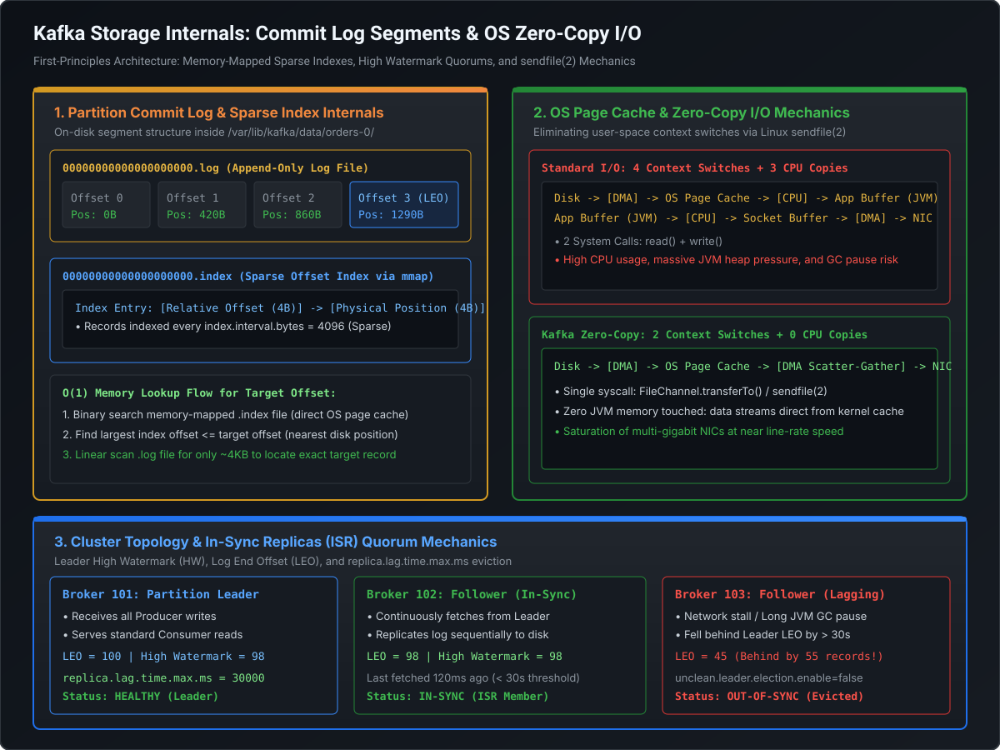

# Kafka Foundations: Commit Log Topology & ISR Mechanics

## 1. The Commit Log Abstraction: Beyond Traditional Queuing

At the Senior Tech Lead, Staff, and Principal Engineer level, understanding Apache Kafka begins by rejecting the mental model of a traditional message broker (such as RabbitMQ, ActiveMQ, or SQS). 

```
TRADITIONAL MESSAGE BROKER (e.g., RabbitMQ, SQS)
Producer ---> [ Broker Queue ] ---> Consumer A (Ack -> Message Deleted from Disk)
                             ---> Consumer B (Competes for next message)

KAFKA DISTRIBUTED COMMIT LOG
Producer ---> [ Partition 0: [0][1][2][3][4][5][6][7]... (Immutable Append-Only Log) ]
                                ^              ^
                          Consumer Group 1     Consumer Group 2
                          (Offset = 2)         (Offset = 6)
```

### 1.1 The Fundamental Paradigm Shifts
1. **Destructive Consumption vs. Immutable Retention**: Traditional queues track state per message. When a consumer acknowledges receipt, the broker deletes the record or modifies queue indices. In contrast, Kafka partitions are **immutable, append-only disk logs**. Consuming a message does not alter or destroy it; messages persist based on time (`log.retention.hours`) or size (`log.retention.bytes`).
2. **Push vs. Pull Flow Control**: Traditional brokers push messages down to consumers, risking client buffer saturation and memory exhaustion. Kafka enforces a **pure pull-based model**: consumers actively request batches of records (`poll()`), self-regulating backpressure according to their local CPU and processing capacity.
3. **Consumer State Ownership**: In Kafka, the broker maintains no per-consumer delivery state. Consumers are simply sequential cursor offsets moving forward across an append-only log. This enables multiple independent consumer groups to read the same topic simultaneously at drastically different speeds, or rewind offsets to replay historical events after an incident.

---

## 2. Architectural Blueprint: Storage & Replication Topology

The following diagram illustrates Kafka's on-disk partition segment layout, sparse offset indexing, kernel zero-copy transfer mechanics, and the In-Sync Replicas (ISR) quorum state machine:

[](images/kafka_storage_and_zero_copy_architecture.svg)

---

## 3. Cluster Topology & Roles

A production Kafka cluster consists of distributed broker instances coordinating partition ownership and log replication:

```
+---------------------------------------------------------------------------------------+
|                                  KAFKA CLUSTER                                        |
|                                                                                       |
|  [ Broker 101 ]                   [ Broker 102 ]                   [ Broker 103 ]     |
|  Partition 0 (LEADER) <====Repl==== Partition 0 (FOLLOWER) <==Repl== Partition 0 (ISR)|
|  Partition 1 (FOLLOWER) <==Repl==== Partition 1 (LEADER) <====Repl== Partition 1 (ISR)|
|                                                                                       |
+---------------------------------------------------------------------------------------+
```

### 3.1 Partition Leaders vs. Followers
- **Partition Leader**: Exactly one broker is elected as the leader for each individual partition. By default, the leader receives all write requests (`ProduceRequests`) from clients and serves all read requests (`FetchRequests`) to consumers.
- **Follower Replicas**: Followers do not serve client traffic under standard configurations. Instead, they act as consumers to the leader, continuously issuing internal `FetchRequests` over TCP to pull the latest log records and append them to their local storage engines.
- **Rack-Aware Follower Fetching (KIP-392)**: In modern multi-AZ cloud deployments, consumers can be configured with `client.rack` to fetch directly from local follower replicas within the same availability zone, eliminating expensive cross-AZ egress bandwidth charges.

### 3.2 In-Sync Replicas (ISR) Quorum Mechanics
The In-Sync Replicas (**ISR**) set represents the subset of all assigned partition replicas currently keeping pace with the leader:
1. **ISR Inclusion Criteria**: A follower replica is considered in-sync if it has issued a fetch request and caught up to the leader's latest log offset within the threshold defined by:
   $$\text{replica.lag.time.max.ms (default: 30,000 ms)}$$
2. **ISR Eviction**: If a follower experiences a Stop-the-World JVM GC pause, network partition, or disk I/O stall exceeding 30 seconds, the partition leader unilaterally evicts that broker from the ISR list and updates cluster metadata via KRaft.
3. **Re-Admission**: Once the stalled follower recovers, it reconnects, truncates any uncommitted records beyond the leader's High Watermark, fetches all missing records, and upon reaching the leader's Log End Offset (LEO), is re-admitted to the ISR.

---

## 4. High Watermark (HW) vs. Log End Offset (LEO)

Replication consistency and consumer read safety in Kafka are governed by two monotonically increasing 64-bit integers maintained per partition:

```
Leader Partition Log:
[ Offset 0 ] [ Offset 1 ] [ Offset 2 ] [ Offset 3 ] [ Offset 4 ]
--------------------------------------->            ------------>
         High Watermark (HW = 3)                     Log End Offset (LEO = 5)
   (Safe for Consumers to Read)               (Awaiting Follower Replication)
```

### 4.1 Definitions & Physical Mechanics
- **Log End Offset (LEO)**: The offset of the next record to be written to the partition log. Every time a producer writes to the leader, the leader increments its local LEO.
- **High Watermark (HW)**: The offset of the latest record replicated to **all** active brokers in the ISR set:
  $$\text{HW} = \min(\text{LEO}_{\text{Leader}}, \text{LEO}_{\text{Follower 1}}, \dots, \text{LEO}_{\text{Follower } N})$$

### 4.2 The Consumer Read Isolation Barrier
> [!IMPORTANT]
> **Consumers can NEVER read beyond the High Watermark.**
> Even if records at offsets 3 and 4 have physically hit the leader broker's page cache, Kafka's fetch handler hides them from consumers until every follower in the ISR confirms replication. This strict read barrier prevents phantom reads and data inconsistency if the leader crashes before replication completes.

### 4.3 The Replication & HW Advancement Walkthrough
1. **Producer Write**: Producer sends a batch to the leader. Leader appends records to local disk segment; leader $\text{LEO}$ moves from 3 to 5. Leader $\text{HW}$ remains 3.
2. **Follower Fetch Request**: Follower issues `FetchRequest(offset=3)`.
3. **Log Append on Follower**: Follower receives records 3 and 4, writes them to its local log; follower $\text{LEO}$ moves from 3 to 5.
4. **Follower Acknowledgment**: Follower sends the next fetch request: `FetchRequest(offset=5)`.
5. **HW Advancement**: The leader notes that all ISR brokers have reached offset 5. The leader advances its local $\text{HW}$ to 5 and informs the follower on the next fetch response. Now, records 3 and 4 are visible to consumer polling.

---

## 5. Partitioning Strategies & Ordering Guarantees

Kafka guarantees **strict total ordering ONLY within a single partition**. Across distinct partitions within the same topic, there is zero ordering guarantee.

```
Topic: "orders" (3 Partitions)

Partition 0: [ord_A1] ---> [ord_A2] ---> [ord_A3]  (Customer 101 - Strictly Ordered!)
Partition 1: [ord_B1] ---> [ord_B2]                (Customer 202 - Strictly Ordered!)
Partition 2: [ord_C1]                              (Customer 303 - Strictly Ordered!)
```

### 5.1 Partitioning Logic & Mechanics
When a producer publishes a record via `ProducerRecord(topic, key, value)`:
1. **Keyed Records (Deterministic Hash Partitioning)**:
   Kafka hashes the serialized byte array of the record key using **MurmurHash2** (32-bit):
   $$\text{Partition} = \text{toPositive}(\text{Utils.murmur2}(\text{serializedKey})) \pmod{\text{numPartitions}}$$
   - Records with the identical key (e.g., `customerId = "cust_98124"`) are mathematically guaranteed to land on the exact same partition, preserving sequence ordering.
2. **Null-Key Records (Sticky Partitioner - KIP-480)**:
   In legacy Kafka, null keys round-robined record-by-record, resulting in tiny, inefficient network packets. The modern **Sticky Partitioner** batches records for the same partition until `batch.size` or `linger.ms` is reached before switching to another partition, dramatically reducing CPU overhead and network frame fragmentation.
3. **Custom Partitioner**:
   Engineers implement `org.apache.kafka.clients.producer.Partitioner` to override default hashing (e.g., routing VIP merchants or high-priority tenants to dedicated isolated partitions).

### 5.2 The Peril of Topic Re-partitioning
> [!CAUTION]
> Increasing the partition count of an existing topic from $N$ to $M$ instantly breaks key-to-partition affinity!
> Because $\text{hash}(\text{key}) \pmod N \neq \text{hash}(\text{key}) \pmod M$, subsequent events for `customerId = "cust_98124"` will route to a different partition, resulting in out-of-order processing across consumer threads. When re-partitioning is mandatory, applications must drain existing topics or use key-preserving intermediate migration pipelines.

---

## 6. Durability Trade-offs: `acks`, `min.insync.replicas` & Unclean Elections

The CAP theorem manifests directly in Kafka's replication settings. Staff engineers must configure these properties deliberately based on business risk tolerance:

### 6.1 The Producer `acks` Matrix

| `acks` Setting | Network Roundtrips | Durability Guarantee | Throughput | Failure Vulnerability |
| :--- | :--- | :--- | :--- | :--- |
| `acks=0` | **Zero** (Fire-and-forget) | **None** | Maximum | If broker socket drops, records are permanently lost without client notification. |
| `acks=1` | **1** (Leader only) | **Moderate** | High | If leader acknowledges, then immediately suffers power failure before replication, records are lost. |
| `acks=all` (or `-1`) | **2+** (Leader + All ISR) | **Absolute** | Balanced | Guarantees zero data loss as long as `min.insync.replicas` are available. |

### 6.2 The Holy Trinity of Zero-Data-Loss Kafka
To achieve ironclad financial-grade durability without data loss, three configurations must be set simultaneously:
1. **Producer**: `acks=all`
2. **Topic/Broker**: `min.insync.replicas=2` (in a cluster with `replication.factor=3`)
3. **Topic/Broker**: `unclean.leader.election.enable=false`

#### What Happens When `min.insync.replicas` Is Violating:
If `replication.factor=3` and `min.insync.replicas=2`, and 2 brokers crash:
- Only 1 broker remains in the ISR.
- Any producer write with `acks=all` fails with:
  ```
  org.apache.kafka.common.errors.NotEnoughReplicasException
  ```
- Kafka **favors Consistency over Availability**: it refuses writes rather than accepting un-replicated records that could be lost.

### 6.3 Unclean Leader Election: The Availability vs. Durability Cliff
If all brokers in the ISR crash, leaving only a lagging out-of-sync replica alive (e.g., Broker 103 in our diagram, behind by 55 records):
- **`unclean.leader.election.enable=false` (Default - Safe)**: The cluster waits until an ISR member restarts. The partition remains offline for writes and reads. **Zero data loss**.
- **`unclean.leader.election.enable=true` (Dangerous)**: Kafka elects the lagging broker as leader. All 55 records written to the previous leader are permanently discarded and overwritten! Downstream consumers experience silent data truncation and duplicate offsets.

---

## 7. Runnable Verification Suite

The following self-contained Java verification suite demonstrates:
1. **MurmurHash2 deterministic partition calculation** and partition distribution analysis.
2. **ISR quorum simulation**: Tracks broker log append, follower lag, and High Watermark advancement.
3. **Unclean leader election data loss calculation**: Measures message delta when electing an out-of-sync broker.

```java
package com.engineering.mastery.kafka;

import java.nio.charset.StandardCharsets;
import java.util.*;
import java.util.concurrent.ConcurrentHashMap;

/**
 * PartitionAssignmentSimulationPOC
 *
 * Demonstrates:
 * 1. Kafka MurmurHash2 key-to-partition mapping algorithm.
 * 2. High Watermark (HW) vs. Log End Offset (LEO) advancement in an ISR quorum.
 * 3. Quantifying data loss under clean vs. unclean leader election.
 */
public class PartitionAssignmentSimulationPOC {

    // =========================================================================
    // 1. MurmurHash2 Algorithm (Exact Kafka Implementation)
    // =========================================================================
    public static class KafkaPartitioner {

        public static int murmur2(byte[] data) {
            int length = data.length;
            int seed = 0x9747b28c;
            int m = 0x5bd1e995;
            int r = 24;
            int h = seed ^ length;
            int length4 = length / 4;

            for (int i = 0; i < length4; i++) {
                int i4 = i * 4;
                int k = (data[i4 + 0] & 0xff) +
                        ((data[i4 + 1] & 0xff) << 8) +
                        ((data[i4 + 2] & 0xff) << 16) +
                        ((data[i4 + 3] & 0xff) << 24);
                k *= m;
                k ^= k >>> r;
                k *= m;
                h *= m;
                h ^= k;
            }

            switch (length % 4) {
                case 3: h ^= (data[(length & ~3) + 2] & 0xff) << 16;
                case 2: h ^= (data[(length & ~3) + 1] & 0xff) << 8;
                case 1: h ^= (data[length & ~3] & 0xff);
                    h *= m;
            }

            h ^= h >>> 13;
            h *= m;
            h ^= h >>> 15;
            return h;
        }

        public static int partition(String key, int numPartitions) {
            byte[] keyBytes = key.getBytes(StandardCharsets.UTF_8);
            int hash = murmur2(keyBytes);
            return (hash & 0x7fffffff) % numPartitions;
        }
    }

    // =========================================================================
    // 2. Replica & ISR State Machine
    // =========================================================================
    public static class PartitionReplica {
        final int brokerId;
        long leo; // Log End Offset
        long lastFetchTimestamp;

        public PartitionReplica(int brokerId) {
            this.brokerId = brokerId;
            this.leo = 0;
            this.lastFetchTimestamp = System.currentTimeMillis();
        }
    }

    public static class PartitionState {
        final int partitionId;
        final int leaderBrokerId;
        final Map<Integer, PartitionReplica> replicas = new LinkedHashMap<>();
        final Set<Integer> isr = new HashSet<>();
        long highWatermark = 0;

        public PartitionState(int partitionId, int leaderBrokerId, List<Integer> assignedBrokers) {
            this.partitionId = partitionId;
            this.leaderBrokerId = leaderBrokerId;
            for (int id : assignedBrokers) {
                replicas.put(id, new PartitionReplica(id));
                isr.add(id);
            }
        }

        public synchronized void writeLeader(int count) {
            PartitionReplica leader = replicas.get(leaderBrokerId);
            leader.leo += count;
            leader.lastFetchTimestamp = System.currentTimeMillis();
        }

        public synchronized void followerFetch(int followerId, long fetchedOffset) {
            PartitionReplica follower = replicas.get(followerId);
            if (follower == null) return;
            follower.leo = fetchedOffset;
            follower.lastFetchTimestamp = System.currentTimeMillis();

            // Re-evaluate High Watermark across all active ISR members
            long minLeoInIsr = isr.stream()
                    .mapToLong(id -> replicas.get(id).leo)
                    .min()
                    .orElse(0);

            this.highWatermark = minLeoInIsr;
        }

        public synchronized void checkIsrLag(long maxLagMs) {
            long now = System.currentTimeMillis();
            for (PartitionReplica rep : replicas.values()) {
                if (rep.brokerId == leaderBrokerId) continue;
                if ((now - rep.lastFetchTimestamp) > maxLagMs) {
                    if (isr.contains(rep.brokerId)) {
                        isr.remove(rep.brokerId);
                        System.out.printf("[ISR EVICTION] Broker %d exceeded lag timeout (%d ms). Removed from ISR!%n",
                                rep.brokerId, (now - rep.lastFetchTimestamp));
                    }
                }
            }
        }
    }

    // =========================================================================
    // 3. Execution & Verification Runner
    // =========================================================================
    public static void main(String[] args) {
        System.out.println("================================================================================");
        System.out.println("       KAFKA COMMIT LOG TOPOLOGY & ISR REPLICATION VERIFICATION SUITE           ");
        System.out.println("================================================================================\n");

        // PART 1: Deterministic MurmurHash2 Partitioning
        int totalPartitions = 3;
        String[] customerKeys = {"cust_101", "cust_202", "cust_303", "cust_101", "cust_404", "cust_202"};

        System.out.println("--- [1. MurmurHash2 Deterministic Key Assignment] ---");
        for (String key : customerKeys) {
            int targetPartition = KafkaPartitioner.partition(key, totalPartitions);
            System.out.printf("Key: %-10s -> Partition: %d (Guarantees per-key ordering!)%n", key, targetPartition);
        }

        // PART 2: High Watermark & Log End Offset Progression
        System.out.println("\n--- [2. Log End Offset (LEO) vs. High Watermark (HW) Progression] ---");
        PartitionState p0 = new PartitionState(0, 101, List.of(101, 102, 103));

        // A. Producer writes 5 messages to Leader (Broker 101)
        p0.writeLeader(5);
        System.out.printf("After Producer Write: Leader (101) LEO=%d | High Watermark=%d%n",
                p0.replicas.get(101).leo, p0.highWatermark);
        System.out.println("→ Consumer cannot read records 0..4 yet! HW is at 0 (Not fully replicated).");

        // B. Follower 102 replicates all 5 records
        p0.followerFetch(102, 5);
        System.out.printf("After Follower 102 Fetches: Follower 102 LEO=%d | High Watermark=%d%n",
                p0.replicas.get(102).leo, p0.highWatermark);
        System.out.println("→ HW remains at 0 because Follower 103 has not acknowledged.");

        // C. Follower 103 replicates all 5 records
        p0.followerFetch(103, 5);
        System.out.printf("After Follower 103 Fetches: Follower 103 LEO=%d | High Watermark=%d%n",
                p0.replicas.get(103).leo, p0.highWatermark);
        System.out.println("✓ High Watermark advanced to 5! Consumers can now safely read records 0..4.");

        // PART 3: ISR Eviction & Unclean Leader Election Disaster
        System.out.println("\n--- [3. Unclean Leader Election & Data Loss Quantification] ---");
        // Producer writes 5 more records (LEO becomes 10)
        p0.writeLeader(5);
        p0.followerFetch(102, 10); // Broker 102 keeps up (LEO=10)
        // Broker 103 stalls (simulated network partition), LEO remains 5

        System.out.printf("Current State: Leader LEO=%d | Follower 102 LEO=%d | Follower 103 LEO=%d%n",
                p0.replicas.get(101).leo, p0.replicas.get(102).leo, p0.replicas.get(103).leo);

        // Manually simulate lag on Broker 103
        p0.replicas.get(103).lastFetchTimestamp = System.currentTimeMillis() - 35000; // 35s ago (> 30s)
        p0.checkIsrLag(30000);
        System.out.println("Active ISR set: " + p0.isr);

        // Scenario: Leader (101) and Follower (102) suffer power outage simultaneously!
        System.out.println("\n[DISASTER SCENARIO]: Brokers 101 and 102 crash! Only lagging Broker 103 remains alive.");

        // Clean Election Evaluation:
        System.out.println("Evaluation with 'unclean.leader.election.enable=false':");
        System.out.println("→ Broker 103 is NOT in ISR. Election refused. Partition stays OFFLINE. Data Loss = 0 records.");

        // Unclean Election Evaluation:
        System.out.println("Evaluation with 'unclean.leader.election.enable=true':");
        long lostRecords = p0.replicas.get(101).leo - p0.replicas.get(103).leo;
        System.out.printf("⚠️ Broker 103 elected leader! %d committed records (offsets 5..9) are PERMANENTLY TRUNCATED!%n",
                lostRecords);

        System.out.println("\n================================================================================");
        System.out.println("                      VERIFICATION COMPLETED SUCCESSFULLY                       ");
        System.out.println("================================================================================");
    }
}
```

---

## 8. Staff / Principal Interview Strategy

### 8.1 Sizing Topic Partitions for High-Throughput Workloads
When an interviewer asks: *"You are designing a high-scale event streaming platform processing 500,000 events/sec (~500 MB/s). How many partitions should you allocate for the topic?"*

#### The Principal Engineer Sizing Formula:
1. **Never guess a static number (e.g., "10 partitions")**. Partitions represent the fundamental unit of parallelism in both storage I/O and consumer execution.
2. **Calculate Producer and Consumer Boundaries**:
   $$\text{Partitions} = \max\left(\frac{\text{Target Throughput}}{\text{Single Producer Throughput } (P)}, \frac{\text{Target Throughput}}{\text{Single Consumer Throughput } (C)}\right)$$
   - A single optimized Java consumer thread doing database writes can typically digest $\sim 5\text{MB/s}$ (or $\sim 5,000\text{ msgs/s}$).
   - To achieve $500\text{ MB/s}$ aggregate consumption throughput:
     $$\text{Partitions} = \frac{500\text{ MB/s}}{5\text{ MB/s}} = 100\text{ partitions}$$
3. **Account for Broker Limits & Overheads**:
   - Each partition requires OS file descriptors (`.log`, `.index`, `.timeindex`) and memory in the broker's metadata cache.
   - Target roughly $2,000$ to $4,000$ partition replicas per broker node. For a 10-node cluster, 100 partitions with `replication.factor=3` ($300$ total replicas) is well within healthy operational headroom.

### 8.2 Defending Against Partition Hotspots
When an interviewer asks: *"We partition orders by `merchantId`. On Black Friday, Amazon processes 10,000x more orders than mom-and-pop shops, causing Partition 4 to lag severely while other partitions are idle. How do you resolve this?"*

#### The Architectural Solutions:
1. **Salted Hash Keying**:
   - For high-volume hot keys, append a random or round-robin salt suffix:
     $$\text{key} = \text{merchantId} + \text{"-"} + \text{randomInt}(0, K)$$
   - Distributes the high-volume merchant across $K$ sub-partitions, restoring horizontal consumer parallelization.
2. **Two-Tier Topic Architecture**:
   - Route VIP / high-velocity merchants to a dedicated high-throughput topic (`orders-vip`) configured with higher partition counts and dedicated consumer pods.
   - Route standard long-tail merchants to the standard multi-tenant topic (`orders-standard`).
3. **Dynamic Re-Keying Stream (Kafka Streams)**:
   - Ingest raw transactions with random null-key distribution (perfect load balance).
   - A Kafka Streams topology re-keys the events downstream after initial validation and rate limiting.
