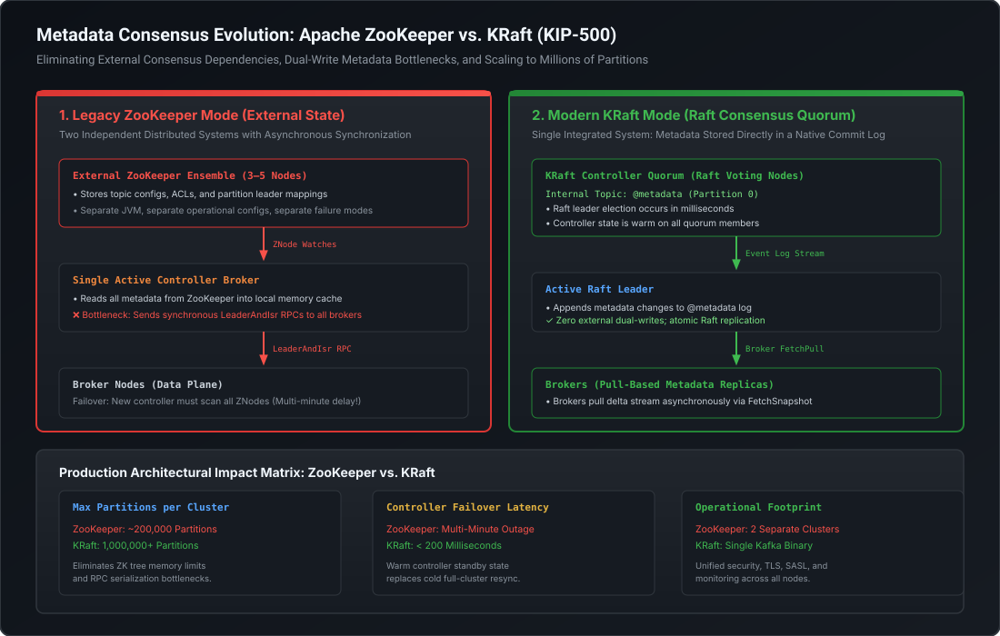

# Metadata Quorum (KRaft): Replacing ZooKeeper with Event-Driven Raft Consensus

## 1. Why ZooKeeper Was Deprecated (KIP-500)

For over a decade, Apache Kafka relied on **Apache ZooKeeper** for cluster metadata management, leader election, and distributed coordination. However, as enterprise clusters scaled to hundreds of brokers and millions of messages per second, ZooKeeper transitioned from a foundational enabler into **Kafka's single greatest scalability and reliability bottleneck**.

With the approval of **KIP-500** (and subsequent KIPs 590, 631, and 833), Apache Kafka completely severed its dependency on ZooKeeper, introducing **KRaft (Kafka Raft Metadata Mode)**. In Kafka 3.x, KRaft became production-ready, and in Kafka 4.0, ZooKeeper support was permanently removed.

```
LEGACY ZOOKEEPER ARCHITECTURE (Dual-System Complexity)
[ ZooKeeper Ensemble ] <--(ZNode Watches)--> [ Active Controller Broker ]
        |                                                 |
(External Consensus)                             (LeaderAndIsr RPC Push)
        |                                                 v
        +----------------------------------------> [ Broker Nodes ]

-----------------------------------------------------------------------------
MODERN KRAFT ARCHITECTURE (Native Single-Binary System)
[ KRaft Controller Quorum (3-5 Nodes) ]
   - Manages internal '@metadata' topic via Raft Consensus
   - Active Controller is Raft Leader; Standbys are warm in-memory
        |
        | (Brokers Asynchronously Pull Metadata Deltas)
        v
[ Broker Nodes (Data Plane) ]
```

---

## 2. Architectural Blueprint: ZooKeeper vs. KRaft

The following diagram illustrates the structural differences between legacy ZooKeeper metadata management and modern KRaft event-driven consensus:



---

## 3. The Structural Flaws of the ZooKeeper Architecture

To articulate this topic at a Staff/Principal level, one must understand the three fatal bottlenecks inherent to ZooKeeper-based clusters:

### 3.1 The Dual-Write Metadata Synchronization Flaw
In ZooKeeper mode, metadata lived in two disparate systems:
1. **The External Tree**: ZooKeeper stored znodes for `/brokers`, `/topics`, `/config`, and `/admin`.
2. **The In-Memory Controller Cache**: The single active controller broker loaded the entire znode tree into its local JVM heap.

Whenever a topic was created or an ISR changed, the controller wrote to ZooKeeper, waited for acknowledgment, and then pushed updates to all other brokers via synchronous `LeaderAndIsrRequest` and `UpdateMetadataRequest` RPCs. This introduced severe synchronization discrepancies, race conditions, and potential split-brain bugs during network flaps.

### 3.2 The Controller Failover Catastrophe (The 5-Minute Freeze)
In a cluster managing $200{,}000$ partitions, when the active controller broker crashed:
1. ZooKeeper detected the ephemeral znode loss and triggered an election.
2. A new broker won the controller lock `/controller`.
3. **The Disaster**: The newly elected controller had a completely cold in-memory state. It was forced to **synchronously read every single znode and child node from ZooKeeper** (hundreds of thousands of network requests!).
4. During this initialization phase—which frequently took **3 to 10 minutes** on large clusters—the entire cluster was paralyzed:
   - Zero topic creation or deletion.
   - Zero partition rebalancing or reassignment.
   - If partition leaders died during this window, their partitions remained offline indefinitely.

### 3.3 The RPC Explosion Bottleneck
When a broker hosting $5{,}000$ partitions died, the active controller sent individual `LeaderAndIsr` RPCs to every surviving broker for each affected partition. This $O(P \times B)$ network storm saturated broker network queues, leading to cascading timeouts, GC stalls, and accidental broker evictions.

---

## 4. KRaft Architecture: Event-Driven Metadata Quorum

KRaft resolves these bottlenecks by treating **cluster metadata as an immutable event stream** stored directly inside Kafka itself.

### 4.1 The `@metadata` Topic
Instead of storing metadata in an external hierarchical znode tree, KRaft introduces an internal, highly compacted partition named `@metadata-0`.
- Every cluster state mutation is serialized as a strongly typed record:
  - `RegisterBrokerRecord`: Broker startup, endpoints, and rack ID.
  - `TopicRecord`: Topic name and UUID.
  - `PartitionRecord`: Partition ID, assigned replicas, ISR set, and leader epoch.
  - `PartitionChangeRecord`: Updates to leader, ISR, or epoch.
  - `RemoveTopicRecord`: Topic deletion marker.

### 4.2 The Controller Quorum & Warm Standby State
A KRaft cluster establishes a dedicated **Controller Quorum** consisting of an odd number of nodes (typically 3 or 5) executing an implementation of the **Raft consensus algorithm** tailored for event-driven logs:
1. **The Active Controller (Raft Leader)**: Receives all administrative metadata requests (create topic, alter config, leader rebalance), appends the corresponding record to the `@metadata` log, and replicates it across the quorum.
2. **Standby Controllers (Raft Followers)**: Actively participate in the Raft consensus quorum. Crucially, they continuously consume the `@metadata` log and **maintain an identical, warm in-memory metadata cache**.
3. **Sub-200ms Failover**: If the active controller crashes, the remaining quorum members hold an immediate Raft election (typically resolving in $< 100\text{ms}$). The new leader already has the complete metadata state in its RAM—**zero cold-start ZNode scanning is required**. The cluster resumes administrative operations instantaneously.

### 4.3 Pull-Based Metadata Replication to Brokers
In KRaft, the active controller **never pushes** synchronous RPCs to hundreds of brokers:
- Standard broker nodes act as consumers to the `@metadata` partition.
- Each broker periodically issues `Fetch` or `FetchSnapshot` requests to the active controller.
- The broker receives an ordered delta stream of metadata records and applies them to its local in-memory routing table asynchronously.
- If a broker is offline or falls behind, it catches up sequentially or fetches a compact base snapshot (`mmap` memory snapshot of the metadata log), eliminating network storms entirely.

---

## 5. Architectural Comparison: ZooKeeper vs. KRaft

| Dimension | Apache ZooKeeper Mode | KRaft Mode (KIP-500) | Architectural Advantage |
| :--- | :--- | :--- | :--- |
| **Consensus Engine** | External ZAB (ZooKeeper Atomic Broadcast) | Integrated Kafka Raft Protocol | Eliminates external dependency and operational tooling. |
| **Metadata Storage** | Hierarchical Tree (ZNodes) | Append-Only Partition Log (`@metadata-0`) | Aligns metadata with Kafka's core log abstraction. |
| **Max Partitions per Cluster** | $\sim 200{,}000$ (Soft Ceiling) | **$1{,}000{,}000+$ Partitions** | $5\times$ scalability increase; massive multi-tenant consolidation. |
| **Controller Failover Latency** | **3 to 10 minutes** (Cold ZNode scan) | **$< 200$ milliseconds** (Warm in-memory standbys) | $1000\times$ faster recovery; zero partition freeze during incidents. |
| **Metadata Distribution** | Push-based (`LeaderAndIsr` RPCs) | Pull-based (Brokers stream delta records) | Eliminates $O(P \times B)$ network storms. |
| **Operational Topology** | 2 distinct clusters (Brokers + ZK Ensemble) | Single unified Kafka cluster | Single binary, unified security, shared SASL/TLS, fewer CVEs. |

---

## 6. Runnable Verification Suite

The following self-contained Java verification suite simulates the **KRaft Controller Quorum**, demonstrating:
1. Raft consensus leader election among controller nodes.
2. Appending metadata events (`TopicRecord`, `PartitionChangeRecord`) to the replicated `@metadata` log.
3. Warm standby state replication across followers.
4. **Instantaneous failover**: Electing a new controller and proving zero metadata re-sync latency.

```java
package com.engineering.mastery.kafka;

import java.util.*;
import java.util.concurrent.ConcurrentHashMap;
import java.util.concurrent.atomic.AtomicLong;

/**
 * KraftMetadataQuorumSimulationPOC
 *
 * Demonstrates:
 * 1. KRaft controller quorum leader election and Raft log replication.
 * 2. Immutable metadata event records appended to the @metadata log.
 * 3. Warm standby state on follower controllers enabling sub-millisecond failover.
 */
public class KraftMetadataQuorumSimulationPOC {

    // =========================================================================
    // 1. Metadata Record Types (Simulating Kafka KIP-500 Records)
    // =========================================================================
    public interface MetadataRecord {
        String recordType();
    }

    public record TopicRecord(String topicName, UUID topicId) implements MetadataRecord {
        @Override
        public String recordType() { return "TOPIC_RECORD"; }
    }

    public record PartitionChangeRecord(
            UUID topicId,
            int partitionId,
            int leaderBrokerId,
            List<Integer> isr,
            int leaderEpoch
    ) implements MetadataRecord {
        @Override
        public String recordType() { return "PARTITION_CHANGE_RECORD"; }
    }

    // =========================================================================
    // 2. KRaft Controller Node State Machine
    // =========================================================================
    public enum Role { LEADER, FOLLOWER, DEAD }

    public static class KraftControllerNode {
        final int nodeId;
        Role role;
        long term;
        final List<MetadataRecord> metadataLog = new ArrayList<>();
        // In-memory state cache derived from log
        final Map<String, UUID> topicsByName = new ConcurrentHashMap<>();
        final Map<String, PartitionChangeRecord> partitionsByTopic = new ConcurrentHashMap<>();

        public KraftControllerNode(int nodeId, Role initialRole, long term) {
            this.nodeId = nodeId;
            this.role = initialRole;
            this.term = term;
        }

        public synchronized void applyRecord(MetadataRecord record) {
            metadataLog.add(record);
            if (record instanceof TopicRecord tr) {
                topicsByName.put(tr.topicName(), tr.topicId());
            } else if (record instanceof PartitionChangeRecord pcr) {
                partitionsByTopic.put(pcr.topicId() + "-" + pcr.partitionId(), pcr);
            }
        }

        public synchronized int logSize() {
            return metadataLog.size();
        }
    }

    // =========================================================================
    // 3. KRaft Quorum Manager
    // =========================================================================
    public static class KraftClusterQuorum {
        final Map<Integer, KraftControllerNode> controllers = new LinkedHashMap<>();
        int activeLeaderId;
        long currentTerm;

        public KraftClusterQuorum(List<Integer> controllerIds) {
            this.currentTerm = 1;
            this.activeLeaderId = controllerIds.get(0);

            for (int id : controllerIds) {
                Role r = (id == activeLeaderId) ? Role.LEADER : Role.FOLLOWER;
                controllers.put(id, new KraftControllerNode(id, r, currentTerm));
            }
        }

        public synchronized boolean commitMetadataEvent(MetadataRecord record) {
            KraftControllerNode leader = controllers.get(activeLeaderId);
            if (leader == null || leader.role != Role.LEADER) {
                throw new IllegalStateException("No active KRaft leader available!");
            }

            // Append to leader
            leader.applyRecord(record);

            // Replicate to followers (simulating Raft quorum majority ACK)
            int acks = 1; // Leader counts as 1
            for (KraftControllerNode node : controllers.values()) {
                if (node.nodeId != activeLeaderId && node.role == Role.FOLLOWER) {
                    node.applyRecord(record);
                    acks++;
                }
            }

            int quorumThreshold = (controllers.size() / 2) + 1;
            return acks >= quorumThreshold;
        }

        public synchronized void simulateLeaderCrashAndFailover() {
            System.out.printf("%n[CRASH DETECTED]: Active KRaft Leader (Node %d) has crashed!%n", activeLeaderId);
            KraftControllerNode deadLeader = controllers.get(activeLeaderId);
            deadLeader.role = Role.DEAD;

            long startElectionNs = System.nanoTime();
            currentTerm++;

            // Select follower with highest term and complete log
            KraftControllerNode newLeader = controllers.values().stream()
                    .filter(c -> c.role == Role.FOLLOWER)
                    .max(Comparator.comparingInt(KraftControllerNode::logSize))
                    .orElseThrow(() -> new IllegalStateException("Quorum lost! Cannot elect leader."));

            newLeader.role = Role.LEADER;
            newLeader.term = currentTerm;
            this.activeLeaderId = newLeader.nodeId;

            long electionDurationNs = System.nanoTime() - startElectionNs;

            System.out.printf("✓ Raft Election Complete: Node %d elected as new Active Controller in Term %d!%n",
                    newLeader.nodeId, currentTerm);
            System.out.printf(Locale.US, "  Election Latency: %.2f microseconds%n", electionDurationNs / 1000.0);
            System.out.printf("  Warm In-Memory Topics: %s%n", newLeader.topicsByName.keySet());
            System.out.printf("  Log Size on New Leader: %d records (Zero cold-start delay!)%n", newLeader.logSize());
        }
    }

    // =========================================================================
    // 4. Verification Runner
    // =========================================================================
    public static void main(String[] args) {
        System.out.println("================================================================================");
        System.out.println("     KRAFT METADATA QUORUM & RAFT CONSENSUS SIMULATION TEST SUITE               ");
        System.out.println("================================================================================\n");

        // 1. Initialize 3-Node Controller Quorum (Nodes 1, 2, 3)
        KraftClusterQuorum quorum = new KraftClusterQuorum(List.of(1, 2, 3));
        System.out.println("--- [1. Initializing 3-Node KRaft Controller Quorum] ---");
        System.out.printf("Active Leader: Node %d | Current Term: %d%n", quorum.activeLeaderId, quorum.currentTerm);

        // 2. Commit Metadata Events via Active Leader
        System.out.println("\n--- [2. Committing Metadata Events to @metadata Topic] ---");
        UUID ordersTopicId = UUID.randomUUID();
        TopicRecord createOrdersTopic = new TopicRecord("orders.v1", ordersTopicId);
        boolean ack1 = quorum.commitMetadataEvent(createOrdersTopic);
        System.out.printf("Event 1: TopicCreated(name='orders.v1', id=%s) -> Quorum Committed: %b%n",
                ordersTopicId, ack1);

        PartitionChangeRecord p0Change = new PartitionChangeRecord(
                ordersTopicId, 0, 101, List.of(101, 102, 103), 1
        );
        boolean ack2 = quorum.commitMetadataEvent(p0Change);
        System.out.printf("Event 2: PartitionChange(topic=orders.v1, p=0, leader=Broker 101, isr=[101,102,103]) -> Quorum Committed: %b%n",
                ack2);

        // Verify warm standby state on all followers
        for (KraftControllerNode node : quorum.controllers.values()) {
            System.out.printf("Node %d [%-8s]: Log Size=%d records | Cached Topics=%s%n",
                    node.nodeId, node.role, node.logSize(), node.topicsByName.keySet());
        }

        // 3. Crash Leader & Execute Instantaneous Failover
        System.out.println("\n--- [3. Simulating Active Controller Disaster & Failover] ---");
        quorum.simulateLeaderCrashAndFailover();

        // 4. Commit New Metadata Event on New Leader
        System.out.println("\n--- [4. Committing New Metadata Under New Leader] ---");
        UUID paymentsTopicId = UUID.randomUUID();
        TopicRecord createPaymentsTopic = new TopicRecord("payments.v1", paymentsTopicId);
        boolean ack3 = quorum.commitMetadataEvent(createPaymentsTopic);

        System.out.printf("Event 3: TopicCreated(name='payments.v1', id=%s) -> Committed on New Leader %d: %b%n",
                paymentsTopicId, quorum.activeLeaderId, ack3);

        System.out.println("\n================================================================================");
        System.out.println("                      VERIFICATION COMPLETED SUCCESSFULLY                       ");
        System.out.println("================================================================================");
    }
}
```

---

## 7. Staff / Principal Interview Strategy

### 7.1 Designing the KRaft Controller Topology
When an interviewer asks: *"In production on AWS Kubernetes, should we run Kafka brokers in Combined Mode (broker + controller in the same JVM) or Dedicated Mode (separate controller nodes)?"*

#### The Principal Architecture Recommendation:
1. **Dedicated Mode for Production (Strict Requirement)**:
   - For high-throughput enterprise clusters, **always decouple Controller nodes from Broker nodes**.
   - **Rationale**:
     - Broker nodes experience intense network I/O, heavy memory-mapped page cache churn, and potential client-induced memory pressure.
     - If a broker node undergoes a sudden burst or high GC pause, combining it with the controller role jeopardizes Raft heartbeats, inducing unnecessary leader elections.
     - Controllers require fast NVMe disks with low fsync latency (to append metadata logs reliably) and modest RAM (4 GB to 8 GB), whereas brokers require massive RAM for the page cache (64 GB+) and large storage volumes.
2. **Quorum Sizing**:
   - Always deploy **3 or 5 dedicated controller nodes**.
   - A 3-node quorum tolerates $F=1$ failure:
     $$N = 2F + 1 = 2(1) + 1 = 3 \quad (\text{Majority Quorum} = 2)$$
   - A 5-node quorum tolerates $F=2$ failures:
     $$N = 2F + 1 = 2(2) + 1 = 5 \quad (\text{Majority Quorum} = 3)$$
   - Deploy controllers across distinct Availability Zones (e.g., 1 controller per AZ across 3 AZs).

### 7.2 Zero-Downtime Migration from ZooKeeper to KRaft
When asked: *"We have a mission-critical 50-broker cluster on ZooKeeper holding petabytes of data. How do we migrate to KRaft without cluster downtime?"*

#### The Battle-Tested Migration Protocol (KIP-833):
1. **Phase 1: Deploy KRaft Controller Quorum in Standby**:
   - Deploy the new KRaft controller nodes configured in `migration.mode = true`.
2. **Phase 2: Enable Dual-Write Bridge Mode**:
   - The active KRaft controller connects to ZooKeeper, reads the complete znode metadata tree, and commits it as an initial base snapshot to the `@metadata` log.
   - Any live metadata changes made during this phase are dual-written to both ZooKeeper and the `@metadata` topic.
3. **Phase 3: Rolling Restart of Brokers to KRaft Mode**:
   - Perform a rolling restart of all broker nodes one-by-one, configuring them to communicate with the KRaft controller quorum instead of ZooKeeper.
4. **Phase 4: Final Cutoff**:
   - Once all brokers report to KRaft, disable migration mode on the controllers.
   - Decommission and terminate the legacy ZooKeeper ensemble. Zero client downtime, zero message loss.
